[⬅ Back to course index](../README.md)

# 📚 Claude Code 101 — Course Notes

> Builds on [Claude 101](../claude-101/README.md) (Chapter 4 "Building software with Claude Code" and Chapter 12 "Other ways to work with Claude").

### 🗺️ Course Map

| Unit | Lessons | Status |
|------|---------|:------:|
| 🗂️ **Unit 1: What is Claude Code?** | [Ch 1: What is Claude Code?](#chapter-1-what-is-claude-code) · [Ch 2: How Claude Code Works](#chapter-2-how-claude-code-works) | ✅ |
| 🗂️ **Unit 2: Your first prompt** | [Ch 3: Installing Claude Code](#chapter-3-installing-claude-code) · [Ch 4: Your First Prompt](#chapter-4-your-first-prompt) | ✅ |
| 🗂️ **Unit 3: Daily workflows** | [Ch 5: Explore → Plan → Code → Commit](#chapter-5-the-explore--plan--code--commit-workflow) · [Ch 6: Context Management](#chapter-6-context-management) · [Ch 7: Code Review](#chapter-7-code-review) | ✅ |
| 🗂️ **Unit 4: Customizing Claude Code** | [Ch 8: The CLAUDE.md File](#chapter-8-the-claudemd-file) · [Ch 9: Subagents](#chapter-9-subagents) · [Ch 10: Skills](#chapter-10-skills) · [Ch 11: MCP](#chapter-11-mcp) · [Ch 12: Hooks](#chapter-12-hooks) | ✅ |
| 🗂️ **Quiz** | Course quiz | 🔲 |

---

> 🗂️ **Unit 1: What is Claude Code?** · Chapters 1–2

## Chapter 1: What is Claude Code?

> Claude Code is an **agentic coding tool** that understands your codebase, edits your files, runs commands, and integrates with your existing developer tools to help you get things done faster.

### 🧠 Key Takeaways

- **Claude Code is an agentic coding tool** — it reads your codebase, edits your files, runs commands, and connects to external tools to help you ship faster
- **The key differentiator is that it works as an AI Agent** — unlike Claude.ai, it has direct access to your files, your terminal, and your entire codebase, so instead of copy-pasting code back and forth, it goes in and does the work itself
- **An agent = an LLM operating in a loop in real time**, with access to tools, external services, or even other AI agents
- **Three concepts for using it effectively:** the **context window** (working memory), **permissions** (it asks before acting), and **mistakes** (it isn't perfect — stay in the loop)

### 💻 Where You Can Use Claude Code

Claude Code is available in:

| Surface | Notes |
|---------|-------|
| ⌨️ **Terminal** | The command-line experience (the screenshots in this chapter are from the terminal) |
| 🟦 **Visual Studio Code** | Inside the VS Code editor |
| 🧠 **JetBrains IDEs** | Inside JetBrains IDEs |
| 🖥️ **Claude Desktop app** | The **Code tab** — see [Claude 101, Chapter 4](../claude-101/README.md) |
| 🌐 **Web** | claude.ai/code |

> 💡 [Claude 101, Chapter 12](../claude-101/README.md) also lists browser and Slack (via **Claude Tag**) as places Claude Code can work.

### 🆚 What Separates Claude Code from Claude?

| | 🌐 **Claude.ai** | 💻 **Claude Code** |
|---|---|---|
| **Access** | Only what you paste or upload into the chat | **Direct access** to your files, terminal, and entire codebase |
| **Workflow** | You copy and paste code back and forth | It goes in and **does the work itself** |
| **Nature** | Conversational assistant | **AI Agent** |

### 🤖 What is an Agent?

> An **AI Agent** is software that can **interact with its environment** and **perform actions** to complete a defined goal.

At its core, an agent is a **large language model operating in a loop in real time**. Agents can have access to:
- 🛠️ **Tools**
- 🔌 **External services**
- 🤝 **Other AI agents**

#### 🔁 The Agent Loop

The lesson video shows the loop as simple pseudocode:

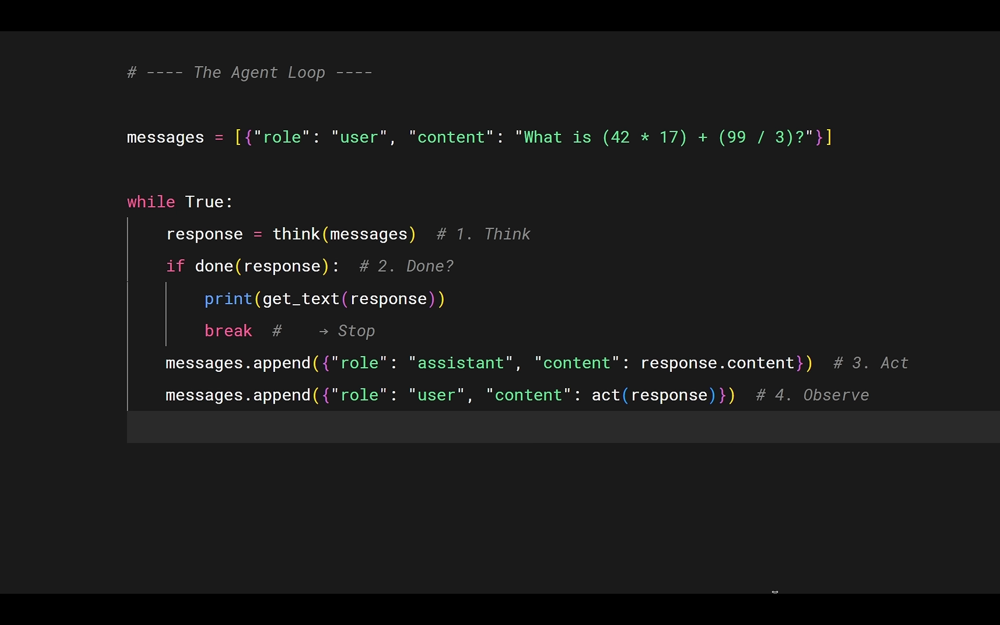

```python
messages = [{"role": "user", "content": "What is (42 * 17) + (99 / 3)?"}]

while True:
    response = think(messages)                                      # 1. Think
    if done(response):                                              # 2. Done?
        print(get_text(response))
        break                                                       #    → Stop
    messages.append({"role": "assistant", "content": response.content})   # 3. Act
    messages.append({"role": "user", "content": act(response)})           # 4. Observe
```

| Step | What happens |
|------|---------------|
| 1️⃣ **Think** | The model looks at the conversation so far (`messages`) and decides what to do next |
| 2️⃣ **Done?** | If the goal is complete → print the answer and **stop** |
| 3️⃣ **Act** | If not, the model's response (e.g. a request to use a tool) is recorded and the action is carried out via `act(response)` |
| 4️⃣ **Observe** | The **result** of the action is added back into the conversation, and the loop starts again with that new information |

> 📌 **Illustrative walk-through** (my example, based on the screenshot's question): to answer *"(42 × 17) + (99 ÷ 3)"*, the agent might **think** it needs to calculate → **act** by running a tool → **observe** the result (747) → loop → **done**, print the answer.

#### 🤝 Agents Can Use Other Agents

The lesson says agents can have access to **other AI agents**. In the demo below, Claude Code is asked to *"Spawn the code reviewer subagent to review the code we last created"* — a separate `code-reviewer` agent is started to do that job.

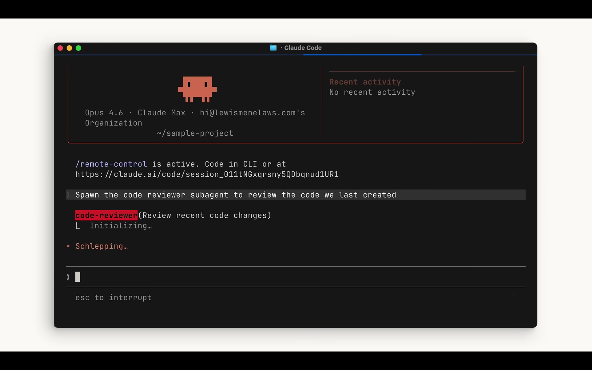

> 🔗 *Why you'd spawn a reviewer subagent is explained in [Chapter 5](#chapter-5-the-explore--plan--code--commit-workflow): it's the review step before you commit. Subagents themselves are covered in [Chapter 9](#chapter-9-subagents).*
>
> 📌 *Seen in the demo, not explained in this lesson:* `/remote-control` is shown as active (the session is reachable in the CLI or at a claude.ai/code session URL), and the footer shows `esc to interrupt`.

### 🛠️ What Can Claude Code Actually Do?

| Capability | What it means | Example |
|------------|---------------|---------|
| 📖 **Read and understand your codebase** | Explain a feature or trace a bug throughout your code | *"Explain how authentication works"* |
| ✏️ **Edit files across your project** | Refactor a function **and update every file that references it** | Rename a function everywhere it's used |
| ⌨️ **Run terminal commands** | Execute your build script, run tests, install packages — and **use the output to decide what to do next** | Run the test suite, read the failures, fix them |
| 🔎 **Search the web** | Look up documentation or the latest API references when needed | Check a library's current API |

#### 📖 Example: Reading & Understanding a Codebase

In this demo the user asks: *"I need to add webp conversion to our image upload pipeline. Figure out where in the pipeline it should happen, whether we need new dependencies and how to approach it."*

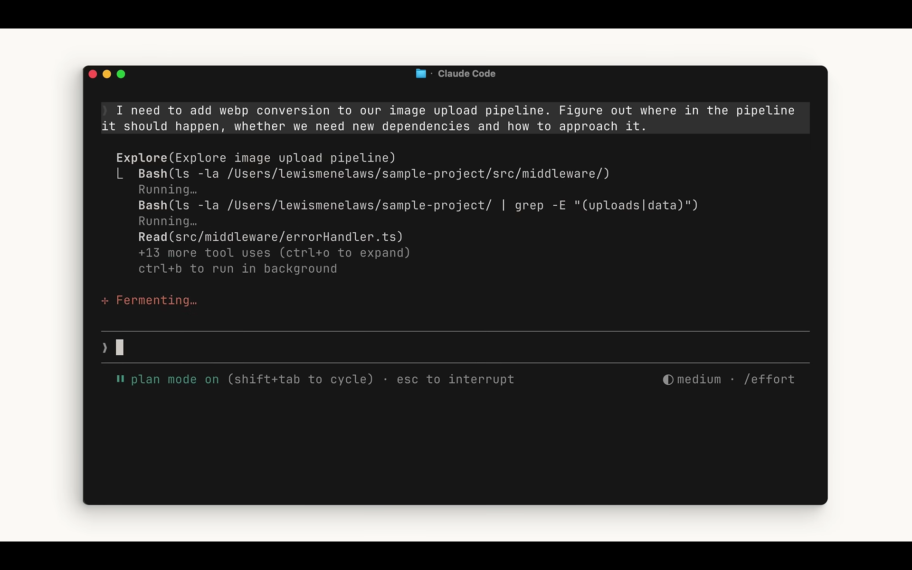

What the screenshot shows:
- An **Explore** task (`Explore image upload pipeline`) runs a series of small, targeted tool calls:
  - `Bash(ls -la …/src/middleware/)` — list a folder
  - `Bash(ls -la … | grep -E "(uploads|data)")` — search for relevant folders
  - `Read(src/middleware/errorHandler.ts)` — read one specific file
  - `+13 more tool uses (ctrl+o to expand)`
- Claude is **locating answers strategically** instead of loading the whole project — this is the "agentic" behavior described under the context window below
- Footer: `plan mode on (shift+tab to cycle)`, `esc to interrupt`, `ctrl+b to run in background`, and `medium · /effort`

> 📌 *Plan mode is explained in [Chapter 2](#chapter-2-how-claude-code-works) and [Chapter 4](#chapter-4-your-first-prompt); `/effort` appears in the demo but isn't explained yet.*
>
> 🔗 *This is the Explore step of the workflow in [Chapter 5](#chapter-5-the-explore--plan--code--commit-workflow) — the same WebP prompt.*

### 🧭 Using Claude Code Effectively

Keep these **three concepts** in mind:

| # | Concept | What it means |
|---|---------|---------------|
| 1 | 🧠 **The context window** | Claude's **working memory** — it can hold a lot, but not everything at once |
| 2 | 🔐 **It asks for permission** | By default, Claude Code asks **before running commands or making changes**. You're always in control, hands-on or hands-off |
| 3 | ⚠️ **It can make mistakes** | It might misunderstand your intent, introduce a bug, or over-engineer a solution. **Staying in the loop** helps you catch these early |

#### 1️⃣ The Context Window

Think of it as Claude's working memory. This is where the "agentic" aspect comes in — Claude finds **strategic ways to locate answers** within your codebase **without loading the entire thing into context** (as in the Explore example above).

The `/context` command shows how the window is being used:

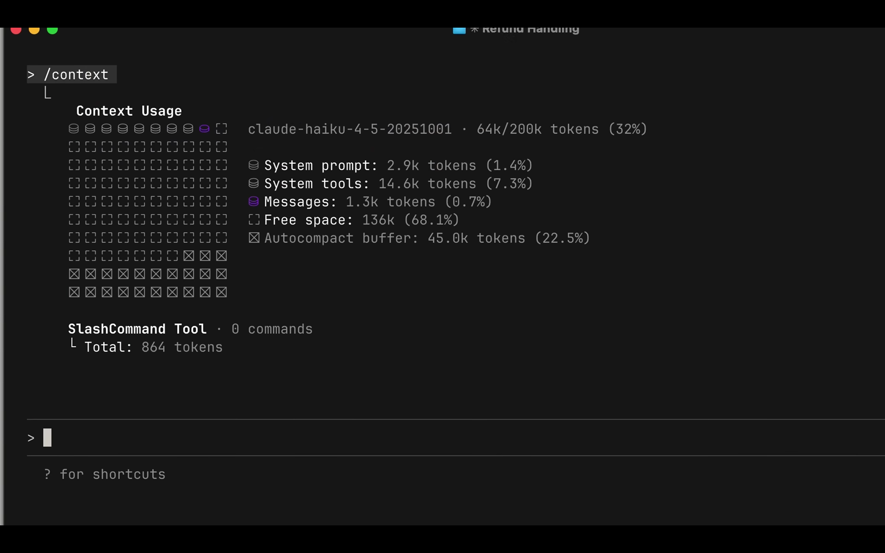

| Category (from the screenshot) | Tokens | % of window |
|--------------------------------|--------|-------------|
| **System prompt** | 2.9k | 1.4% |
| **System tools** | 14.6k | 7.3% |
| **Messages** | 1.3k | 0.7% |
| **Free space** | 136k | 68.1% |
| **Autocompact buffer** | 45.0k | 22.5% |
| **Total used** (model: `claude-haiku-4-5-20251001`) | **64k / 200k** | **32%** |

- The 64k total ≈ 2.9k + 14.6k + 1.3k + **45.0k** — so the autocompact buffer is counted in the used total
- Notice that **before you've typed much, tools and the system prompt already use space** — the window is a finite budget
- The tool also lists `SlashCommand Tool · 0 commands · Total: 864 tokens`

> 📌 *`/context` is explained in [Chapter 6](#chapter-6-context-management). The lesson doesn't explain the autocompact buffer row; it most likely relates to the automatic compaction described in [Chapter 2](#chapter-2-how-claude-code-works) and [Chapter 6](#chapter-6-context-management) (my inference).*

#### 2️⃣ It Asks for Permission

By default, Claude Code **asks you before running commands or making changes**:

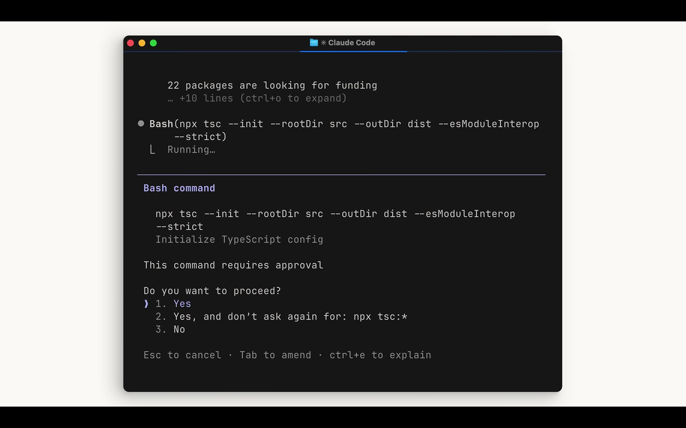

What the screenshot shows:
- Claude wants to run `npx tsc --init --rootDir src --outDir dist --esModuleInterop --strict` (description: *"Initialize TypeScript config"*)
- Message: **"This command requires approval"** — *"Do you want to proceed?"*

| Option | Meaning |
|--------|---------|
| **1. Yes** | Allow this one command |
| **2. Yes, and don't ask again for: `npx tsc:*`** | Allow it and similar commands going forward |
| **3. No** | Deny it |

Shortcuts shown: `Esc` to cancel · `Tab` to amend · `ctrl+e` to explain

> 🔗 Compare with the desktop Code tab settings from [Claude 101, Chapter 4](../claude-101/README.md): **Manually approve**, **Accept edits**, **Plan**.

#### 3️⃣ It Can Make Mistakes

Just like any tool, Claude Code isn't perfect. Watch for:
- ❌ Misunderstanding your intent
- 🐛 Introducing a bug
- 🏗️ Over-engineering a solution

> 💡 **Staying in the loop** — reviewing what it proposes and runs — helps you catch these early.

### 🔁 Recap

Claude Code is an **agentic coding tool**. It reads your codebase, edits your files, runs commands, and connects to external tools to help you ship faster. You can use it today in your **terminal, VS Code, JetBrains, and the Claude Desktop app**.

### 📝 Quick Reference: Claude Code Basics (for exam prep)

| Concept | Key point |
|---------|-----------|
| 💻 **Claude Code** | Agentic coding tool — reads codebase, edits files, runs commands, integrates with dev tools |
| 🤖 **AI Agent** | Software that interacts with its environment and performs actions to reach a goal |
| 🔁 **Agent core** | An **LLM operating in a loop** in real time (Think → Done? → Act → Observe) |
| 🧰 **Agents can access** | Tools · external services · other AI agents |
| 🧠 **Context window** | Claude's working memory — holds a lot, **not everything**; Claude searches strategically instead of loading the whole codebase |
| 🔐 **Permissions** | Asks **by default** before running commands or making changes |
| ⚠️ **Mistakes** | Can misunderstand intent, introduce bugs, or over-engineer — stay in the loop |

> 🎓 **Memory tip:** Claude Code = **Claude + hands** — an LLM in a **loop** (Think → Act → Observe) with access to your **files and terminal**

**Key features for exam:**
- **Key differentiator vs Claude.ai** = it works as an **AI Agent** with direct access to files, terminal, and codebase (no copy-paste)
- **Four capabilities:** read & understand code · edit files across the project · run terminal commands · search the web
- **Available in:** terminal, VS Code, Claude Desktop app, web, JetBrains IDEs
- **Three concepts:** context window · permission prompts (by default) · it can make mistakes

---

## Chapter 2: How Claude Code Works

> Claude Code is different from typical chat applications. Understanding how it works under the hood will help you use it more effectively.

### 🧠 Key Takeaways

- **The agentic loop** is the core of Claude Code: **gather context → take action → verify results**, repeated until the result is complete and verifiable
- **You stay in the loop** — you can add context, interrupt, or steer at any point
- **Context window** = how much conversation, file content, and command output Claude can hold; when the limit is reached, Claude Code **compacts** the conversation automatically
- **Tools** are the backbone of agents — they let Claude Code decide *when to execute code* instead of just returning text
- **Permission modes:** Default (asks for edits *and* commands) · Auto-accept (edits without asking, commands still need approval) · Plan mode (read-only, builds a plan first)

### 🔁 The Agentic Loop

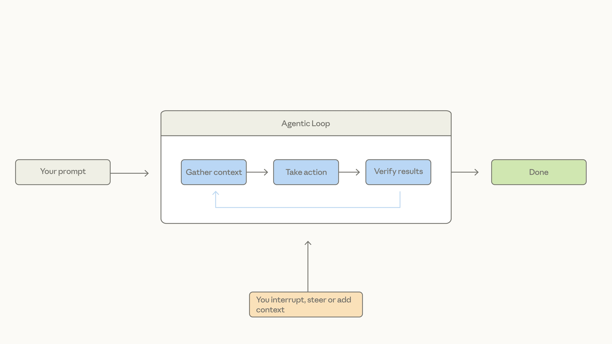

| Step | What happens |
|------|---------------|
| 1️⃣ **You enter a prompt** | The loop starts with your request |
| 2️⃣ **Gather context** | Claude gets what it needs by interacting with the model, which returns **text or a tool call** that Claude Code can execute |
| 3️⃣ **Take action** | For example, **editing a file** or **running a command** |
| 4️⃣ **Verify results** | Claude checks whether the results achieve what your prompt set out to do |
| 5️⃣ **Done or repeat** | ✅ If yes → Claude **finishes and waits for the next prompt**. ❌ If no → it **loops back and tries again** until the results are complete and verifiable |

> 🙋 **Throughout the loop, you can add context, interrupt, or steer the model** to help guide it toward your goal (the orange box in the diagram).

> 🔗 **Same loop as Chapter 1, different labels** (my mapping): *Think* ≈ gather context (the model returns text or a tool call) · *Act* ≈ take action · *Done? / Observe* ≈ verify results.

#### 🔎 Example: One Pass Through the Loop

The user types: *"Can we create a simple test api with typescript?"*

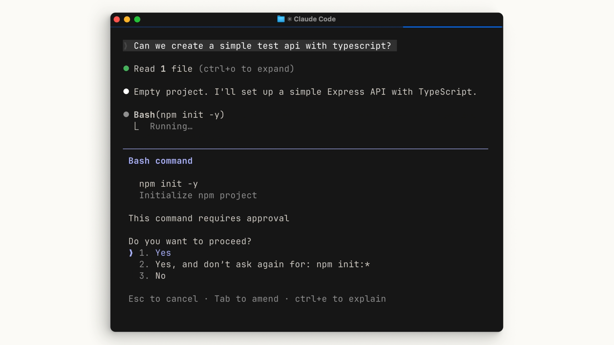

| Loop step | What the screenshot shows |
|-----------|----------------------------|
| **Prompt** | *"Can we create a simple test api with typescript?"* |
| **Gather context** | `Read 1 file (ctrl+o to expand)` — then Claude concludes: *"Empty project. I'll set up a simple Express API with TypeScript."* |
| **Take action** | `Bash(npm init -y)` — *"Initialize npm project"* |
| **Permission check** | *"This command requires approval"* — the loop **pauses until you decide** |

The approval options:

| Option | Meaning |
|--------|---------|
| **1. Yes** | Allow this one command |
| **2. Yes, and don't ask again for: `npm init:*`** | Allow it and matching commands going forward |
| **3. No** | Deny it |

Shortcuts shown: `Esc` to cancel · `Tab` to amend · `ctrl+e` to explain

> 🔗 Same prompt style as the `npx tsc --init` approval in Chapter 1 — this time for `npm init:*`.

### 🧠 Context

Claude has a **context window** that determines how much of your **conversation, file contents, command outputs, and more** it can store and reference.

**What happens at the limit:**
- Once you reach it, Claude Code **compacts** your conversation
- It **automatically determines what it can remove or summarize** to bring the context window back down to a usable size

> 🔗 In the `/context` screenshot from [Chapter 1](#chapter-1-what-is-claude-code), the **Autocompact buffer** row is most likely this mechanism (my inference — the lesson doesn't connect them explicitly). Manual control of compaction (`/compact`, `/clear`, `/context`) is covered in [Chapter 6](#chapter-6-context-management).

### 🛠️ Tools

> **Tools are the backbone of how agents work.**

| | 💬 **Typical AI assistant** | 💻 **Claude Code** |
|---|---|---|
| **Input → Output** | Text in → text out | Can decide **when to execute code** to get closer to completing a task |
| **Capabilities** | Generates responses | Uses tools like a **file-reading tool**, a **web search tool**, or any number of other capabilities |

- Claude Code uses **semantic understanding** to determine **when to call a tool** and **how to use the output**

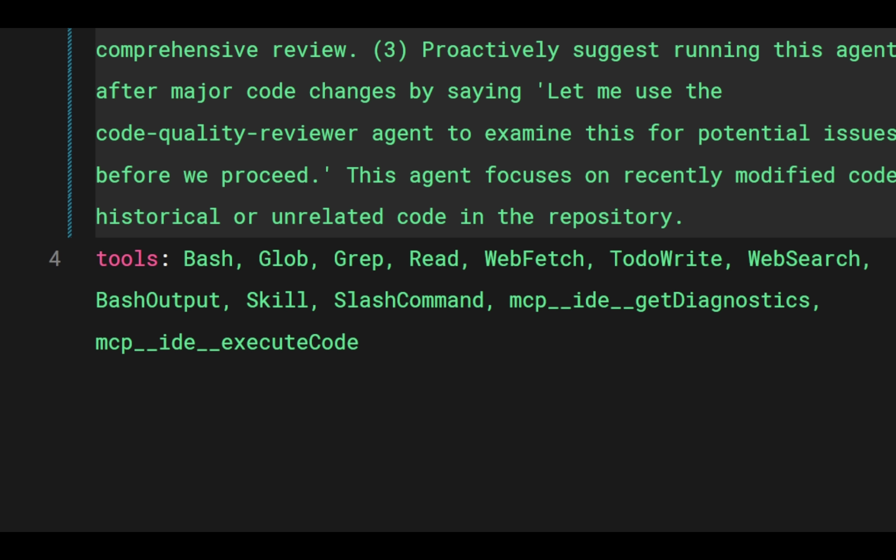

What the screenshot shows (a `tools:` line, apparently from an agent's configuration, next to a description about proactively suggesting a `code-quality-reviewer` agent after major code changes):

| Tool name | What the name suggests |
|-----------|-------------------------|
| `Read` | Read files |
| `Glob`, `Grep` | Find files / search inside files |
| `Bash`, `BashOutput` | Run shell commands / read their output |
| `WebFetch`, `WebSearch` | Fetch a web page / search the web |
| `TodoWrite` | Keep a task list |
| `Skill`, `SlashCommand` | Invoke skills / slash commands |
| `mcp__ide__getDiagnostics`, `mcp__ide__executeCode` | Tools exposed through an IDE connection (the `mcp__` prefix; MCP is covered in [Chapter 11](#chapter-11-mcp)) |

> 📌 *This screenshot isn't explained in the lesson — the "what the name suggests" column is my reading of the tool names, not lesson content.*

### 🔐 Permissions

Claude Code has several **permission modes**:

| Mode | Behavior |
|------|----------|
| 🟡 **Default** | Claude asks for **explicit permission before editing a file or running a shell command** |
| 🟢 **Auto-accept** | **Files are edited without asking**, but **commands still require approval** |
| 🔵 **Plan mode** | Uses **read-only tools** to compile a **plan of action before starting any work** |

- All of this can be **configured in your settings file**

> 🔗 Related: [Claude 101, Chapter 4](../claude-101/README.md) lists the desktop Code tab settings *Manually approve / Accept edits / Plan* — they line up with Default / Auto-accept / Plan mode (my mapping).
>
> 🔗 The Chapter 1 plan-mode screenshot showed `plan mode on (shift+tab to cycle)` — **Shift + Tab** is how you switch modes (confirmed in [Chapter 4](#chapter-4-your-first-prompt)).

> ⚠️ **Be cautious when skipping permissions.** Giving Claude Code free rein to run commands means **a mistake could be harder to catch before it happens.**

### 🔁 Recap

Claude Code combines several agentic concepts: an **agentic loop**, a **managed context window**, **tools**, and **configurable permissions** — all inside your terminal. It can **read your codebase, take action, and verify its own work**. That's what makes it fundamentally different from a chat window.

### 📝 Quick Reference: How Claude Code Works (for exam prep)

| Concept | Key point |
|---------|-----------|
| 🔁 **Agentic loop** | Gather context → Take action → Verify results → (repeat until complete and verifiable) |
| 🙋 **Your role** | Add context, interrupt, or steer at any point in the loop |
| 🧠 **Context window** | Holds conversation, file contents, command outputs; **auto-compacts** when full |
| 🛠️ **Tools** | Backbone of agents; Claude decides **when** to call a tool and **how** to use the output (semantic understanding) |
| 🟡 **Default mode** | Asks before editing files **and** running commands |
| 🟢 **Auto-accept** | Edits files without asking; **commands still need approval** |
| 🔵 **Plan mode** | **Read-only** tools to build a plan before any work |
| ⚙️ **Config** | Permissions are configurable in the **settings file** |

> 🎓 **Memory tip:** **L-C-T-P** — **L**oop · **C**ontext · **T**ools · **P**ermissions (the four agentic concepts of Claude Code)

**Key features for exam:**
- Loop ends only when results are **complete and verifiable**; failures **loop back and retry**
- **Context compaction** is automatic — Claude Code decides what to remove or summarize
- **Typical assistants:** text in → text out · **Claude Code:** can execute code via tools
- **Auto-accept ≠ fully autonomous** — commands still need approval
- **Plan mode = read-only** until the plan is made
- Skipping permissions makes mistakes **harder to catch before they happen**

---

> 🗂️ **Unit 2: Your first prompt** · Chapters 3–4

## Chapter 3: Installing Claude Code

> 🎬 **Video: Installing Claude Code** — Claude Code is simple to install whether you want to use it in your **terminal, on the web, or in your IDE**.

### 🧠 Key Takeaways

- **Terminal:** on macOS, Linux, or WSL, install with a single `curl` command. Homebrew and winget work too, but **don't auto-update**
- **After installing,** run `claude` in your project directory. **If the command isn't found, restart your terminal**
- **Scope:** whatever directory you run `claude` in, it has access to **that directory and all of its subfolders**
- **IDEs:** install the **Anthropic** extension for VS Code (look for the **blue verification check**) or the plugin for JetBrains
- **Desktop and web:** Desktop has a **"Code" toggle**; the web is at **claude.ai/code** and is **restricted to GitHub repositories**
- **Which one?** The **terminal gets features first**; IDEs are nearly identical; Desktop suits background work; web suits remote GitHub work

### ⌨️ Terminal

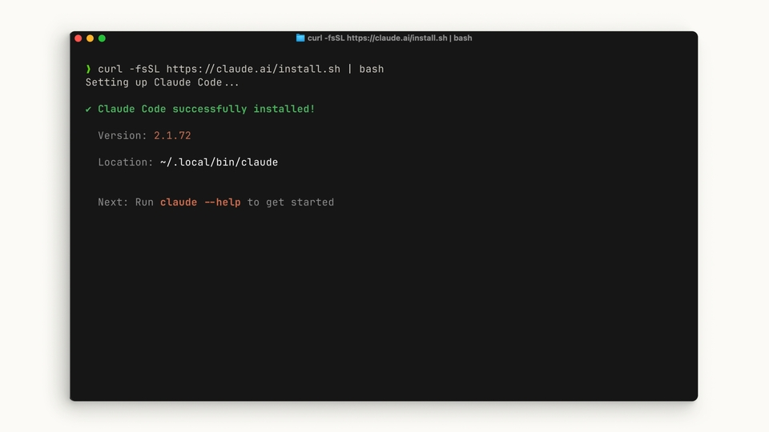

| Platform | Install method | Auto-updates? |
|----------|----------------|:-------------:|
| 🍎 **macOS / 🐧 Linux / WSL** | `curl` command (installs in one go) | ✅ |
| 🍎 **macOS / 🐧 Linux** | **Homebrew** (`brew install`) | ❌ |
| 🪟 **Windows — PowerShell** | `Invoke-RestMethod` command | ✅ |
| 🪟 **Windows — CMD** | `curl` command | ✅ |
| 🪟 **Windows** | **winget** | ❌ |

> 📌 *From the screenshot (macOS):* `curl -fsSL https://claude.ai/install.sh | bash`. The installer reports the **version** (2.1.72) and **location** (`~/.local/bin/claude`) and suggests running `claude --help`. *The lesson itself only says Homebrew and winget don't auto-update. The ✅ for the script installs comes from Anthropic's official setup docs (native installs update in the background), not from the lesson.*

#### ▶️ After installation

1. You should be able to run the `claude` command. **If not, restart your terminal.**
2. Navigate to your project directory and run:

```bash
claude
```

3. Go through the **initial setup steps**: choose your **color theme** and **sign in** with your Claude account (**Pro, Max, or Enterprise**) or use an **API key**
4. If your organization has a **Claude Enterprise** account, be sure to select that option

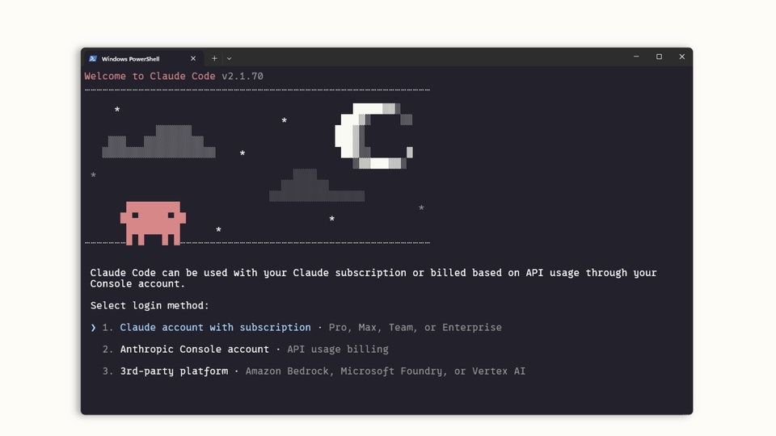

What the screenshot shows (login method menu):

| Option | Description shown |
|--------|--------------------|
| **1. Claude account with subscription** | Pro, Max, Team, or Enterprise |
| **2. Anthropic Console account** | API usage billing |
| **3. 3rd-party platform** | Amazon Bedrock, Microsoft Foundry, or Vertex AI |

> 📌 *The lesson text lists "Pro, Max, or Enterprise"; the screenshot also lists **Team**, which matches [Claude 101, Chapter 4](../claude-101/README.md) (Pro, Max, Team, Enterprise). The screenshot is a Windows PowerShell session, so the setup is the same on Windows.*

> 🔐 **Scope rule:** Claude Code can access **the directory you run `claude` in and all of its subfolders**. Choose where you launch it on purpose.

### 🟦 Visual Studio Code

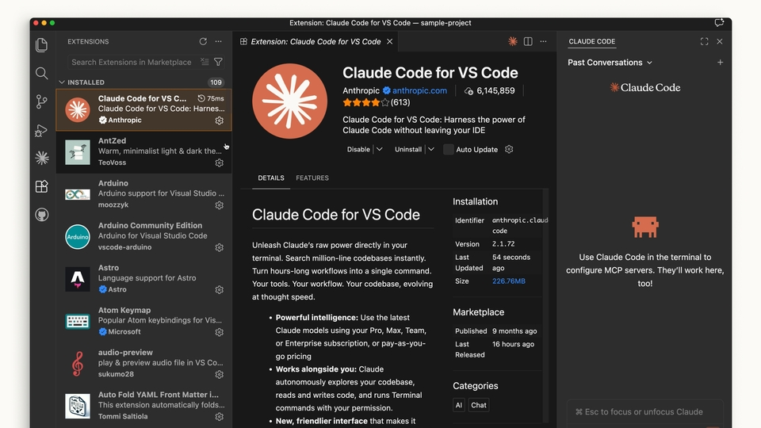

| Step | What to do |
|------|------------|
| 1️⃣ | Open the **Extensions** panel and search for **"Claude Code"** |
| 2️⃣ | Choose the extension by **Anthropic** with the **blue verification check**, then hit **Install** |
| 3️⃣ | You **may need to restart VS Code** |
| 4️⃣ | Open the command palette with **Ctrl/Cmd + Shift + P** and search for **"Claude Code: Open in New Tab"**, or click the **Claude logo** if it's visible in your sidebar |

- The VS Code extension gives a **very similar experience to the terminal**
- You can **opt out of the UI** and use the terminal experience directly in your settings

> 💡 **Check the publisher.** The screenshot shows the extension published by **Anthropic** with the verified badge, listed above third-party extensions.

### 🧠 JetBrains

![JetBrains Settings → Plugins: searching "claude code" and the Claude Code [Beta] plugin by Anthropic PBC, with other similarly named third-party plugins in the results](assets/L3-installing-claude-code/jetbrains-plugin-marketplace.png)

1. Install the **Claude Code plugin** from the **JetBrains Marketplace**
2. **Restart your IDE**
3. When you reopen it, you'll see the **Claude logo**. Clicking it opens a pane with the **terminal experience** that works alongside your editor

What the screenshot shows (plugin details):

| Feature | What it does |
|---------|---------------|
| **Diff viewing** | Open file diffs in the IDE diff viewer to review and modify proposed changes |
| **Selection context** | The current selection in the IDE is automatically shared with Claude Code |
| **File reference shortcuts** | `Cmd+Option+K` (Mac) or `Ctrl+Alt+K` (Linux/Windows) inserts file references (e.g. `@File#L1-99`) |
| **Diagnostics sharing** | Squiggly errors and warnings are shared with Claude Code in real time |

> ⚠️ **From the screenshot:** the plugin page says it **requires Claude Code to be installed separately**.
>
> 📌 *The search results also show several third-party plugins with similar names (e.g. "Claude Code GUI", "Claude Code Plus"). The official one in the screenshot is **Claude Code [Beta]** by **Anthropic PBC**. The lesson doesn't mention this. It's my observation from the screenshot.*

### 🖥️ Desktop

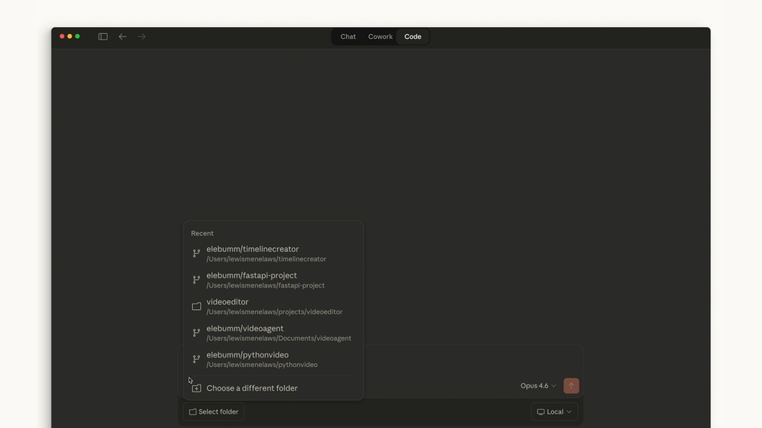

- After **installing and signing into Claude Desktop**, you'll see a toggle at the top labeled **"Code"**
- The look and feel is **similar to the chat side**, but it lets you:
  - 📁 **work in a specific folder**
  - 🔐 **change permissions**
  - ☁️ **work in a cloud environment**

> 🔗 Same three tabs as [Claude 101, Chapter 4](../claude-101/README.md): **Chat · Cowork · Code**. *In the screenshot, the **Select folder** menu lists **Recent** folders plus "Choose a different folder", and the **Local** environment selector sits at the bottom right.*

### 🌐 Web

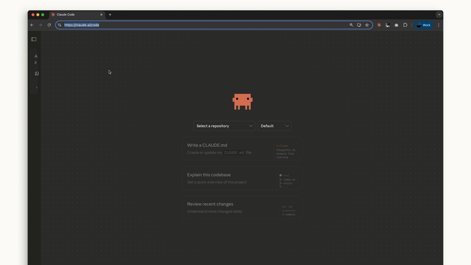

- Go to **claude.ai/code**, or click the **"Code"** label in the sidebar of the chat app
- Works **similarly to the desktop app**, but you're **restricted to GitHub repositories**

> 📌 *From the screenshot:* a **Select a repository** dropdown and starter prompts: **Write a CLAUDE.md**, **Explain this codebase**, **Review recent changes**. *The lesson doesn't explain these prompts, but "Write a CLAUDE.md" connects to [Chapter 8](#chapter-8-the-claudemd-file).*

### 🧭 Which One Should I Use?

| Surface | Best when… |
|---------|------------|
| ⌨️ **Terminal** | You want to **stay on the cutting edge** — **features ship there first** |
| 🟦🧠 **IDE integrations** (VS Code, JetBrains) | You want Claude Code **more intertwined with your code editor**, with a **nearly identical experience** |
| 🖥️ **Desktop** | You want to **let Claude run in the background** while you handle other tasks |
| 🌐 **Web** | You want to **work remotely on projects through a GitHub repository** |

> 💡 However you want to use Claude Code is up to you.

### 🔁 Recap

Claude Code installs in the **terminal** (curl, Homebrew, winget, PowerShell/CMD), as an **extension or plugin** in **VS Code** and **JetBrains**, in the **Desktop app's Code toggle**, and on the **web** at claude.ai/code. The **terminal gets features first**; the other surfaces fit different workflows.

### 📝 Quick Reference: Installing Claude Code (for exam prep)

| Surface | How to get it | Key point |
|---------|---------------|-----------|
| ⌨️ **Terminal** | `curl` (macOS/Linux/WSL), `Invoke-RestMethod` (PowerShell), `curl` (CMD) | **Features ship here first**; run `claude` in your project directory |
| 🍺 **Homebrew / winget** | `brew install` / `winget` | **No auto-updates** |
| 🟦 **VS Code** | Extension by **Anthropic** (blue check) | Command palette → "Claude Code: Open in New Tab"; restart may be needed |
| 🧠 **JetBrains** | Plugin from JetBrains Marketplace | **Restart IDE**; Claude logo opens a terminal-style pane |
| 🖥️ **Desktop** | Sign in to Claude Desktop → **"Code"** toggle | Folder, permissions, **cloud environment**; good for background work |
| 🌐 **Web** | claude.ai/code | **GitHub repositories only** |

> 🎓 **Memory tip:** **T**erminal = **T**op features · **I**DE = **I**ntegrated · **D**esktop = **D**o it in the background · **W**eb = **W**ork on GitHub repos

**Key features for exam:**
- `claude` can access the **directory you run it in and all subfolders**
- If `claude` isn't found after install → **restart your terminal**
- **Homebrew and winget don't auto-update**
- Sign-in options: **Claude account** (Pro, Max, Enterprise) **or an API key**; Enterprise orgs should choose the Enterprise option
- VS Code: choose the extension with the **blue verification check**; JetBrains: **restart the IDE** after installing
- Web = **GitHub repositories only**

---

## Chapter 4: Your First Prompt

> 🎬 **Video** — You talk to Claude Code like you would any AI assistant. When entering your prompt, here are some things to consider that can both **protect you** and **make things easier**.

### 🧠 Key Takeaways

- **Press Shift + Tab to cycle between modes** — you choose how much Claude does without asking
- **Approval mode:** Claude asks permission **each time** it wants to edit a file **or** run a command
- **Auto-accept mode:** **file edits are automatically approved**, but **commands still require your permission**
- **Plan mode** (in the same Shift + Tab cycle): uses **read-only tools** to analyze your codebase and research your suggested implementation, **asks clarifying questions**, then returns a **detailed plan** it can execute
- **Plan mode is great for** complex, multi-step changes and for a **safe code review**
- **Be as descriptive as possible** in your prompt

### 🔀 Auto-Accept vs. Approval

You can choose whether Claude **auto-accepts every file change** it suggests, or **asks for your explicit permission each time**. Press **Shift + Tab** to cycle between modes.

| Mode | What happens |
|------|---------------|
| ✋ **Approval mode** | Claude asks permission **each time** it wants to **edit a file or run a command** |
| ⚡ **Auto-accept mode** | **File edits are automatically approved**, but **commands still require your permission** |

> 💡 **There's no right or wrong answer** — it's whatever you're comfortable with.

> 🔗 Same behavior as **Default** and **Auto-accept** in [Chapter 2: Permissions](#chapter-2-how-claude-code-works) (my mapping — the lesson uses different names). The desktop equivalents are *Manually approve* and *Accept edits* in [Claude 101, Chapter 4](../claude-101/README.md).

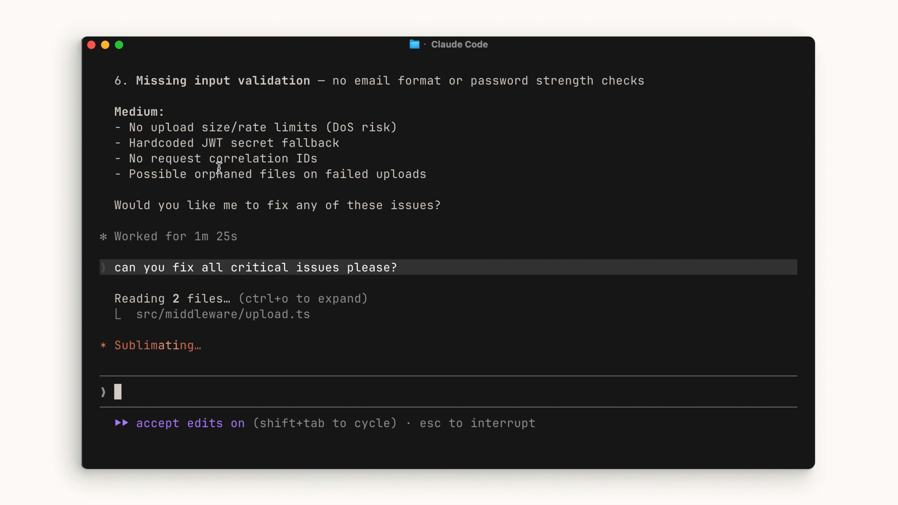

What the screenshot shows:

| Part of the screen | What it shows |
|--------------------|----------------|
| **Earlier output** | A code review ending with *"6. Missing input validation — no email format or password strength checks"*, a **Medium** list (no upload size/rate limits, hardcoded JWT secret fallback, no request correlation IDs, possible orphaned files on failed uploads), and *"Would you like me to fix any of these issues?"* |
| **Your follow-up** | *"can you fix all critical issues please?"* |
| **Claude working** | `Reading 2 files… (ctrl+o to expand)` → `src/middleware/upload.ts` |
| **Footer** | `accept edits on (shift+tab to cycle) · esc to interrupt` |

> 📌 *My reading, not explained in the lesson:* the footer label **`accept edits on`** is how this mode is displayed (the lesson calls it auto-accept). `esc to interrupt` matches the lesson's point that you can **interrupt or steer** at any time ([Chapter 2](#chapter-2-how-claude-code-works)). The screenshot is a review followed by a "fix it" request — the lesson only says the screenshot shows auto-accept mode *"reading files and working through a task"*.

### 🗺️ Plan Mode

Within the **Shift + Tab** menu is **Plan Mode**.

| What plan mode does | |
|---------------------|--|
| 🔍 **Analyzes** | Takes your prompt and uses **read-only tools** to analyze your codebase |
| 📚 **Researches** | Looks into your suggested implementation |
| ❓ **Asks** | **Clarifying questions** along the way |
| 📋 **Returns** | A **detailed plan** it can execute |

**Great for:**
- 🧩 Planning **complex changes**
- 🛡️ Doing a **safe code review**
- 🪜 **Multi-step implementations** toward a feature — *"this is exactly where Plan Mode excels"*

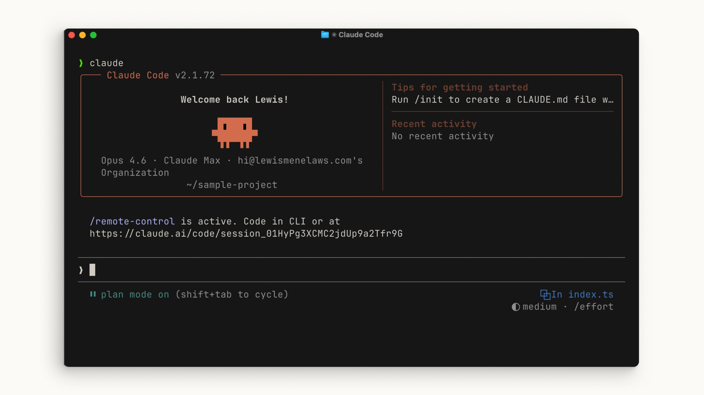

What the screenshot shows (the **status bar indicator** the lesson points to):

| Part of the screen | What it shows |
|--------------------|----------------|
| **Command** | `claude` run from the project folder `~/sample-project` |
| **Welcome box** | Claude Code **v2.1.72**, model **Opus 4.6** on a **Claude Max** account |
| **Tip** | *"Run /init to create a CLAUDE.md file w…"* |
| **Footer (left)** | **`plan mode on (shift+tab to cycle)`** |
| **Footer (right)** | `In index.ts` and `medium · /effort` |

> 📌 `/init` and `CLAUDE.md` are covered in [Chapter 8](#chapter-8-the-claudemd-file). *Not explained in the lesson:* `/remote-control` (shown active again), `/effort`, and `In index.ts` (it appears to show the file open in the connected IDE — my reading).
>
> 🔗 You already saw plan mode working in [Chapter 1](#chapter-1-what-is-claude-code): the *Explore image upload pipeline* screenshot has the same `plan mode on` footer, and its read-only `ls`, `grep`, and `Read` calls are exactly the kind of work plan mode does.

### 🌗 Example: Add a Dark Mode Toggle

Say you have an application that needs a dark mode toggle.

| Step | What to do |
|------|------------|
| 1️⃣ | **Open the root directory** of your project and run `claude` |
| 2️⃣ | Press **Shift + Tab a couple of times** to enter **Plan Mode** |
| 3️⃣ | Write your prompt (below) |
| 4️⃣ | **Let Claude plan it out** and review the plan |
| 5️⃣ | If it looks good, **accept it** and let Claude **ask you for approval at each step** |
| 6️⃣ | At the end, see **exactly what Claude did** and **how it reached its conclusions** |

The prompt from the lesson:

> *"My app needs a dark mode implemented across the entire app. Can you create a toggle switch on the header that allows a user to toggle between light mode and dark mode? I need you to find a good contrast color that works based on my existing light theme."*

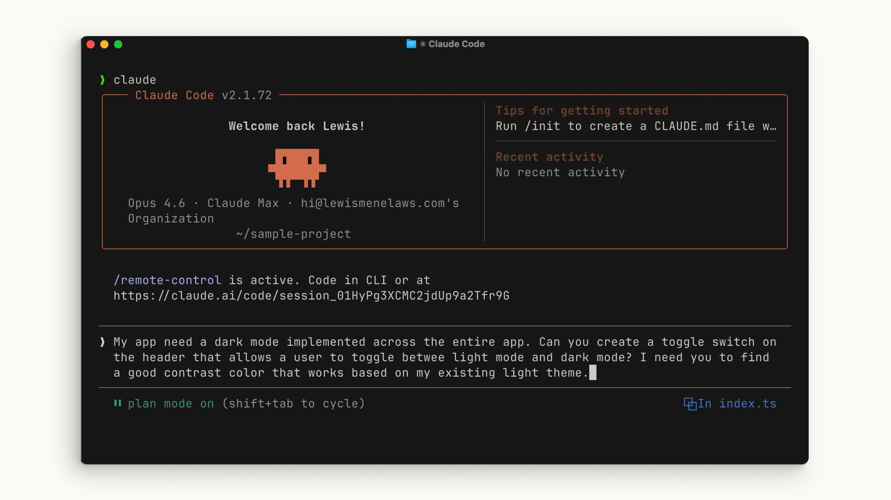

> 📌 *From the screenshot:* the prompt is typed into the input box while the footer reads `plan mode on (shift+tab to cycle)` — **plan mode is switched on before** the prompt is sent. The typed text in the video differs slightly from the lesson text (e.g. "My app need…", "betwee").

#### 🔬 Why This Prompt Works

*My breakdown, using the prompt framework from [Claude 101, Chapter 2](../claude-101/README.md) — not from the lesson text:*

| Part of the prompt | What it gives Claude |
|--------------------|-----------------------|
| *"dark mode implemented across the **entire app**"* | The **goal and scope** |
| *"create a **toggle switch on the header** … between light mode and dark mode"* | The **specific deliverable** and where it goes |
| *"find a **good contrast color** … based on my **existing light theme**"* | A **constraint** — a design decision to research against what already exists |

### 🔁 Recap

When using Claude Code, try to be **as descriptive as possible** with your prompt. If you want to **stay in the loop at every step**, you can. Use **Plan Mode** to let Claude dig into the details of what you want to achieve **before executing any code**.

### 📝 Quick Reference: Your First Prompt (for exam prep)

| Mode | File edits | Commands | Best for |
|------|-----------|----------|----------|
| ✋ **Approval** | Ask each time | Ask each time | Staying in the loop at every step |
| ⚡ **Auto-accept** | **Auto-approved** | **Still require permission** | Letting Claude work through edits without interruption |
| 🗺️ **Plan mode** | Read-only tools while planning | Read-only tools while planning | Complex, multi-step changes; safe code review |

> 🎓 **Memory tip:** **Shift + Tab = switch gears** — ✋ **ask** every time · ⚡ **auto-accept** edits · 🗺️ **plan** first (**look, don't touch**)

**Key features for exam:**
- **Shift + Tab** cycles between modes
- **Auto-accept ≠ fully autonomous** — file edits are approved automatically, **commands still need permission**
- **Plan mode = read-only tools** → analyzes the codebase, asks **clarifying questions**, returns a **detailed plan**
- After you **accept the plan**, Claude can still **ask for approval at each step**
- **No right or wrong mode** — choose what you're comfortable with
- **Descriptive prompts** make Claude's work easier

---

> 🗂️ **Unit 3: Daily workflows** · Chapters 5–7

## Chapter 5: The Explore → Plan → Code → Commit Workflow

> 🎬 **Video** — *If you take one thing away from this course, let it be this workflow:* **Explore, Plan, Code, and Commit.** Without it, most people jump straight to asking Claude to write code — which means **more course-correcting later on**.

### 🧠 Key Takeaways

- **The workflow:** Explore → Plan → Code → Commit
- **Explore and Plan** are fastest in **Plan Mode** — Claude **can't edit files**, it just **reads files** to gather information
- **Enter plan mode:** press **Shift + Tab until you see "Plan Mode"** under the text input
- **Review the plan** — if it doesn't meet your criteria, **ask Claude to revise specific areas**. This is the **best place to course-correct**, because **no code is written yet**
- You can run the **explore subagent without plan mode** for a general summary of your codebase when you don't plan to make changes
- **Code:** approve the plan, and Claude works through the list; you choose **auto-accept or ask each time**
- **Three tips for coding:** define **success criteria** · add **tools** · include a **test suite**
- **Commit:** test it yourself, run a **subagent code reviewer** (a fresh pair of eyes), then have Claude generate a **commit message in your style**

### 🗺️ The Workflow at a Glance

| Step | What it does |
|------|---------------|
| 🔍 **Explore** | Gives Claude the **relevant context** it needs for your project |
| 📋 **Plan** | Creates a **plan of action** that Claude uses to **measure success** |
| 💻 **Code** | The **back and forth** between you and Claude before settling on the final outcome |
| ✅ **Commit** | Helps you **review and push** your code so you can start on your next feature |

> 🔗 [Chapter 4](#chapter-4-your-first-prompt) taught the **modes**; this chapter is how you **use them in order**.

### 🔍📋 Explore and Plan

The fastest way to handle these first two steps is with **Plan Mode**. In plan mode, Claude **can't edit files** — it just **reads files** to gather information about how it will tackle the implementation.

To enter plan mode, press **Shift + Tab** until you see **"Plan Mode"** under the text input.

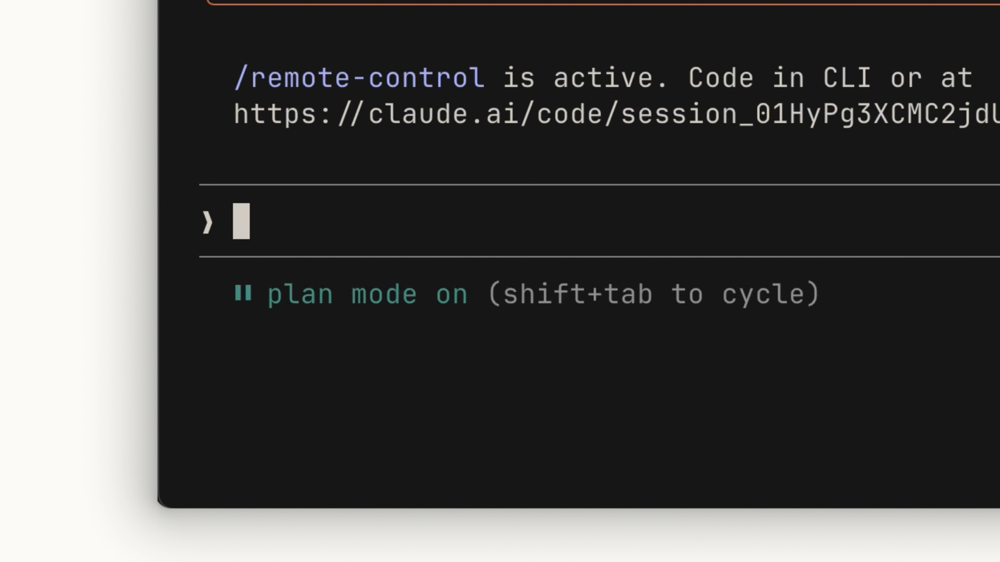

Then write a prompt like:

> *"I need to add WebP conversion to our image upload pipeline. Figure out where in the pipeline it should happen, whether we need new dependencies, and how to approach it."*

What Claude does:
- 📖 **Reads relevant files**
- 🌐 **Runs some web searches**
- 📋 **Gives you a plan of action**

Then **review it** and decide if it meets your criteria. **If not, ask it to revise specific areas.**

> 🔗 This is the same WebP prompt as the **Explore** demo in [Chapter 1](#chapter-1-what-is-claude-code) — the `Explore image upload pipeline` task there is the **Explore** step of this workflow (my mapping).

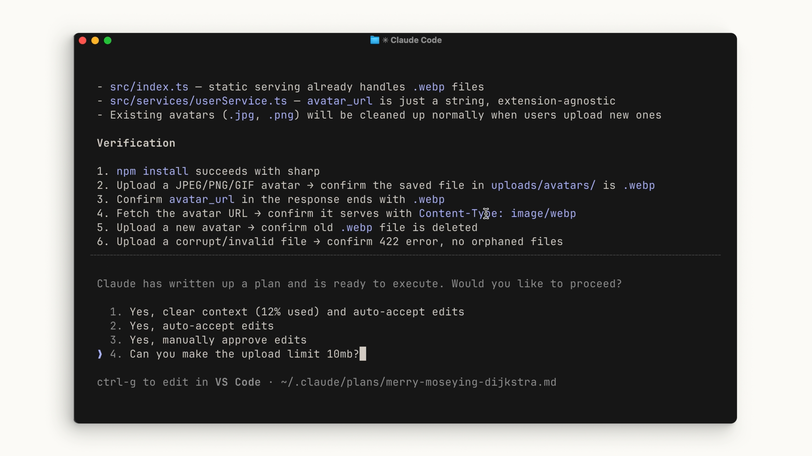

What the screenshot shows:

| Part of the screen | What it shows |
|--------------------|----------------|
| **End of the plan** | Files that need **no changes**: `src/index.ts` (static serving already handles `.webp`), `src/services/userService.ts` (`avatar_url` is just a string, extension-agnostic), and existing `.jpg`/`.png` avatars (cleaned up normally on new uploads) |
| **Verification list** | 6 checks: `npm install` succeeds with `sharp` · uploading a JPEG/PNG/GIF avatar saves a `.webp` in `uploads/avatars/` · `avatar_url` ends with `.webp` · fetching it serves `Content-Type: image/webp` · uploading a new avatar deletes the old `.webp` · a corrupt/invalid file returns a **422 error** with **no orphaned files** |
| **Prompt** | *"Claude has written up a plan and is ready to execute. Would you like to proceed?"* |
| **Option 1** | Yes, **clear context (12% used)** and auto-accept edits |
| **Option 2** | Yes, **auto-accept edits** |
| **Option 3** | Yes, **manually approve edits** |
| **Option 4** | A typed reply: *"Can you make the upload limit 10mb?"* |
| **Footer** | `ctrl-g to edit in VS Code · ~/.claude/plans/….md` |

> 📌 *My mapping to the lesson (the lesson only says the screen offers "options to approve, revise areas, or ask questions"):*
> - **Options 2 and 3** = the lesson's *"auto-accepts file edits or asks you each time"*
> - **Option 4** = *"ask it to revise specific areas"* — you can **type feedback instead of approving**, before any code exists
> - The **Verification list** is what *success criteria* look like (see the Code tips below)
>
> 📌 *Not explained in the lesson:* **"clear context (12% used)"** (the 12% is most likely context-window usage, as in the `/context` view from [Chapter 1](#chapter-1-what-is-claude-code)) and **ctrl-g / the saved plan file** under `~/.claude/plans/`.

> 💡 **This is the best place to course-correct** — **before any code is written.**

> 💡 You can also run the **explore subagent without being in plan mode** if you just want a **general summary of your codebase** without intending to make changes afterward.

### 💻 Code

Once the plan looks good, select **"approve"** to accept it and let Claude **work through the list items**. You can choose whether Claude **auto-accepts file edits** or **asks you each time** (see [Chapter 4](#chapter-4-your-first-prompt)).

- Claude will do its best to **troubleshoot before considering the plan "finished"**, but **at times you'll need to step in**
- **Benefit of Plan Mode:** after execution, you also have **the context of how you got to the results**, which **helps guide Claude's next decisions**

#### ✅ Three Tips for a Smoother Coding Phase

| Tip | Why |
|-----|-----|
| 🎯 **Define a success criteria** | For Claude to be confident in its results, it needs to be clear on **what "correct" looks like**. **Make this explicit when writing your plan.** |
| 🧰 **Add tools** | Tools that help Claude complete its goals **remove a lot of back and forth**. Example: for web UIs, install the **Claude in Chrome** extension so Claude Code can **control a browser tab and test the UI directly**. |
| 🧪 **Include a test suite** | Give Claude a test suite it can **continuously validate against**. Claude can even **write tests for you**. Before handing this off, make sure the tests are a **reliable source of truth** to avoid **false positives**. |

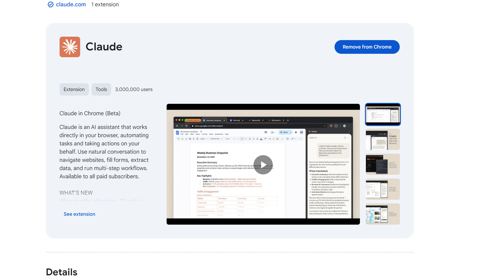

> 📌 *From the screenshot (Chrome Web Store listing):* the description says Claude *"works directly in your browser, automating tasks and taking actions on your behalf… navigate websites, fill forms, extract data, and run multi-step workflows"* and is *"available to all paid subscribers"*. The **Remove from Chrome** button means it's already installed. Preview thumbnails include *"Test code right in your browser with Claude Code"* and *"Approve Claude's plan and let it run"*.
>
> 🔗 For plan availability as stated by the course, see [Claude 101, Chapter 12](../claude-101/README.md): on by default for **Pro, Max, Team**; **Enterprise** off until an admin turns it on; **not on Free**.

> 💡 **Quick tip:** If you find Claude **keeps running into the same issues**, ask it to **save the solution to its `CLAUDE.md` file**.

### ✅ Commit

Once you've **tested the changes yourself** and are happy with the results, it's time to push your code.

| Step | What to do |
|------|------------|
| 1️⃣ **Test it yourself** | Make sure you're happy with the results |
| 2️⃣ **Run a subagent code reviewer** | A subagent gets a **fresh pair of eyes** on the codebase — it **doesn't carry the bias** the main agent might have from the session |
| 3️⃣ **Generate a commit message** | Get Claude to write one **in your style** |
| 4️⃣ **Rinse and repeat** | Start the next feature |

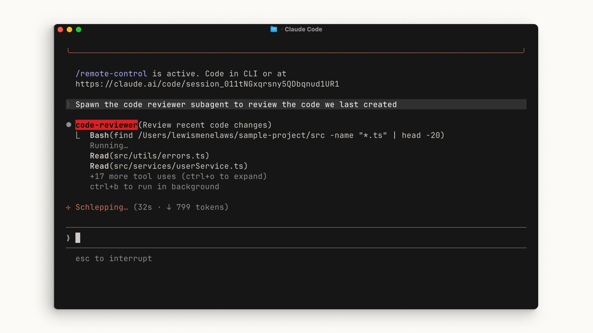

What the screenshot shows:

| Part of the screen | What it shows |
|--------------------|----------------|
| **Prompt** | *"Spawn the code reviewer subagent to review the code we last created"* |
| **Subagent** | `code-reviewer (Review recent code changes)` |
| **Its tool calls** | `Bash(find …/src -name "*.ts" \| head -20)` → `Read(src/utils/errors.ts)` → `Read(src/services/userService.ts)` → `+17 more tool uses (ctrl+o to expand)` |
| **Hints** | `ctrl+b to run in background` · `esc to interrupt` |

> 🔗 The same subagent demo appeared in [Chapter 1](#chapter-1-what-is-claude-code) — now you know **why** you'd spawn it: it's the **review step before you commit**.
>
> 📌 *Not explained in the lesson:* `ctrl+b to run in background` and the status line `Schlepping… (32s · ↓ 799 tokens)` (looks like a progress/token indicator — my reading).

### 🔁 Recap

To be effective with Claude Code, follow the **Explore, Plan, Code, and Commit** workflow:

- **Explore** gives Claude the **relevant context** it needs for your project
- **Plan** creates a **plan of action** that Claude uses to **measure success**
- **Code** is the **back and forth** between you and Claude before settling on the final outcome
- **Commit** helps you **review and push** your code so you can start on your next feature

### 📝 Quick Reference: Explore → Plan → Code → Commit (for exam prep)

| Step | Goal | How | Key tip |
|------|------|-----|---------|
| 🔍 **Explore** | Give Claude the context it needs | **Plan mode** (read-only) or the **explore subagent** | Describe what you need, what to figure out, and how to approach it |
| 📋 **Plan** | An action plan Claude measures success against | Review the plan; **ask to revise specific areas** | **Best place to course-correct** — before any code |
| 💻 **Code** | Work through the plan to a final outcome | **Approve** the plan; auto-accept edits or ask each time | **Success criteria · tools · test suite** |
| ✅ **Commit** | Review and push | Test yourself → **code-reviewer subagent** → commit message in your style | **Fresh eyes**, no session bias |

> 🎓 **Memory tip:** **E-P-C-C** — **E**xplore · **P**lan · **C**ode · **C**ommit — *look before you leap, review before you push*

**Key features for exam:**
- Skipping straight to code → **more course-correcting later**
- **Plan mode:** Claude **can't edit files**, it only **reads** to gather information
- Enter plan mode: **Shift + Tab until "Plan Mode"** shows under the text input
- Plan not right? **Ask to revise specific areas** — cheapest time to fix things
- **Explore subagent** works **without plan mode** (general codebase summary, no changes planned)
- Coding tips: **success criteria** (make them explicit in the plan) · **tools** (e.g. **Claude in Chrome** to test UIs) · **test suite** (a **reliable source of truth** → avoid **false positives**)
- Same issue keeps happening? Ask Claude to **save the solution to `CLAUDE.md`**
- Commit: **test yourself** → **subagent code reviewer** (**fresh pair of eyes**, **no bias** from the session) → **commit message in your style**

---

## Chapter 6: Context Management

> 🎬 **Video: Context Management** — **Context is Claude's working memory.** Every file it reads, every command it runs, every message you send — it all takes up space in the context window.

### 🧠 Key Takeaways

- **Context window = the amount of space Claude can hold in its memory.** Prompts, file reads, tool calls, and tool call results all add to it
- **Space is finite**, so it becomes important to **optimize how you use it**
- **Near the limit, the context is automatically compacted:** details are summarized and unnecessary tool call results are removed — ⚠️ this can **lose details**
- **Three commands:** `/compact` (summarize, keep a memory) · `/clear` (remove everything) · `/context` (inspect usage)
- **Rule of thumb:** `/compact` to **continue the same feature** · `/clear` to **start a new feature**
- **For things Claude should remember across sessions → `CLAUDE.md`**
- **Three tips for saving space:** be **specific** · manage **MCP servers** · use **subagents**

### 🪟 What is the Context Window?

Think of the context window as **the amount of space Claude can hold in its memory.** Each of these adds to it:

| What adds to the context | |
|---|---|
| ⌨️ | **Every prompt** you enter |
| 📖 | **Every file** Claude reads |
| 🛠️ | **Every tool call** it runs |
| 📥 | **Every tool call result** it receives |

Since the space is **finite**, it becomes important to **optimize how you use it**.

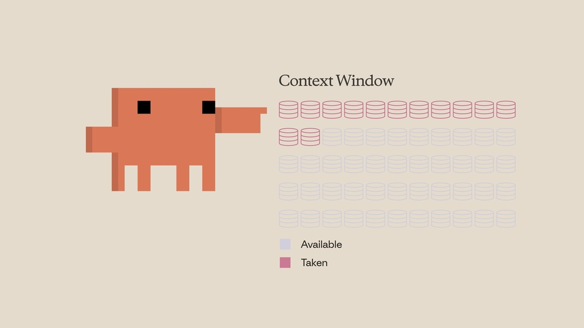

> 📌 *My reading of the diagram:* the grid has 5 rows of 11 token icons (55 total), and **13 are shown as Taken** (11 in the first row plus 2 in the second). The numbers are only illustrative, not from the lesson.
>
> 🔗 Builds on the context window in [Chapter 1](#chapter-1-what-is-claude-code) (working memory) and the automatic compaction in [Chapter 2](#chapter-2-how-claude-code-works).

### ⚠️ What Happens When Context Fills Up

When you **approach the limit**, the context window is **automatically compacted**.

| Compaction… | |
|---|---|
| ✅ **Summarizes** | The **important details** |
| 🗑️ **Removes** | **Unnecessary tool call results** to free up space |
| ⚠️ **Risk** | The process can **potentially lose details** |

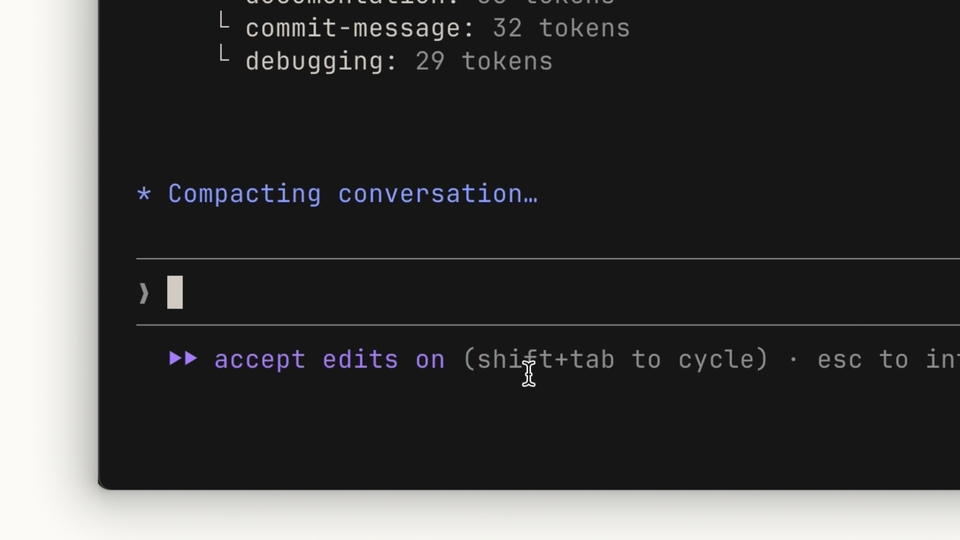

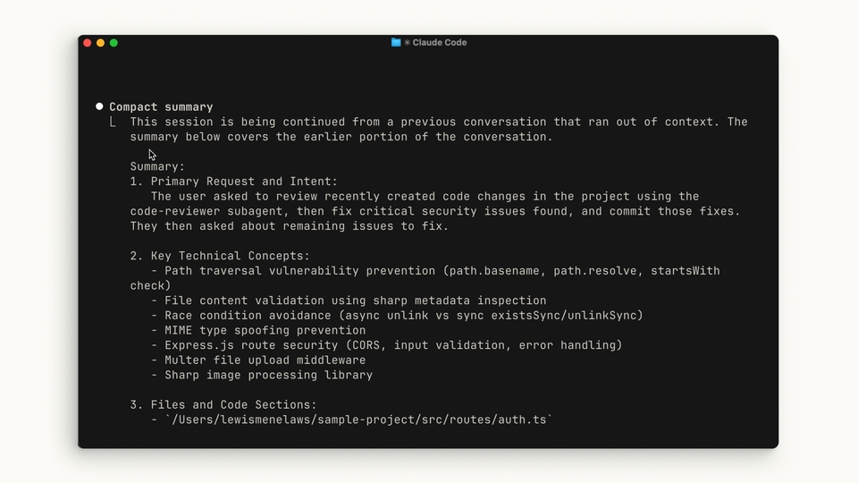

What the screenshots show:

| Part of the screen | What it shows |
|--------------------|----------------|
| **Status line** | `Compacting conversation…` while Claude summarizes |
| **Summary header** | *"This session is being continued from a previous conversation that ran out of context. The summary below covers the earlier portion of the conversation."* |
| **1. Primary Request and Intent** | The user asked to review recent code changes with the **code-reviewer subagent**, **fix critical security issues**, and **commit those fixes**, then asked about remaining issues |
| **2. Key Technical Concepts** | Path traversal prevention (`path.basename`, `path.resolve`, `startsWith` check) · file content validation using `sharp` metadata · race condition avoidance (async `unlink` vs sync `existsSync`/`unlinkSync`) · MIME type spoofing prevention · Express.js route security (CORS, input validation, error handling) · Multer file upload middleware · Sharp image processing library |
| **3. Files and Code Sections** | Starts with `src/routes/auth.ts` (the list continues below the visible area) |

> 📌 *My reading:* the summary is organized into **numbered sections** and carries the earlier request, key concepts, and files forward, so the session can continue. It also follows the **review → fix → commit** flow from [Chapter 5](#chapter-5-the-explore--plan--code--commit-workflow). The lesson doesn't describe the summary's format.

### ⌨️ Commands

| Command | What it does | Use it when |
|---------|---------------|-------------|
| 📦 **`/compact`** | Runs compaction **manually**. It compacts **everything up to that point** | You want to **free up context space while keeping a memory** of what you previously worked on |
| 🧹 **`/clear`** | **Completely starts from scratch** with **no memory** of the previous session. **Removes everything** | You're starting something new |
| 📊 **`/context`** | Shows the **state of your context**: a high-level overview of the **context size**, the **categories taking up the most space**, and a **visual graphic** of the breakdown | You want to see what is consuming your context |

#### 📦 `/compact`

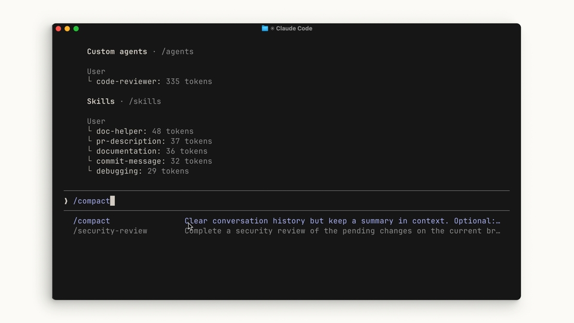

What the screenshot shows:
- `/compact` is typed at the prompt, and the autocomplete menu lists it as: *"Clear conversation history but keep a summary in context. Optional:…"* (the text is cut off)
- Above the prompt, a token list: **Custom agents · `/agents`** → `code-reviewer: 335 tokens`, and **Skills · `/skills`** → `doc-helper: 48`, `pr-description: 37`, `documentation: 36`, `commit-message: 32`, `debugging: 29` tokens

> 📌 *Not explained in the lesson:* `/security-review` (the second item in the autocomplete menu) and `/skills`. `/agents` is covered in [Chapter 9](#chapter-9-subagents). *My observation:* each custom agent and skill appears with a **token count**, so they also take up (a small amount of) context. The skills here cost only **tens of tokens each**, which fits the lesson's tip that Skills don't load everything upfront.

#### 🧹 `/clear`

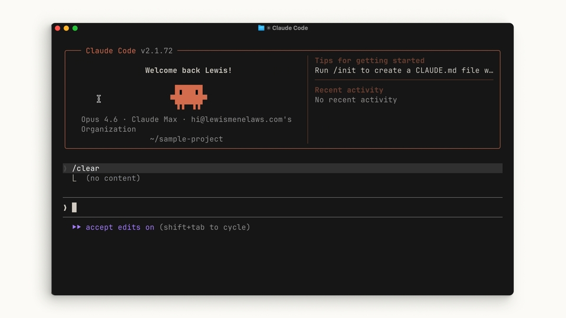

> 📌 *From the screenshot:* after `/clear` the output shows **`(no content)`** under a fresh welcome box (Claude Code v2.1.72, Opus 4.6, Claude Max, `~/sample-project`). The welcome box still suggests *"Run /init to create a CLAUDE.md file w…"* (`/init` is covered in [Chapter 8](#chapter-8-the-claudemd-file)).

#### 📊 `/context`

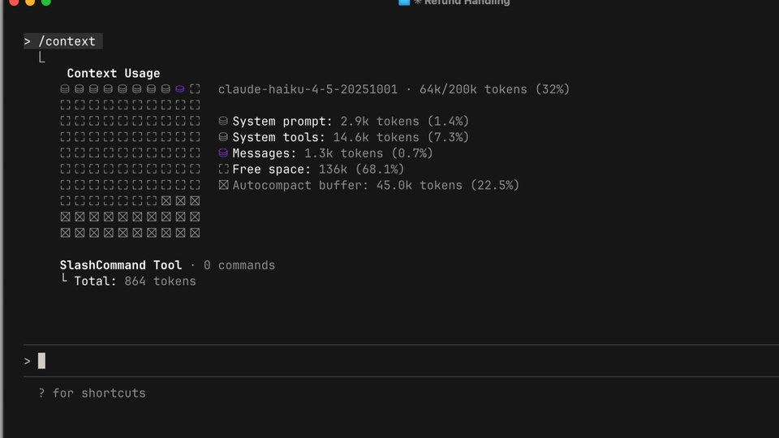

> 🔗 This is the same `/context` output as in [Chapter 1](#chapter-1-what-is-claude-code) (64k / 200k tokens, 32%). The categories and numbers are in the table there.
>
> 📌 *Lesson wording vs. screen:* the lesson calls the graphic a "visual bar chart", but in the screenshot it's a **grid of icons**, one per slice of the window. The lesson doesn't explain the **Autocompact buffer** row (see my inference in Chapter 2).

### 🧭 When to Use Which

A general rule of thumb:

| Situation | Use | Why |
|-----------|-----|-----|
| Working on a **specific feature**, running up against the context limit, but **need to continue** | 📦 **`/compact`** | Keeps the context **relevant to your current feature** |
| Starting a **new feature** | 🧹 **`/clear`** | You **don't want the previous conversation to introduce bias** into something new |
| Things you want Claude to **remember across sessions** | 📄 **`CLAUDE.md`** | So it **doesn't have to rediscover things from scratch** |

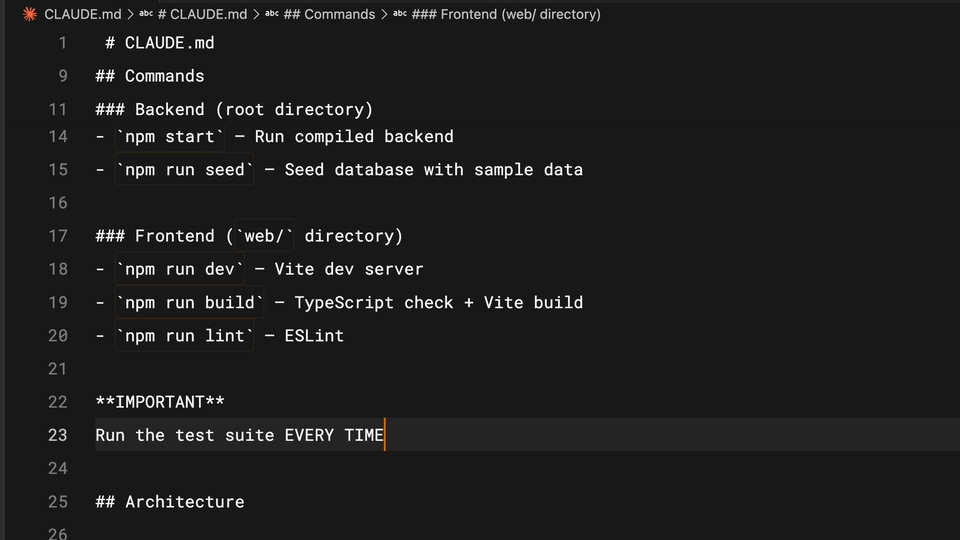

What the screenshot shows (a `CLAUDE.md` file with **commands, important notes, and architecture sections**):

| Section | Content |
|---------|---------|
| `## Commands` → `### Backend (root directory)` | `npm start` — run compiled backend · `npm run seed` — seed database with sample data |
| `## Commands` → `### Frontend (web/ directory)` | `npm run dev` — Vite dev server · `npm run build` — TypeScript check + Vite build · `npm run lint` — ESLint |
| `**IMPORTANT**` | *"Run the test suite EVERY TIME"* |
| `## Architecture` | A section follows (not visible in the screenshot) |

> 📌 *The line numbers skip, so only part of the file is visible.*
>
> 🔗 [Chapter 5](#chapter-5-the-explore--plan--code--commit-workflow) also tells you to **save solutions for recurring issues to `CLAUDE.md`**. The "run the test suite" note shows the same kind of lasting instruction (my link).

### 💡 Tips for Saving Context Space

| Tip | Why |
|-----|-----|
| 🎯 **Be specific** | A vague prompt might seem smaller, but it **costs more context in the long run**. Without clear instructions, Claude is forced to **explore your codebase more and do its own reasoning**, which takes far more space than a detailed prompt |
| 🔌 **Manage your MCP servers** | MCP servers **load all of their available tools into context by default**, even when you're not using them. If you have servers for things **unrelated to the current project**, consider **turning them off**. You can also try **Skills**: they work similarly to MCP servers but **don't load everything into context upfront** (MCP servers are covered in [Chapter 11](#chapter-11-mcp)) |
| 🤖 **Use subagents** | Subagents run **in parallel** with your main agent but have a **completely separate context window**. For tasks where you **only need the answer** (e.g. *"where are the authentication endpoints located?"*), a subagent does the work and **returns just a summary**, keeping your primary context clean |

> 🔗 Subagents already appeared as the **code reviewer** in [Chapter 5](#chapter-5-the-explore--plan--code--commit-workflow) (fresh eyes). Here the benefit is a **separate context window** (my link).

### 🔁 Recap

Managing context within Claude Code is crucial. Use **`/compact`** to summarize long sessions and **`/clear`** to start fresh. To use your context window effectively: **be specific with your prompts**, **check what's consuming your current context**, and **use subagents** to delegate tasks where you only need the result.

### 📝 Quick Reference: Context Management (for exam prep)

| Concept | Key point |
|---------|-----------|
| 🪟 **Context window** | Claude's **working memory**; prompts, file reads, tool calls, and tool results all fill it |
| 🔄 **Auto-compaction** | Triggered **near the limit**; summarizes important details, removes unnecessary tool results; **can lose details** |
| 📦 **`/compact`** | **Manual** compaction of everything up to that point; **keeps a summary** |
| 🧹 **`/clear`** | **Removes everything**; fresh start with **no memory** |
| 📊 **`/context`** | Overview of **size**, **biggest categories**, and a **visual breakdown** |
| 📄 **`CLAUDE.md`** | Persistent memory **across sessions** |
| 🎯 **Be specific** | Vague prompts → more exploring and reasoning → **more context used** |
| 🔌 **MCP servers** | Load **all tools by default**; turn off unrelated ones; **Skills** don't load everything upfront (see [Chapter 11](#chapter-11-mcp)) |
| 🤖 **Subagents** | **Separate context window**; return only a **summary** |

> 🎓 **Memory tip:** **C-C-C** — **/C**ompact = **C**ontinue the same feature · **/C**lear = **C**lean slate for a new feature · **/C**ontext = **C**heck the usage

**Key features for exam:**
- Compaction **summarizes** and **removes unnecessary tool call results**, and it **can lose details**
- `/compact` = compacts **everything up to that point**, keeps a memory · `/clear` = **removes everything**
- `/compact` → same feature, near the limit · `/clear` → new feature, so the old conversation **doesn't bias** it
- Want Claude to remember across sessions? → **`CLAUDE.md`** (commands, important notes, architecture)
- **Vague prompts cost more context** over time
- **MCP servers load all their tools into context by default**, even unused ones · **Skills** don't
- **Subagents** have a **completely separate context window** and return **just a summary** to the main agent

---

## Chapter 7: Code Review

> 🎬 **Video: Code Review** — Claude Code has a few **built-in features that make your git workflow faster**. This lesson covers three: a **subagent reviewer**, the **`/commit-push-pr` skill**, and **session linking with `--from-pr`**.

### 🧠 Key Takeaways

- **Before you push a PR, ask Claude to use a subagent to review your changes.** The subagent runs in **its own context window** with **fresh eyes**, so it **doesn't carry the bias** of the main agent that just wrote the code
- **Restrict a code-reviewer subagent to read-only tools** — *a reviewer should flag issues, not edit files*
- **Check the subagent configuration into your repo** so your **whole team uses the same reviewer**
- **`/commit-push-pr`** handles **commit + push + PR creation in one step**
- With a **Slack MCP server** configured and **channels listed in your `CLAUDE.md`**, it **automatically posts the PR link** to your team's channel
- **Session linking:** when Claude creates a PR through **`gh pr create`**, the session is **linked to that PR automatically**
- **Resume later with `claude --from-pr <PR_NUMBER>`** to pick up where you left off (e.g. address review comments or fix a failing build)

### 🕵️ Review with a Subagent

Before you push a PR, **ask Claude to use a subagent to review your changes.**

| Why a subagent? | |
|---|---|
| 🪟 **Own context window** | The subagent runs in a **separate context window** from your main session |
| 👀 **Fresh eyes** | It **doesn't carry the bias** of the main agent that just spent the session writing the code |

#### 🛡️ Setting up a code-reviewer subagent

| Best practice | Why |
|---------------|-----|
| 🔒 **Restrict it to read-only tools** | A reviewer should **flag issues, not edit files** |
| 📂 **Check the subagent configuration into your repo** | So your **whole team uses the same reviewer** |

> 🔗 You've seen this reviewer already: [Chapter 5](#chapter-5-the-explore--plan--code--commit-workflow) introduced it as the **review step before you commit** (the `code-reviewer` demo), and [Chapter 6](#chapter-6-context-management) explained why a subagent is useful: a **completely separate context window**.
>
> 🔗 [Chapter 9](#chapter-9-subagents) shows how to create a subagent with `/agents`, including **selecting the tools it has access to**. That's where you'd limit a reviewer to read-only tools (my mapping). The `tools:` line in the [Chapter 2](#chapter-2-how-claude-code-works) screenshot is probably the same setting in an agent's configuration (my inference).

### 🚀 The `/commit-push-pr` Skill

The **`/commit-push-pr`** skill handles **three steps in one**:

| Step | |
|------|--|
| 1️⃣ **Commit** | Your changes are committed |
| 2️⃣ **Push** | The branch is pushed |
| 3️⃣ **Create the PR** | The pull request is opened |

Instead of doing each manually, **just run the skill** and Claude takes care of it.

#### 💬 Bonus: Slack notification

| Requirement | What happens |
|-------------|---------------|
| A **Slack MCP server** is configured | |
| **Channels are listed in your `CLAUDE.md`** | The **PR link is posted automatically** to your team's channel |

> 🔗 [Chapter 6](#chapter-6-context-management) covered what `CLAUDE.md` is for (lasting instructions across sessions) and noted that **MCP servers load their tools into context**. Here, `CLAUDE.md` tells Claude **which Slack channels to post to** (my link).
>
> 🔗 How to add an MCP server is covered in [Chapter 11](#chapter-11-mcp). MCP also has its own course later on your path (*Introduction to MCP* in the [course index](../README.md)).

### 🔗 Session Linking with `--from-pr`

When Claude creates a PR through **`gh pr create`**, the **session is linked to that PR automatically**.

If you need to come back later — maybe to **address review comments** or **fix a failing build** — run:

```bash
claude --from-pr <PR_NUMBER>
```

This **picks up right where you left off.**

| Piece | Meaning |
|-------|---------|
| `claude` | Starts Claude Code |
| `--from-pr` | Resumes the **session linked to a PR** |
| `<PR_NUMBER>` | The number of the PR you want to return to |

> 📌 *My note, not from the lesson:* `gh` is the **GitHub CLI**, so `gh pr create` is the GitHub command-line way to open a PR.
>
> 🔗 This follows the [Chapter 5](#chapter-5-the-explore--plan--code--commit-workflow) **Commit** step: **test → subagent reviewer → commit message → push**. `/commit-push-pr` covers the commit-to-PR part in one step (my mapping), and `--from-pr` covers coming back after review.

### 🔁 Recap

Use a **subagent for an unbiased code review** before pushing. Use **`/commit-push-pr`** to handle the **full commit-to-PR flow in one step**. And use **`--from-pr`** to **resume work on a PR later**. These are small features, but they **remove a lot of friction** from your daily workflow.

### 📝 Quick Reference: Code Review (for exam prep)

| Feature | What it does | Key point |
|---------|---------------|-----------|
| 🕵️ **Subagent code review** | Reviews your changes before you push a PR | **Own context window**, **fresh eyes**, **no bias** from the writing session |
| 🔒 **Reviewer tools** | Tools the reviewer subagent may use | **Read-only** — flag issues, don't edit files |
| 📂 **Subagent config** | The reviewer's setup | **Check it into your repo** so the whole team uses the same reviewer |
| 🚀 **`/commit-push-pr`** | Commit + push + create PR | **One step** |
| 💬 **Slack post** | Posts the PR link to your team's channel | Needs a **Slack MCP server** + **channels listed in `CLAUDE.md`** |
| 🔗 **Session linking** | Links the session to a PR | Automatic when the PR is created via **`gh pr create`** |
| ⏪ **`claude --from-pr <PR_NUMBER>`** | Resumes the linked session | For **review comments** or a **failing build** |

> 🎓 **Memory tip:** **Review · Ship · Link** — 🕵️ **Review** with a subagent · 🚀 **Ship** with `/commit-push-pr` · 🔗 **Link** back with `--from-pr`

**Key features for exam:**
- A subagent review is **unbiased** because it has its **own context window** and didn't write the code
- A code-reviewer subagent should be **read-only** (**flags issues, doesn't edit files**)
- **Check the subagent configuration into your repo** → the **whole team** uses the same reviewer
- **`/commit-push-pr`** = **commit + push + PR** in one step
- Auto-posting the PR link to Slack needs a **Slack MCP server** and **channels in `CLAUDE.md`**
- PRs created through **`gh pr create`** are **automatically linked** to the session
- **`claude --from-pr <PR_NUMBER>`** resumes the session linked to that PR

---

> 🗂️ **Unit 4: Customizing Claude Code** · Chapters 8–12

## Chapter 8: The CLAUDE.md File

> 🎬 **Video: The CLAUDE.md File** — One of the most useful features in Claude Code. It gives Claude Code **persistent memory about your project**.

### 🧠 Key Takeaways

- **Without a `CLAUDE.md`, Claude Code starts fresh every time:** it re-explores your codebase, works out dependencies and existing features, and sometimes **makes assumptions** — which makes it **harder to steer**
- **`CLAUDE.md` is a Markdown file in the root of your project.** Claude Code **reads it automatically every time you start a session**
- Think of it as an **onboarding script for your codebase**. Its contents are **appended to your prompt**
- **Commit it to version control** so your team benefits. There's a **hierarchy of memory files:** **project-level** (root, shared with the team) and **user-level** (your configuration folder, just for you, across all projects)
- **Tips:** save repeated corrections to memory · reference project docs with **`@`** · **start without one**, then run **`/init`** to have Claude generate it

### ❓ The Problem It Solves

| Without a `CLAUDE.md` | With a `CLAUDE.md` |
|------------------------|----------------------|
| Claude Code **starts fresh every time** | Claude Code **reads the file automatically** at the start of every session |
| It has to **re-explore your codebase** | It already has the project's **onboarding script** |
| It must **figure out what dependencies are needed** and **what features are already implemented** | Stack, commands, and conventions are **written down** |
| Sometimes it **makes assumptions**, so it's **harder to steer** in the right direction | Fewer assumptions to correct |

> 🔗 [Chapter 6](#chapter-6-context-management) introduced `CLAUDE.md` as the place for things you want Claude to **remember across sessions** (so it doesn't have to rediscover them). This chapter explains how it works.

### 📄 What It Is

- A **Markdown file** you add to the **root of your project**
- Claude Code **reads it automatically every time you start a session**
- Think of it as an **onboarding script for your codebase**
- **The contents are appended to your prompt**

> 📌 *My inference, not stated in the lesson:* because the contents are **appended to your prompt**, a `CLAUDE.md` takes up space in the [context window](#chapter-6-context-management). That fits the lesson's advice to keep it **compact and focused on only the necessary information** (see "Start without one" below).

### 🧪 An Example

Here's what a typical `CLAUDE.md` looks like (from the lesson):

```markdown
# Project

This is a Next.js 15 app using the App Router, Tailwind, and Drizzle ORM.

# Commands
- Dev server: `pnpm dev`
- Run tests: `pnpm test`
- Lint: `pnpm lint`

# Code Style
- Use 2-space indentation
- Prefer named exports
- All API routes go in app/api/
- Use server actions instead of API routes where possible
```

| Section | What it tells Claude |
|---------|------------------------|
| `# Project` | The **stack**: Next.js 15, App Router, Tailwind, Drizzle ORM |
| `# Commands` | How to **run the dev server, tests, and lint** |
| `# Code Style` | **Conventions**: indentation, named exports, where API routes go, server actions over API routes |

**Why it helps:** if you now ask Claude Code to create a React component, it **already knows to use Tailwind** for styling and to **follow your code conventions**.

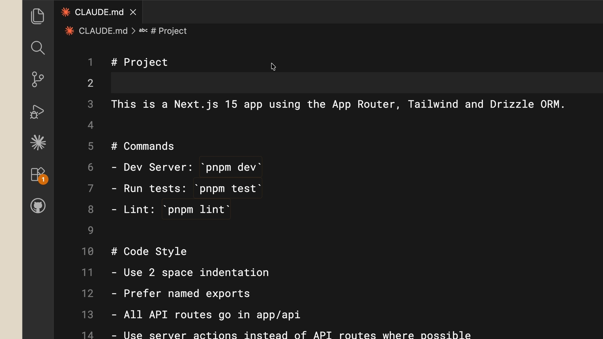

> 📌 *From the screenshot:* it shows the same file in VS Code, with small wording differences from the lesson text (e.g. "Dev Server", "2 space indentation", `app/api` without the trailing slash). Line 14 reads *"Use server actions instead of API routes where possible"*, and the file continues below the visible area.
>
> 🔗 Compare with the larger `CLAUDE.md` in [Chapter 6](#chapter-6-context-management), which had **Commands**, an **IMPORTANT** note, and **Architecture** sections. Both are plain Markdown; the section names are up to you (my observation).

### 👥 CLAUDE.md Is for Teams

You can (and **should**) **commit your `CLAUDE.md` to version control** so your team benefits from it. There's a **hierarchy of memory files** depending on who they're for:

| Level | Where it lives | Who it's for |
|-------|-----------------|--------------|
| 📁 **Project-level** `CLAUDE.md` | The **root directory** of your project | **Shared with the team** |
| 👤 **User-level** `CLAUDE.md` | Your **configuration folder** | **Just for you**; applies **across all your projects**. Put your **personal preferences** here |

> 📌 *The lesson doesn't give the exact path of the user-level file, only "your configuration folder".*

### 💡 Tips

#### 1️⃣ Save corrections to memory

If you find yourself **correcting Claude repeatedly** (for example, telling it to **always use server actions instead of API routes**), **explicitly ask Claude to save that rule to memory**. Next time you open the project, it will know.

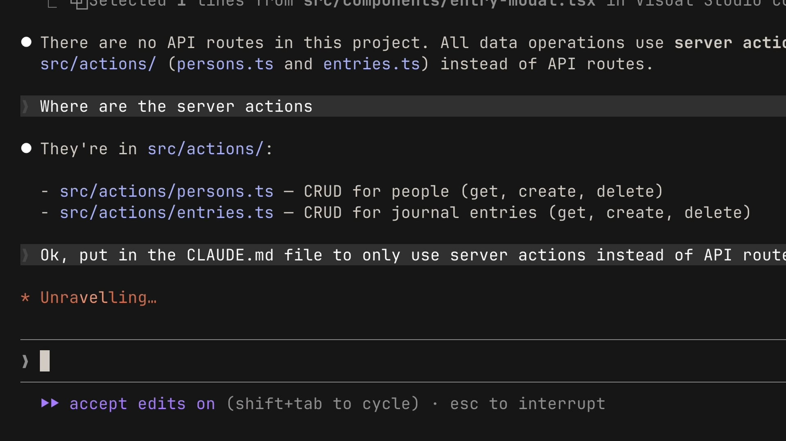

What the screenshot shows:

| Part of the screen | What it shows |
|--------------------|----------------|
| **Claude's answer** | *"There are no API routes in this project. All data operations use server actions (`src/actions/persons.ts` and `entries.ts`) instead of API routes."* |
| **Follow-up** | *"Where are the server actions"* → *"They're in `src/actions/`:"* · `persons.ts` — CRUD for people (get, create, delete) · `entries.ts` — CRUD for journal entries (get, create, delete) |
| **Your request** | *"Ok, put in the CLAUDE.md file to only use server actions instead of API route…"* (cut off) |
| **Status** | `* Unravelling…` while Claude works |
| **Footer** | `accept edits on (shift+tab to cycle) · esc to interrupt` |

> 📌 *My reading:* the top of the screenshot shows a line like *"Selected 1 lines from `src/components/entry-modal.tsx` in Visual Studio Co…"* (cut off), which looks like **editor selection context** shared from the IDE. This matches the "Selection context" feature in [Chapter 3](#chapter-3-installing-claude-code) (JetBrains table). The lesson doesn't explain it here. The footer is in **accept edits** mode ([Chapter 4](#chapter-4-your-first-prompt)), so the file edit to `CLAUDE.md` is approved automatically.
>
> 🔗 Same habit as the [Chapter 5](#chapter-5-the-explore--plan--code--commit-workflow) tip: when Claude **keeps running into the same issues**, ask it to **save the solution to its `CLAUDE.md` file**.

#### 2️⃣ Reference project docs with `@`

If you have **documentation in your project** that you want Claude to reference, use the **`@` symbol with the file path**:

```markdown
## README.md

Please read if you need more info: @README.md
```

#### 3️⃣ Start without one

| Recommendation | Why |
|----------------|-----|
| 🚫 **Start a project without a `CLAUDE.md`** | You can **see where you constantly have to course-correct** the model |
| 🎯 **Keep it compact** | That keeps it **focused on only the necessary information** |
| ⚙️ **When you're ready, run `/init`** | Claude **generates one for you** |

> 🔗 You saw the `/init` hint in the welcome box in [Chapter 4](#chapter-4-your-first-prompt) and [Chapter 6](#chapter-6-context-management): *"Run /init to create a CLAUDE.md file w…"*. The web app's **"Write a CLAUDE.md"** starter prompt in [Chapter 3](#chapter-3-installing-claude-code) is a related idea (my link; the lesson doesn't connect them).

### 🔁 Recap

The difference between a **frustrating** Claude Code session and a **productive** one often comes down to **context**, and the **`CLAUDE.md` file is how you provide that context**. Start with **your stack, your preferences, and your commands**, then **build from there as you go**.

### 📝 Quick Reference: The CLAUDE.md File (for exam prep)

| Concept | Key point |
|---------|-----------|
| 📄 **What it is** | A **Markdown file** in the **root of your project**; **persistent memory** about your project |
| 🔄 **When it's read** | **Automatically, every time you start a session** |
| ➕ **How it's used** | Its contents are **appended to your prompt**; an **onboarding script** for your codebase |
| ❓ **Problem solved** | Without it, Claude **starts fresh every time**, **re-explores**, and **makes assumptions** |
| 📁 **Project-level** | In the **project root**; **shared with the team** (commit it) |
| 👤 **User-level** | In your **configuration folder**; **just for you**, **all projects** |
| 💾 **Save corrections** | **Explicitly ask Claude to save the rule** to memory |
| 🔗 **`@path`** | **Reference project docs** (e.g. `@README.md`) |
| ⚙️ **`/init`** | **Generates a `CLAUDE.md` for you**; best **after** starting without one |

> 🎓 **Memory tip:** **CLAUDE.md = Claude's onboarding script** — **Project-level = Team** · **User-level = Me** · **Start empty, then `/init`**

**Key features for exam:**
- `CLAUDE.md` gives Claude Code **persistent memory about your project**
- Lives in the **root of your project**; read **automatically at session start**; contents are **appended to your prompt**
- Without it, Claude Code **starts fresh every time** (re-explores, assumes)
- **Commit it to version control** so the team benefits
- **Project-level** = root, **shared with team** · **User-level** = config folder, **just you**, **across all projects**
- Repeated corrections → **explicitly ask Claude to save the rule to memory**
- **`@` + file path** references project docs
- **Start without one** to see where you course-correct, keep it **compact**, then run **`/init`**
- Start with **stack, preferences, commands**, then build from there

---

## Chapter 9: Subagents

> 🎬 **Video: Subagents** — Claude can **delegate tasks to subagents** that break them down and **run component tasks in parallel**, improving your context management. **Each subagent operates in its own isolated context window.**

### 🧠 Key Takeaways

- **A subagent runs in parallel with its own, isolated context window.** It does the heavy work, then **summarizes its findings and returns just that summary** to Claude
- **Why:** much of the context window is consumed by **exploration tool calls and web searches** that aren't always relevant to the feature you're building. A subagent keeps **the journey out of your main context**
- **Subagents are defined in Markdown files with YAML frontmatter**
- **Easiest way to create one:** run **`/agents`** → **"Create new agent"** and let Claude generate it
- Setup steps: **scope**, **purpose**, **tools** the agent can access, and a **color**. Claude generates the **name, description, and prompt**
- **Further customization:** **persistent memory** across conversations, and **preloading skills** (the **entire** skill is loaded into context)

### ⚙️ How It Works

| The problem | The subagent solution |
|-------------|------------------------|
| A lot of the context window is consumed by **tool calls exploring your codebase** or **web searches for research** | Claude **spawns a subagent** for tasks like *"explore this codebase for me"* |
| What Claude discovers during exploration **isn't always relevant** to the main feature | The subagent runs **in parallel**, in **its own context window**, and does all the exploration |
| Your main context gets **cluttered** | When it finishes, it **summarizes its findings** and **returns that summary** to Claude |

> ✅ **The result:** you get the **answer you were looking for**, **without the entire journey** it took to get there **cluttering your main context**.

| | 🧠 **Main agent** | 🤖 **Subagent** |
|---|---|---|
| **Context window** | Your main session's | **Its own, isolated** |
| **Does the exploration** | ❌ Doesn't have to | ✅ Yes |
| **What comes back** | — | **Just a summary** of its findings |

> 🔗 This is the "use subagents" tip from [Chapter 6](#chapter-6-context-management) (a **separate context window**, returns **just a summary**) explained in more detail. The **explore subagent** and **code reviewer** from [Chapter 5](#chapter-5-the-explore--plan--code--commit-workflow) and [Chapter 7](#chapter-7-code-review) are both examples. Agents using other agents was introduced in [Chapter 1](#chapter-1-what-is-claude-code).

### 🛠️ Creating Your Own Subagent

Subagents are defined in **Markdown files with YAML frontmatter**. The **easiest way to get started** is to **let Claude generate one for you**. Run:

```text
/agents
```

Then select **"Create new agent."**

| Step | What you decide |
|------|------------------|
| 1️⃣ **Scope** | The **scope** of the agent |
| 2️⃣ **Purpose** | What the agent is **for** |
| 3️⃣ **Tools** | The **tools it has access to** |
| 4️⃣ **Color** | A **color** for it |

**What Claude generates:** a **name**, a **description**, and a **prompt** for the subagent. This also **tells Claude when to call the subagent** based on the prompts you give it.

> 🔗 [Chapter 6](#chapter-6-context-management) showed `/agents` in the screenshot (**Custom agents · /agents → `code-reviewer: 335 tokens`**), so a custom agent also costs a small amount of context (my observation).
>
> 🔗 **Selecting the tools** is how you'd create the **read-only code reviewer** from [Chapter 7](#chapter-7-code-review) (my mapping). The `tools:` line in the [Chapter 2](#chapter-2-how-claude-code-works) screenshot is probably the same setting inside an agent's file (my inference).
>
> 📌 *Not explained in the lesson:* the exact **frontmatter fields**, **where the file is saved**, and what each **scope** option means. The lesson only says the file is Markdown with YAML frontmatter.

### 🎛️ Further Customization

| Feature | What it does |
|---------|---------------|
| 🧠 **Persistent memory** | Lets your subagent **retain memory across conversations**. Great if you use it **consistently on the same projects** |
| 🎓 **Preload skills** | Add the **skill key** and **list skills by name**. ⚠️ **Unlike skills in your main conversation, the entire skill is loaded into context** here |

> 📌 *My note:* the lesson says "the skill key" and doesn't show the exact frontmatter spelling. Check the official subagents docs before relying on it.
>
> 🔗 Compare with [Chapter 6](#chapter-6-context-management): in the **main** conversation, **Skills don't load everything upfront**. In a subagent, a **preloaded skill is loaded in full** (my link). Skills themselves are explained in [Chapter 10](#chapter-10-skills).

### 🔁 Recap

**Keeping your context window clean** is one of the best ways to stay productive with Claude Code. With subagents, you can run an agent **in the background** to handle the **heavy lifting** and return **just the answer** to your main context window.

> 📚 **Want to go deeper?** The lesson points to a dedicated course: ***Introduction to subagents***.
>
> 📌 *My observation:* that course isn't one of the 8 in your [course index](../README.md) path, so it looks like an optional extra.

### 📝 Quick Reference: Subagents (for exam prep)

| Concept | Key point |
|---------|-----------|
| 🤖 **Subagent** | A delegated agent that runs **in parallel** with **its own isolated context window** |
| 🎯 **Purpose** | Keep **exploration and research** out of your main context |
| 📨 **Output** | Returns **only a summary** of its findings |
| 📄 **Definition** | **Markdown file with YAML frontmatter** |
| ⌨️ **Create** | **`/agents`** → **"Create new agent"** (let Claude generate it) |
| 🧩 **Setup** | **Scope**, **purpose**, **tools**, **color** → Claude generates **name, description, prompt** |
| 🧠 **Persistent memory** | Retains memory **across conversations** |
| 🎓 **Preloaded skills** | List skills by name; the **entire skill loads into context** |

> 🎓 **Memory tip:** **Subagent = side quest** — it goes off in its **own context**, does the heavy lifting **in parallel**, and brings back **only the loot (the summary)**

**Key features for exam:**
- Subagents **run in parallel** and have **their own isolated context window**
- They **summarize findings and return the summary** to the main agent, so the **exploration doesn't clutter your main context**
- Typical task: *"explore this codebase for me"*
- Defined in **Markdown with YAML frontmatter**; easiest to start with **`/agents` → "Create new agent"**
- Creation covers **scope, purpose, tools, color**; Claude generates **name, description, prompt** (which also tells Claude **when to call it**)
- **Persistent memory** = remembers across conversations
- **Preloaded skills:** the **whole skill** is loaded into context, **unlike** skills in the main conversation
- Dedicated deeper course: **Introduction to subagents**

---

## Chapter 10: Skills

> 🎬 **Video: Skills** — Every time you explain your team's coding standards, PR feedback format, or commit message style to Claude, you're repeating yourself. **Skills fix this.** A skill is a **Markdown file** that teaches Claude **how to do something once**, and Claude **applies that knowledge automatically** whenever it's relevant.

### 🧠 Key Takeaways

- **A skill is a Markdown file** that teaches Claude how to do something **once**. Claude **applies it automatically** whenever it's relevant
- **Agent skills = folders of instructions, scripts, and resources** that Claude can **discover and use** to do things **more accurately and efficiently**
- **The `SKILL.md` file's description is how Claude decides whether to use the skill** — it **matches your request against all available skill descriptions** and **activates the ones that match**
- **Where skills live:** **personal skills** in `~/.claude/skills` (follow you across all projects) · **project skills** in `.claude/skills` in the repo root (anyone who clones the repo gets them)
- **Skills vs other customizations:** skills are **automatic and task-specific** — `CLAUDE.md` loads into **every** conversation, slash commands **require you to type them**
- **Skills load on demand:** only the **name and description** are loaded up front, so they **don't fill your context window**
- **Best use cases:** **specialized knowledge for specific tasks** — code review standards, commit message formats, brand guidelines
- **Rule of thumb:** explaining the same thing to Claude repeatedly? **That's a skill waiting to be written**

### ❓ The Problem It Solves

| Without skills | With skills |
|----------------|-------------|
| You **re-explain your team's coding standards** to Claude | Written down **once** in a skill |
| Every PR review, you **redescribe how you want feedback structured** | Claude already knows the review format |
| Every commit message, you **remind Claude of your preferred format** | Claude applies your format **automatically** |

> 🔗 Same idea as [Chapter 8](#chapter-8-the-claudemd-file): stop repeating yourself. The difference is *when* the knowledge loads (see "Skills vs Other Customizations" below).

### ⚙️ How Skills Work

> **Agent skills** are **folders of instructions, scripts, and resources** that Claude can **discover and use** to do things **more accurately and efficiently**.

In Claude Code, the core of a skill is its **`SKILL.md` file**:

| Step | What happens |
|------|---------------|
| 1️⃣ **You make a request** | e.g. *"review this PR"* |
| 2️⃣ **Claude compares** | It **matches your request against the descriptions** of all available skills |
| 3️⃣ **Matching skills activate** | Claude **activates the ones that match** and uses their instructions |

> 🔑 **The description is the trigger.** It's **how Claude decides whether to use the skill**, so a clear description matters.

> 🔗 [Chapter 2](#chapter-2-how-claude-code-works) showed `Skill` in the tools list, and [Chapter 7](#chapter-7-code-review) introduced **`/commit-push-pr`** as a built-in skill (my link). In [Chapter 6](#chapter-6-context-management), the `/compact` screenshot listed skills like `commit-message`, `pr-description`, and `documentation` with **tens of tokens each**. That fits the idea that only the name and description are loaded up front (my observation).

#### 🖼️ What a Skill Looks Like

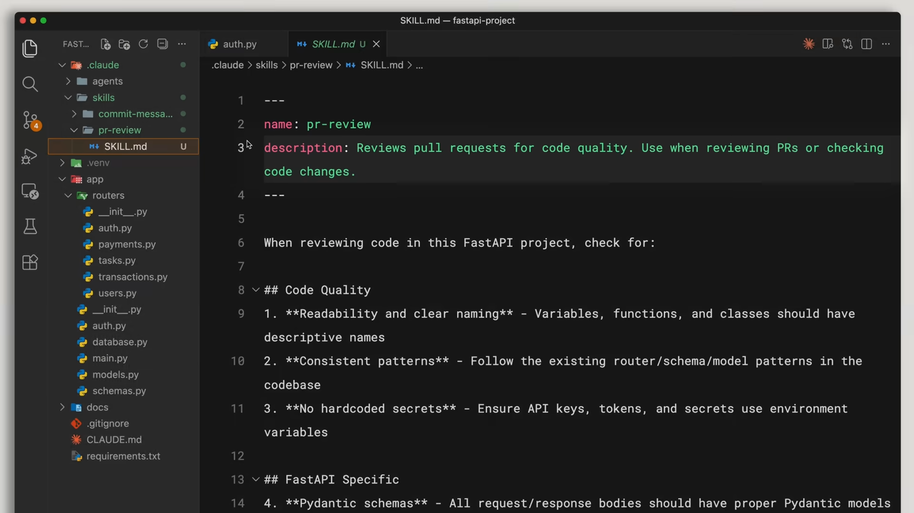

What the screenshot shows (a `pr-review` skill in a FastAPI project):

| Part of the screen | What it shows |
|--------------------|----------------|
| **Folder** | `.claude/skills/pr-review/SKILL.md`. The `skills` folder also has a `commit-messa…` folder, so each skill sits in **its own folder** with a `SKILL.md` |
| **Frontmatter (lines 1–4)** | Between two `---` lines: `name: pr-review` and `description: Reviews pull requests for code quality. Use when reviewing PRs or checking code changes.` |
| **Body** | Plain Markdown instructions: *"When reviewing code in this FastAPI project, check for:"*, then a **Code Quality** list (readable and clear naming · consistent patterns · no hardcoded secrets) and a **FastAPI Specific** section (the first item is Pydantic schemas) |

> 🔑 **The description is written like a trigger.** It says what the skill does (*reviews pull requests for code quality*) **and when to use it** (*when reviewing PRs or checking code changes*). This matches the lesson's *"review this PR"* example: Claude compares your request to this text.
>
> 📌 *My reading of the screenshot, not stated in the lesson:*
> - `name` and `description` are the two frontmatter fields shown. This fits the lesson's point that only the **name and description** load up front.
> - Everything below the frontmatter is the skill's instructions.
> - The `U` next to `SKILL.md` is VS Code's "untracked" marker. The skill hasn't been committed yet, so for a team skill you'd commit it (see Storing and Organizing Skills below).
> - A `.claude/agents` folder sits next to `skills`. It is probably where project subagents live ([Chapter 9](#chapter-9-subagents)), but the lesson doesn't say.
>
> 📌 *Still not explained in the lesson:* any other frontmatter fields, and what scripts or resource files a skill folder can contain.

### 🗂️ Storing and Organizing Skills

Where you store a skill depends on **who needs it**:

| Type | Location | Who it's for | What goes here |
|------|----------|--------------|----------------|
| 👤 **Personal skills** | `~/.claude/skills` (your home directory) | **Just you** — they **follow you across all your projects** | Your preferences: **commit message style**, **documentation format**, **how you like code explained** |
| 👥 **Project skills** | `.claude/skills` inside the **root of your repository** | **Your team** — **anyone who clones the repo gets them automatically** | **Team standards**: your company's **brand guidelines**, **preferred fonts and colors** for web design |

> 🔗 Same split as the `CLAUDE.md` hierarchy in [Chapter 8](#chapter-8-the-claudemd-file): **project-level = team**, **user-level = me** (my link).
>
> 📌 *Transcript note:* the auto-generated transcript garbles the folder names ("do.claw/skills", "directory.cloud/skills"). I wrote them as `.claude/skills`, matching the lesson context. The screenshot in "How Skills Work" confirms the **project** path `.claude/skills/<skill-name>/SKILL.md`. It doesn't show the personal `~/.claude/skills` location, so double-check that one against the video or official docs.

### 🆚 Skills vs Other Customizations

Claude Code has **several ways to customize behavior**. Skills are unique because they're **automatic and task-specific**.

| | 📄 **`CLAUDE.md`** | 🧩 **Skills** | ⌨️ **Slash commands** |
|---|---|---|---|
| **When it loads** | **Into every conversation** | **On demand**, when it matches your request | When **you type it** |
| **Who triggers it** | Automatic, always | **Claude**, automatically | **You**, manually |
| **Context cost** | Always in context | Only **name + description** up front | Only when you run it (my reading) |
| **Best for** | Things Claude should **always** do (e.g. *"always use TypeScript strict mode"*) | **Specialized knowledge** for **specific tasks** (e.g. a PR review checklist) | Commands you want to **invoke explicitly** |

- **Example:** your **PR review checklist doesn't need to be in context while you're debugging**. It **loads when you actually ask for a review**
- **Skills don't require you to type anything** — Claude **applies them when it recognizes the situation**

> 🔗 This is the "**Skills don't load everything upfront**" tip from [Chapter 6](#chapter-6-context-management), now explained. Compare with [Chapter 9](#chapter-9-subagents): a subagent with **preloaded skills** loads the **entire** skill into context (my link).
>
> 📌 *My reading:* the "Context cost" for slash commands is my inference. The lesson only says they **require you to type them**.

### 🎯 Best Use Cases

Skills work best for **specialized knowledge that applies to specific tasks**:

| Use case | Example |
|----------|---------|
| 🔍 **Code review standards** | The checklist and feedback structure your team follows |
| 📝 **Commit message formats** | The format you prefer |
| 🎨 **Brand guidelines** | Your organization's fonts, colors, and design rules |

> 💡 **Rule of thumb:** if you find yourself **explaining the same thing to Claude repeatedly**, that's **a skill waiting to be written**.

### 🔁 Recap

Skills let you **teach Claude something once** and have it applied **automatically, only when relevant**. Store **personal** skills in `~/.claude/skills` and **team** skills in the repo's `.claude/skills`. Because only the **name and description** load up front, skills **keep your context window light**, unlike `CLAUDE.md`, which loads every time.

### 📝 Quick Reference: Skills (for exam prep)

| Concept | Key point |
|---------|-----------|
| 🧩 **Skill** | A **Markdown file** (`SKILL.md`) that teaches Claude how to do a task **once** |
| 📦 **Agent skills** | **Folders** of **instructions, scripts, and resources** |
| 🔑 **Description** | **How Claude decides** whether to use the skill; requests are matched against it |
| 📄 **Frontmatter** | `name` + `description` between `---` lines at the top of `SKILL.md` (as shown in the demo); instructions follow in Markdown |
| ⚡ **Activation** | **Automatic** — Claude applies it when it recognizes the situation |
| 🪶 **Loading** | **On demand**; only **name + description** up front |
| 👤 **Personal skills** | `~/.claude/skills` — **follow you across all projects** |
| 👥 **Project skills** | `.claude/skills` in the repo root — **shared with anyone who clones the repo** |
| 📄 **`CLAUDE.md`** | Loads into **every** conversation (always-on rules) |
| ⌨️ **Slash commands** | **You** have to type them |
| 🎯 **Best for** | Code review standards, commit message formats, brand guidelines |

> 🎓 **Memory tip:** **Skills = "teach once, apply when needed"** — **CLAUDE.md = always** · **Slash command = you ask** · **Skill = Claude decides**

**Key features for exam:**
- A skill is a **Markdown file** that teaches Claude how to do something **once**
- Agent skills are **folders of instructions, scripts, and resources**
- The **description** in `SKILL.md` is **how Claude decides** to use the skill
- Claude **matches your request against all skill descriptions** and **activates the matching ones**
- **Personal** = `~/.claude/skills` (all your projects) · **Project** = `.claude/skills` in repo root (**team gets it on clone**)
- **`CLAUDE.md`** loads into **every conversation** · **Skills** load **on demand** (name + description only up front) · **Slash commands** need to be **typed**
- Skills are **automatic and task-specific**
- Best for **specialized, task-specific knowledge**: code review standards, commit message formats, brand guidelines
- Explaining the same thing repeatedly → **write a skill**

---

## Chapter 11: MCP

> 🎬 **Video: MCP in Claude Code** — **Model Context Protocol (MCP)** is an **open standard** that lets Claude Code **connect to external tools and data sources**. When you ask a question, Claude **automatically understands when it should use those tools** to better handle your query.

### 🧠 Key Takeaways

- **MCP is an open standard** for connecting Claude Code to **external tools and data sources**. A lot of your context lives **outside your codebase** (databases, productivity apps, public repositories), and MCP **bridges that gap**
- **Tools** give agents the ability to **perform actions**, unlike typical AI where you just get a **text response** back
- **Examples:** a **Linear** MCP server brings in the details of your **issues**. A docs MCP server like **Context7** provides **up-to-date documentation** for a dependency
- **Add servers with `claude mcp add`.** Two main types: **HTTP** (remote services, hosted by the provider, connect over the network) and **stdio** (local processes on your machine)
- **Manage servers with `/mcp`** inside a session: see what's connected, check status, and **disable** servers you don't need
- **Three scopes:** **Local** (current project, just you) · **User** (all your projects) · **Project** (`.mcp.json`, checked into version control so the whole team gets the same servers)
- **Context cost:** MCP servers add **tool definitions to your context window, even when you're not using them**. Disable what you don't need
- **Cheaper alternatives:** a **CLI** (like `gh` or `aws`) or a **Skill**
- **Tool search mode:** if MCP tools exceed **10% of your context window**, Claude Code **switches to it automatically**. It discovers the right tools on demand, though this **may not work as reliably**

### ❓ Why MCP?

A lot of the context you need **isn't in your codebase**. MCP lets Claude reach it.

| Your context lives in… | MCP example from the lesson |
|-------------------------|------------------------------|
| 📋 **A project management app** | A **Linear** MCP server brings in the details of your specific issues |
| 📚 **Documentation for a dependency** | A docs MCP server like **Context7** provides up-to-date docs |
| 🗄️ **Databases, other apps, public repositories** | A matching MCP server connects Claude Code to them |

> 💡 **Tools, again:** tools let an agent **act** instead of only replying with text. Claude decides **when** a tool is useful for your request, so you don't have to name it.
>
> 📚 **Where to find servers:** the video says there are **hundreds of connectors** in a directory on claude.com (the transcript spells it "cloud.com/connectors").
>
> 📌 *Transcript note:* that URL comes from the auto-generated transcript, not the written lesson. Check it in the video.
>
> 🔗 This builds on **tools** from [Chapter 2](#chapter-2-how-claude-code-works) and on agents having access to **external services** ([Chapter 1](#chapter-1-what-is-claude-code)). MCP is how you add more of them. The **Slack MCP server** in [Chapter 7](#chapter-7-code-review) is one example: it let `/commit-push-pr` post the PR link to your team's channel (my link).

### 🛠️ What Can You Do With It?

#### 📋 Example 1: Linear (project management)

The user asks: *"Can you make a plan off of the linear ticket: MEN-12"*

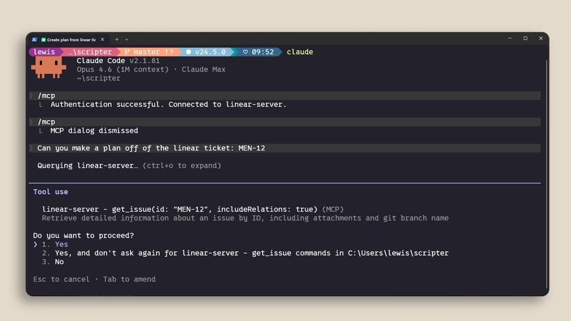

What the screenshot shows:

| Part of the screen | What it shows |
|--------------------|----------------|
| **Connection** | `/mcp` → *"Authentication successful. Connected to linear-server."*, then *"MCP dialog dismissed"* |
| **Prompt** | *"Can you make a plan off of the linear ticket: MEN-12"* |
| **Status** | `Querying linear-server…` |
| **Tool use** | `linear-server - get_issue(id: "MEN-12", includeRelations: true) (MCP)`, described as retrieving detailed information about an issue by ID, including attachments and git branch name |
| **Permission prompt** | *"Do you want to proceed?"* → **1. Yes** · **2. Yes, and don't ask again for `linear-server - get_issue` commands in `<project folder>`** · **3. No** |

#### 📚 Example 2: Context7 (up-to-date docs)

The user asks: *"Can you get the latest docs from shadcn ui and see if our implementation matches the newest standards?"*

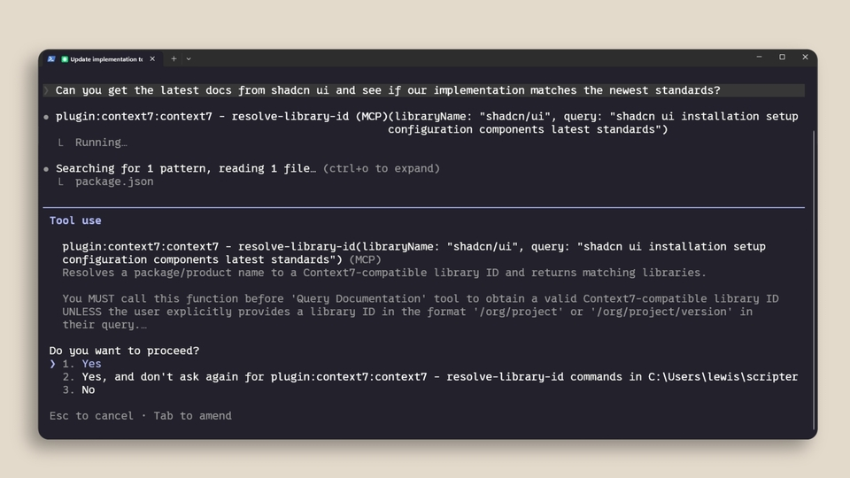

What the screenshot shows:

| Part of the screen | What it shows |
|--------------------|----------------|
| **Tool call** | `plugin:context7:context7 - resolve-library-id (MCP)` with `libraryName: "shadcn/ui"` and a query about installation, setup, configuration, components and latest standards |
| **Local work** | `Searching for 1 pattern, reading 1 file…` → `package.json`. Claude also looks at the project itself |
| **Tool description** | It **resolves a package or product name to a Context7-compatible library ID**. The text says to call it **before the "Query Documentation" tool**, unless you give a library ID |
| **Permission prompt** | The same three options: **Yes** · **Yes, and don't ask again for `resolve-library-id` commands in `<project folder>`** · **No** |

> 📌 *My reading, not stated in the lesson:*
> - **MCP tool calls use the same permission prompt** as the bash command in [Chapter 1](#chapter-1-what-is-claude-code). Claude asks before using the tool, and you can approve once or for similar calls.
> - The Context7 tool name starts with `plugin:`, so this server seems to come from a **plugin**. The lesson doesn't explain plugins.

### ➕ Adding an MCP Server

Add servers with the **`claude mcp add`** command. There are **two main types**:

| Type | What it is | Example in the lesson |
|------|-------------|------------------------|
| 🌐 **HTTP** | For **remote services**. **Hosted by the service provider** and **connect over the network** | Linear |
| 💻 **stdio** | For **local processes** that **run on your machine** | A Python script |

#### 🌐 HTTP server

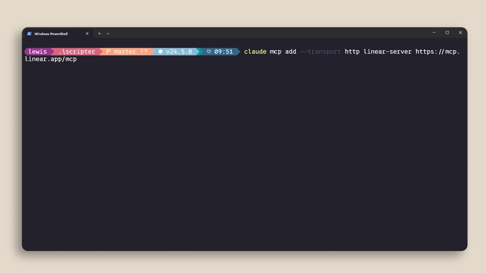

```bash
claude mcp add --transport http linear-server https://mcp.linear.app/mcp
```

| Piece | Meaning (from the screenshot) |
|-------|--------------------------------|
| `claude mcp add` | Add an MCP server |
| `--transport http` | It's a **remote HTTP** server |
| `linear-server` | The **name** you give the server |
| `https://mcp.linear.app/mcp` | The **URL** of the server |

#### 💻 stdio server

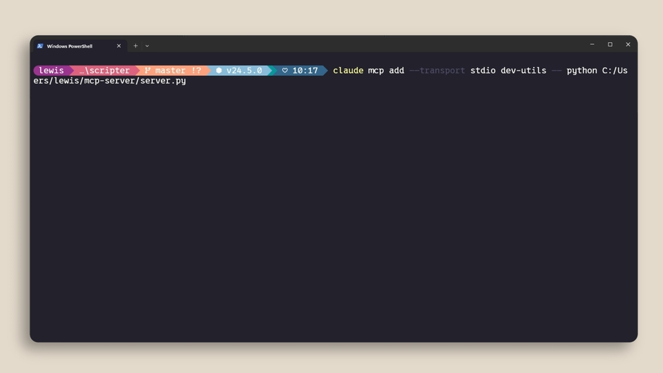

```bash
claude mcp add --transport stdio dev-utils -- python C:/Users/lewis/mcp-server/server.py
```

| Piece | Meaning (from the screenshot) |
|-------|--------------------------------|
| `--transport stdio` | It's a **local process** |
| `dev-utils` | The **name** you give the server |
| `-- python C:/Users/lewis/mcp-server/server.py` | After the `--`, the **command that starts the server**: Python running a script on the machine |

> 📌 *My reading, not stated in the lesson:* the `--` separates the options of `claude mcp add` from the command that launches the local server. The lesson doesn't explain this syntax.

### 🎛️ Managing Servers with `/mcp`

Inside a Claude Code session, **`/mcp`** lets you **see what's connected**, **check the status**, and **disable servers** you don't want to use.

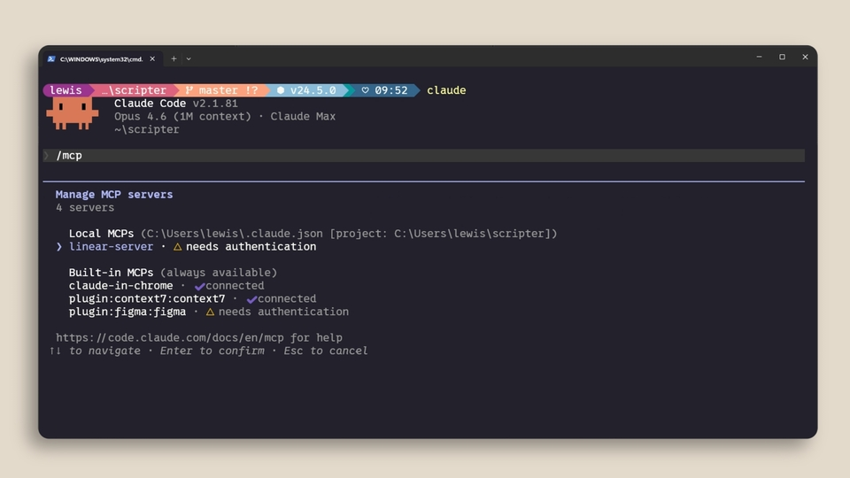

What the screenshot shows ("Manage MCP servers · 4 servers"):

| Group | Server | Status |
|-------|--------|--------|
| **Local MCPs** (listed with a config file path and the project folder) | `linear-server` | ⚠️ **needs authentication** |
| **Built-in MCPs** (*always available*) | `claude-in-chrome` | ✅ **connected** |
| **Built-in MCPs** | `plugin:context7:context7` | ✅ **connected** |
| **Built-in MCPs** | `plugin:figma:figma` | ⚠️ **needs authentication** |

Navigation shown: `↑↓` to navigate · `Enter` to confirm · `Esc` to cancel.

> 📌 *My reading, not stated in the lesson:*
> - A freshly added HTTP server like Linear shows **needs authentication** until you sign in. In the Linear example above, `/mcp` then reported *"Authentication successful. Connected to linear-server."*
> - `claude-in-chrome` is the **Claude in Chrome** extension from [Chapter 5](#chapter-5-the-explore--plan--code--commit-workflow), listed as a built-in MCP.
> - The screen points to the official help page `https://code.claude.com/docs/en/mcp`.

### 🎯 Scoping Servers

MCP servers can be **scoped in three ways**:

| Scope | Where it's available | Who gets it |
|-------|------------------------|--------------|
| 📁 **Local** | **Only in the current project** | **Just you** |
| 👤 **User** | **Across all your projects** | **Just you** |
| 👥 **Project** | Uses a **`.mcp.json`** file **checked into version control** | **Anyone working on the codebase** gets the **exact same servers automatically** |

> 🔗 The same **project = team, user = me** pattern as `CLAUDE.md` in [Chapter 8](#chapter-8-the-claudemd-file) and skills in [Chapter 10](#chapter-10-skills) (my link).
>
> 📌 *Transcript note:* the auto-generated transcript spells the file "MCP.json". The written lesson says **`.mcp.json`**, which is what I used.
>
> 📌 *Not explained in the lesson:* how to choose a scope when you run `claude mcp add`. In the screenshots, the local servers are listed with a config file path and the project folder.

### 💸 Context Costs

> ⚠️ **MCP servers add tool definitions to your context window, even when you're not using them.** With a lot of servers configured, this **eats into your available context**.

**What to do:** run **`/mcp`** to see what's connected and **disable anything you're not actively using** (or don't expect to use).

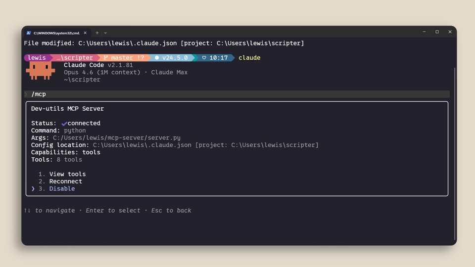

What the screenshot shows (a server detail view):

| Field | What it shows |
|-------|----------------|
| **Server** | `Dev-utils MCP Server` |
| **Status** | ✅ **connected** |
| **Command / Args** | `python` / `C:/Users/lewis/mcp-server/server.py` |
| **Config location** | `C:\Users\lewis\.claude.json [project: C:\Users\lewis\scripter]` |
| **Capabilities** | **tools** |
| **Tools** | **8 tools** |
| **Options** | **1. View tools** · **2. Reconnect** · **3. Disable** |

> 📌 *My reading, not stated in the lesson:*
> - The **8 tools** are the kind of definitions that sit in context. A server with many tools costs more than one with few.
> - The line `File modified: …\.claude.json` at the top of the screenshot suggests that adding a server writes to that file.
> - **Disable** is the action the lesson recommends for servers you aren't using.
> - Compare the **System tools** row (14.6k tokens) in the `/context` screenshot from [Chapter 1](#chapter-1-what-is-claude-code). The lesson doesn't say how many tokens MCP tools use.

#### 🔄 Lower-cost alternatives

| Alternative | Why it can cost less context |
|-------------|--------------------------------|
| 🖥️ **A CLI equivalent** (like **`gh`** for GitHub or **`aws`** for AWS) | The CLI **doesn't add persistent tool definitions** |
| 🧩 **A Skill** | A skill loads only its **name and description** into context, similar to MCP. Claude loads the **full skill** only when it decides it needs it. That's where you could put **instructions for CLI tools** |

> 🔗 Matches the Chapter 6 tip ([Context Management](#chapter-6-context-management)): **MCP servers load all their tools by default**, and **Skills don't load everything upfront**. Skills are explained in [Chapter 10](#chapter-10-skills).

#### 🔎 Tool search mode

If your **MCP tools exceed 10% of your context window**, Claude Code **automatically switches to tool search mode**. It **discovers the right tools on demand**.

> ⚠️ **Trade-off:** this **might not work as well**, since the tools **aren't in the context** up front (from the video).

### 🔁 Recap

**MCP connects Claude Code to your external tools and data sources.** **Add servers with `claude mcp add`.** **Scope them to your project with `.mcp.json`** so your team gets them automatically. And **keep an eye on context usage** by **disabling servers you're not actively using**.

> 📚 *Not in this lesson:* the course has a separate **Introduction to MCP** (see the [course index](../README.md)), so this chapter covers only how to use MCP inside Claude Code.

### 📝 Quick Reference: MCP (for exam prep)

| Concept | Key point |
|---------|-----------|
| 🔌 **MCP** | **Model Context Protocol**: an **open standard** connecting Claude Code to **external tools and data sources** |
| 🛠️ **Tools** | Let agents **perform actions**, not just return text |
| ➕ **Add a server** | **`claude mcp add`** |
| 🌐 **HTTP server** | **Remote** service, **hosted by the provider**, connects **over the network** |
| 💻 **stdio server** | **Local process** on your machine |
| 🎛️ **`/mcp`** | See **what's connected**, **status**, and **disable** servers |
| 📁 **Local scope** | **Current project, just you** |
| 👤 **User scope** | **All your projects** |
| 👥 **Project scope** | **`.mcp.json`**, checked into version control, **whole team** |
| 💸 **Context cost** | **Tool definitions load even when unused** |
| 🖥️ **CLI alternative** | `gh`, `aws`: **no persistent tool definitions** |
| 🧩 **Skill alternative** | Only **name + description** in context; full skill loads **on demand** |
| 🔎 **Tool search mode** | **Automatic** when MCP tools exceed **10%** of the context window; discovers tools **on demand**, **may be less reliable** |

> 🎓 **Memory tip:** **MCP = "plug in your tools"** and the three scopes go **L-U-P**: **L**ocal = **L**ittle (this project, just me) · **U**ser = **U**niversal (all my projects) · **P**roject = **P**ublished to the team (`.mcp.json`)

**Key features for exam:**
- **MCP** is an **open standard** for connecting Claude Code to **external tools and data sources**
- Claude **decides automatically** when to use MCP tools for your query
- Examples: **Linear** (issue details) · **Context7** (up-to-date docs)
- **`claude mcp add`**: **HTTP** = remote, hosted by the provider · **stdio** = local process
- **`/mcp`** shows what's connected, the status, and lets you **disable** servers
- **Scopes:** **Local** (current project, you) · **User** (all projects) · **Project** (`.mcp.json` in version control, **team gets the same servers**)
- **MCP servers add tool definitions to context even when unused**, so disable what you don't need
- **CLI tools** (`gh`, `aws`) are **more context-efficient** than MCP because they add **no persistent tool definitions**
- A **Skill** loads only **name + description** until needed
- MCP tools over **10% of context** → **tool search mode** (automatic, on-demand discovery, **may not work as well**)

---

## Chapter 12: Hooks

> 🎬 **Video: Hooks** — Hooks let you **run commands at specific points in Claude Code's lifecycle**. The key difference between hooks and everything else covered in this course is that **hooks are deterministic — they always run.**

### 🧠 Key Takeaways

- **Hooks are deterministic:** they **always run**. Instructions in a prompt or `CLAUDE.md` are followed *most of the time*, a hook makes it happen **every single time, no exceptions**
- **Common use cases:** auto-formatting after file edits · logging all executed commands for compliance · blocking dangerous operations (e.g. modifying production files) · sending yourself a notification when Claude finishes
- **Configured in `settings.json`:** pick an **event**, optionally set a **matcher** (which tools it applies to), and provide a **command** to run
- **Five events:** `PreToolUse` · `PostToolUse` · `UserPromptSubmit` · `Stop` · `Notification`
- **Configure with `/hooks`** inside Claude Code, or by **editing `settings.json` directly**
- **`PostToolUse`** is used for **auto-formatting and logging**. **`PreToolUse`** is used to **block dangerous operations**
- **Exit codes in `PreToolUse`:** **0** = proceed · **2** = block (stderr goes back to Claude as feedback) · **anything else** = non-blocking error shown to you
- **Share with your team:** hooks in **`.claude/settings.json`** are **project-level** and can be **checked into your repo**. Use **`CLAUDE_PROJECT_DIR`** to reference scripts in your project
- **Rule of thumb:** if something must happen **every time without fail**, **don't put it in a prompt — put it in a hook**

### ❓ Why Use Hooks

You can tell Claude in your `CLAUDE.md` to run Prettier after every file edit. **Most of the time it will. But sometimes it won't.** A hook makes it happen **every single time**.

| | 📄 **Instruction (prompt / `CLAUDE.md`)** | 🪝 **Hook** |
|---|---|---|
| **Reliability** | Followed **most of the time**, but not perfect | **Deterministic**: always runs |
| **Good for** | Guidance and preferences | Things that must be **guaranteed, not suggested** |

> 🔗 [Chapter 8](#chapter-8-the-claudemd-file) showed `CLAUDE.md` as persistent instructions, and [Chapter 10](#chapter-10-skills) showed skills that Claude **decides** to apply. Hooks are different: **nothing is left to Claude's judgment** (my link).

**Common use cases:**

| Use case | Example |
|----------|---------|
| 🎨 **Auto-formatting** | Format files after Claude edits them |
| 📋 **Compliance logging** | Log all executed commands |
| 🛑 **Blocking dangerous operations** | Stop modifications to production files |
| 🔔 **Notifications** | Get notified when Claude finishes a task |

### ⚙️ How They Work

Hooks are configured in your **`settings.json`**. You:
1. Pick an **event**
2. Optionally set a **matcher** for which tools it applies to
3. Provide a **command** to run

**The available events:**

| Event | When it runs |
|-------|---------------|
| 🔧 **`PreToolUse`** | **Before** a tool call |
| ✅ **`PostToolUse`** | **After** a tool call completes |
| ⌨️ **`UserPromptSubmit`** | When you **submit a prompt**, **before Claude processes it** |
| 🏁 **`Stop`** | When Claude **finishes responding** |
| 🔔 **`Notification`** | When Claude **sends a notification** |

**Two ways to configure them:**
- The **`/hooks`** command inside Claude Code
- Editing **`settings.json`** directly

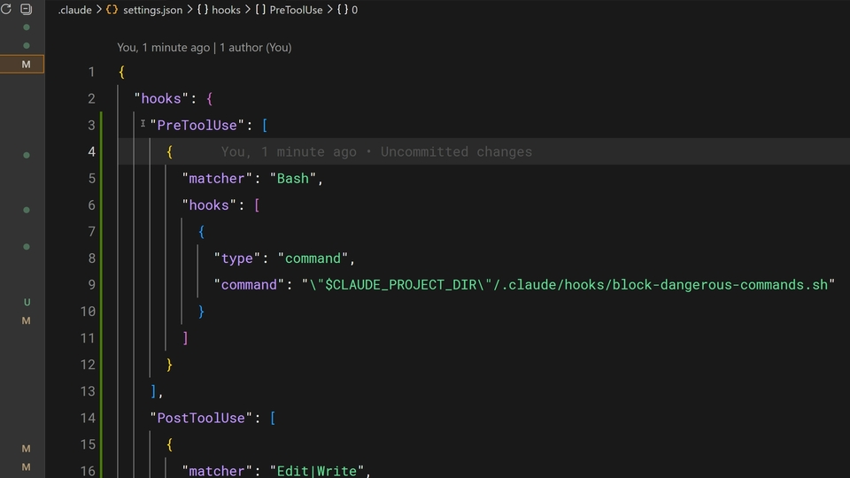

What the screenshot shows:

| Part of the screen | What it shows |
|--------------------|----------------|
| **Folder** | A **`.claude`** folder in the project (`SCRIPTER`) containing a **`hooks`** folder and **`settings.json`** |
| **Editor** | `settings.json` open, starting with a `"hooks"` key and a `"PreToolUse"` entry |

> 📌 *My reading, not stated in the lesson:* the **`hooks`** folder next to `settings.json` is probably where the hook scripts are stored (the next screenshot points a command at `.claude/hooks/…`). The `M` next to `settings.json` is VS Code's "modified" marker, meaning the change isn't committed yet.

### 🛠️ A Practical Example: Auto-Format After Edits

The most common hook is **auto-formatting after edits**:

| Piece | Value |
|-------|-------|
| **Event** | `PostToolUse` |
| **Matcher** | `"Edit\|MultiEdit\|Write"`, so it fires **whenever Claude modifies a file** |
| **Command** | Checks the **file extension** and runs the **appropriate formatter**: **Prettier** for TypeScript, **gofmt** for Go, whatever your project uses |

> 📌 *Transcript note:* the video's auto-generated transcript also mentions a formatter for Python that it spells "rough". I read that as Ruff, but the written lesson doesn't list it, so check the video.

### 🛑 Blocking with PreToolUse

`PreToolUse` hooks can **block tool calls before they execute**. Your hook **receives the tool name and input as JSON on stdin**. The **exit code** decides what happens:

| Exit code | What happens |
|-----------|---------------|
| ✅ **0** | **Proceed normally** |
| 🛑 **2** | **Block the action.** The **stderr message is fed back to Claude** as feedback, so it knows **why** it was blocked and can **adjust** |
| ⚠️ **Any other** | A **non-blocking error** that is **shown to you** but **doesn't stop anything** |

**This is how you enforce hard rules**, such as:
- Block writes to a **production config directory**
- Block bash commands that contain **`rm -rf`**
- Block **commits to `main`**
- Whatever your team needs to be **guaranteed, not suggested**

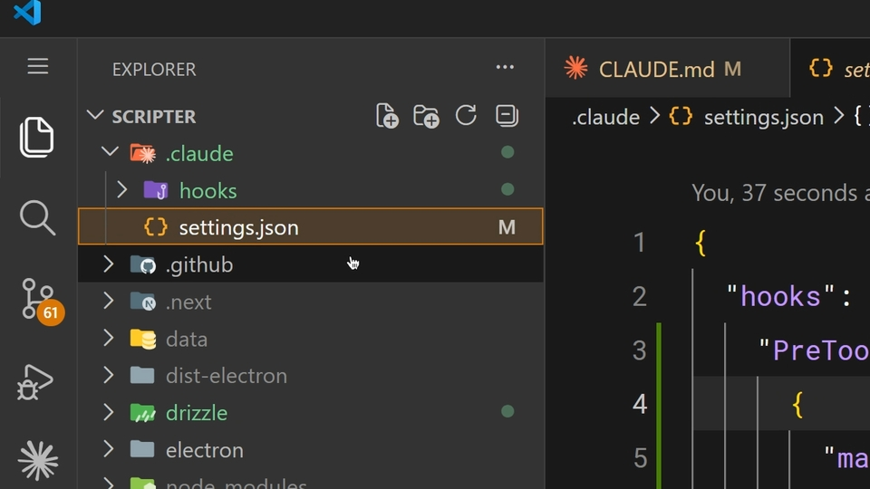

What the screenshot shows (the part of `settings.json` that is visible):

```json
{
  "hooks": {
    "PreToolUse": [
      {
        "matcher": "Bash",
        "hooks": [
          {
            "type": "command",
            "command": "\"$CLAUDE_PROJECT_DIR\"/.claude/hooks/block-dangerous-commands.sh"
          }
        ]
      }
    ]
  }
}
```

| Part | What it is |
|------|-------------|
| `"hooks"` → `"PreToolUse"` | The **event** the hook listens to |
| `"matcher": "Bash"` | The hook applies to the **Bash** tool |
| `"type": "command"` | The hook **runs a command** |
| `"command": "\"$CLAUDE_PROJECT_DIR\"/.claude/hooks/block-dangerous-commands.sh"` | A **script stored in the project**, referenced through **`CLAUDE_PROJECT_DIR`** |
| `"PostToolUse"` (below) | A second event with matcher **`"Edit\|Write"`** (the rest is cut off) |

> 📌 *My reading, not stated in the lesson:*
> - The script name suggests it checks Bash commands for dangerous patterns, like the `rm -rf` example above. The script's contents aren't shown.
> - The `Bash` matcher uses the same name as the `Bash` tool in [Chapter 2](#chapter-2-how-claude-code-works), so matchers appear to be **tool names**.
> - This screenshot's `PostToolUse` matcher is `Edit|Write`, while the lesson's example is `Edit|MultiEdit|Write`. The matcher is up to you.
> - The `M` markers in the gutter and "Uncommitted changes" show the file isn't committed yet. That is the step the next section covers.

### 👥 Sharing Hooks with Your Team

| Topic | What to know |
|-------|---------------|
| 📁 **Where** | Hooks in **`.claude/settings.json`** are **project-level** |
| 📤 **Share** | They can be **checked into your repo**, so your **entire team gets the same hooks automatically** |
| 📍 **Paths** | Use the **`CLAUDE_PROJECT_DIR`** environment variable in your commands to **reference scripts stored in your project**, so they work **regardless of Claude's current working directory** |

> 🔗 Same team pattern as the **project-level `CLAUDE.md`** in [Chapter 8](#chapter-8-the-claudemd-file), the **project skills** in [Chapter 10](#chapter-10-skills), and the **reviewer subagent config** in [Chapter 7](#chapter-7-code-review): commit it, and everyone gets it (my link).

### 🔁 Recap

Hooks give you **deterministic control** over Claude Code's behavior. Use **`PostToolUse`** for **auto-formatting and logging**. Use **`PreToolUse`** to **block dangerous operations**. Configure them with **`/hooks`** or in **`settings.json`**. And **check them into your repo** so your team gets them too.

> 💡 If something needs to happen **every time without fail**, **don't put it in a prompt. Put it in a hook.**

### 📝 Quick Reference: Hooks (for exam prep)

| Concept | Key point |
|---------|-----------|
| 🪝 **Hook** | A command that runs at a specific point in Claude Code's lifecycle |
| ⚙️ **Deterministic** | **Always runs**, unlike prompt or `CLAUDE.md` instructions |
| 📄 **Config** | **`settings.json`**: event + optional matcher + command |
| ⌨️ **Configure via** | **`/hooks`** or edit **`settings.json`** |
| 🔧 **`PreToolUse`** | Runs **before** a tool call; can **block** it |
| ✅ **`PostToolUse`** | Runs **after** a tool call; auto-formatting, logging |
| 💬 **`UserPromptSubmit`** | When you submit a prompt, **before Claude processes it** |
| 🏁 **`Stop`** | When Claude **finishes responding** |
| 🔔 **`Notification`** | When Claude **sends a notification** |
| 📥 **Hook input** | **Tool name + input as JSON on stdin** |
| ✅ **Exit 0** | Proceed |
| 🛑 **Exit 2** | **Block**; stderr is **fed back to Claude** |
| ⚠️ **Other exit code** | **Non-blocking error**, shown to you |
| 👥 **Team sharing** | **`.claude/settings.json`** is project-level, **commit it**; use **`CLAUDE_PROJECT_DIR`** for script paths |

> 🎓 **Memory tip:** **Prompt = "please" · Hook = "always"** — and for PreToolUse exit codes: **0 = go · 2 = stop · other = just a warning**

**Key features for exam:**
- Hooks are **deterministic**: they **always run**
- Use a hook (not a prompt or `CLAUDE.md`) when something must happen **every time**
- Configured in **`settings.json`** (event, optional matcher, command) or via **`/hooks`**
- **Five events:** `PreToolUse`, `PostToolUse`, `UserPromptSubmit`, `Stop`, `Notification`
- **`PostToolUse`** → auto-formatting and logging (e.g. matcher `Edit|MultiEdit|Write`)
- **`PreToolUse`** → block dangerous operations; input arrives as **JSON on stdin**
- **Exit 0** = proceed · **Exit 2** = block, and **stderr goes back to Claude** so it can adjust · **other** = non-blocking error shown to you
- Hooks in **`.claude/settings.json`** are **project-level**, can be **checked into the repo**, and give the **whole team** the same hooks
- Use **`CLAUDE_PROJECT_DIR`** to reference project scripts regardless of the **current working directory**

---
<!-- Add new chapters below this line -->
