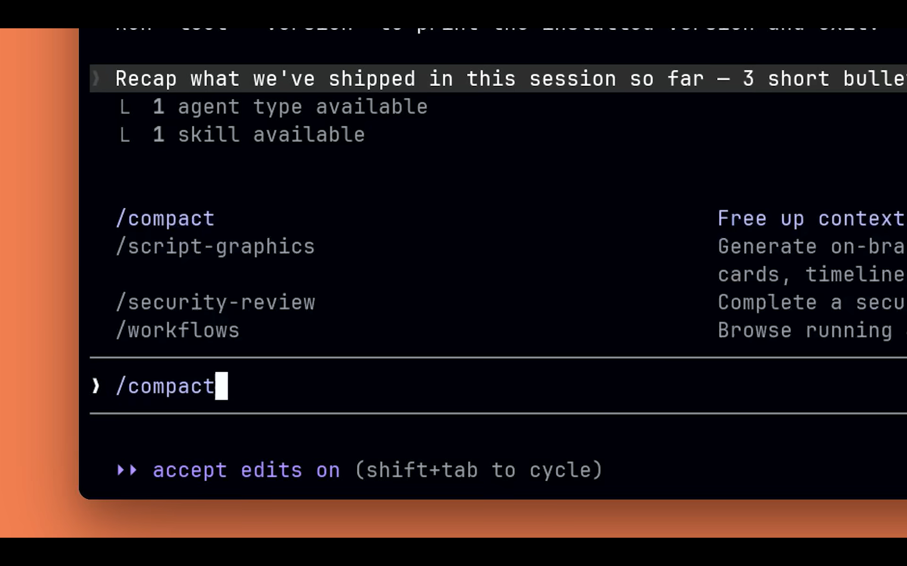
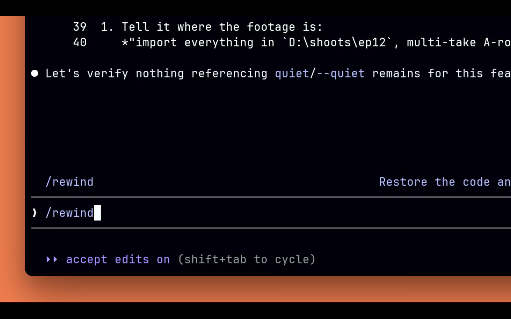
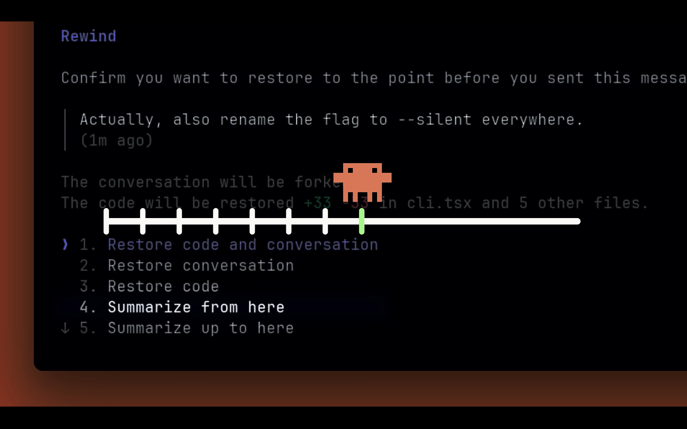
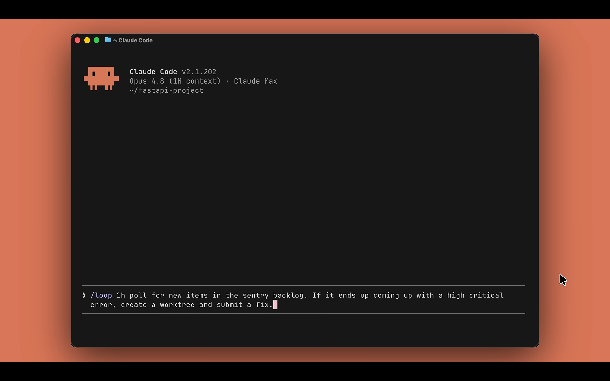
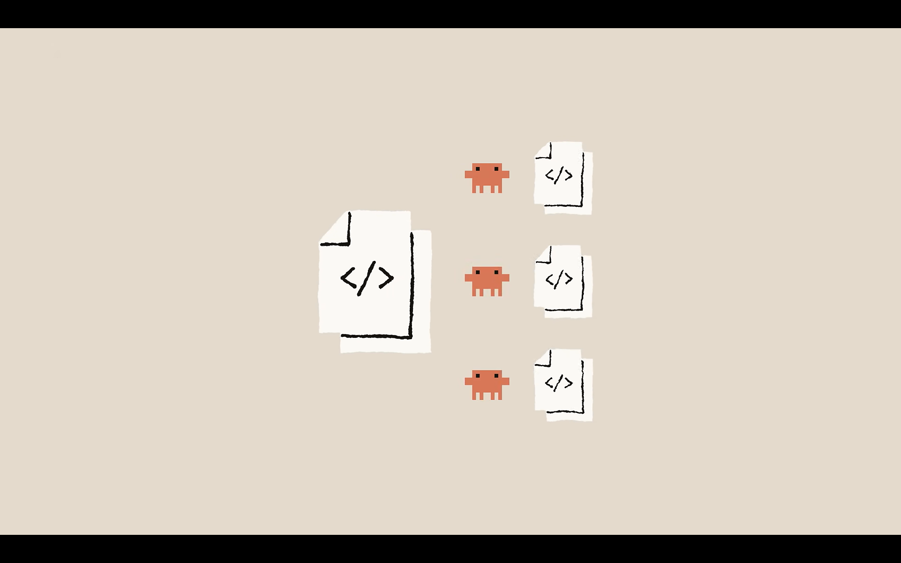
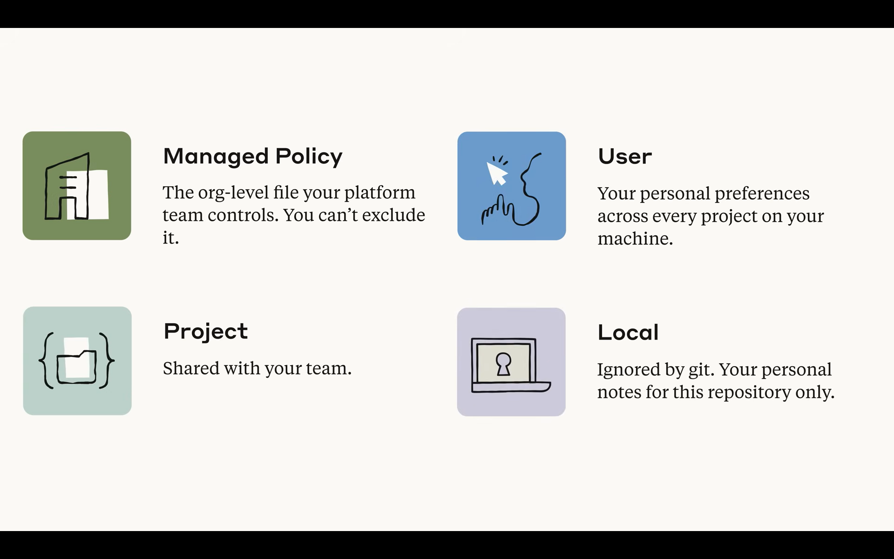
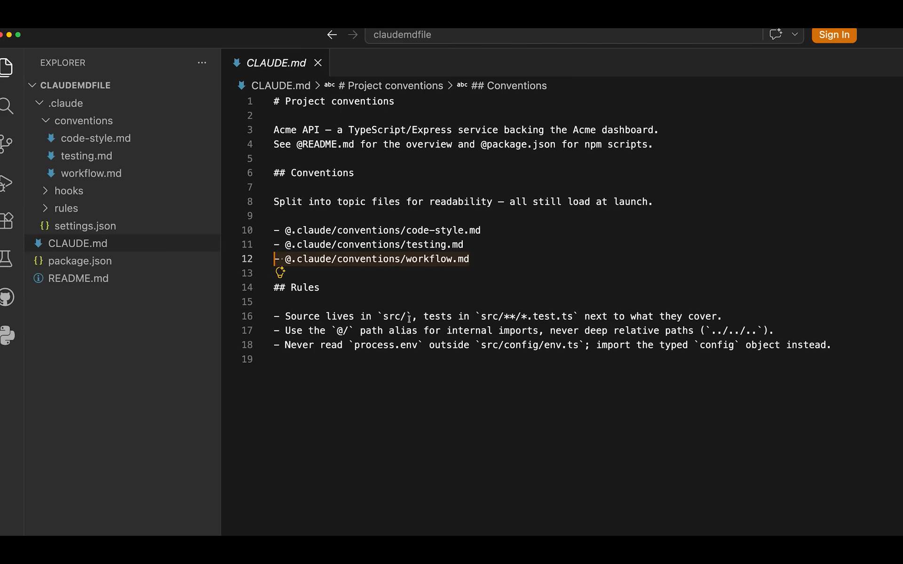
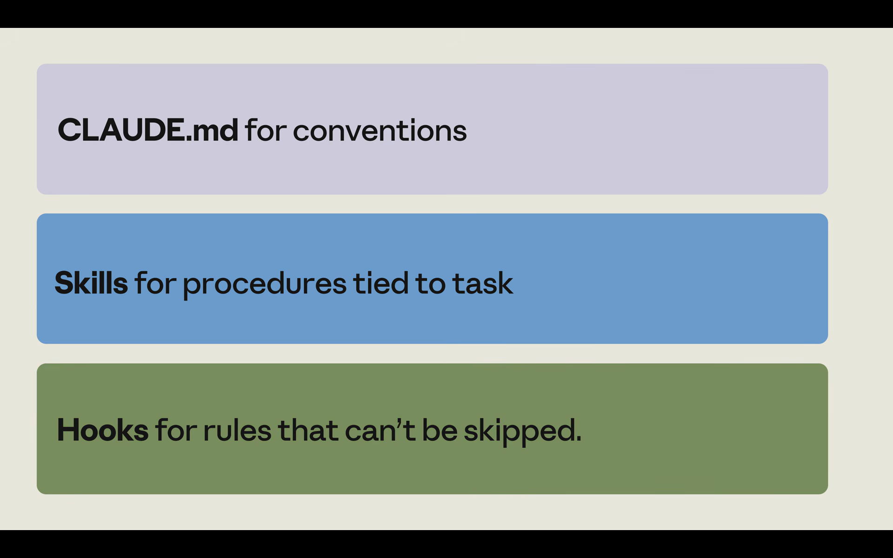

[⬅ Back to course index](../README.md)

# 📚 Claude Code in Action — Course Notes

> Builds on [Claude Code 101](../claude-code-101/README.md). That course covered what Claude Code is, how the agentic loop works, permission modes, context management, and customization (CLAUDE.md, subagents, skills, MCP, hooks). **Claude Code in Action** is the hands-on follow-up: steering long sessions, configuring Claude, automating repeat work, and verifying unsupervised runs.

### 🗺️ Course Map

| Unit | Chapters | Status |
|------|----------|:------:|
| 🗂️ **Steer the Work** | [Ch 1: Steering Long Sessions](#chapter-1-steering-long-sessions) | ✅ |
| 🗂️ **Configure Claude** | [Ch 2: A CLAUDE.md That Follows](#chapter-2-a-claudemd-that-follows) · [Ch 3: Verification Skills](#chapter-3-verification-skills) · Ch 4: Permission Modes · Ch 5: Hooks | 🚧 |
| 🗂️ **Automate Repeat Work** | Ch 6: Routines and Headless · Ch 7: GitHub Actions and Code Review | 🔲 |
| 🗂️ **Verify and Share** | Ch 8: Trust It — Verifying Unsupervised Runs · Ch 9: Plugins | 🔲 |
| 🗂️ **Quiz** | Course quiz | 🔲 |

> **Annotation guide for these notes:** 📌 = my own reading from screenshots/context — **not stated in the lesson text itself**. 🔗 = my cross-reference between chapters — **my mapping, not the lesson's wording**. For exam prep, focus on the **📝 Quick Reference** tables and **Key features for exam** bullet lists at the end of each chapter.

---

> 🗂️ **Unit 1: Steer the Work** · Chapter 1

## Chapter 1: Steering Long Sessions

> 🎬 **Video: Steering Claude Code Through Hours-Long Sessions — Plan Mode, Compact, Rewind, Goals.** Short tasks are easy: you ask, Claude works, you check the result. **Long tasks** (refactoring across a dozen files, building out a feature) can take hours, and the more you have to steer along the way, the longer they drag on. The fix comes down to two habits: **scope the work before Claude starts**, and **steer it while it runs**.

### 🎯 Learning Objectives

- Scope a long task up front with **plan mode** before any code is written
- Steer a running session with **compact** and **rewind**
- Hand Claude more autonomy with **goal** and **loop**
- Run parallel agents safely with **worktrees**

### 🧠 Key Takeaways

- **Two core habits:** **scope the work first, then steer** while it runs
- **Plan mode** does read-only research and hands you a plan to review *before* Claude writes anything — iterating on a plan is faster than cleaning up a bad run
- **`/compact`** summarizes the conversation into new context and deletes the old messages to free the context window — **add instructions after the command** to steer what the summary keeps
- **Rewind** rolls back to a checkpoint; **every user prompt creates a checkpoint**, and **double-tapping Esc on an empty prompt** opens the menu
- **`/goal`** sets a completion condition and keeps working across turns until a **fast evaluator** confirms it — the evaluator **only reads the transcript**, so the condition must be checkable from Claude's output
- **`/loop`** runs a prompt on an interval between turns to react to external state (a CI run, a deploy)
- **Worktrees** give each parallel agent its **own independent file tree** so sessions can't clobber each other

### 🧭 The Two Habits

| Habit | When | Tools |
|-------|------|-------|
| 1️⃣ **Scope the work first** | **Before** Claude writes any code | **Plan mode** |
| 2️⃣ **Steer while it runs** | **During** the session | Compact · Rewind (hands-on) · Goal · Loop (more autonomous) |

---

### 📋 Scope First: Plan Mode

Before Claude writes a single line, get it to lay out a plan. In **plan mode**, Claude does its research in **read-only mode** — it reads the code, figures out what needs to change, and hands you a plan to review.

- **Actually read the plan — don't skim it.** The more thorough the plan, the fewer surprises once Claude executes.
- If something's off or missing, **ask Claude to add it where you want.**
- **Iterating on a plan is much faster** than letting Claude run and hoping for the best, then cleaning up the mess.

> 🔗 Plan mode was introduced in [Claude Code 101, Chapter 4](../claude-code-101/README.md): it uses **read-only tools** to analyze the codebase, asks clarifying questions, and returns a detailed plan. This chapter frames it as the **scoping step** for long sessions.

---

### 🎚️ Steer While It Runs

Once Claude is running, you have a few ways to keep it pointed in the right direction.

#### 🗜️ Compact

**Compact summarizes your conversation, uses that summary as the new context, and deletes the old messages.** This frees up the context window so Claude can keep going.

- ⚠️ **The risk:** something important gets dropped in the summary and Claude drifts off course.
- ✅ **So don't just run `/compact` on its own — add instructions after the command** to tell Claude how to summarize. Anything you write after the command shapes what the summary keeps. **That's your steering wheel for context.**

Example — you finished debugging a while back and now only care about some API changes:

```text
/compact Focus on the --version flag implementation
```



> 🔗 **Compaction also happens automatically** when the context window fills up ([Claude Code 101, Chapters 2 & 6](../claude-code-101/README.md)). `/compact` is the **manual, steerable** version — the instructions you append are what this chapter adds.
>
> 📌 *From the screenshot:* the command palette lists `/compact` with the description **"Free up context"**, alongside project-specific commands (`/script-graphics`, `/security-review`, `/workflows`) — these extra ones are custom slash commands in that demo project, not built-ins (my reading).

#### ⏪ Rewind

When Claude heads down the wrong path, you don't have to prompt your way back out. **Rewind takes you to your last checkpoint.**

- **Every user prompt creates a checkpoint** you can revert to.
- **To open the menu: double-tap Esc on an empty prompt** (or run `/rewind`).



From the rewind menu you get a few options:

| Option | What it does | When to use |
|--------|--------------|-------------|
| **Restore code and conversation** | Roll back **both** together | Full undo to the checkpoint |
| **Restore conversation** | Roll back **just the chat** | Keep the files, redo the discussion |
| **Restore code** | Roll back **just the files** | Keep the chat, undo the edits |
| **Summarize from here** | Summarizes everything **after** the checkpoint | Had a side conversation and just want to free up space |
| **Summarize up to here** | Summarizes everything **before** the checkpoint | Long **setup phase** you want to compress while keeping the implementation parts intact |



> 📌 *From the screenshot:* the menu confirms restoring "to the point before you sent this message," notes "the conversation will be forked," and previews the code change (e.g. "+33 … in cli.tsx and 5 other files") — so rewind **forks** rather than destroying history, and shows the diff before you confirm (my reading).

#### 🧭 Hands-on vs. autonomous

| Steering tool | Style | What it gives you |
|---------------|-------|-------------------|
| 🗜️ **Compact** | Hands-on | Free context, keep the right summary |
| ⏪ **Rewind** | Hands-on | Course-correct to a checkpoint |
| 🎯 **Goal** | Autonomous | Work until a "done" condition is met |
| 🔁 **Loop** | Autonomous | React to external state on an interval |

---

### 🤖 Let Claude Run More Autonomously

Everything above assumes you're hands-on, watching and correcting. For something more autonomous, there's **goal** and **loop**.

#### 🎯 Goal

**Goal sets a completion condition.** You describe what "done" looks like, and Claude **keeps working across turns until a fast evaluator confirms those conditions are met.** It won't just stop the first time it thinks it's finished.

```text
/goal all tests in src/billing pass, and the type checker reports zero errors
```

- To cancel it: **`/goal clear`**
- ⚠️ **One important constraint:** the **evaluator only reads the transcript.** So your condition has to be **checkable from the output Claude actually produces**, like the results of a test run.


> 📌 *From the screenshot:* setting the goal prints a **"Goal set: …"** confirmation echoing the condition, then the session shows **"Orchestrating…"** with a **`/goal active`** status indicator in the corner — that's how an active goal is displayed (my reading).

#### 🔁 Loop

**Loop runs a prompt on an interval between turns** — either fixed or self-paced. Use it to **pull something external** (a CI run, a deploy) and **act when the state changes.**

- To stop a loop: **press Esc.**



> 📌 *From the screenshot:* the loop prompt combines an interval (`1h`), an external poll (the Sentry backlog), and a conditional action (create a worktree and submit a fix) — tying loop together with worktrees (my reading).

| | 🎯 **Goal** | 🔁 **Loop** |
|---|---|---|
| **What it is** | A **completion condition** | A prompt run **on an interval** between turns |
| **Stops when** | A fast evaluator confirms "done" (reads the **transcript**) | You **press Esc** |
| **Cancel** | `/goal clear` | `Esc` |
| **Best for** | "I can describe *done* better than the steps" (e.g. tests pass, zero type errors) | Reacting to **external state** that changes over time (CI, deploy) |

---

### 🌳 Run Parallel Work with Worktrees

The steering metaphor so far assumes **one steering wheel in one car**. But when you run **multiple agents on the same codebase**, you don't want two steering wheels in one car — that's unsafe. **Two Claude sessions fighting over the same files leads to conflicts.**

That's where **worktrees** come in. Instead of sessions stepping on each other, **each one gets its own independent file tree.**



| Fact | Detail |
|------|--------|
| 🌳 **Isolation** | Each agent has its **own file tree**, so they **can't clobber each other's changes** |
| 🧹 **Cleanup** | When a session exits, a **clean** worktree is **automatically removed** |
| 📄 **`.worktreeinclude`** | A file at the **repo root** listing **git-ignored files to copy into each worktree** — e.g. an env var file or local config you need in every worktree but don't want to commit |

> 🔗 Confirmed against the live [Claude Code worktrees docs](https://code.claude.com/docs/en/worktrees): a worktree is a separate working directory with its own files and branch that shares the same repo history and remote. *(Content was rephrased for compliance with licensing restrictions.)*

---

### 🔁 Recap

Handling long Claude Code sessions comes down to a handful of habits:

1. **Scope your work first, then steer.**
2. **Direct your compaction** so the summary keeps what matters.
3. **Use the rewind menu** to course-correct when Claude drifts.
4. **Set a goal** when you can describe "done" better than you can describe the steps.
5. **Run parallel work in worktrees.**

Do that, and you can trust a long run without babysitting every step.

### 📝 Quick Reference: Steering Long Sessions (for exam prep)

| Tool | What it does | Key detail |
|------|--------------|-----------|
| 📋 **Plan mode** | Read-only research → a plan to review **before** coding | Iterate on the plan; it's faster than cleaning up a bad run |
| 🗜️ **`/compact`** | Summarizes the chat, uses it as new context, **deletes old messages** | **Add instructions after the command** to steer the summary; risk = dropping something important |
| ⏪ **Rewind** | Rolls back to a checkpoint | **Every user prompt = a checkpoint**; open with **Esc Esc** on an empty prompt (or `/rewind`) |
| ⏪ **Rewind options** | Restore code+conversation / conversation / code · Summarize **from here** / **up to here** | "From here" = after the checkpoint; "up to here" = before it |
| 🎯 **`/goal`** | Works across turns until a **fast evaluator** confirms "done" | Evaluator reads **only the transcript** → condition must be checkable from output; cancel with **`/goal clear`** |
| 🔁 **`/loop`** | Runs a prompt **on an interval** between turns | React to **external state** (CI, deploy); stop with **Esc** |
| 🌳 **Worktrees** | **Separate file tree per agent** for parallel work | Clean worktrees **auto-removed** on exit; **`.worktreeinclude`** copies git-ignored files into each |

> 🎓 **Memory tip:** **Scope, then steer.** Steering tools = **C-R-G-L-W**: **C**ompact · **R**ewind · **G**oal · **L**oop · **W**orktrees. (First two are hands-on, next two are autonomous, last is for parallel runs.)

**Key features for exam:**
- **Two habits:** scope the work first (plan mode), then steer while it runs.
- **`/compact`** = summarize + replace context + delete old messages; **always append instructions** to steer what's kept.
- **Every user prompt creates a checkpoint**; rewind opens via **double-Esc on an empty prompt**.
- Rewind's **five** options: restore code+conversation, restore conversation, restore code, **summarize from here** (after checkpoint), **summarize up to here** (before checkpoint).
- **`/goal`** keeps working until a **fast evaluator** (which reads **only the transcript**) confirms the condition; cancel with **`/goal clear`**.
- **`/loop`** runs on an interval to react to **external** state; stop with **Esc**.
- **Worktrees** give each agent its **own file tree** (no conflicts); clean ones are **auto-removed**; **`.worktreeinclude`** lists git-ignored files to copy in.

---

> 🗂️ **Unit 2: Configure Claude** · Chapter 2

## Chapter 2: A CLAUDE.md That Follows

> 🎬 **Video: A CLAUDE.md That Follows.** The trap that catches almost everyone: your CLAUDE.md keeps growing — you hit a problem, you add a rule; you hit another, you add another. Before long it's one giant file and **Claude starts ignoring parts of it.** That's not a bug in Claude — it's how the file works.

### 🎯 Learning Objectives

- Understand that **CLAUDE.md is guidance, not enforced configuration**
- Decide when a rule belongs in CLAUDE.md versus a **hook**
- Know the **four CLAUDE.md locations** and how they load
- Use **imports** to organize a long file (and what they do *not* do)
- **Phrase rules** so Claude actually follows them, and keep the file under revision

### 🧠 Key Takeaways

- **CLAUDE.md is guidance, not enforced config.** Every line competes with every other line for Claude's attention — the longer the file, the less reliably any single rule is followed. **The leaner the file, the more of it Claude follows.**
- **Hard rules belong in hooks, not CLAUDE.md.** A hook is code that runs *before* an action and can **block** it — real enforcement, not a polite request.
- **Four locations** load together at launch and **stack** (nothing gets dropped): **managed policy · user · project · local**
- **Imports** (`@path/to/file`) help you **organize** a long file, but Claude **expands them inline** at launch — they do **not** reduce the context it has to read
- **Phrasing makes rules stick:** be **specific and checkable**, **name the replacement** (don't just ban), and treat **emphasis as a budget**
- **Keep the file under revision** — treat a wrong action as a **bug report** against CLAUDE.md

---

### ⚖️ CLAUDE.md Is Guidance, Not Enforcement

| | 📋 **CLAUDE.md** | 🪝 **Hook** |
|---|---|---|
| **What it is** | **Guidance** Claude reads | **Code that runs before an action** |
| **Can it block an action?** | ❌ No — it's a request Claude usually honors | ✅ Yes — it can actually **stop** the action |
| **Reliability** | "Most of the time" | **Real enforcement** |
| **Use for** | Softer **conventions** | **Hard rules** that must never be crossed |

- Every line **competes** with every other line for attention. The longer the file, the more it competes **with itself**.
- So the goal isn't to write down everything — **keep the file tight.** The leaner it is, the more of it Claude actually follows.

#### Example: "never push to main"

> A rule like **"never push to `main`"** in CLAUDE.md is just *hoping* Claude reads and respects it. "Most of the time" isn't good enough for something that dangerous — it belongs in a **pre-tool-use hook** that **blocks** the push even if Claude tries it.

> 🔗 Hooks were introduced in [Claude Code 101, Chapter 12](../claude-code-101/README.md). This chapter adds the decision rule: **hard line → hook; soft convention → CLAUDE.md.**

---

### 📍 The Four Locations

CLAUDE.md isn't just one file in your project. There are **four places** it can live, and **Claude loads all of them together at launch**. **Nothing gets dropped, and they stack.**



| Location | Who controls it | Scope | Notes |
|----------|-----------------|-------|-------|
| 🏢 **Managed policy** | Your **platform/org team** | Org-wide | **You can't exclude it** — org policy is always in play |
| 👤 **User** | You | **Every project on your machine** | Personal preferences that follow you everywhere |
| 📁 **Project** | Your team | This repo, **shared** | Checked into the repo |
| 💻 **Local** | You | **This repo only** | **Ignored by git** — personal notes just for you |

> 💡 **Local is easy to overlook but handy.** Refactoring on your own branch and want Claude to hold some architectural decisions in mind? That doesn't belong in the shared **project** file (it'd affect the whole team) — put it in **local**, where it's just yours for this repo.

---

### 🧩 Split a Big File with Imports

When your project file gets long, break it into pieces with the **path-to-file import syntax** — instead of one wall of text, point to other files:

```text
@.claude/conventions/code-style.md
@.claude/conventions/testing.md
@.claude/conventions/workflow.md
```



⚠️ **Know exactly what imports buy you — it's easy to get the wrong idea:**

| Imports **do** | Imports **do NOT** |
|----------------|--------------------|
| Help you **organize** / keep things tidy | **Reduce** the context Claude has to read |
| Split one file into topic files | Shrink the load |

- When Claude launches, it **expands imported files inline**, right where you referenced them. **Everything still loads up front.**
- **Use imports to organize, not to shrink the load.**

> 📌 *From the screenshot:* the file itself says *"Split into topic files for readability — all still load at launch,"* and its Rules are already written in the specific/checkable style this lesson recommends (e.g. source in `src/`, tests in `src/**/*.test.ts`; use the `@/` path alias, never deep relative paths; never read `process.env` outside `src/config/env.ts`). The explorer also shows sibling `hooks/` and `rules/` folders (my reading — the lesson doesn't walk through this file).

---

### ✍️ Phrasing Is What Makes Rules Stick

Once you've decided a rule belongs in CLAUDE.md, whether Claude obeys it comes down to **how you phrase it**. Most rules fail because they're **vague**.

#### 1️⃣ Be specific and checkable

If you can't check whether it was followed, neither can Claude.

| ❌ Vague | ✅ Specific & checkable |
|----------|------------------------|
| "Follow best practices for API routes." | "Put new API routes in `src/api/handlers`, one per file." |

The specific one is explicit — you can look at the result and **immediately tell if it was done right.** That's the bar every rule should clear.

#### 2️⃣ Name the replacement, don't just ban something

When you tell Claude not to do something, **say what to do instead** — otherwise you've left the door open.

| ❌ Leaves it open | ✅ Closes it |
|-------------------|-------------|
| "Don't use default exports." (then what?) | "Use **named exports, not default exports**." |

#### 3️⃣ Emphasis is a budget

Words like **"IMPORTANT"** and **"YOU MUST"** do raise a rule's priority — **but only relative to everything quieter around it.** If every rule shouts, nothing stands out and the emphasis means nothing.

- **Treat emphasis like a budget.** Spend it on the **two or three rules** that really hurt when broken; let the rest sit at normal volume.

---

### 🔄 Keep the File Under Revision

Your CLAUDE.md is **never finished** — treat it like **living code** that keeps getting edited.

- When Claude does the wrong thing, **don't just sigh and fix it by hand.** Treat it as a **bug report** against your CLAUDE.md.
- You can tell Claude directly: **"add that to the CLAUDE.md file,"** and it'll write the rule for you.
- That way the file gets **better every time something goes wrong.**

---

### 🔁 Recap (The Bottom Line)

Treat your CLAUDE.md like **production code**: **if you can't justify a line, delete it.** To keep it lean and followable:

1. **Move hard rules to hooks**, where they're actually enforced.
2. **Organize long files with imports** (just remember they don't reduce context).
3. **Make every rule specific and checkable, and name the replacement.**
4. **Spend your emphasis budget** on the few rules that matter most.
5. **Keep revising** the file whenever Claude gets something wrong.

> The whole idea is simple: **the leaner the file, the more of it Claude follows.**

### 📝 Quick Reference: A CLAUDE.md That Follows (for exam prep)

| Concept | Key point |
|---------|-----------|
| 📋 **Nature** | **Guidance, not enforced config** — every line competes for attention; leaner = more followed |
| 🪝 **Hard rules → hooks** | A **pre-tool-use hook** runs before an action and can **block** it; CLAUDE.md can't |
| 📍 **Four locations** | **Managed policy** (org, can't exclude) · **User** (your machine) · **Project** (team/repo) · **Local** (git-ignored, this repo only) — all load together and **stack** |
| 🧩 **Imports** | `@path/to/file` **organizes**; expanded **inline** at launch — **does NOT reduce context** |
| 🎯 **Specific & checkable** | "Put new API routes in `src/api/handlers`, one per file" > "follow best practices" |
| 🔁 **Name the replacement** | "Use named exports, not default exports" > "Don't use default exports" |
| 📢 **Emphasis is a budget** | `IMPORTANT`/`YOU MUST` only work if **rare**; spend on 2–3 rules max |
| 🔄 **Living document** | Treat wrong actions as **bug reports**; tell Claude "add that to CLAUDE.md" |

> 🎓 **Memory tip:** **MUPL** = **M**anaged policy · **U**ser · **P**roject · **L**ocal (broad → narrow, all stack). And: **hard line → Hook, soft convention → CLAUDE.md.**

**Key features for exam:**
- CLAUDE.md is **guidance, not enforcement** — the **leaner the file, the more of it Claude follows**.
- **Hard/dangerous rules** (e.g. "never push to main") belong in a **pre-tool-use hook** that can **block** the action.
- **Four locations load together and stack; nothing is dropped.** Managed policy **can't be excluded**; local is **git-ignored** and scoped to **one repo**.
- **Imports organize but do NOT reduce context** — files are **expanded inline** at launch.
- Phrase rules **specific & checkable** and **name the replacement**; **emphasis is a budget** (spend on 2–3 rules).
- Keep CLAUDE.md **under revision** — treat mistakes as bug reports and have Claude add the rule.

---

> 🗂️ **Unit 2: Configure Claude** · Chapter 3

## Chapter 3: Verification Skills

> 🎬 **Video: Verification Skills.** As your project grows, you notice the same work happening over and over. Skills are a good way to automate repeated work — this lesson looks at one job skills are great for: **verifying your own work.** **If there's one skill worth building first, this is it.**

### 🎯 Learning Objectives

- Understand why a **verification skill** is the first skill to build
- See the **shape** of a verification skill and why "done" means **gates run and observed**
- Use a skill **folder** (reference files + scripts) to keep `skill.md` lean
- Pick the right **instruction surface**: CLAUDE.md vs skills vs hooks

### 🧠 Key Takeaways

- **Build a verification skill first.** It removes the dependency on *you remembering* to check Claude's work — the skill fires on its own when the change matches its description
- **"Done" ≠ "the code looks right."** Done = **the gates are run and observed, with results stated explicitly** — including a check that **no test was weakened** just to pass
- A skill is a **folder**, not just a file: drop a **`reference.md`** for depth (read only when needed) and **scripts** Claude executes (not loaded into context) — keep **`skill.md` lean**
- **Only skill descriptions load into context** until a skill is actually needed, so there's **no cost** to packaging every repeated procedure
- **Three instruction surfaces:** **CLAUDE.md** = always-on conventions · **Skills** = procedures/reference tied to a task · **Hooks** = rules that **must not be skippable**
- **Rule of thumb:** if you've typed the **same multi-step instruction twice**, that's a skill
- Check the skill into **`.claude/skills`** so the **whole team inherits** the same move

---

### 🥇 Why a Verification Skill Is the One to Build First

Think about how you normally check Claude's work: it refactors something, finishes, and then **you have to remember** to double-check — run the tests, read the diff. **The checking depends on you remembering to ask.** Skip it once and bad code slips through.

**A verification skill removes that dependency.** The change matches the skill's description, so **the skill fires on its own** and walks the same steps every time:

| Step | What the skill does |
|------|---------------------|
| 1️⃣ | **Runs the test suite** |
| 2️⃣ | **Reads the diff** |
| 3️⃣ | **Checks that no test was weakened** just to make things pass |
| 4️⃣ | **Reports pass or fail**, with the **evidence attached** |

- The **description** on the skill is what **triggers** it; once triggered it runs the whole flow **without you asking**.


> 🧪 **The key check is the last one before reporting.** It's not enough to run the tests and see green — **a test can be quietly loosened** so it passes no matter what. So the skill **reads the diff and confirms tests weren't weakened.**
>
> ✅ **"Done" is the gates being run and observed, with the results stated explicitly** — not "the code looks right" from reading the diff alone.

> 📌 *From the screenshot:* the report is `Skill: verify-refactor` → `Verification: PASS` with explicit evidence — *Tests: 74 passed (2 files) via `npx vitest run src/timeline`*, *Diff reviewed: yes*, *Tests weakened: no* — exactly the "evidence attached" the lesson describes (my reading).

#### 🔁 The same shape fits any repeated procedure

A release checklist · a migration recipe · a pre-PR check.

> 📏 **Rule of thumb:** if you've typed the **same multi-step instruction twice**, that's a skill.

---

### 📁 A Skill Folder Can Hold More Than Instructions

A skill isn't just a single `skill.md`. The **folder around it** can carry other things — and that's what makes skills powerful for verification.

| What you add | How Claude uses it | Why it helps |
|--------------|--------------------|--------------|
| 📄 **`reference.md`** (linked from `skill.md`) | Read **only when it actually needs that depth** | Main file stays short |
| 📜 **Scripts** (e.g. `check.sh`) | **Executes** them — doesn't load their contents into context | The skill carries its **own tooling** (e.g. runs all the gates) |

> 💡 **The takeaway:** keep **`skill.md` itself lean.** Push the heavy material — long explanations and executable scripts — into **side files.** The lean file **describes what to do**; the side files hold the **depth and the tools.**

> 🔗 This mirrors the CLAUDE.md lesson's advice to keep the main file lean and push depth into side files ([Chapter 2](#chapter-2-a-claudemd-that-follows)) — but note the difference: CLAUDE.md **imports expand inline** (they don't save context), whereas a skill's **reference files load only on demand** and **scripts are executed, not loaded** (my mapping).

---

### 🧭 Which Instruction Surface Owns Which Rule

By now you have **three places** to put instructions — here's how to keep them straight.



| Surface | Owns… | Because… |
|---------|-------|----------|
| 📋 **CLAUDE.md** | Conventions that apply **all the time** (naming rules, where files go) | Always-on guidance |
| 🧰 **Skills** | **Procedures and reference** tied to a **particular kind of task** | Loaded when the task comes up |
| 🪝 **Hooks** | A rule Claude **must not be able to skip** | CLAUDE.md and skills are **instructions Claude follows**; a **hook is code that actually runs** |

> ⚠️ **If skipping the rule isn't acceptable, don't leave it up to instruction-following** — put it in a hook.

> 🔗 This extends the Chapter 2 split (CLAUDE.md vs hooks) by adding **skills** as the middle surface for task-scoped procedures (my mapping).

---

### 🔁 Recap

A skill is a **folder with a `skill.md`** inside it: a **name**, a **description that triggers it**, and the **procedure** itself. **Only the descriptions load into context** until a skill is actually needed — so there's **no cost** to packaging every procedure you repeat.

**Start with verification.** Build the skill, check it into your project's **`.claude/skills`**, and the **whole team inherits the same move** — everyone's work gets checked the same way, automatically, without anyone having to remember to ask.

> 📌 **Terminology (beyond the course — not on the exam):** the lesson writes **`skill.md`** in lowercase. The live [Agent Skills spec](https://www.anthropic.com/research/equipping-agents-for-the-real-world-with-agent-skills) requires the file to be named **`SKILL.md`** (uppercase) with YAML frontmatter containing **`name`** and **`description`**. Learn the course's wording for the exam; the uppercase filename is just how the real product discovers skills.

### 📝 Quick Reference: Verification Skills (for exam prep)

| Concept | Key point |
|---------|-----------|
| 🥇 **Build first** | A **verification skill** — removes the dependency on *you remembering* to check |
| 🔫 **Trigger** | The skill's **description** fires it automatically when the change matches |
| 🪜 **Verify flow** | Run tests → read diff → **check tests weren't weakened** → report pass/fail with **evidence** |
| ✅ **"Done"** | **Gates run and observed, results stated explicitly** — not "the code looks right" |
| 📁 **Folder** | `skill.md` + **`reference.md`** (read on demand) + **scripts** (executed, not loaded) |
| 🪶 **Keep lean** | `skill.md` describes *what to do*; side files hold **depth and tools** |
| 🧠 **Context cost** | **Only descriptions load** until a skill is needed — no cost to packaging many |
| 🧭 **Surfaces** | **CLAUDE.md** = conventions · **Skills** = task procedures · **Hooks** = can't-be-skipped rules |
| 📏 **Rule of thumb** | Typed the same multi-step instruction **twice** → make it a skill |
| 👥 **Share** | Commit to **`.claude/skills`** so the whole team inherits it |

> 🎓 **Memory tip:** **C-S-H** = **C**LAUDE.md (conventions, always) · **S**kills (task procedures, on demand) · **H**ooks (can't-be-skipped, actually runs). And verification's motto: **"run the gates, read the diff, prove tests weren't weakened."**

**Key features for exam:**
- The **first skill to build is a verification skill** — it fires on its own so checking doesn't depend on you remembering.
- Verify flow: **run tests → read diff → confirm no test was weakened → report pass/fail with evidence.**
- **"Done" = gates run and observed with explicit results**, not the diff merely looking right.
- A skill is a **folder**: `reference.md` is read **only when needed**; **scripts are executed, not loaded into context**; keep `skill.md` lean.
- **Only skill descriptions load** into context until needed → no cost to packaging every repeated procedure.
- Three surfaces: **CLAUDE.md = conventions · Skills = task procedures · Hooks = rules that can't be skipped.**
- Commit the skill to **`.claude/skills`** so the **whole team** inherits it.
