[⬅ Back to course index](../README.md)

# 📚 Claude Code in Action — Course Notes

> Builds on [Claude Code 101](../claude-code-101/README.md). That course covered what Claude Code is, how the agentic loop works, permission modes, context management, and customization (CLAUDE.md, subagents, skills, MCP, hooks). **Claude Code in Action** is the hands-on follow-up: steering long sessions, configuring Claude, automating repeat work, and verifying unsupervised runs.

### 🗺️ Course Map

| Unit | Chapters | Status |
|------|----------|:------:|
| 🗂️ **Steer the Work** | [Ch 1: Steering Long Sessions](#chapter-1-steering-long-sessions) | ✅ |
| 🗂️ **Configure Claude** | [Ch 2: A CLAUDE.md That Follows](#chapter-2-a-claudemd-that-follows) · [Ch 3: Verification Skills](#chapter-3-verification-skills) · [Ch 4: Permission Modes](#chapter-4-permission-modes) · [Ch 5: Hooks](#chapter-5-hooks) | ✅ |
| 🗂️ **Automate Repeat Work** | [Ch 6: Routines and Headless](#chapter-6-routines-and-headless) · [Ch 7: GitHub Actions and Code Review](#chapter-7-github-actions-and-code-review) | ✅ |
| 🗂️ **Verify and Share** | [Ch 8: Trust It — Verifying Unsupervised Runs](#chapter-8-trust-it--verifying-unsupervised-runs) · [Ch 9: Plugins](#chapter-9-plugins) | ✅ |
| 🗂️ **Quiz** | Course quiz | ✅ |

> **Annotation guide for these notes:** 📌 = my own reading from screenshots/context — **not stated in the lesson text itself**. 🔗 = my cross-reference between chapters — **my mapping, not the lesson's wording**. For exam prep, focus on the **📝 Quick Reference** tables and **Key features for exam** bullet lists at the end of each chapter.

---

> 🗂️ **Unit 1: Steer the Work** · Chapter 1

## Chapter 1: Steering Long Sessions

> 🎬 **Video: Steering Claude Code Through Hours-Long Sessions — Plan Mode, Compact, Rewind, Goals.** Short tasks are easy: you ask, Claude works, you check the result. **Long tasks** (refactoring across a dozen files, building out a feature) can take hours, and the more you have to steer along the way, the longer they drag on. The fix comes down to two habits: **scope the work before Claude starts**, and **steer it while it runs**.

### 🎯 Learning Objectives

- Scope a long task up front with **plan mode** before any code is written
- Steer a running session with **compact** and **rewind**
- Hand Claude more autonomy with **goal** and **loop**
- Run parallel agents safely with **worktrees**

### 🧠 Key Takeaways

- **Two core habits:** **scope the work first, then steer** while it runs
- **Plan mode** does read-only research and hands you a plan to review *before* Claude writes anything — iterating on a plan is faster than cleaning up a bad run
- **`/compact`** summarizes the conversation into new context and deletes the old messages to free the context window — **add instructions after the command** to steer what the summary keeps
- **Rewind** rolls back to a checkpoint; **every user prompt creates a checkpoint**, and **double-tapping Esc on an empty prompt** opens the menu
- **`/goal`** sets a completion condition and keeps working across turns until a **fast evaluator** confirms it — the evaluator **only reads the transcript**, so the condition must be checkable from Claude's output
- **`/loop`** runs a prompt on an interval between turns to react to external state (a CI run, a deploy)
- **Worktrees** give each parallel agent its **own independent file tree** so sessions can't clobber each other

### 🧭 The Two Habits

| Habit | When | Tools |
|-------|------|-------|
| 1️⃣ **Scope the work first** | **Before** Claude writes any code | **Plan mode** |
| 2️⃣ **Steer while it runs** | **During** the session | Compact · Rewind (hands-on) · Goal · Loop (more autonomous) |

---

### 📋 Scope First: Plan Mode

Before Claude writes a single line, get it to lay out a plan. In **plan mode**, Claude does its research in **read-only mode** — it reads the code, figures out what needs to change, and hands you a plan to review.

- **Actually read the plan — don't skim it.** The more thorough the plan, the fewer surprises once Claude executes.
- If something's off or missing, **ask Claude to add it where you want.**
- **Iterating on a plan is much faster** than letting Claude run and hoping for the best, then cleaning up the mess.

> 🔗 Plan mode was introduced in [Claude Code 101, Chapter 4](../claude-code-101/README.md): it uses **read-only tools** to analyze the codebase, asks clarifying questions, and returns a detailed plan. This chapter frames it as the **scoping step** for long sessions.

---

### 🎚️ Steer While It Runs

Once Claude is running, you have a few ways to keep it pointed in the right direction.

#### 🗜️ Compact

**Compact summarizes your conversation, uses that summary as the new context, and deletes the old messages.** This frees up the context window so Claude can keep going.

- ⚠️ **The risk:** something important gets dropped in the summary and Claude drifts off course.
- ✅ **So don't just run `/compact` on its own — add instructions after the command** to tell Claude how to summarize. Anything you write after the command shapes what the summary keeps. **That's your steering wheel for context.**

Example — you finished debugging a while back and now only care about some API changes:

```text
/compact Focus on the --version flag implementation
```

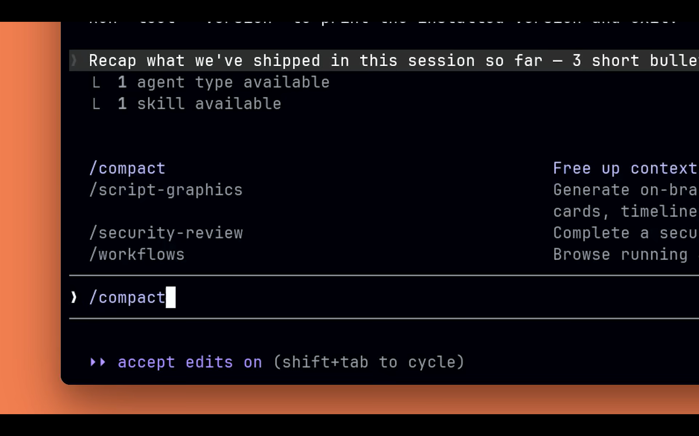

> 🔗 **Compaction also happens automatically** when the context window fills up ([Claude Code 101, Chapters 2 & 6](../claude-code-101/README.md)). `/compact` is the **manual, steerable** version — the instructions you append are what this chapter adds.
>
> 📌 *From the screenshot:* the command palette lists `/compact` with the description **"Free up context"**, alongside project-specific commands (`/script-graphics`, `/security-review`, `/workflows`) — these extra ones are custom slash commands in that demo project, not built-ins (my reading).

#### ⏪ Rewind

When Claude heads down the wrong path, you don't have to prompt your way back out. **Rewind takes you to your last checkpoint.**

- **Every user prompt creates a checkpoint** you can revert to.
- **To open the menu: double-tap Esc on an empty prompt** (or run `/rewind`).

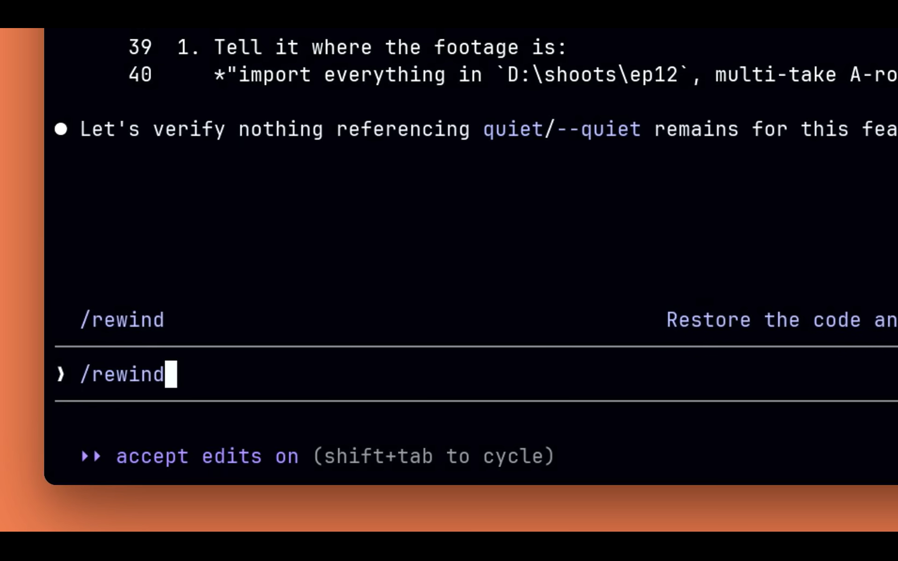

From the rewind menu you get a few options:

| Option | What it does | When to use |
|--------|--------------|-------------|
| **Restore code and conversation** | Roll back **both** together | Full undo to the checkpoint |
| **Restore conversation** | Roll back **just the chat** | Keep the files, redo the discussion |
| **Restore code** | Roll back **just the files** | Keep the chat, undo the edits |
| **Summarize from here** | Summarizes everything **after** the checkpoint | Had a side conversation and just want to free up space |
| **Summarize up to here** | Summarizes everything **before** the checkpoint | Long **setup phase** you want to compress while keeping the implementation parts intact |

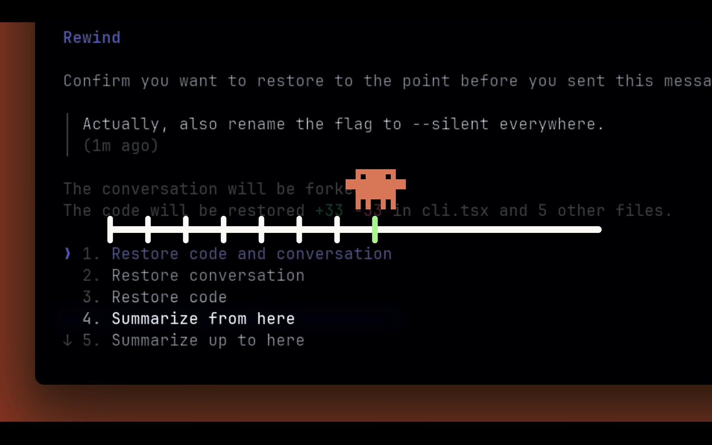

> 📌 *From the screenshot:* the menu confirms restoring "to the point before you sent this message," notes "the conversation will be forked," and previews the code change (e.g. "+33 … in cli.tsx and 5 other files") — so rewind **forks** rather than destroying history, and shows the diff before you confirm (my reading).

#### 🧭 Hands-on vs. autonomous

| Steering tool | Style | What it gives you |
|---------------|-------|-------------------|
| 🗜️ **Compact** | Hands-on | Free context, keep the right summary |
| ⏪ **Rewind** | Hands-on | Course-correct to a checkpoint |
| 🎯 **Goal** | Autonomous | Work until a "done" condition is met |
| 🔁 **Loop** | Autonomous | React to external state on an interval |

---

### 🤖 Let Claude Run More Autonomously

Everything above assumes you're hands-on, watching and correcting. For something more autonomous, there's **goal** and **loop**.

#### 🎯 Goal

**Goal sets a completion condition.** You describe what "done" looks like, and Claude **keeps working across turns until a fast evaluator confirms those conditions are met.** It won't just stop the first time it thinks it's finished.

```text
/goal all tests in src/billing pass, and the type checker reports zero errors
```

- To cancel it: **`/goal clear`**
- ⚠️ **One important constraint:** the **evaluator only reads the transcript.** So your condition has to be **checkable from the output Claude actually produces**, like the results of a test run.


> 📌 *From the screenshot:* setting the goal prints a **"Goal set: …"** confirmation echoing the condition, then the session shows **"Orchestrating…"** with a **`/goal active`** status indicator in the corner — that's how an active goal is displayed (my reading).

#### 🔁 Loop

**Loop runs a prompt on an interval between turns** — either fixed or self-paced. Use it to **pull something external** (a CI run, a deploy) and **act when the state changes.**

- To stop a loop: **press Esc.**

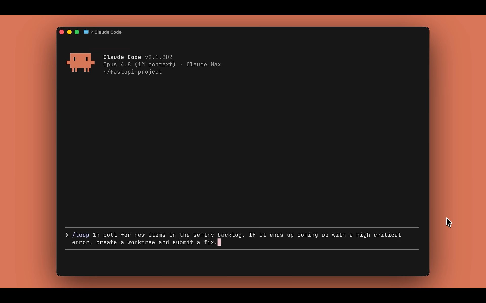

> 📌 *From the screenshot:* the loop prompt combines an interval (`1h`), an external poll (the Sentry backlog), and a conditional action (create a worktree and submit a fix) — tying loop together with worktrees (my reading).

| | 🎯 **Goal** | 🔁 **Loop** |
|---|---|---|
| **What it is** | A **completion condition** | A prompt run **on an interval** between turns |
| **Stops when** | A fast evaluator confirms "done" (reads the **transcript**) | You **press Esc** |
| **Cancel** | `/goal clear` | `Esc` |
| **Best for** | "I can describe *done* better than the steps" (e.g. tests pass, zero type errors) | Reacting to **external state** that changes over time (CI, deploy) |

---

### 🌳 Run Parallel Work with Worktrees

The steering metaphor so far assumes **one steering wheel in one car**. But when you run **multiple agents on the same codebase**, you don't want two steering wheels in one car — that's unsafe. **Two Claude sessions fighting over the same files leads to conflicts.**

That's where **worktrees** come in. Instead of sessions stepping on each other, **each one gets its own independent file tree.**

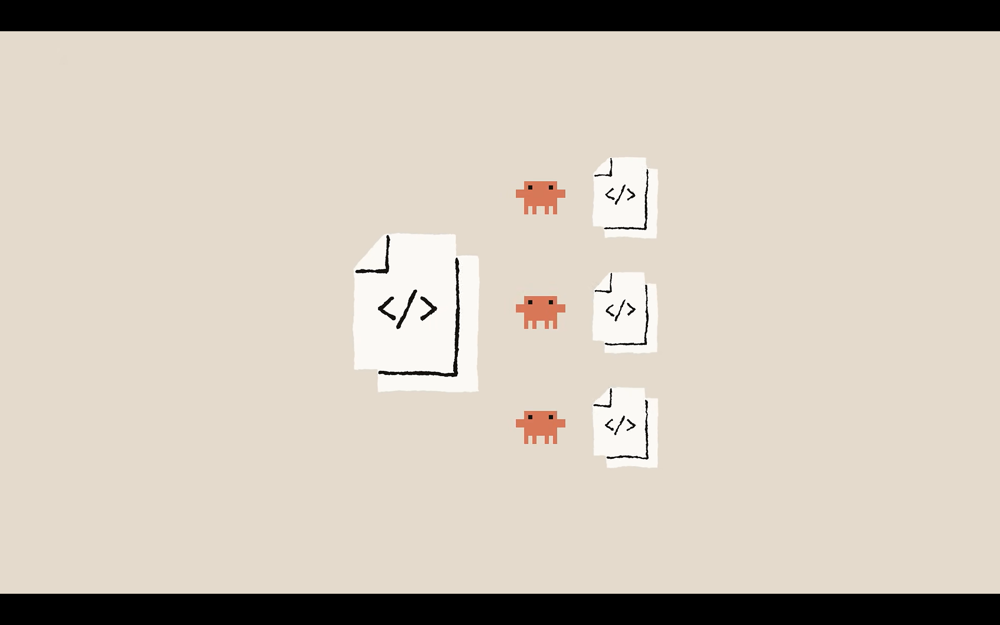

| Fact | Detail |
|------|--------|
| 🌳 **Isolation** | Each agent has its **own file tree**, so they **can't clobber each other's changes** |
| 🧹 **Cleanup** | When a session exits, a **clean** worktree is **automatically removed** |
| 📄 **`.worktreeinclude`** | A file at the **repo root** listing **git-ignored files to copy into each worktree** — e.g. an env var file or local config you need in every worktree but don't want to commit |

> 🔗 Confirmed against the live [Claude Code worktrees docs](https://code.claude.com/docs/en/worktrees): a worktree is a separate working directory with its own files and branch that shares the same repo history and remote. *(Content was rephrased for compliance with licensing restrictions.)*

---

### 🔁 Recap

Handling long Claude Code sessions comes down to a handful of habits:

1. **Scope your work first, then steer.**
2. **Direct your compaction** so the summary keeps what matters.
3. **Use the rewind menu** to course-correct when Claude drifts.
4. **Set a goal** when you can describe "done" better than you can describe the steps.
5. **Run parallel work in worktrees.**

Do that, and you can trust a long run without babysitting every step.

### 📝 Quick Reference: Steering Long Sessions (for exam prep)

| Tool | What it does | Key detail |
|------|--------------|-----------|
| 📋 **Plan mode** | Read-only research → a plan to review **before** coding | Iterate on the plan; it's faster than cleaning up a bad run |
| 🗜️ **`/compact`** | Summarizes the chat, uses it as new context, **deletes old messages** | **Add instructions after the command** to steer the summary; risk = dropping something important |
| ⏪ **Rewind** | Rolls back to a checkpoint | **Every user prompt = a checkpoint**; open with **Esc Esc** on an empty prompt (or `/rewind`) |
| ⏪ **Rewind options** | Restore code+conversation / conversation / code · Summarize **from here** / **up to here** | "From here" = after the checkpoint; "up to here" = before it |
| 🎯 **`/goal`** | Works across turns until a **fast evaluator** confirms "done" | Evaluator reads **only the transcript** → condition must be checkable from output; cancel with **`/goal clear`** |
| 🔁 **`/loop`** | Runs a prompt **on an interval** between turns | React to **external state** (CI, deploy); stop with **Esc** |
| 🌳 **Worktrees** | **Separate file tree per agent** for parallel work | Clean worktrees **auto-removed** on exit; **`.worktreeinclude`** copies git-ignored files into each |

> 🎓 **Memory tip:** **Scope, then steer.** Steering tools = **C-R-G-L-W**: **C**ompact · **R**ewind · **G**oal · **L**oop · **W**orktrees. (First two are hands-on, next two are autonomous, last is for parallel runs.)

**Key features for exam:**
- **Two habits:** scope the work first (plan mode), then steer while it runs.
- **`/compact`** = summarize + replace context + delete old messages; **always append instructions** to steer what's kept.
- **Every user prompt creates a checkpoint**; rewind opens via **double-Esc on an empty prompt**.
- Rewind's **five** options: restore code+conversation, restore conversation, restore code, **summarize from here** (after checkpoint), **summarize up to here** (before checkpoint).
- **`/goal`** keeps working until a **fast evaluator** (which reads **only the transcript**) confirms the condition; cancel with **`/goal clear`**.
- **`/loop`** runs on an interval to react to **external** state; stop with **Esc**.
- **Worktrees** give each agent its **own file tree** (no conflicts); clean ones are **auto-removed**; **`.worktreeinclude`** lists git-ignored files to copy in.

---

> 🗂️ **Unit 2: Configure Claude** · Chapter 2

## Chapter 2: A CLAUDE.md That Follows

> 🎬 **Video: A CLAUDE.md That Follows.** The trap that catches almost everyone: your CLAUDE.md keeps growing — you hit a problem, you add a rule; you hit another, you add another. Before long it's one giant file and **Claude starts ignoring parts of it.** That's not a bug in Claude — it's how the file works.

### 🎯 Learning Objectives

- Understand that **CLAUDE.md is guidance, not enforced configuration**
- Decide when a rule belongs in CLAUDE.md versus a **hook**
- Know the **four CLAUDE.md locations** and how they load
- Use **imports** to organize a long file (and what they do *not* do)
- **Phrase rules** so Claude actually follows them, and keep the file under revision

### 🧠 Key Takeaways

- **CLAUDE.md is guidance, not enforced config.** Every line competes with every other line for Claude's attention — the longer the file, the less reliably any single rule is followed. **The leaner the file, the more of it Claude follows.**
- **Hard rules belong in hooks, not CLAUDE.md.** A hook is code that runs *before* an action and can **block** it — real enforcement, not a polite request.
- **Four locations** load together at launch and **stack** (nothing gets dropped): **managed policy · user · project · local**
- **Imports** (`@path/to/file`) help you **organize** a long file, but Claude **expands them inline** at launch — they do **not** reduce the context it has to read
- **Phrasing makes rules stick:** be **specific and checkable**, **name the replacement** (don't just ban), and treat **emphasis as a budget**
- **Keep the file under revision** — treat a wrong action as a **bug report** against CLAUDE.md

---

### ⚖️ CLAUDE.md Is Guidance, Not Enforcement

| | 📋 **CLAUDE.md** | 🪝 **Hook** |
|---|---|---|
| **What it is** | **Guidance** Claude reads | **Code that runs before an action** |
| **Can it block an action?** | ❌ No — it's a request Claude usually honors | ✅ Yes — it can actually **stop** the action |
| **Reliability** | "Most of the time" | **Real enforcement** |
| **Use for** | Softer **conventions** | **Hard rules** that must never be crossed |

- Every line **competes** with every other line for attention. The longer the file, the more it competes **with itself**.
- So the goal isn't to write down everything — **keep the file tight.** The leaner it is, the more of it Claude actually follows.

#### Example: "never push to main"

> A rule like **"never push to `main`"** in CLAUDE.md is just *hoping* Claude reads and respects it. "Most of the time" isn't good enough for something that dangerous — it belongs in a **pre-tool-use hook** that **blocks** the push even if Claude tries it.

> 🔗 Hooks were introduced in [Claude Code 101, Chapter 12](../claude-code-101/README.md). This chapter adds the decision rule: **hard line → hook; soft convention → CLAUDE.md.**

---

### 📍 The Four Locations

CLAUDE.md isn't just one file in your project. There are **four places** it can live, and **Claude loads all of them together at launch**. **Nothing gets dropped, and they stack.**

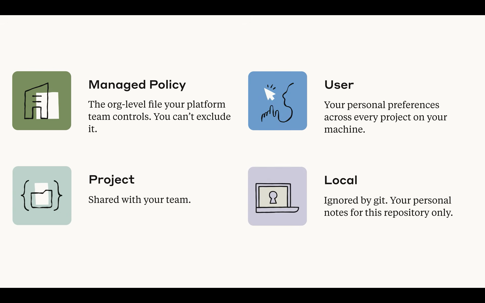

| Location | Who controls it | Scope | Notes |
|----------|-----------------|-------|-------|
| 🏢 **Managed policy** | Your **platform/org team** | Org-wide | **You can't exclude it** — org policy is always in play |
| 👤 **User** | You | **Every project on your machine** | Personal preferences that follow you everywhere |
| 📁 **Project** | Your team | This repo, **shared** | Checked into the repo |
| 💻 **Local** | You | **This repo only** | **Ignored by git** — personal notes just for you |

> 💡 **Local is easy to overlook but handy.** Refactoring on your own branch and want Claude to hold some architectural decisions in mind? That doesn't belong in the shared **project** file (it'd affect the whole team) — put it in **local**, where it's just yours for this repo.

---

### 🧩 Split a Big File with Imports

When your project file gets long, break it into pieces with the **path-to-file import syntax** — instead of one wall of text, point to other files:

```text
@.claude/conventions/code-style.md
@.claude/conventions/testing.md
@.claude/conventions/workflow.md
```

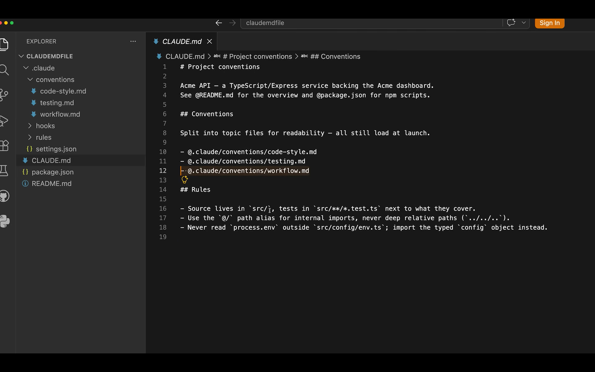

⚠️ **Know exactly what imports buy you — it's easy to get the wrong idea:**

| Imports **do** | Imports **do NOT** |
|----------------|--------------------|
| Help you **organize** / keep things tidy | **Reduce** the context Claude has to read |
| Split one file into topic files | Shrink the load |

- When Claude launches, it **expands imported files inline**, right where you referenced them. **Everything still loads up front.**
- **Use imports to organize, not to shrink the load.**

> 📌 *From the screenshot:* the file itself says *"Split into topic files for readability — all still load at launch,"* and its Rules are already written in the specific/checkable style this lesson recommends (e.g. source in `src/`, tests in `src/**/*.test.ts`; use the `@/` path alias, never deep relative paths; never read `process.env` outside `src/config/env.ts`). The explorer also shows sibling `hooks/` and `rules/` folders (my reading — the lesson doesn't walk through this file).

---

### ✍️ Phrasing Is What Makes Rules Stick

Once you've decided a rule belongs in CLAUDE.md, whether Claude obeys it comes down to **how you phrase it**. Most rules fail because they're **vague**.

#### 1️⃣ Be specific and checkable

If you can't check whether it was followed, neither can Claude.

| ❌ Vague | ✅ Specific & checkable |
|----------|------------------------|
| "Follow best practices for API routes." | "Put new API routes in `src/api/handlers`, one per file." |

The specific one is explicit — you can look at the result and **immediately tell if it was done right.** That's the bar every rule should clear.

#### 2️⃣ Name the replacement, don't just ban something

When you tell Claude not to do something, **say what to do instead** — otherwise you've left the door open.

| ❌ Leaves it open | ✅ Closes it |
|-------------------|-------------|
| "Don't use default exports." (then what?) | "Use **named exports, not default exports**." |

#### 3️⃣ Emphasis is a budget

Words like **"IMPORTANT"** and **"YOU MUST"** do raise a rule's priority — **but only relative to everything quieter around it.** If every rule shouts, nothing stands out and the emphasis means nothing.

- **Treat emphasis like a budget.** Spend it on the **two or three rules** that really hurt when broken; let the rest sit at normal volume.

---

### 🔄 Keep the File Under Revision

Your CLAUDE.md is **never finished** — treat it like **living code** that keeps getting edited.

- When Claude does the wrong thing, **don't just sigh and fix it by hand.** Treat it as a **bug report** against your CLAUDE.md.
- You can tell Claude directly: **"add that to the CLAUDE.md file,"** and it'll write the rule for you.
- That way the file gets **better every time something goes wrong.**

> 💡 **Scope past always-on conventions into rules.** Beyond the four CLAUDE.md locations, a task-specific rule can live in a **`rules/`** file that **loads only when it applies** — so it doesn't take up context on every session (the video's closing maintenance tip; the `rules/` folder is visible in the Ch-2 screenshot).

---

### 🔁 Recap (The Bottom Line)

Treat your CLAUDE.md like **production code**: **if you can't justify a line, delete it.** To keep it lean and followable:

1. **Move hard rules to hooks**, where they're actually enforced.
2. **Organize long files with imports** (just remember they don't reduce context).
3. **Make every rule specific and checkable, and name the replacement.**
4. **Spend your emphasis budget** on the few rules that matter most.
5. **Keep revising** the file whenever Claude gets something wrong.

> The whole idea is simple: **the leaner the file, the more of it Claude follows.**

### 📝 Quick Reference: A CLAUDE.md That Follows (for exam prep)

| Concept | Key point |
|---------|-----------|
| 📋 **Nature** | **Guidance, not enforced config** — every line competes for attention; leaner = more followed |
| 🪝 **Hard rules → hooks** | A **pre-tool-use hook** runs before an action and can **block** it; CLAUDE.md can't |
| 📍 **Four locations** | **Managed policy** (org, can't exclude) · **User** (your machine) · **Project** (team/repo) · **Local** (git-ignored, this repo only) — all load together and **stack** |
| 🧩 **Imports** | `@path/to/file` **organizes**; expanded **inline** at launch — **does NOT reduce context** |
| 🎯 **Specific & checkable** | "Put new API routes in `src/api/handlers`, one per file" > "follow best practices" |
| 🔁 **Name the replacement** | "Use named exports, not default exports" > "Don't use default exports" |
| 📢 **Emphasis is a budget** | `IMPORTANT`/`YOU MUST` only work if **rare**; spend on 2–3 rules max |
| 🔄 **Living document** | Treat wrong actions as **bug reports**; tell Claude "add that to CLAUDE.md" |

> 🎓 **Memory tip:** **MUPL** = **M**anaged policy · **U**ser · **P**roject · **L**ocal (broad → narrow, all stack). And: **hard line → Hook, soft convention → CLAUDE.md.**

**Key features for exam:**
- CLAUDE.md is **guidance, not enforcement** — the **leaner the file, the more of it Claude follows**.
- **Hard/dangerous rules** (e.g. "never push to main") belong in a **pre-tool-use hook** that can **block** the action.
- **Four locations load together and stack; nothing is dropped.** Managed policy **can't be excluded**; local is **git-ignored** and scoped to **one repo**.
- **Imports organize but do NOT reduce context** — files are **expanded inline** at launch.
- Phrase rules **specific & checkable** and **name the replacement**; **emphasis is a budget** (spend on 2–3 rules).
- Keep CLAUDE.md **under revision** — treat mistakes as bug reports and have Claude add the rule.

---

> 🗂️ **Unit 2: Configure Claude** · Chapter 3

## Chapter 3: Verification Skills

> 🎬 **Video: Verification Skills.** As your project grows, you notice the same work happening over and over. Skills are a good way to automate repeated work — this lesson looks at one job skills are great for: **verifying your own work.** **If there's one skill worth building first, this is it.**

### 🎯 Learning Objectives

- Understand why a **verification skill** is the first skill to build
- See the **shape** of a verification skill and why "done" means **gates run and observed**
- Use a skill **folder** (reference files + scripts) to keep `skill.md` lean
- Pick the right **instruction surface**: CLAUDE.md vs skills vs hooks

### 🧠 Key Takeaways

- **Build a verification skill first.** It removes the dependency on *you remembering* to check Claude's work — the skill fires on its own when the change matches its description
- **"Done" ≠ "the code looks right."** Done = **the gates are run and observed, with results stated explicitly** — including a check that **no test was weakened** just to pass
- A skill is a **folder**, not just a file: drop a **`reference.md`** for depth (read only when needed) and **scripts** Claude executes (not loaded into context) — keep **`skill.md` lean**
- **Only skill descriptions load into context** until a skill is actually needed, so there's **no cost** to packaging every repeated procedure
- **Three instruction surfaces:** **CLAUDE.md** = always-on conventions · **Skills** = procedures/reference tied to a task · **Hooks** = rules that **must not be skippable**
- **Rule of thumb:** if you've typed the **same multi-step instruction twice**, that's a skill
- Check the skill into **`.claude/skills`** so the **whole team inherits** the same move

---

### 🥇 Why a Verification Skill Is the One to Build First

Think about how you normally check Claude's work: it refactors something, finishes, and then **you have to remember** to double-check — run the tests, read the diff. **The checking depends on you remembering to ask.** Skip it once and bad code slips through.

**A verification skill removes that dependency.** The change matches the skill's description, so **the skill fires on its own** and walks the same steps every time:

| Step | What the skill does |
|------|---------------------|
| 1️⃣ | **Runs the test suite** |
| 2️⃣ | **Reads the diff** |
| 3️⃣ | **Checks that no test was weakened** just to make things pass |
| 4️⃣ | **Reports pass or fail**, with the **evidence attached** |

- The **description** on the skill is what **triggers** it; once triggered it runs the whole flow **without you asking**.


> 🧪 **The key check is the last one before reporting.** It's not enough to run the tests and see green — **a test can be quietly loosened** so it passes no matter what. So the skill **reads the diff and confirms tests weren't weakened.**
>
> ✅ **"Done" is the gates being run and observed, with the results stated explicitly** — not "the code looks right" from reading the diff alone.

> 📌 *From the screenshot:* the report is `Skill: verify-refactor` → `Verification: PASS` with explicit evidence — *Tests: 74 passed (2 files) via `npx vitest run src/timeline`*, *Diff reviewed: yes*, *Tests weakened: no* — exactly the "evidence attached" the lesson describes (my reading).

#### 🔁 The same shape fits any repeated procedure

A release checklist · a migration recipe · a pre-PR check.

> 📏 **Rule of thumb:** if you've typed the **same multi-step instruction twice**, that's a skill.

---

### 📁 A Skill Folder Can Hold More Than Instructions

A skill isn't just a single `skill.md`. The **folder around it** can carry other things — and that's what makes skills powerful for verification.

| What you add | How Claude uses it | Why it helps |
|--------------|--------------------|--------------|
| 📄 **`reference.md`** (linked from `skill.md`) | Read **only when it actually needs that depth** | Main file stays short |
| 📜 **Scripts** (e.g. `check.sh`) | **Executes** them — doesn't load their contents into context | The skill carries its **own tooling** (e.g. runs all the gates) |

> 💡 **The takeaway:** keep **`skill.md` itself lean.** Push the heavy material — long explanations and executable scripts — into **side files.** The lean file **describes what to do**; the side files hold the **depth and the tools.**

> 🔗 This mirrors the CLAUDE.md lesson's advice to keep the main file lean and push depth into side files ([Chapter 2](#chapter-2-a-claudemd-that-follows)) — but note the difference: CLAUDE.md **imports expand inline** (they don't save context), whereas a skill's **reference files load only on demand** and **scripts are executed, not loaded** (my mapping).

---

### 🧭 Which Instruction Surface Owns Which Rule

By now you have **three places** to put instructions — here's how to keep them straight.

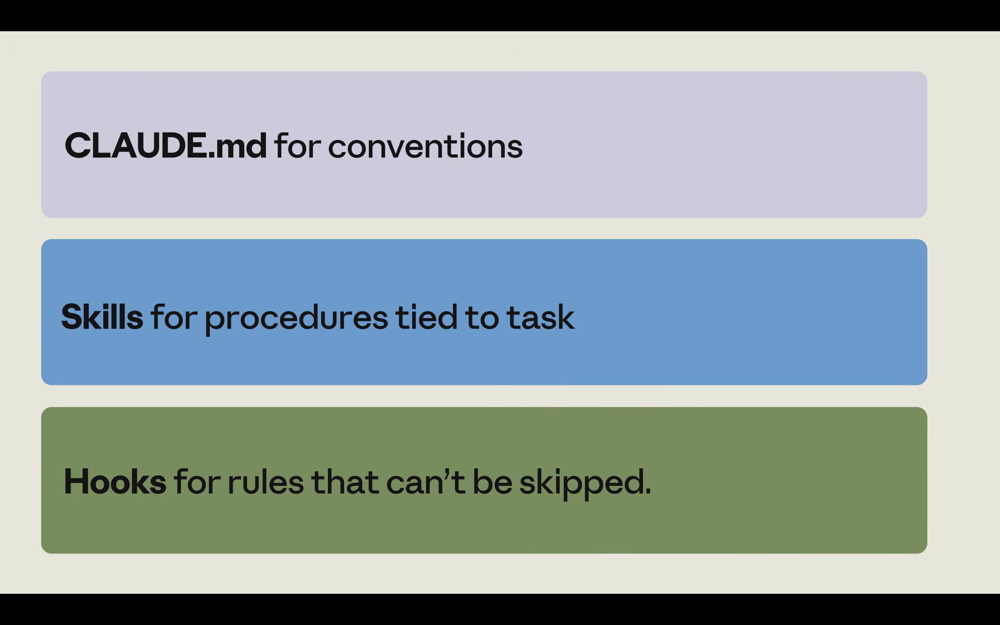

| Surface | Owns… | Because… |
|---------|-------|----------|
| 📋 **CLAUDE.md** | Conventions that apply **all the time** (naming rules, where files go) | Always-on guidance |
| 🧰 **Skills** | **Procedures and reference** tied to a **particular kind of task** | Loaded when the task comes up |
| 🪝 **Hooks** | A rule Claude **must not be able to skip** | CLAUDE.md and skills are **instructions Claude follows**; a **hook is code that actually runs** |

> ⚠️ **If skipping the rule isn't acceptable, don't leave it up to instruction-following** — put it in a hook.

> 🔗 This extends the Chapter 2 split (CLAUDE.md vs hooks) by adding **skills** as the middle surface for task-scoped procedures (my mapping).

---

### 🔁 Recap

A skill is a **folder with a `skill.md`** inside it: a **name**, a **description that triggers it**, and the **procedure** itself. **Only the descriptions load into context** until a skill is actually needed — so there's **no cost** to packaging every procedure you repeat.

**Start with verification.** Build the skill, check it into your project's **`.claude/skills`**, and the **whole team inherits the same move** — everyone's work gets checked the same way, automatically, without anyone having to remember to ask.

> 📌 **Terminology (beyond the course — not on the exam):** the lesson writes **`skill.md`** in lowercase. The live [Agent Skills spec](https://www.anthropic.com/research/equipping-agents-for-the-real-world-with-agent-skills) requires the file to be named **`SKILL.md`** (uppercase) with YAML frontmatter containing **`name`** and **`description`**. Learn the course's wording for the exam; the uppercase filename is just how the real product discovers skills.

### 📝 Quick Reference: Verification Skills (for exam prep)

| Concept | Key point |
|---------|-----------|
| 🥇 **Build first** | A **verification skill** — removes the dependency on *you remembering* to check |
| 🔫 **Trigger** | The skill's **description** fires it automatically when the change matches |
| 🪜 **Verify flow** | Run tests → read diff → **check tests weren't weakened** → report pass/fail with **evidence** |
| ✅ **"Done"** | **Gates run and observed, results stated explicitly** — not "the code looks right" |
| 📁 **Folder** | `skill.md` + **`reference.md`** (read on demand) + **scripts** (executed, not loaded) |
| 🪶 **Keep lean** | `skill.md` describes *what to do*; side files hold **depth and tools** |
| 🧠 **Context cost** | **Only descriptions load** until a skill is needed — no cost to packaging many |
| 🧭 **Surfaces** | **CLAUDE.md** = conventions · **Skills** = task procedures · **Hooks** = can't-be-skipped rules |
| 📏 **Rule of thumb** | Typed the same multi-step instruction **twice** → make it a skill |
| 👥 **Share** | Commit to **`.claude/skills`** so the whole team inherits it |

> 🎓 **Memory tip:** **C-S-H** = **C**LAUDE.md (conventions, always) · **S**kills (task procedures, on demand) · **H**ooks (can't-be-skipped, actually runs). And verification's motto: **"run the gates, read the diff, prove tests weren't weakened."**

**Key features for exam:**
- The **first skill to build is a verification skill** — it fires on its own so checking doesn't depend on you remembering.
- Verify flow: **run tests → read diff → confirm no test was weakened → report pass/fail with evidence.**
- **"Done" = gates run and observed with explicit results**, not the diff merely looking right.
- A skill is a **folder**: `reference.md` is read **only when needed**; **scripts are executed, not loaded into context**; keep `skill.md` lean.
- **Only skill descriptions load** into context until needed → no cost to packaging every repeated procedure.
- Three surfaces: **CLAUDE.md = conventions · Skills = task procedures · Hooks = rules that can't be skipped.**
- Commit the skill to **`.claude/skills`** so the **whole team** inherits it.

---

> 🗂️ **Unit 2: Configure Claude** · Chapter 4

## Chapter 4: Permission Modes

> 🎬 **Video: Permission Modes.** Permission modes let you **decide once** what Claude is allowed to run without stopping to ask. Instead of approving every action one prompt at a time, you pick a **mode that matches the job** and let Claude work at the level of trust you're comfortable with.

### 🎯 Learning Objectives

- Know the **six permission modes** and the line each one draws
- Cycle the everyday modes with **Shift + Tab** and read the status bar
- Understand how **auto mode** works and what its **classifier** can and can't do
- Pair auto mode with a **stop hook**, and pick **don't ask** for unattended runs

### 🧠 Key Takeaways

- A permission mode **decides once** what runs freely vs. what needs your sign-off
- **Six modes:** `manual` · `acceptEdits` · `plan` · `auto` · `dontAsk` · `bypassPermissions`
- **Shift + Tab cycles the everyday ones:** manual → accept edits → plan → **auto**; the **status bar** always shows the current mode
- **Auto** is the hands-off mode: a **separate classifier model reviews each action before it runs**, guarding **intent** (blocking escalation beyond what you asked)
- The **classifier checks intent, not correctness** — it won't catch broken code, because *broken isn't dangerous*. So **pair auto with a stop hook that runs your tests**
- **Don't ask** is for **unattended runs** (CI, scheduled jobs, overnight batches): only pre-approved tools run, everything else is **auto-denied with no prompt**
- **Bypass permissions** skips all checks (= the `--dangerously-skip-permissions` flag) — **only inside an isolated container or VM**

---

### 🎛️ The Six Permission Modes

Each mode draws a different line between what runs freely and what needs your sign-off.

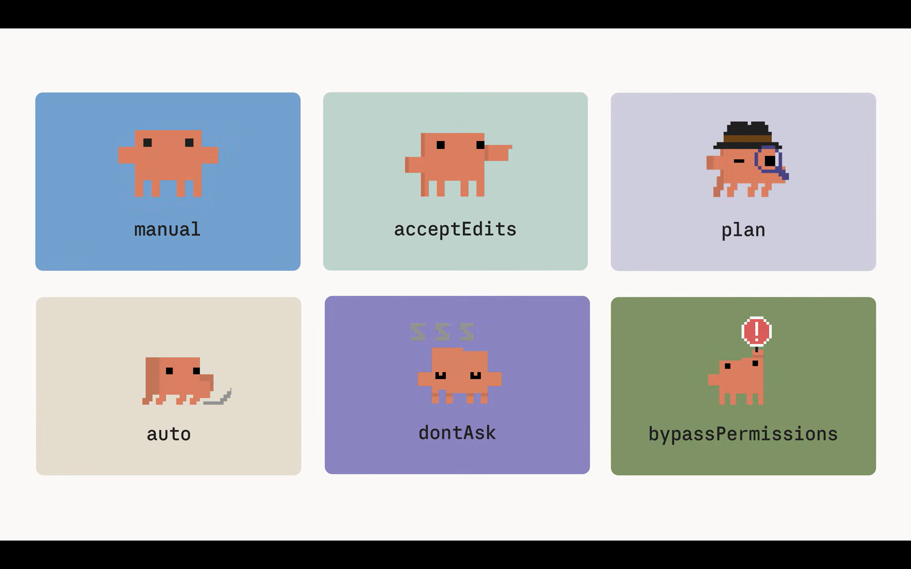

| Mode | What runs without asking | Everything else |
|------|--------------------------|-----------------|
| ✋ **`manual`** | **Reads only**, without prompting | **Asks first** |
| ⚡ **`acceptEdits`** | Reads, **file edits**, and **common file-system bash commands** | For iterating on code you **review after the fact** |
| 🔵 **`plan`** | **Reads only** — researches and **proposes** changes without editing | — |
| 🤖 **`auto`** | **Accepts everything**, but a **separate classifier model reviews each action** before it runs | Classifier may block |
| 🔕 **`dontAsk`** | Only **pre-approved tools** | Everything else is **auto-denied, no prompt** |
| ☠️ **`bypassPermissions`** | **Skips all checks** (= `--dangerously-skip-permissions`) | ⚠️ **Only inside an isolated container / VM** |

> 🔗 You've already met the first three — `manual`, `acceptEdits`, and `plan` — as the everyday hands-on modes ([Claude Code 101, Ch 2 & 4](../claude-code-101/README.md), where they were called **Default / Auto-accept / Plan**). The remaining three (`auto`, `dontAsk`, `bypassPermissions`) are where **hands-off Claude Code** lives, and the one to reach for there is **`auto`** (my mapping — this is the course that finally names all six).

---

### 🔀 Cycling with Shift + Tab

You don't need to memorize a command for each mode. **Press Shift + Tab** to cycle through the everyday ones:

```text
manual  →  accept edits  →  plan  →  auto
```

- The **status bar at the bottom always shows which mode you're in** — glance down and you know exactly what Claude is allowed to do.

---

### 🤖 How Auto Mode Works

**Auto** is the hands-off mode. Claude runs on its own, but **before each action executes, a separate classifier model reviews it.** The classifier **guards intent** — it watches for moves that **escalate beyond what you actually asked for.**

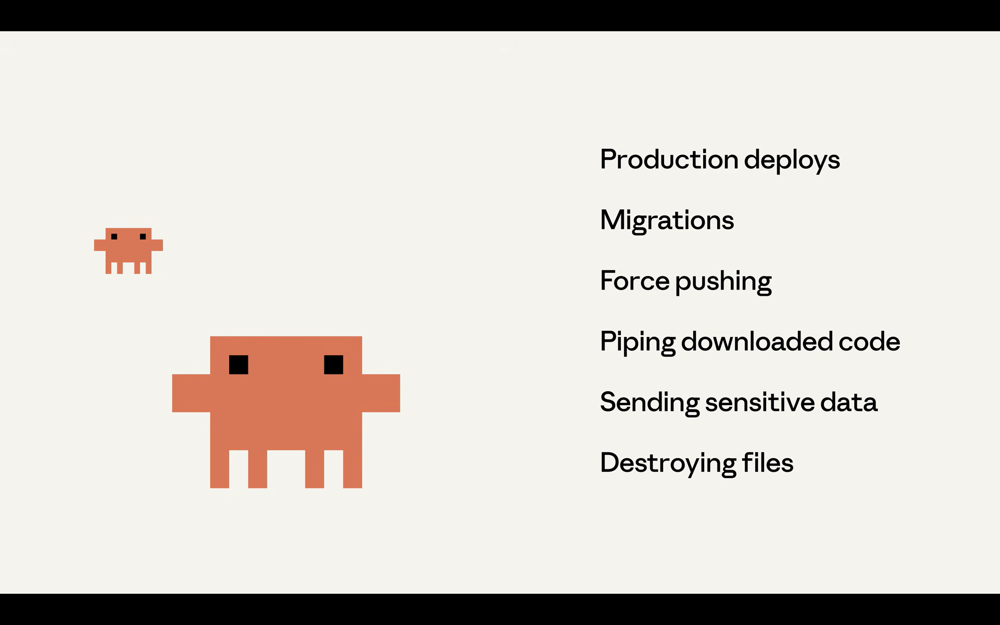

| 🚫 Classifier is designed to **block** | ✅ Classifier **waves through** |
|---------------------------------------|--------------------------------|
| Production **deploys** and **migrations** | **Local edits** in your project |
| **Force pushing**, or piping downloaded code straight into a shell | Installing dependencies **from your lock file** |
| Sending **sensitive data** to external endpoints | **Read-only** requests |
| **Destroying files** that exist for the session | Pushing to **your own branch** |

> ⚠️ **Auto mode's guardrails are still evolving** — check the docs for the current **block and allow lists.**

#### 🧩 What the classifier can't do — pair it with a stop hook

The classifier checks **intent, not correctness.** It won't catch whether the code actually **works**: ask Claude to refactor authentication and it writes **broken** auth, the classifier **waves it through** — because *broken isn't dangerous.*

That's why you **pair auto mode with a stop hook that runs your tests:**

| Guardrail | When | Guards |
|-----------|------|--------|
| 🤖 **Auto mode classifier** | **Before** each action, while Claude runs | **Intent** |
| 🛑 **Stop hook** (runs your tests) | **After** Claude finishes | **Correctness** |

> 🔗 One guards intent **before** each action, the other guards correctness **after** — the same "verify with gates" idea as the verification skill in [Chapter 3](#chapter-3-verification-skills), here enforced by a **hook** so it can't be skipped ([Chapter 2](#chapter-2-a-claudemd-that-follows)). Stop hooks: [Claude Code 101, Ch 12](../claude-code-101/README.md) (my mapping).

---

### 🔕 Don't Ask — for Unattended Runs

**`dontAsk`** is the right move whenever **no human is around to approve prompts**: CI pipelines, scheduled jobs, overnight batches.

- Only **pre-approved tools** are allowed; anything off that list is **auto-denied with no prompt.**
- **That's the whole point:** your pipeline **keeps moving** instead of hanging on an approval no one is there to give.

---

### 🔁 Recap (Match the Mode to the Job)

There are several permission modes, and you reach the everyday ones by cycling **Shift + Tab**. To sum it up:

- **`auto`** is the hands-off mode — the **classifier checks intent before** each action, and a **stop hook checks correctness after.**
- **`dontAsk`** covers **unattended pipelines** where no one is there to approve.
- **`bypassPermissions`** belongs **only inside isolated containers and VMs.**

> Pick the mode that fits what you're doing, and let Claude run at that level.

### 📝 Quick Reference: Permission Modes (for exam prep)

| Mode | One-liner |
|------|-----------|
| ✋ **`manual`** | Reads only without prompting; **everything else asks first** |
| ⚡ **`acceptEdits`** | Auto-runs reads + **file edits** + common FS bash commands; review after |
| 🔵 **`plan`** | **Reads only** — proposes changes, edits nothing |
| 🤖 **`auto`** | Accepts everything, but a **classifier reviews each action** (guards **intent**) |
| 🔕 **`dontAsk`** | Only **pre-approved tools**; everything else **auto-denied, no prompt** (unattended runs) |
| ☠️ **`bypassPermissions`** | Skips **all** checks (= `--dangerously-skip-permissions`); **container/VM only** |
| 🔀 **Shift + Tab** | Cycles the everyday four: manual → accept edits → plan → auto; **status bar shows current mode** |
| 🧩 **Classifier limit** | Checks **intent, not correctness** → pair auto with a **stop hook** that runs tests |

> 🎓 **Memory tip:** order = **M-A-P-A-D-B** (**M**anual, **A**cceptEdits, **P**lan, **A**uto, **D**ontAsk, **B**ypassPermissions). First four cycle on **Shift + Tab**. Auto = **intent before, stop-hook correctness after.**

**Key features for exam:**
- **Six modes:** `manual`, `acceptEdits`, `plan`, `auto`, `dontAsk`, `bypassPermissions`.
- **Shift + Tab** cycles the everyday four (manual → accept edits → plan → auto); the **status bar** shows the current mode.
- **Auto mode:** a **separate classifier model reviews each action before it runs**, guarding **intent** (blocks deploys, migrations, force pushes, piping downloaded code to a shell, exfiltrating data, destroying session files).
- The classifier checks **intent, not correctness** → **pair auto with a stop hook** that runs your tests (intent before / correctness after).
- **`dontAsk`** = unattended pipelines: only pre-approved tools, everything else **auto-denied with no prompt**.
- **`bypassPermissions`** = `--dangerously-skip-permissions`; **only in an isolated container/VM**.

---

> 🗂️ **Unit 2: Configure Claude** · Chapter 5

## Chapter 5: Hooks

> 🎬 **Video: Hooks.** The problem with telling Claude to do something in a CLAUDE.md file: **it's a request, not a guarantee.** Write "always format after editing" and Claude *usually* listens — but on a long run you're not watching, and "usually" isn't good enough. **A hook is deterministic code that runs at a fixed point in the loop**, so it can **guarantee** behavior instead of hoping for it. It turns a rule from *"Claude usually listens"* into *"Claude can't skip it."*

### 🎯 Learning Objectives

- Know the **hook events** worth reaching for and where they sit in the agentic loop
- Use **PreToolUse** to return a **JSON decision** (allow / deny / ask) or **rewrite** a call
- Read **exit codes** for hooks that don't return JSON (and the exit-1 gotcha)
- Build a **redact-instead-of-block** guardrail and a **state-preserver across compaction**

### 🧠 Key Takeaways

- A hook is **deterministic code at a fixed point** in the loop → turns a rule into one Claude **can't skip**
- Claude Code fires **~30 hook events**; you only need a small handful
- **PreToolUse** is the **enforcement primitive** — it can **stop a call before it happens**
- PreToolUse talks back via **JSON + exit 0**; `permissionDecision` = **allow / deny / ask** (rare 4th: **defer**)
- **`updatedInput` rewrites the call** (e.g. redact a secret) — but it **replaces the whole input**, so echo back fields you aren't changing
- **Exit codes:** `0` = success · `2` = **blocking error** (stderr → Claude) · **anything else = non-blocking**. ⚠️ **Exit 1 does NOT block**
- To **re-inject context after compaction**, use **SessionStart with the `compact` matcher** — **not** PostCompact

---

### 🎣 The Hook Events

Claude Code fires **around 30 hook events** over a session — you don't need them all. A small handful recur, and they line up with points in the **agentic loop** where you'd want to step in: a session starts, prompts come in, tools get called, and the turn eventually ends.

![The agentic loop with hook points — Session Start → UserPromptSubmit → PreToolUse → PermissionRequest → [tool executes] → PostToolUse — plus a side list describing PreToolUse, PostToolUse, Stop, Pre/Post Compact, InstructionsLoaded, and SessionStart](assets/L5-hooks/hook-events-loop.png)

**The ones worth knowing:**

| Event | Fires… | Use it for |
|-------|--------|-----------|
| 🛑 **PreToolUse** | **Before** a tool call | **Enforcement primitive** — the one that can **stop something before it happens** |
| 🧹 **PostToolUse** | **After** a successful tool call | Usually **auto-formatting / auto-lint** |
| ✋ **Stop** | When Claude wants to **end its turn** | Refuse — *"no, you're not done yet"* if a condition isn't met (matching **SubagentStop** for sub-agents) |
| 🗜️ **PreCompact / PostCompact** | **Before / after** compaction | — |
| 📄 **InstructionsLoaded** | When a **CLAUDE.md or rule file loads** | **Auditing** what actually made it into context |
| 🚀 **SessionStart** | At the **start**; primes the environment | Use the **`startup` source** to only run on fresh starts |

> ⚠️ **The gotcha:** to **re-inject context after compaction, don't use PostCompact** — use **SessionStart with the `compact` matcher.** That's the one whose output actually gets back into the conversation.

> 🔗 These hang off the same **agentic loop** from [Claude Code 101, Ch 2](../claude-code-101/README.md) (gather context → act → verify). Hooks were introduced in [Claude Code 101, Ch 12](../claude-code-101/README.md); this chapter is the deep dive.

---

### 🚦 PreToolUse: Returning a Decision as JSON

PreToolUse is where the real power is — it can **block a tool call before it runs.** You talk back to Claude by **printing JSON and exiting 0.** The key field is **`permissionDecision`**:

| Value | Effect |
|-------|--------|
| ✅ **`allow`** | Let the call through |
| ⛔ **`deny`** | Stop the call |
| 🙋 **`ask`** | Hand it back to the **user** to decide |
| ⏸️ **`defer`** *(rare)* | Only for non-interactive `-p` runs where a calling process pauses the tool and resumes it later |

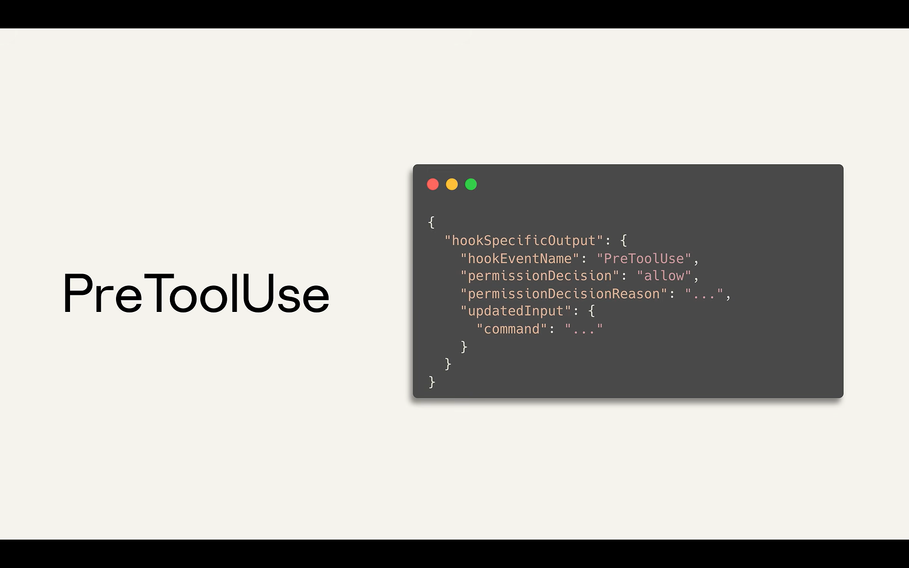

The shape:

```json
{
  "hookSpecificOutput": {
    "hookEventName": "PreToolUse",
    "permissionDecision": "deny",
    "permissionDecisionReason": "...",
    "updatedInput": {
      "command": "..."
    }
  }
}
```

> 🔑 **Notice `updatedInput`.** Instead of blocking a call, you can **rewrite** it — e.g. redact a secret out of a bash command and still let it run.
>
> ⚠️ **One catch:** `updatedInput` **replaces the whole input object**, so you must **echo back the fields you aren't changing**, or you'll lose them.

> 🔗 This is the same `permissionDecision: "ask"` mechanism Kiro's own PreToolUse hooks use (my cross-reference to the hooks you've seen in this IDE — not course wording).

---

### 🔢 Exit Codes — for Hooks That Don't Return JSON

Not every hook needs JSON. For simpler hooks, **exit codes do the job.** Three numbers matter:

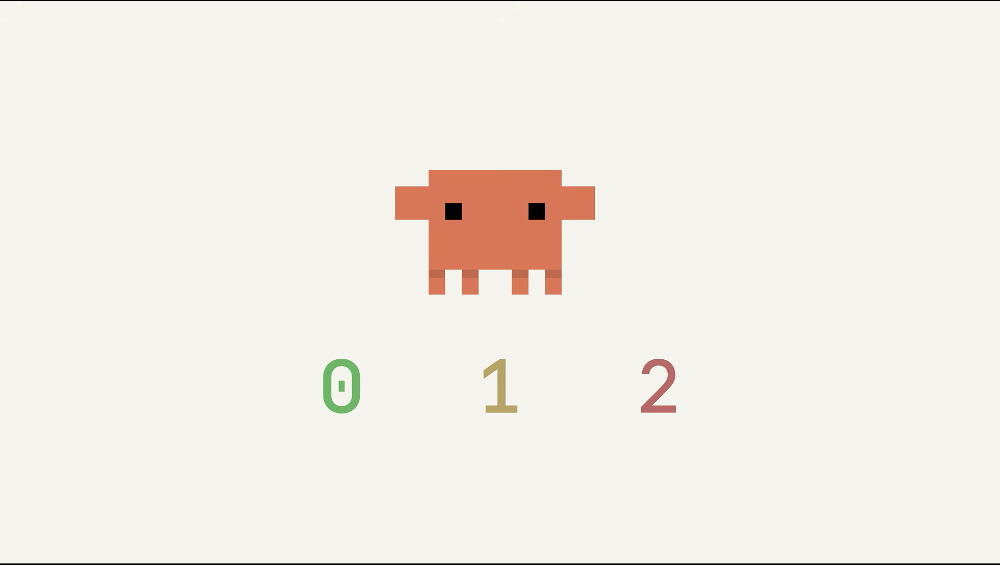

| Exit code | Meaning | stdout / stderr behavior |
|-----------|---------|--------------------------|
| **`0`** | **Success** | If stdout is **JSON**, Claude parses it. **Plain text is ignored on most events** — but on **SessionStart, UserPromptSubmit, and UserPromptExpansion**, plain text is **added to context** (this is what makes a **state-preserver** hook work) |
| **`2`** | **Blocking error** | **stderr is fed back to Claude as context.** The blocking exit code almost everywhere |
| **anything else** | **Non-blocking** | stderr is **logged**, Claude **carries on** |

> ⚠️ **The one that catches people out: exit code `1`.** It *feels* like an error, but it **does NOT block** — Claude runs the command anyway. **To stop something, exit `2`, not `1`.**
>
> ⚠️ **The lone exception: `WorktreeCreate`.** Unlike every other event, `WorktreeCreate` **aborts on *any* non-zero exit** (not just `2`) — so a failing worktree hook stops the worktree from being created.

**A couple more wrinkles:**
- Exit `2` can even **block Stop** — that's how you tell Claude it's not done.
- **PostToolUse fires after the tool already ran**, so blocking there is **too late to stop the call** — though it can still feed text back to Claude.
- A few events **ignore blocking entirely** (**Notification**, **SessionStart**, and **FileChanged**) — they show your stderr and carry on regardless.

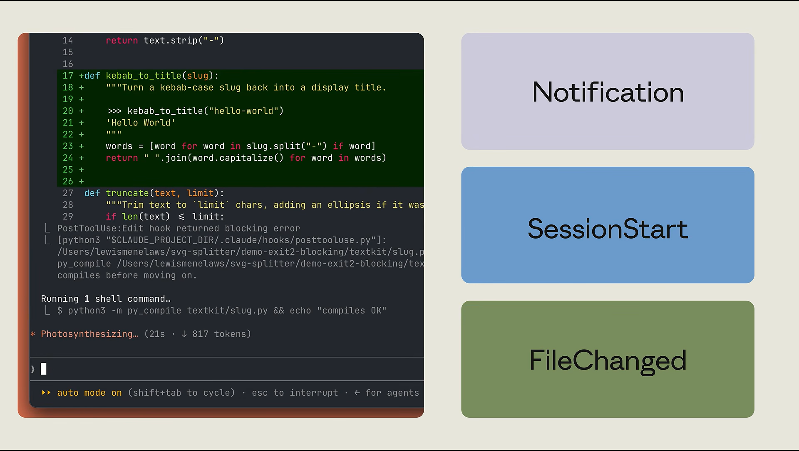

> 📌 *From the screenshot:* a `PostToolUse:Edit` hook returns a **blocking error** and runs `python3 -m py_compile … && echo "compiles OK"` — i.e. a post-edit gate that makes sure the file **compiles before moving on** (my reading; the footer shows `auto mode on`, tying hooks to the [Ch 4](#chapter-4-permission-modes) auto-mode + stop-hook pairing). The side bars **Notification / SessionStart / FileChanged** are events that **ignore blocking**.

---

### 🛡️ A Real Guardrail: Redact Instead of Block

A **PreToolUse guardrail on the Bash tool.** The **matcher** picks the tool to watch; an optional **`if` clause** can narrow it to a specific command.

| Move | What it does |
|------|--------------|
| ⛔ **Return `deny`** | Stop a dangerous call (good) |
| ✏️ **Return `updatedInput`** | **Rewrite** the call — the lesser-known, more interesting move |

**The redact example:** Claude is asked to run a command that includes a live-looking secret. The hook intercepts it, spots the **`sk_live_`** pattern, and **swaps it for a placeholder** before the command ever executes.

> ✅ **The command still ran. The work still got done. But the secret never made it through.** That's the difference between **blocking** and **redacting** — and a hook can enforce it **every single time.**

---

### 💾 Preserving State Across a Compact

When Claude compacts a long conversation, it drops a lot of detail. Set up a **SessionStart hook with the `compact` matcher** — it runs **right after compaction.**

- Have it **print a short summary** of the files you've been working on.
- That summary **goes back into context** (because SessionStart stdout is added to context), so Claude **picks up where it left off** instead of starting cold.

> 🔗 Complements the manual, steerable `/compact` from [Chapter 1](#chapter-1-steering-long-sessions): there you steer *what the summary keeps*; here a hook **automatically re-injects** state after every compaction (my mapping).

---

### 🔁 Recap

Hooks turn a rule Claude **usually** follows into one it **always** follows. Reach past auto-formatting:

- **Guard tools with PreToolUse** (allow / deny / ask, or rewrite with `updatedInput`)
- **Gate the turn with Stop** (exit 2 = "not done yet")
- **Preserve state across a compact** (SessionStart + `compact` matcher)

> The setup takes a little effort up front, but it pays back the **first time it catches something on a run you weren't even watching.**

### 📝 Quick Reference: Hooks (for exam prep)

| Concept | Key point |
|---------|-----------|
| 🎯 **Why a hook** | **Deterministic code at a fixed point** → guarantees behavior ("can't skip it"), vs CLAUDE.md's request |
| 🔢 **Event count** | Claude Code fires **~30** hook events; know the handful below |
| 🛑 **PreToolUse** | **Before** a tool call — the **enforcement primitive**; can **block** |
| 🧹 **PostToolUse** | **After** a successful call — auto-format/lint; **too late to block the call** |
| ✋ **Stop** | Claude ends its turn — refuse to say "not done" (**SubagentStop** for sub-agents) |
| 📄 **InstructionsLoaded** | CLAUDE.md/rule file loads — audit what entered context |
| 🚀 **SessionStart** | Primes environment; **`startup` source** = fresh starts; **`compact` matcher** = re-inject after compaction |
| 🚦 **permissionDecision** | **allow / deny / ask** (+ rare **defer** for `-p` runs) — print **JSON, exit 0** |
| ✏️ **updatedInput** | **Rewrites** the call (redact secrets); **replaces whole input** → echo back unchanged fields |
| 0️⃣ **Exit 0** | Success; JSON parsed; plain text → context **only** on SessionStart / UserPromptSubmit / UserPromptExpansion |
| 2️⃣ **Exit 2** | **Blocking** error; stderr → Claude; can even block **Stop** |
| 1️⃣ **Exit 1** | ⚠️ **Does NOT block** — Claude runs anyway |
| 🌳 **`WorktreeCreate`** | **Exception:** aborts on **any non-zero** exit (not just 2) |

> 🎓 **Memory tip:** **"0 ok · 2 block · 1 is a lie."** Enforcement verbs: PreToolUse **guards**, Stop **gates**, SessionStart+compact **remembers**. Decisions: **A-D-A** = allow / deny / ask.

**Key features for exam:**
- A hook is **deterministic code at a fixed loop point** → a rule Claude **can't skip** (vs CLAUDE.md = request).
- **PreToolUse** can **block before** a call; returns **JSON + exit 0** with `permissionDecision` = **allow / deny / ask** (rare **defer**).
- **`updatedInput`** rewrites a call (e.g. redact `sk_live_` secrets) and **replaces the whole input** — echo back unchanged fields.
- **Exit codes:** `0` success · `2` **blocking** (stderr → Claude, can block **Stop**) · **everything else non-blocking** — and **exit 1 does NOT block**. **Exception: `WorktreeCreate` aborts on any non-zero exit.**
- **Blocking-ignore events:** **Notification**, **SessionStart**, and **FileChanged** show stderr and carry on regardless.
- **Exit 0 plain-text reaches context only on SessionStart / UserPromptSubmit / UserPromptExpansion** (the state-preserver trick).
- **PostToolUse is too late to stop a call**; **Notification & SessionStart ignore blocking**.
- **Re-inject context after compaction with SessionStart + `compact` matcher**, NOT PostCompact.

---

> 🗂️ **Unit 3: Automate Repeat Work** · Chapter 6

## Chapter 6: Routines and Headless

> 🎬 **Video: Routines and Headless.** Once you **trust** Claude to do a task, the next move is to **stop doing it by hand.** If it's the **same prompt on a recurring trigger**, you shouldn't have to kick it off yourself every time. Two ways to hand that work off: **routines** (you build nothing) and **headless mode** (full control from your own scripts).

### 🎯 Learning Objectives

- Place automation options on a **spectrum** from "build nothing" to "full control"
- Create and rely on **routines** (and know their three limits)
- Run **headless mode** with `-p`, get **structured output**, and chain **sessions**
- Pick between **routines · headless `-p` · `--bare` · the Agent SDK**

### 🧠 Key Takeaways

- Think of it as a **spectrum**: **routines** (Anthropic's managed infra) → **headless mode / Agent SDK** (run from your own code). **Start where you build the least.**
- A **routine** = a saved **prompt + repo + connectors** that runs **in the cloud** on a **schedule**. No script, no server, nothing of yours to host
- **Triggers:** a **cron schedule** · an **HTTP POST** to its API · a **GitHub event**
- **Create a routine** two ways: the web (**claude.ai/code/routines**) or **`/schedule`** inside Claude Code
- **Three limits:** **research preview** · **at most hourly** · each run starts from a **fresh clone of the default branch** and can only push to **`claude/`-prefixed branches** (unless loosened per repo)
- **Headless mode** = the **`-p` / `--print`** flag: a **one-shot**, non-interactive run that **pipes** like any shell tool. `-p` **skips auto-discovery** of hooks/skills/plugins/MCP/CLAUDE.md → faster startup
- **Structured output:** `--output-format json` + `--json-schema` → the object lands in **`structured_output`**
- **`--bare`** = **deterministic mode** for CI (repeatable output); the **Agent SDK** embeds Claude Code in your own TS/Python app

---

### 📈 The Spectrum: Build the Least First

| | 🟪 **Routines** | 🟦 **Headless `-p`** | 🟩 **`--bare`** | 🟫 **Agent SDK** |
|---|---|---|---|---|
| **Runs on** | **Anthropic's** infra (cloud) | Your pipeline | Your CI | Inside your product |
| **You host** | Nothing | A script | A pipeline | Your app |
| **Reach for when** | **Default** for repeat work | Job needs your env / pipe data through a script | CI needs the **same results every run** | Work belongs **inside your own product** |

> 💡 **Start with routines. Drop down the spectrum only when the job actually needs the extra control.**

---

### ☁️ Routines: A Saved Prompt That Runs in the Cloud

A routine is the **most direct** way to automate a task — **no script, no server.** It bundles **three things** and runs them in the cloud whenever triggered:

| Bundled | |
|---------|--|
| 📝 **A prompt** | What Claude should do each session |
| 📁 **The repository** | What it works on |
| 🔌 **Connectors** | Anything the job needs |

- **The infrastructure is Anthropic's** — no machine of yours staying on overnight, no workflow file to maintain. **You describe the job once and it just runs.**

#### ⏰ Triggers

| Trigger | Example |
|---------|---------|
| 🕘 **Cron schedule** | Every morning at 9am |
| 🌐 **HTTP POST** to its API endpoint | Your own code kicks it off |
| 🐙 **GitHub event** | A new pull request landing |

> **Good fits** (same prompt on a recurring trigger): a **morning dependency audit** · a **PR triager** that fires on a new PR · a **daily Sentry scan** to find the most urgent tickets.

> 🧠 **Mental model** — a routine ties together: **prompt + repo + connectors + schedule.**

#### 🛠️ Two Ways to Create One

| Entry point | How |
|-------------|-----|
| 🌐 **Web** | **claude.ai/code/routines** — name it, write instructions, pick a repository, choose a trigger |
| ⌨️ **In Claude Code** | Run **`/schedule`** and describe it in plain language |

```text
/schedule daily dependency audit at 9am
```

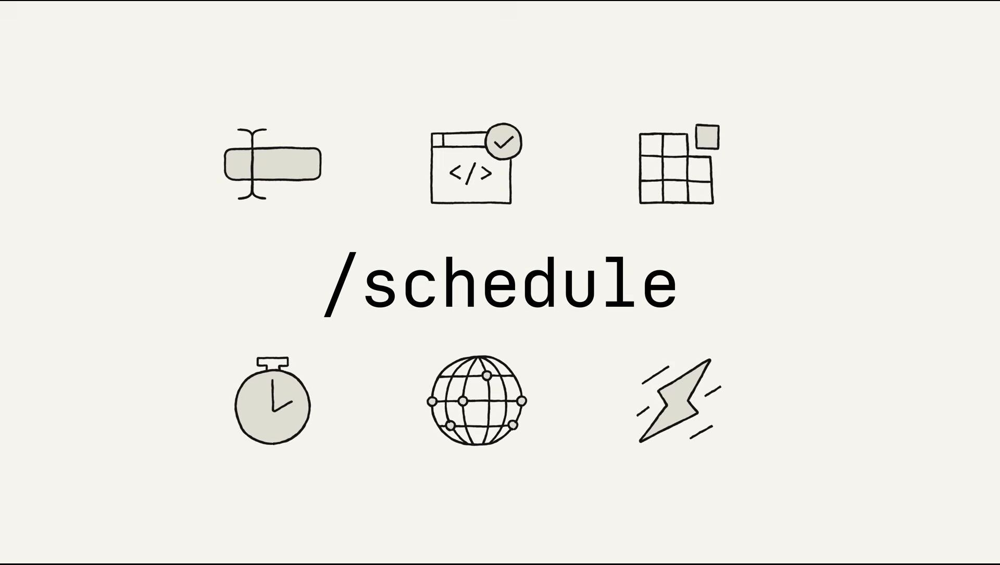

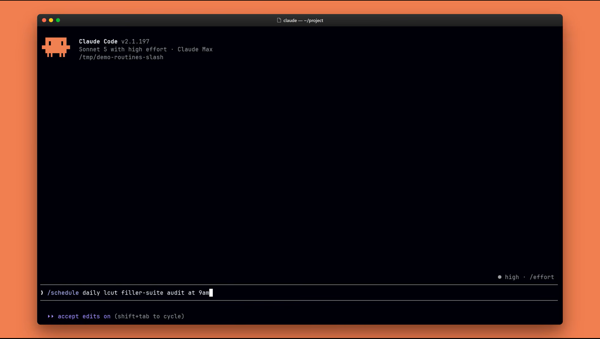

> 💡 **Same idea, either entry point** — pick whichever fits your flow.

#### ⚠️ Three Things to Know Before You Rely on Routines

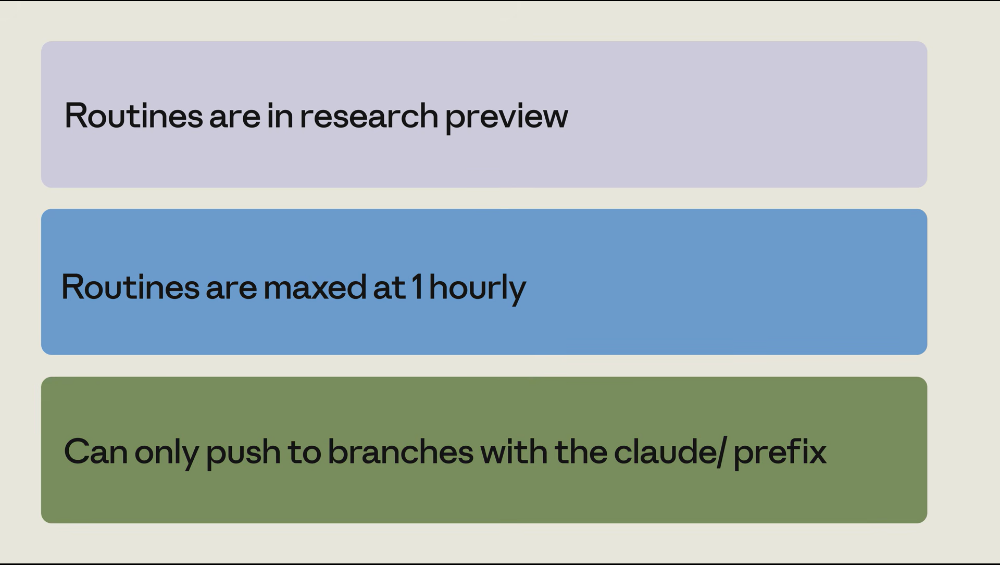

| Limit | Detail |
|-------|--------|
| 🔬 **Research preview** | Behavior and limits will keep moving — don't be surprised if things change |
| ⏱️ **At most hourly** | A recurring schedule runs **at most hourly**; need more frequent → routines aren't the tool |
| 🌿 **`claude/` branches only** | Each run starts from a **fresh clone of your default branch** and can only push to **`claude/`-prefixed branches** (unless loosened per repo) — the guardrail that keeps an autonomous run from **rewriting `main`** |

---

### 🖥️ Headless Mode: When You Need Your Own Environment

Routines are great when the work fits in the cloud. When the job needs **your environment**, or **logic wrapped around the run**, drop to **headless mode.**

The core is the **`-p`** flag (short for **`--print`**). It runs Claude Code as a **one-shot command with no interactive UI** — reads **stdin**, writes **stdout**, so it **pipes like any other shell tool:**

```bash
claude -p "summarize the changes in this diff"
```

> ⚡ **Worth knowing:** `-p` **skips auto-discovery** of hooks, skills, plugins, MCP servers, and the CLAUDE.md file. You get **Claude plus the tools you allow explicitly**, and nothing the local environment happens to load — **startup is much faster** this way.

#### 📦 Getting Structured Output Back

Pair a **JSON schema** with the **JSON output format** and Claude constrains its output to match. The matching object lands in the **`structured_output`** field — pull it out with `jq`:

```bash
claude -p "Extract the exported function names from src/core/style.js" \
  --output-format json \
  --json-schema '{"type":"object","properties":{"functions":{"type":"array","items":{"type":"string"}}},"required":["functions"]}' \
  | jq '.structured_output.functions'
```

#### 🔗 Multi-Step Automation with Sessions

For work across multiple steps, **capture the session's ID** from the JSON output and **resume** it later:

```bash
claude --resume "$(jq -r .session_id /tmp/plan.json)"
```

- **One script kicks off the work; another resumes it later with full context.** Handy when the first pass produces a **plan** and a second pass **carries it out.**

#### 🔁 Deterministic Runs for CI

> **`--bare`** gives you **deterministic mode** — the right choice inside a pipeline when you want **repeatable, predictable output** rather than anything that varies run to run.

---

### 🧰 The Agent SDK: Claude Code Inside Your Own App

The last step on the spectrum. A **library** that embeds Claude Code inside your own **TypeScript or Python** applications.

- Both languages expose a **`query`** function and the **same primitives as the CLI.** You pass a **prompt + options:**

| Option | Controls |
|--------|----------|
| `allowedTools` | What Claude can do |
| a **system prompt** | How it behaves |
| a **permission mode** | Its level of autonomy ([Ch 4](#chapter-4-permission-modes)) |

- Then you **iterate over the messages** Claude streams back and handle them however your app needs. **Same engine as the CLI, callable from inside your product.**

---

### 🔁 Recap (Which One Should You Reach For?)

| Tool | Reach for it when… |
|------|--------------------|
| ☁️ **Routines** | **Default** for repeat work — Anthropic's infra, nothing to host |
| 🖥️ **Headless `-p`** | The job needs **your pipeline** and you want to **pipe data** through a script |
| 🔁 **`--bare`** | **CI needs the same results every single run** |
| 🧰 **Agent SDK** | The work belongs **inside your own product** |

> **Start with routines. Drop down the spectrum only when the job actually needs the extra control.**

> 📌 **Terminology (beyond the course — not on the exam):** the live [Claude Code docs](https://code.claude.com/docs/en/routines) have since **renamed "routines" to "cloud scheduled tasks."** The course teaches **"routines"** — learn that wording for the exam; the rename is just how the current product labels the same feature.

### 📝 Quick Reference: Routines and Headless (for exam prep)

| Concept | Key point |
|---------|-----------|
| 📈 **Spectrum** | Routines (managed) → headless `-p` → `--bare` → Agent SDK (your code) |
| ☁️ **Routine** | Saved **prompt + repo + connectors**, runs **in the cloud** on a **schedule** |
| ⏰ **Triggers** | **cron** · **HTTP POST** to API · **GitHub event** |
| 🛠️ **Create** | Web **claude.ai/code/routines** or **`/schedule`** in Claude Code |
| ⚠️ **3 limits** | **research preview** · **≤ hourly** · **`claude/` branches only** (fresh clone of default branch) |
| 🖥️ **Headless** | **`-p` / `--print`** = one-shot, no UI, **pipes**; **skips auto-discovery** (hooks/skills/plugins/MCP/CLAUDE.md) → faster |
| 📦 **Structured output** | `--output-format json` + `--json-schema` → object in **`structured_output`** (grab with `jq`) |
| 🔗 **Sessions** | Capture **`session_id`**, later `claude --resume "<id>"` |
| 🔁 **`--bare`** | **Deterministic** mode for CI |
| 🧰 **Agent SDK** | TS/Python **`query`** + options (`allowedTools`, system prompt, permission mode); stream messages |

> 🎓 **Memory tip:** spectrum = **R-H-B-S** (**R**outines → **H**eadless `-p` → `--**B**are` → Agent **S**DK) = managed → your-code. Routine limits = **"Preview · Hourly · `claude/` only."** Headless mantra: **`-p` prints, skips discovery, pipes.**

**Key features for exam:**
- **Routine** = cloud-run **prompt + repo + connectors + schedule**; **no script/server to host**.
- Routine **triggers:** cron schedule · HTTP POST to its API · GitHub event. Create via **claude.ai/code/routines** or **`/schedule`**.
- **Three routine limits:** research preview · **at most hourly** · pushes only to **`claude/`-prefixed branches** (fresh clone of default branch, protects `main`).
- **Headless `-p` / `--print`:** one-shot, non-interactive, **pipes stdin/stdout**; **skips auto-discovery** of hooks/skills/plugins/MCP/CLAUDE.md (faster startup).
- **Structured output:** `--output-format json` + `--json-schema`; result lands in **`structured_output`**.
- **`--resume "<session_id>"`** chains multi-step runs; **`--bare`** gives **deterministic** CI output.
- **Agent SDK** (TS/Python) embeds Claude Code via a **`query`** function with the **same primitives as the CLI**.

---

> 🗂️ **Unit 3: Automate Repeat Work** · Chapter 7

## Chapter 7: GitHub Actions and Code Review

> 🎬 **Video: GitHub Actions and Code Review.** The best place to hand off repetitive work is the **pull request** — where review happens, changes land, and busywork lives. Two ways to put Claude to work here, solving different problems: a **managed service you turn on** (Code Review) and a **GitHub Action you wire up yourself**.

### 🎯 Learning Objectives

- Enable the managed **Code Review** service and know its boundaries
- Apply a finding locally with **`/code-review --fix`**
- Set up and tune the **GitHub Action** (`anthropics/claude-code-action@v1`)
- Write workflows for **`@claude` mentions** and **cron**, and know **which path to pick**

### 🧠 Key Takeaways

- **Two paths at the PR:** **Code Review** (managed, Anthropic-hosted) vs the **GitHub Action** (DIY custom CI)
- **Code Review** posts findings as **inline comments** on the exact lines, **tagged by severity**, with a **summary table** — reviews the diff against your **full codebase**, then **dedupes and ranks**
- Code Review **never approves or blocks** the PR (a human decides), **has no managed autofix**, and is a **research preview** (team + enterprise)
- Apply a finding locally: **`/code-review`** reviews a diff; its **`--fix`** flag applies findings to your working tree
- The **GitHub Action** = `anthropics/claude-code-action@v1`; set it up with **`/install-github-app`** (needs **repo admin**)
- Action **triggers:** `@claude` mentions (default `trigger_phrase`), scheduled jobs, any GitHub event
- All run **tuning lives in `claude_args`** (e.g. `--max-turns`, permission mode, allowed tools)

---

### 🅰️ The Managed Path: Code Review

The simplest option. An **Anthropic-hosted service** that reviews your PRs through the **Claude GitHub app** — **nothing to build or host.** Turn it on and it posts findings as **inline comments** on the lines that matter.

#### 🔧 Enabling it

An **organization admin** enables it from **Claude Code admin settings** → a **Code review** section with a **Configure** button. From there the admin:

| Step | Detail |
|------|--------|
| 1️⃣ | **Installs the Claude GitHub app** |
| 2️⃣ | **Picks which repos** it watches |
| 3️⃣ | **Decides when it runs** (timing below) |

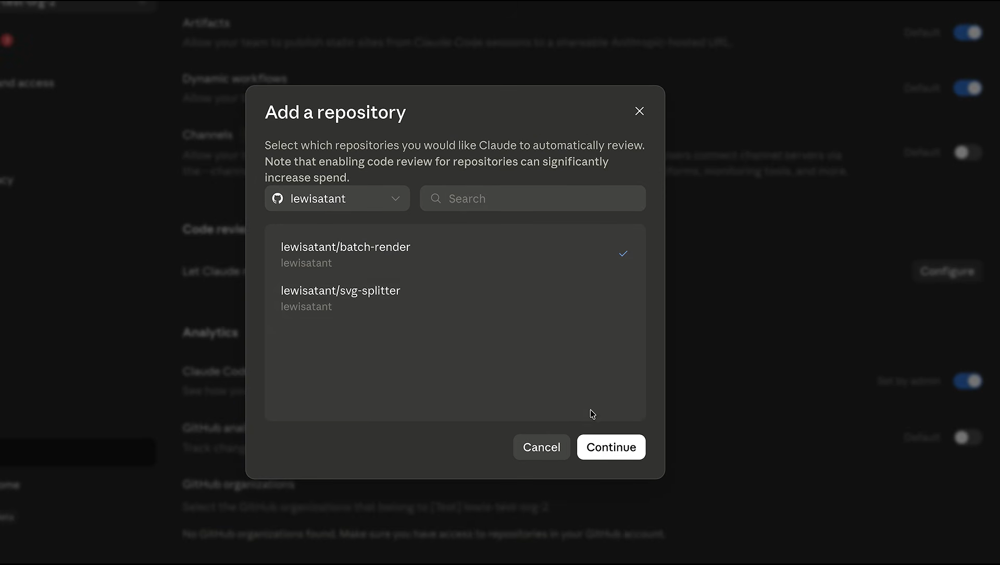

**When it runs:**

| Timing | |
|--------|--|
| 🆕 **Once when a PR opens** | |
| 🔁 **On every push to the PR** | |
| 💬 **Only when someone comments `@claude review`** | |

> 📌 *From the screenshot:* the repo picker warns that **enabling code review for repositories can significantly increase spend** — a cost note worth remembering, though not stressed in the lesson text (my reading).

#### ⚙️ How it works

Once on, everything runs on **Anthropic's infrastructure.** A set of **review agents** analyzes the diff **against your full codebase** (not just the changed lines in isolation), then posts findings as **inline comments** on the specific lines, **tagged by severity**, with a **summary table** in the check run.

> 💡 **It dedupes and ranks** the findings — so instead of a wall of nitpicks, you read a **handful of real issues** worth your attention. Each finding lands as a comment from Claude, right on the line, with a **clear explanation and a suggested fix.**

#### 🚧 What Code Review will and won't do

| ❌ Won't | Detail |
|---------|--------|
| **Approve or block** the PR | The **judgment call stays with a human** — Claude flags, you decide |
| **Managed autofix** | The service **posts findings only** |
| **Stable** | It's a **research preview** (team + enterprise) — behavior keeps moving |

#### 🩹 Applying a finding (local move)

Since there's **no autofix in the service**, applying a finding is **local**:

| Command | What it does |
|---------|--------------|
| **`/code-review`** | Reviews a diff **from your own terminal** |
| **`/code-review --fix`** | **Applies the findings to your working tree** |

> 🔁 **The flow:** Claude **finds** it in the PR → you **pull it down and fix** it locally with `--fix`.

---

### 🅱️ The Do-It-Yourself Path: the GitHub Action

When the job goes **beyond review**, reach for the **GitHub Action** — custom CI: implementing changes from a comment, running scheduled reports, anything you'd write a workflow for. It runs the agent on **PR comments, scheduled jobs, and any GitHub event.**

#### 🔧 Setup

Starts **inside Claude Code**: run **`/install-github-app`** (needs **repo admin**). The slash command walks you through installing the GitHub app and **setting the Anthropic API key secret** on the repo.

#### 📥 The action and its inputs

The action is **`anthropics/claude-code-action@v1`**. Inputs you'll actually use:

| Input | Purpose |
|-------|---------|
| `anthropic_api_key` | Optional |
| `github_token` | Defaults to `secrets.GITHUB_TOKEN` |
| `trigger_phrase` | What it listens for in comments — **defaults to `@claude`** |
| `use_bedrock` / `use_vertex` | Switch to those providers if you're on Bedrock or Vertex |
| `prompt` | The instruction for the run |
| `claude_args` | A string of **CLI arguments passed straight through** to Claude Code |


> 📌 *From the screenshot:* the demo `with:` block also shows **`plugin_marketplaces`** and **`plugins: "code-review@claude-code-plugins"`** inputs (not covered in the lesson text) — tying the action to **plugins**, covered in [Chapter 9](#chapter-9-plugins) (my reading / cross-reference).

#### 💬 A workflow that responds to `@claude`

Drop a workflow into **`.github/workflows/claude.yaml`** and it listens for **`@claude`** on PR and issue comments. The core step:

```yaml
- uses: anthropics/claude-code-action@v1
  with:
    anthropic_api_key: ${{ secrets.ANTHROPIC_API_KEY }}
    github_token: ${{ secrets.GITHUB_TOKEN }}
    trigger_phrase: "@claude"
    prompt: "Your instructions here"
    claude_args: "--max-turns 5 --model claude-sonnet-5"
```

> Someone writes **`@claude implement the spec in the linked Linear issue`** on a PR → the action picks it up, **pushes commits**, and **posts comments** describing what it did.

#### ⏰ A workflow that runs on a schedule

The same action works for a **daily rollup**: a **cron** trigger fires at e.g. `9:00 UTC`, the action runs, and Claude **posts the results.** Add a **`workflow_dispatch`** trigger to also kick it off **manually from the Actions tab**. You can **watch it work through the steps** in the Actions tab like any GitHub workflow.

#### 🎛️ Tuning the run with `claude_args`

| Knob | What it does |
|------|--------------|
| `--max-turns 5` | **Hard cap** on the agent loop — it can't run forever |
| **Permission mode** | For an unattended job, set it to **not stop and ask** (no one's there to answer) — see [Ch 4](#chapter-4-permission-modes) |
| **Allowed tools** | Give the job **exactly what it needs and nothing more** — for a report, **read-only** |

---

### 🔁 Recap (Which One Should You Use?)

| Path | Reach for it when… |
|------|--------------------|
| 🅰️ **Code Review (managed)** | **PR reviews** — enable it, let the GitHub app post inline findings, apply fixes locally with **`/code-review --fix`** |
| 🅱️ **GitHub Action** | The job is **more than review** — `/install-github-app` to set up, one workflow for `@claude`, one for cron, all tuning in **`claude_args`** |

> **Start with the managed service. Move to the action the moment you need Claude to actually *do* something in CI, not just comment on it.**

### 📝 Quick Reference: GitHub Actions and Code Review (for exam prep)

| Concept | Key point |
|---------|-----------|
| 🅰️ **Code Review** | Managed, **Anthropic-hosted**; reviews PRs via the **Claude GitHub app**; nothing to host |
| 💬 **Output** | **Inline comments** on exact lines, **tagged by severity**, **summary table**; reviews diff vs **full codebase**; **dedupes + ranks** |
| 🔧 **Enable** | **Org admin** → Claude Code admin settings → **Code review → Configure** → install app, pick repos, set timing |
| ⏰ **Timing** | PR open · every push · `@claude review` comment |
| 🚫 **Won't** | **Never approves/blocks** (human decides) · **no managed autofix** · **research preview** (team + enterprise) |
| 🩹 **Local fix** | **`/code-review`** reviews a diff; **`--fix`** applies findings to your working tree |
| 🅱️ **Action** | **`anthropics/claude-code-action@v1`**; setup via **`/install-github-app`** (repo admin) |
| 📥 **Key inputs** | `trigger_phrase` (default `@claude`) · `prompt` · `claude_args` · `github_token` (default `GITHUB_TOKEN`) · `use_bedrock`/`use_vertex` |
| 📄 **Workflows** | `.github/workflows/claude.yaml` for `@claude`; **cron** for rollups; `workflow_dispatch` for manual |
| 🎛️ **`claude_args`** | `--max-turns` (cap loop) · permission mode (don't-ask for unattended) · allowed tools (read-only for reports) |

> 🎓 **Memory tip:** **Review = managed** (`/code-review --fix` is the only fix, and it's local). **More-than-review = Action** (`@claude` + cron, tuned by `claude_args`). Code Review's three "won'ts": **no approve/block · no autofix · preview-only.**

**Key features for exam:**
- **Code Review** is **managed/Anthropic-hosted**, posts **inline comments by severity** with a **summary table**, reviews against the **full codebase**, and **dedupes + ranks** findings.
- Code Review **never approves or blocks** (human decides), has **no managed autofix**, and is a **research preview** on **team + enterprise**.
- Apply findings **locally** with **`/code-review --fix`** (the service only comments).
- The **GitHub Action** is **`anthropics/claude-code-action@v1`**, set up via **`/install-github-app`** (needs repo admin).
- Action inputs: **`trigger_phrase`** (default `@claude`), **`prompt`**, **`claude_args`**, `github_token` (default `GITHUB_TOKEN`), `use_bedrock`/`use_vertex`.
- Workflows: **`@claude`** mentions in `.github/workflows/claude.yaml`, **cron** for scheduled rollups, **`workflow_dispatch`** for manual runs.
- **Tune in `claude_args`:** `--max-turns` caps the loop, set a **don't-ask permission mode** for unattended jobs, and grant **only the tools needed** (read-only for reports).

---

> 🗂️ **Unit 4: Verify and Share** · Chapter 8

## Chapter 8: Trust It — Verifying Unsupervised Runs

> 🎬 **Video: Trust It — Verifying Unsupervised Runs.** You handed Claude a task and let it run **without watching every step.** Now it says it's done. Before you ship, you need a way to **check something you didn't supervise.** That check is what makes **hands-off Claude Code safe to rely on.**

### 🎯 Learning Objectives

- **Verify in proportion** to how unsupervised the run was
- Keep unattended runs in **auto mode** and know what its classifier does *not* do
- Start verification from the **diff**, gate on **tests via a hook**, and get a **cold second opinion**

### 🧠 Key Takeaways

- **Verify in proportion to how much rope you gave the run.** Short, watched session → a glance. Unattended / CI run with nobody in the loop → a **real check**. **The less you watched, the more you verify.**
- Keep unattended runs in **auto mode, not bypass permissions** — the **classifier still reviews each action for danger** (a safety net worth keeping). But it **never judges whether the code is correct**, so your verification bar stays where it was
- **Start with the diff, not Claude's summary** — a tidy summary can read fine while the real diff touched a file you didn't expect
- **Turn tests into a gate, not a promise:** wire them as a **hook** (so Claude can't skip), and use **exit 2** to feed the failure back so Claude fixes it
- **Get a cold second opinion:** a **fresh session / sub-agent** reviews the changed code **with no memory of how it was built** — it catches what the original run rationalized away

---

### ⚖️ Verify in Proportion to the Rope

The idea is simple: **verify in proportion to how much rope you gave the run.**

| How the run went | Verification |
|------------------|--------------|
| You **watched** the messages scroll by (short session) | A **quick glance** is enough |
| **Unattended** run, or a **CI job with nobody in the loop** | A **real check** — no one saw what happened, so you **reconstruct it after the fact** |

> 📊 **The less you watched, the more you verify.** Set your verification bar based on **how unsupervised the run was.**

---

### 🤖 Keep Unattended Runs in Auto Mode

When a run goes unattended **at work**, keep it in **auto mode** rather than **bypass permissions.**

- In auto mode, the **classifier still reviews each action for danger** — a safety net worth keeping.
- ⚠️ **Be clear what the net does and doesn't do:** the classifier **never judges whether the code is actually correct.** It only **flags dangerous actions.** So your **verification bar stays exactly where it was.**

> 🔗 Same classifier from [Chapter 4](#chapter-4-permission-modes): it guards **intent, not correctness**. That's why the steps below (diff → test gate → cold review) still matter even with auto mode on.

---

### 🔍 Start with the Diff, Not the Summary

**Don't start with Claude's summary of what it did. Start with the diff itself.**

| Step | Do this |
|------|---------|
| 1️⃣ | Run **`/code-review`** to walk the changes and flag issues |
| 2️⃣ | Then put **your own eyes on `git diff`** |

> ⚠️ **The trap:** a tidy summary that reads perfectly fine, while the actual diff **touched a file you honestly didn't expect.** The summary won't tell you that — **the diff will.**

- **Read what changed.** Read the files that were **part of the plan first**, then look for **anything outside it.**

> 💡 **A clean write-up is not proof of clean code.**

> 🔗 `/code-review` is the same local review command from [Chapter 7](#chapter-7-github-actions-and-code-review) (with `--fix` to apply findings) — here used to inspect an unsupervised run.

---

### 🧪 Turn Tests into a Gate, Not a Promise

The real gate on an unsupervised run: **did the tests pass, and did Claude actually run them or only claim to?** **Don't leave that to trust — wire it as a hook** so Claude can't skip it.

| Hook | What it does |
|------|--------------|
| 🛑 **Stop hook** | Runs your tests and **refuses to end the turn on a failure** |
| 🧹 **PostToolUse hook** | **Lints and type-checks after every edit** |

> 🔑 **The key detail is the exit code.** A hook that **exits with `2`** feeds the failure **straight back to Claude** — Claude reads it and **fixes it without you asking.** Best of all, the check **fires on every run**, whether or not you remember to ask.

> 🔗 Exit-2 semantics and the Stop / PostToolUse hooks are from [Chapter 5](#chapter-5-hooks); the "tests as a gate" idea is the verification skill of [Chapter 3](#chapter-3-verification-skills) made **unskippable** by a hook (my mapping).

---

### 🧊 Get a Cold Second Opinion

The **sub-agent code review** you'd run before a pull request works here too — point it at an unsupervised run.

- Open a **fresh session or sub-agent** and have it **review the changed code with no memory of how the code was built.**
- Because it has **no stake in the approach**, it catches the things the original run **talked itself past.**

> 💡 **A second reviewer with fresh eyes finds what the author rationalized away.**

> 🔗 Sub-agent code review: [Claude Code 101, Ch 5 & 9](../claude-code-101/README.md).

---

### 🔁 Recap (Putting It Together)

**Make the check as serious as the run was unsupervised:**

1. **Read the diff yourself.**
2. **Turn the tests into a hook** that gates the turn.
3. **Verify headless runs by their JSON result and exit code.**
4. **Get a cold second opinion** on anything that matters.

> Do that, and *"Claude did it while I wasn't looking"* **no longer takes faith.**

### 📝 Quick Reference: Verifying Unsupervised Runs (for exam prep)

| Principle | Key point |
|-----------|-----------|
| ⚖️ **Proportional verification** | **The less you watched, the more you verify**; set the bar by how unsupervised the run was |
| 🤖 **Auto, not bypass** | Keep unattended runs in **auto mode** — classifier guards **danger**, **not correctness** |
| 🔍 **Diff first** | Start with **`/code-review` + `git diff`**, not the summary; plan files first, then anything outside the plan |
| 🧪 **Tests as a gate** | **Hook** it (Stop + PostToolUse); **exit 2** feeds failures back; fires **every run** |
| 📦 **Headless** | Verify by **JSON result + exit code** ([Ch 6](#chapter-6-routines-and-headless)) |
| 🧊 **Cold review** | **Fresh session/sub-agent** with **no memory** of how the code was built |

> 🎓 **Memory tip:** **D-T-H-C** — **D**iff first · **T**ests as a gate (hook, exit 2) · **H**eadless by JSON + exit code · **C**old second opinion. And the rule: **less watched → more verified.**

**Key features for exam:**
- **Verify in proportion** to how unsupervised the run was — **the less you watched, the more you verify**.
- Keep unattended runs in **auto mode (not bypass permissions)**; the classifier flags **danger only, never correctness**.
- **Start with the diff** (`/code-review` + `git diff`), not Claude's summary — a clean write-up isn't proof of clean code.
- **Gate on tests with a hook** (Stop hook refuses to end on failure; PostToolUse lints/type-checks); **exit 2 feeds the failure back** so Claude fixes it, on **every run**.
- **Verify headless runs by their JSON result and exit code**.
- **Get a cold second opinion** from a **fresh session/sub-agent** with no memory of how the code was built.

---

> 🗂️ **Unit 4: Verify and Share** · Chapter 9

## Chapter 9: Plugins

> 🎬 **Video: Plugins.** A setup you trust is worth far more once your **whole team** is running it — the problem is **moving it around.** You build a great `.claude` directory with skills, subagents, and hooks, then everyone copies files between machines and hopes they stay in sync. **Plugins fix that:** a plugin is how Claude Code **packages a setup and moves it from one person to the next.**

### 🎯 Learning Objectives

- Understand what a **plugin** bundles and how **marketplaces** distribute it
- **Read before you install** — know why a plugin's code and hooks matter
- Know how plugin **components run alongside** yours (stack / namespace / settings)
- **Package your own** `.claude` as a plugin with a manifest

### 🧠 Key Takeaways

- A **plugin = one installable unit** bundling skills, subagents, hooks, MCP server configs (+ LSP servers, background monitors, themes, a slice of `settings.json`). **One version, one install**
- Install directly by name (`/plugin install org@name`) or, for a team, **add a private marketplace once** (`/plugin marketplace add`) so every install resolves through it — central discovery, version tracking, updates
- ⚠️ **Read before you install:** a plugin **runs code on your machine with your privileges**, and **its hooks fire on every matching tool call** — you get its PreToolUse/Stop hooks whether you read them or not
- **Reviewed ≠ trusted:** automated review catches *some* things; install plugins / add marketplaces **only from sources you truly trust**
- Plugin components **run alongside yours** (don't overwrite): **hooks stack**, skills/agents/commands are **namespaced**, and only **two `settings.json` keys** are honored
- **Package your own** with the **same `.claude` shape** + an optional **`.claude-plugin/plugin.json`** manifest (only **`name`** is required)

---

### 📦 What a Plugin Is

A plugin is **one installable unit.** It bundles everything you'd otherwise share by hand:

| Core | Longer tail |
|------|-------------|
| **Skills** · **subagents** · **hooks** · **MCP server configs** | LSP (language server protocol) servers · background monitors · themes · a slice of `settings.json` |

> **One version, one install.**

**Where the plugin lives decides how you install it.** Inside a session, install one directly by name:

```text
/plugin install org-name@plugin-name
```

> Claude Code installs it and tells you to run **`/reload-plugins`** to apply the change.

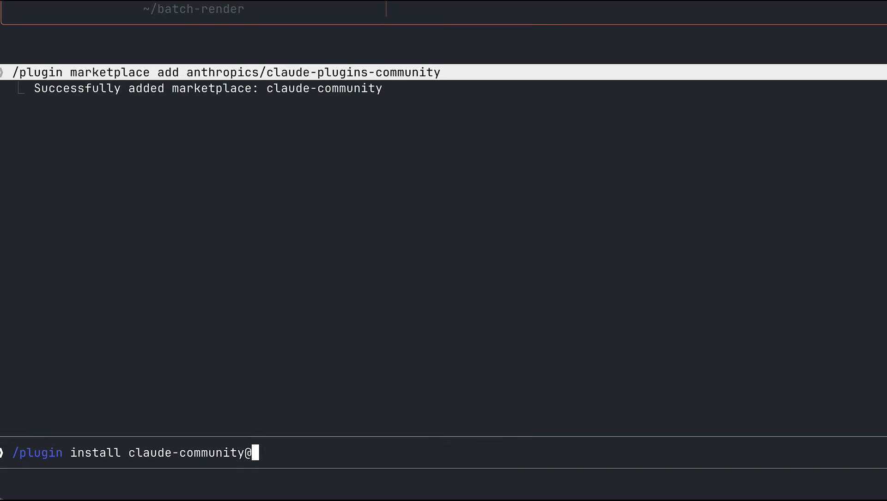

> 📌 *From the screenshot:* adding the marketplace prints **"Successfully added marketplace: claude-community"**, and installs then resolve as **`/plugin install claude-community@…`** — showing the marketplace name becomes the right-hand side of the `@` in an install (my reading).

---

### 🏪 Adding a Marketplace for Your Team

For a team, the better move is to **add a private marketplace once.** A **marketplace** is a shared source that plugins resolve through:

```text
/plugin marketplace add your-org/claude-plugins
```

- Call it whatever you want. Once added, **every install after that resolves through it** → **centralized discovery, version tracking, and updates in one place** instead of scattered across everyone's laptops.
- Browse what's available from the **Discover tab** — it lists the plugins on your marketplaces so you can search and pick.


> 📌 *From the screenshot:* the Discover tab shows **"Install Plugins (7/2198)"** — a large community catalog — with search and per-plugin descriptions, and footer hints *"Type to search · Space to toggle · Enter to view · Esc to go back"* (my reading).

---

### 🔍 Read Before You Install

**The part that matters most.** A plugin **runs code on your machine, with your privileges.** Its **hooks fire on every matching tool call.** So if you install a plugin for its **skills**, you also get its **PreToolUse and Stop hooks** — whether you read them or not.

> ⚠️ A community plugin could ship a **Stop hook that calls a network endpoint every time**, and nothing in your configuration would warn you. **That's not a reason to avoid plugins — it's a reason to look first.**

**Before you install, check the plugin's details.** Claude Code shows:
- **What it will install**
- An **estimate of the context cost**
- A plain warning that **Anthropic doesn't control what's inside third-party plugins**

#### Where plugins come from

| Source | How it's reviewed |
|--------|-------------------|
| 🧑‍🤝‍🧑 **Community marketplace** | The in-app **submission form** posts here **after Anthropic's automated review** |
| ⭐ **Official marketplace** | **Curated on its own separate track** |

> ⚠️ **But reviewed isn't the same as trusted.** Automated review catches some things, not everything. **The rule stands:** install plugins and add marketplaces **only from sources you truly trust**, and **check what a plugin actually does** before turning it on.

---

### 🧩 Components Run Alongside Yours

A plugin **doesn't overwrite your configuration** — its components **run alongside your own.** Mostly good, but with consequences:

| Behavior | What it means |
|----------|---------------|
| 🪝 **Hooks stack** | A plugin's PreToolUse and your own PreToolUse **both fire** on every tool call — **neither replaces the other** (exactly why you read the details first) |
| 🏷️ **Namespaced** | Skills, agents, and commands are **namespaced under the plugin name**, so they **never clash** with yours |
| ⚙️ **Narrow `settings.json`** | A plugin can ship a `settings.json`, but Claude Code honors **only two keys**: the **agent** and **subagent status line** keys |

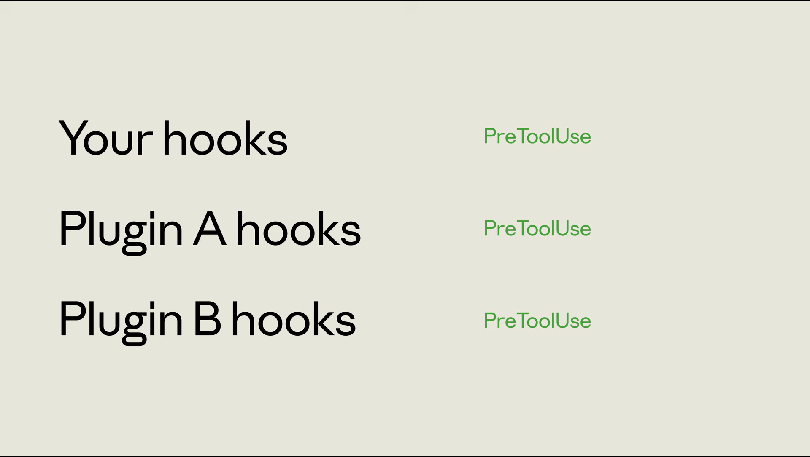

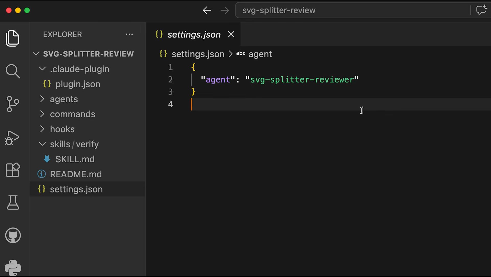

> 📌 *From the screenshots:* the hooks illustration shows **your PreToolUse and each plugin's PreToolUse all firing** (stacking), and the `settings.json` holds **just the `agent` key** (`"svg-splitter-reviewer"`) — the narrow slice Claude Code honors, promoting that subagent to the main thread (my reading).

> ⚠️ **That `agent` key is worth a pause.** Setting it **promotes one of the plugin's subagents to the main thread** — along with its **system prompt, tool restrictions, and model.** In other words, enabling the plugin **can change how Claude Code behaves by default.** One of the main reasons to **look before you even turn it on.**

> 💡 Once installed, you can **see everything a plugin added, manage it, and uninstall it** from the **plugin panel.**

> 🔗 These components are the ones from earlier chapters/courses — skills ([Ch 3](#chapter-3-verification-skills)), hooks ([Ch 5](#chapter-5-hooks)), subagents & MCP ([Claude Code 101, Ch 9 & 11](../claude-code-101/README.md)) — now **bundled and shippable** (my mapping).

---

### 🛠️ Packaging Your Own Plugin

Once you've built a `.claude` directory that works, **don't make your team copy-paste it — package it.** You **don't have to restructure anything**: a plugin uses the **same `.claude` shape you already use.**

| Component | Where it lives |
|-----------|----------------|
| **Skills** | **One folder per skill** |
| **Subagents** | **One markdown file per subagent** under `agents` |
| **Hooks / MCP** | **`hooks/hooks.json`** and **`.mcp.json`** at the **plugin root** |

> **The directory structure does most of the work** — Claude Code **discovers components by convention.**

#### The manifest (optional)

On top of that, an **optional manifest** at **`.claude-plugin/plugin.json`** holds the **name, version, description, and author:**

```json
{
  "name": "svg-splitter-review",
  "version": "0.1.0",
  "description": "Reviews the SVG Splitter repo",
  "author": {
    "name": "Lewis Menelaws"
  }
}
```

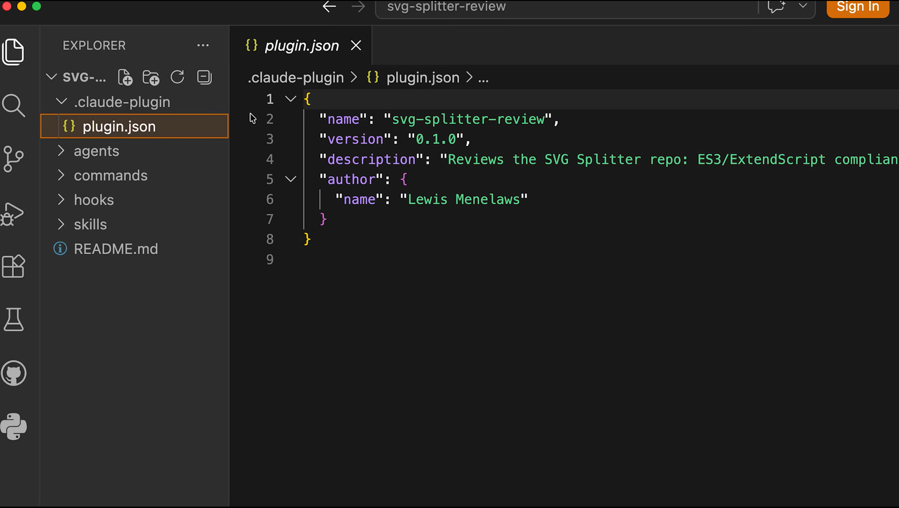

> 📌 *From the screenshot:* the plugin keeps the familiar layout — **`.claude-plugin/plugin.json`** beside **`agents/`, `commands/`, `hooks/`, and `skills/`** folders — i.e. the same `.claude` shape, discovered by convention (my reading).

- **Leave it out** and Claude Code **still discovers your components** by directory convention. But:

| Field | Why it matters |
|-------|----------------|
| **`name`** | The **only required field.** It **namespaces your skills** as **`company-name:skill-name`**, keeping them from colliding with anyone else's |
| **`version`** | Version it like any other dependency — that's what makes **updates and version tracking** work across your team |

---

### 🔁 Recap (The Takeaway)

Two simple rules cover most of this:

1. **When you use plugins — read before you install.** A plugin runs **code with your privileges**, so look at its **hooks, agents, and MCP servers** first.
2. **When you build one — package your `.claude` the moment it works.** One manifest, one install.

> **One installable unit, and the setup you trust reaches your entire team.**

### 📝 Quick Reference: Plugins (for exam prep)

| Concept | Key point |
|---------|-----------|
| 📦 **Plugin** | **One installable unit**: skills + subagents + hooks + MCP (+ LSP, monitors, themes, slice of `settings.json`) |
| ⬇️ **Install** | `/plugin install org@name` → then **`/reload-plugins`** |
| 🏪 **Marketplace** | `/plugin marketplace add org/repo` **once** → central discovery, versioning, updates; browse via **Discover tab** |
| ⚠️ **Read first** | Runs **code with your privileges**; **hooks fire on every matching tool call** (you get its PreToolUse/Stop too) |
| 🧐 **Before install** | Claude shows **what it installs**, **context-cost estimate**, and a **third-party warning** |
| 🧑‍🤝‍🧑 **Sources** | Community marketplace = **submission form after automated review**; official = **curated separate track**; **reviewed ≠ trusted** |
| 🪝 **Hooks stack** | Plugin's + yours both fire; neither replaces the other |
| 🏷️ **Namespaced** | Skills/agents/commands namespaced under plugin name → **no clashes** |
| ⚙️ **settings.json** | Only **two keys** honored: **agent** + **subagent status line**; the **`agent` key can change default behavior** |
| 🛠️ **Build** | Same `.claude` shape (skill folders, `agents/*.md`, `hooks/hooks.json`, `.mcp.json`) — discovered by convention |
| 📄 **Manifest** | `.claude-plugin/plugin.json` (optional); **`name` required** (namespaces as `company:skill`); **version** for updates |

> 🎓 **Memory tip:** two rules — **"Read before you install · Package the moment it works."** Components **S-A-N**: **S**tack (hooks), **A**lias/namespace (skills/agents), **N**arrow settings (2 keys). Manifest lives at **`.claude-plugin/plugin.json`**, only **`name`** required.

**Key features for exam:**
- A **plugin = one installable unit** bundling skills, subagents, hooks, and MCP configs (plus LSP servers, monitors, themes, a slice of `settings.json`).
- Install with **`/plugin install org@name`** (then **`/reload-plugins`**); for teams, **`/plugin marketplace add org/repo`** once → central discovery/versioning/updates; browse via the **Discover tab**.
- **Read before you install:** a plugin **runs code with your privileges** and its **hooks fire on every matching tool call**; Claude shows what it installs, a **context-cost estimate**, and a **third-party warning**. **Reviewed ≠ trusted.**
- Components **run alongside** yours: **hooks stack**, skills/agents/commands are **namespaced**, and only **two `settings.json` keys** are honored (**agent** + **subagent status line**) — the **`agent` key can change default behavior**.
- **Package your own** with the **same `.claude` shape** (skill folders, `agents/*.md`, `hooks/hooks.json`, `.mcp.json`) + optional **`.claude-plugin/plugin.json`** manifest where **`name` is the only required field** (namespaces skills as `company:skill`) and **version** enables updates.
