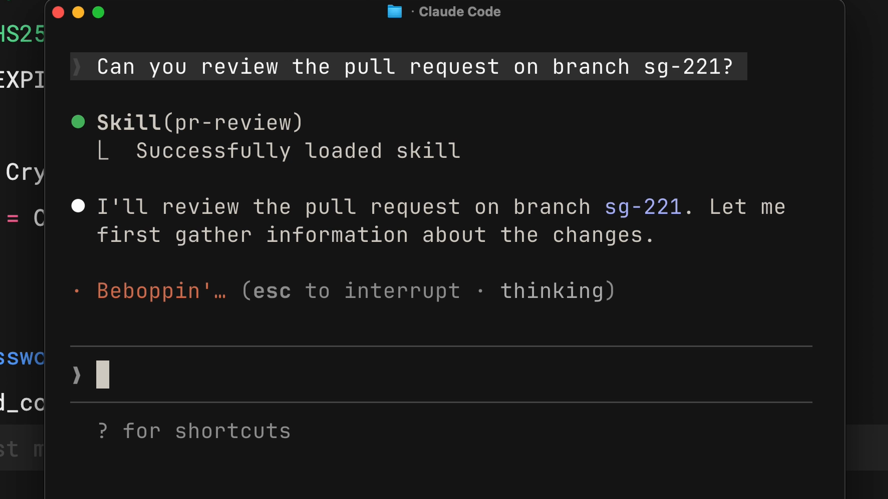
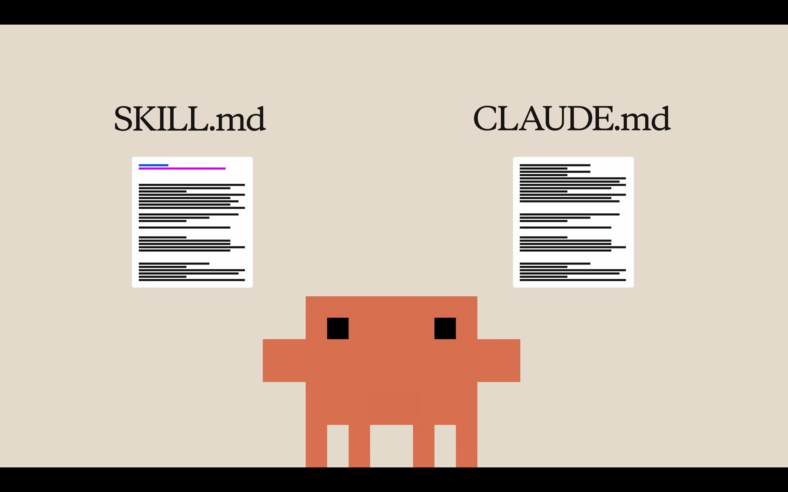
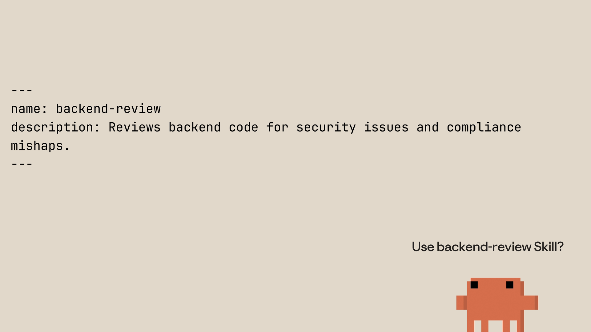
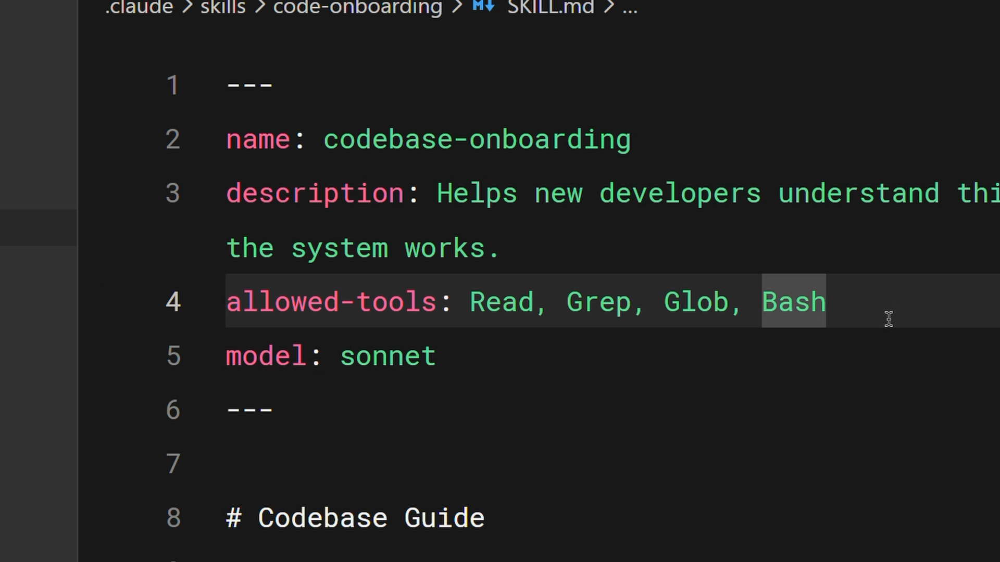
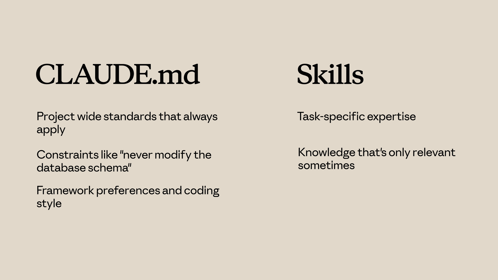
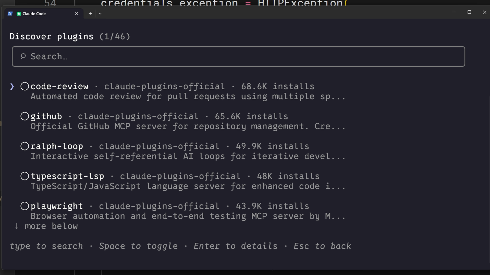
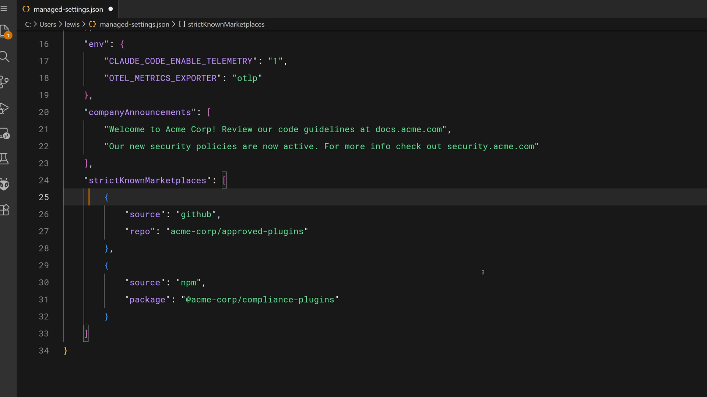
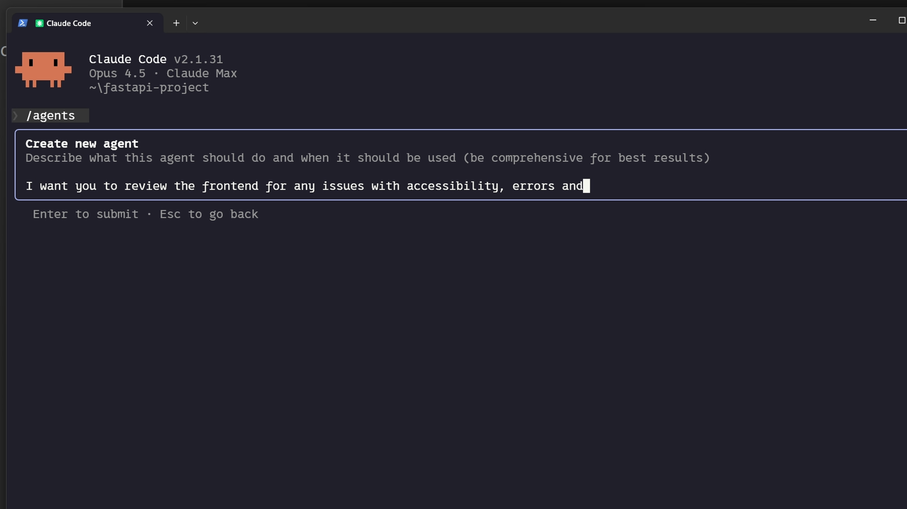
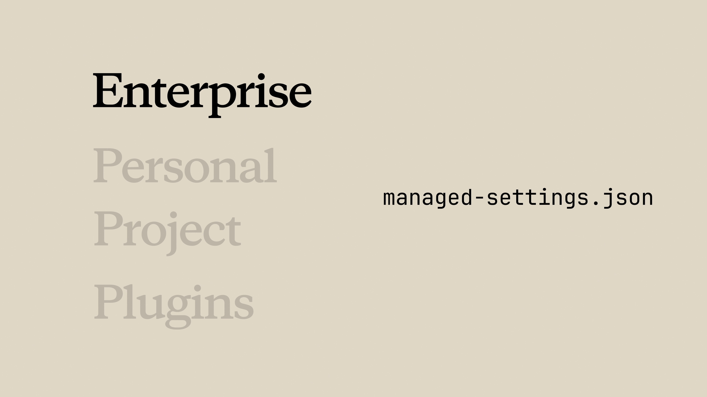

[⬅ Back to course index](../README.md)

# 📚 Introduction to Agent Skills — Course Notes

> Builds on [Claude Code 101](../claude-code-101/README.md) (Ch 10 "Skills") and [Claude Code in Action](../claude-code-in-action/README.md) (Ch 3 "Verification Skills"). This course is the dedicated deep dive: what skills are, creating one, multi-file skills, how they compare to other features, sharing, and troubleshooting.

### 🗺️ Course Map

| Unit | Chapters | Status |
|------|----------|:------:|
| 🗂️ **Course Overview** | [Ch 1: What Are Skills?](#chapter-1-what-are-skills) · [Ch 2: Creating Your First Skill](#chapter-2-creating-your-first-skill) · [Ch 3: Configuration and Multi-File Skills](#chapter-3-configuration-and-multi-file-skills) · [Ch 4: Skills vs. Other Claude Code Features](#chapter-4-skills-vs-other-claude-code-features) · [Ch 5: Sharing Skills](#chapter-5-sharing-skills) · [Ch 6: Troubleshooting Skills](#chapter-6-troubleshooting-skills) | ✅ |

> _This course has **no quiz** — it ends with a course wrap-up after Chapter 6._

> **Annotation guide for these notes:** 📌 = my own reading from screenshots/context — **not stated in the lesson text itself**. 🔗 = my cross-reference between chapters — **my mapping, not the lesson's wording**. For exam prep, focus on the **📝 Quick Reference** tables and **Key features for exam** bullet lists at the end of each chapter.

---

> 🗂️ **Course Overview** · Chapter 1

## Chapter 1: What Are Skills?

> 🎬 **Video: What are skills? (3 min).** Skills are **reusable markdown files that teach Claude Code how to handle specific tasks automatically.** Instead of repeating instructions every time you ask Claude to review a PR or write a commit message, you **write a skill once** and Claude applies it whenever the task comes up.

### 🎯 Learning Objectives

- **Define** what Claude Code skills are and how they work
- **Explain** where skills live (personal vs. project directories)
- **Distinguish** between skills, CLAUDE.md, and slash commands
- **Identify** scenarios where skills are the right customization tool

### 🧠 Key Takeaways

- Skills are **folders of instructions, scripts, and resources** Claude Code can **discover and use**. Each skill lives in a **`SKILL.md`** file with a **`name`** and **`description`** in its frontmatter
- Claude uses the **`description` to match** skills to requests — it compares your request against available skill descriptions and **activates the ones that match**
- **Personal skills** → `~/.claude/skills` (follow you across all projects). **Project skills** → `.claude/skills` inside a repo (shared with anyone who clones it)
- Skills **load on demand** — unlike **CLAUDE.md** (loads into *every* conversation) or **slash commands** (require *explicit* invocation), skills **activate automatically** when Claude recognizes the situation
- **Rule of thumb:** if you find yourself **explaining the same thing repeatedly**, that's a skill waiting to be written

---

### 📦 What Skills Are

Skills are **folders of instructions, scripts, and resources** that Claude Code can discover and use to handle tasks **more accurately and efficiently.** Each skill lives in a **`SKILL.md`** file with a **`name` and `description`** in its frontmatter.

- **The `description` is how Claude decides whether to use the skill.** When you ask Claude to review a PR, it **reads your request, compares it to all available skill descriptions, and activates the ones that match.**

Example frontmatter:

```yaml
---
name: pr-review
description: Reviews pull requests for code quality. Use when reviewing PRs or checking code changes.
---
```

> Below the frontmatter, you write the **actual instructions** — your review checklist, formatting preferences, or whatever Claude needs for that task.


> 📌 *From the screenshot:* the skill lives at **`.claude/skills/pr-review/SKILL.md`** (one folder per skill), and the body is a structured checklist (`## Code Quality`, `## FastAPI Specific`) with items like *readability, consistent patterns, no hardcoded secrets, Pydantic schemas* — i.e. the "actual instructions" below the frontmatter. A sibling **`commit-message`** skill shows multiple skills coexisting (my reading).

#### 🔎 Matching in action

When Claude matches a skill to your request, **you'll see it load in the terminal.**



> 📌 *From the screenshot:* a plain request — *"Can you review the pull request on branch sg-221?"* — triggers **`Skill(pr-review) · Successfully loaded skill`** with **no slash command typed.** That's the automatic, description-based matching in action (my reading).

---

### 📍 Where Skills Live

| Scope | Location | Who gets it |
|-------|----------|-------------|
| 👤 **Personal** | **`~/.claude/skills`** (home directory) | **Follows you across all your projects** — e.g. your commit-message style, documentation format, how you like code explained |
| 📁 **Project** | **`.claude/skills`** inside the repo root | **Anyone who clones the repo gets them automatically** — team standards like brand guidelines, preferred fonts/colors |

- On **Windows**, personal skills live in **`C:/Users/<your-user>/.claude/skills`**.
- **Project skills get committed to version control** alongside your code, so the whole team shares them.

> 🔗 Same locations as [Claude Code 101, Ch 10](../claude-code-101/README.md) and the `.claude/skills` sharing point from [Claude Code in Action, Ch 3](../claude-code-in-action/README.md) (my mapping).

---

### 🆚 Skills vs. CLAUDE.md vs. Slash Commands

Skills are unique because they're **automatic and task-specific.**

| Feature | When it loads | Invocation |
|---------|---------------|------------|
| 📋 **CLAUDE.md** | Into **every conversation** | Always on (e.g. "always use TypeScript strict mode" goes here) |
| 🧰 **Skill** | **On demand, when it matches your request** | **Automatic** — Claude loads only the **name + description** initially, so it **doesn't fill the context window**; the body loads when you actually ask |
| ⌨️ **Slash command** | When you **type it** | **Explicit** — you invoke it yourself |

> 💡 **Why on-demand matters:** your PR-review checklist doesn't need to be in context when you're debugging — **it loads only when you actually ask for a review.**



> 🔗 This is the three-surfaces idea from [Claude Code in Action, Ch 3](../claude-code-in-action/README.md) (CLAUDE.md = always-on conventions · Skills = task procedures · Hooks = can't-be-skipped) — here focused on the **loading difference** (my mapping).

---

### 🎯 When to Use Skills

Skills work best for **specialized knowledge that applies to specific tasks:**

| Use case |
|----------|
| 🔍 **Code review standards** your team follows |
| ✍️ **Commit message formats** you prefer |
| 🎨 **Brand guidelines** for your organization |
| 📄 **Documentation templates** for specific types of docs |
| 🐛 **Debugging checklists** for particular frameworks |

> 📏 **The rule of thumb:** if you find yourself **explaining the same thing to Claude repeatedly**, that's a skill waiting to be written.

> 🔗 Same "typed it twice → make it a skill" rule as [Claude Code in Action, Ch 3](../claude-code-in-action/README.md).

---

### 🔁 Recap

A **skill is a markdown file (`SKILL.md`) that teaches Claude how to do something once**, and Claude **applies that knowledge automatically whenever it's relevant.** Skills live **personally** (`~/.claude/skills`) or **per-project** (`.claude/skills`), match by **description**, and **load on demand** — keeping your context window free until the task comes up.

### 📝 Quick Reference: What Are Skills? (for exam prep)

| Concept | Key point |
|---------|-----------|
| 📦 **Skill** | A **folder** with a **`SKILL.md`** (frontmatter: **`name`** + **`description`**) + instructions |
| 🎯 **Matching** | Claude compares your request to each skill's **`description`** and activates matches |
| 👤 **Personal** | `~/.claude/skills` — follows you across all projects (Windows: `C:/Users/<user>/.claude/skills`) |
| 📁 **Project** | `.claude/skills` in the repo — committed to version control, shared with everyone who clones |
| ⏳ **Load on demand** | Only **name + description** load up front; the **body loads when it matches** → no context bloat |
| 🆚 **vs CLAUDE.md** | CLAUDE.md loads into **every** conversation; skills load **only when relevant** |
| 🆚 **vs slash commands** | Slash commands need **explicit typing**; skills activate **automatically** |
| 📏 **When to use** | Task-specific specialized knowledge — review standards, commit formats, brand guidelines, doc templates, debug checklists |

> 🎓 **Memory tip:** **"Write once, match by description, load on demand."** Locations: **`~/.claude/skills` = personal (travels with you)**, **`.claude/skills` = project (travels with the repo)**. The three surfaces by *loading*: **CLAUDE.md = always · Skill = auto-when-relevant · Slash command = explicit.**

**Key features for exam:**
- A skill = a **folder with a `SKILL.md`** whose frontmatter has a **`name`** and **`description`**; the body holds the instructions.
- Claude **matches skills by their `description`** against your request and **activates automatically** — no slash command needed.
- **Personal skills** → `~/.claude/skills` (all projects); **project skills** → `.claude/skills` (committed, shared with the repo).
- Skills **load on demand** (only name + description up front), unlike **CLAUDE.md** (every conversation) and **slash commands** (explicit invocation).
- **Rule of thumb:** repeating the same explanation → write a skill. Best for review standards, commit formats, brand guidelines, doc templates, debug checklists.

---

> 🗂️ **Course Overview** · Chapter 2

## Chapter 2: Creating Your First Skill

> 🎬 **Video: Creating your first skill (4 min).** Build a skill **from scratch** — a **personal PR-description skill** that works across all your projects. See how to structure the `SKILL.md`, test it, and understand how Claude Code **discovers and matches** skills behind the scenes, plus the **priority hierarchy** that decides which skill wins when names conflict.

### 🎯 Learning Objectives

- **Create** a skill from scratch with proper frontmatter structure
- **Test and verify** that a skill loads correctly in Claude Code
- **Explain** how Claude Code matches incoming requests to available skills
- **Describe** the skill **priority hierarchy** (Enterprise → Personal → Project → Plugins)

### 🧠 Key Takeaways

- A skill is a **directory** containing a **`SKILL.md`** with **metadata (`name`, `description`) in frontmatter** and **instructions below**
- Claude loads **only names + descriptions at startup**, then matches requests against those descriptions using **semantic matching**
- You get a **confirmation prompt** before Claude loads the **full skill content** into context
- **Priority for name conflicts:** **Enterprise → Personal → Project → Plugins**
- To **update** a skill, edit its `SKILL.md`; to **remove** one, delete its directory. **Always restart Claude Code** for changes to take effect

---

### 🏗️ Creating a Skill

We'll build a **personal** skill that teaches Claude to write PR descriptions in a consistent format. Being personal, it **lives in your home directory** and works **across all your projects.**

**Step 1 — make a directory** inside the skills folder; **the directory name should match the skill name:**

```bash
mkdir -p ~/.claude/skills/pr-description
```

**Step 2 — create `SKILL.md`** inside it, with two parts separated by frontmatter dashes:

```markdown
---
name: pr-description
description: Writes pull request descriptions. Use when creating a PR, writing a PR, or when the user asks to summarize changes for a pull request.
---

When writing a PR description:

1. Run `git diff main...HEAD` to see all changes on this branch
2. Write a description following this format:

## What
One sentence explaining what this PR does.

## Why
Brief context on why this change is needed

## Changes
- Bullet points of specific changes made
- Group related changes together
- Mention any files deleted or renamed
```

| Part | Role |
|------|------|
| **`name`** | **Identifies** your skill |
| **`description`** | Tells Claude **when to use it** — this is the **matching criteria** |
| **Everything after the second `---`** | The **instructions** Claude follows when the skill is activated |


> 📌 *From the screenshot:* the Skills sidebar shows this skill sitting alongside **commit-message, debugging, and documentation** skills, and the output panel reads *"Loading configuration… Done loading configuration"* (my reading).

---

### 🧪 Testing Your Skill

Claude Code **loads skills at startup**, so **restart your session** after creating one. Verify it's available by checking the **available skills list** — you should see `pr-description` listed.


- To test: make some changes on a branch and say *"write a PR description for my changes."* Claude **indicates it's using the pr-description skill**, checks your diff, and writes a description following your template — **same format every time.**

> 📌 *From the screenshot:* the panel confirms skills can be invoked **either** by a slash command (`/commit`, `/debugging`) **or** by asking Claude directly — matching the automatic-vs-explicit distinction from [Chapter 1](#chapter-1-what-are-skills). It also shows each skill's description is what's loaded at this stage, not the body (my reading).

---

### 🔎 How Skill Matching Works

When Claude Code **starts**, it scans **four locations** for skills but loads **only the name and description — not the full content.** (This matters for the priority rules below.)

| Step | What happens |
|------|--------------|
| 1️⃣ **Startup scan** | Scans four locations, loads **only name + description** of each skill |
| 2️⃣ **Request** | Claude compares your message against **all available skill descriptions** (semantic matching) |
| 3️⃣ **Match** | e.g. *"explain what this function does"* matches a skill described as *"explain code with visual diagrams"* — the **intent overlaps** |
| 4️⃣ **Confirm** | Claude **asks you to confirm loading** the skill (keeps you aware of what context it's pulling in) |
| 5️⃣ **Execute** | After you confirm, Claude **reads the complete `SKILL.md`** and follows its instructions |



> 📌 *From the screenshot:* the confirmation reads **"Use backend-review Skill?"** — the step 4 prompt in action, shown with a `backend-review` skill whose descriptive name avoids conflicts (the naming tip below) (my reading).

---

### 🏆 Skill Priority

If you clone a repo with a skill named the same as one of your personal skills — **which wins?** There's a clear order:

| # | Scope | Location | Priority |
|---|-------|----------|:--------:|
| 1 | 🏢 **Enterprise** | Managed settings | **Highest** |
| 2 | 👤 **Personal** | `~/.claude/skills` (home directory) | ↓ |
| 3 | 📁 **Project** | `.claude/skills` inside a repo | ↓ |
| 4 | 🧩 **Plugins** | Installed plugins | **Lowest** |

- This lets organizations **enforce standards** via enterprise skills while still allowing **individual customization.** If your company has an enterprise `code-review` and you make a personal `code-review` with the same name, **the enterprise version takes precedence.**
- ✅ **To avoid conflicts, use descriptive names** — instead of `review`, use `frontend-review` or `backend-review`.

> 🎓 **Order mnemonic:** **E-P-P-P** → **E**nterprise > **P**ersonal > **P**roject > **P**lugins (enterprise always wins; plugins always lose).

> 📌 **Beyond the course (not on the exam):** the course teaches **Enterprise → Personal → Project → Plugins**, and the [Claude Academy course page](https://academy.claude.com/courses/introduction-to-agent-skills/creating-your-first-skill) confirms this wording — **learn this order for the exam.** In the live product, the **Personal-vs-Project** relationship has since gained nuance (some docs describe project skills overriding personal ones, configurable via a `skillOverrides` setting). Ignore that for exam prep; just know the course's order.

---

### 🔄 Updating and Removing Skills

| Action | How |
|--------|-----|
| ✏️ **Update** | Edit its **`SKILL.md`** file |
| 🗑️ **Remove** | Delete its **directory** |
| 🔁 **Apply changes** | **Restart Claude Code** after any change |

> ⚠️ **Always restart Claude Code** — skills are loaded at startup, so edits and deletions don't take effect until you do.

---

### 🔁 Recap

Creating a skill means making a **directory with a `SKILL.md`** containing **metadata + instructions.** Claude loads **names and descriptions at startup**, **matches** incoming requests against those descriptions, and **asks for confirmation** before loading the full content. **Priority rules** handle name conflicts — **Enterprise overrides Personal overrides Project overrides Plugins** — and you **restart Claude Code** for any change to take effect.

### 📝 Quick Reference: Creating Your First Skill (for exam prep)

| Concept | Key point |
|---------|-----------|
| 🏗️ **Create** | `mkdir -p ~/.claude/skills/<name>` (dir name = skill name), then add a **`SKILL.md`** |
| 📄 **Structure** | Frontmatter (`name`, `description`) between `---` dashes · instructions below the second `---` |
| 🎯 **`description`** | The **matching criteria** — how Claude decides when to use the skill |
| 🧪 **Test** | **Restart** → check the **available skills list** → make a request that matches |
| 🔎 **Matching** | Startup loads **only name + description** (4 locations) → semantic match → **confirm** → read full `SKILL.md` |
| 🏆 **Priority** | **Enterprise → Personal → Project → Plugins** (enterprise wins, plugins lose) |
| 🏷️ **Avoid conflicts** | Use **descriptive names** (`frontend-review`, not `review`) |
| 🔄 **Update / remove** | Edit `SKILL.md` / delete the directory — **restart Claude Code** either way |

> 🎓 **Memory tip:** **"Make a dir, write SKILL.md, restart."** Matching = **scan names+descriptions → match → confirm → load body.** Conflicts = **E-P-P-P** (Enterprise > Personal > Project > Plugins).

**Key features for exam:**
- A skill = a **directory with a `SKILL.md`** (frontmatter `name` + `description`, instructions below); create via `mkdir -p ~/.claude/skills/<name>`.
- Claude loads **only name + description at startup** from **four locations**, then **semantically matches** requests to descriptions.
- Claude shows a **confirmation prompt** before loading the **full skill body** into context.
- **Priority for name conflicts: Enterprise → Personal → Project → Plugins** (enterprise highest, plugins lowest).
- **Avoid conflicts** with descriptive names (`backend-review`, not `review`).
- **Update** = edit `SKILL.md`; **remove** = delete the directory; **always restart Claude Code** for changes to take effect.

---

> 🗂️ **Course Overview** · Chapter 3

## Chapter 3: Configuration and Multi-File Skills

> 🎬 **Video: Configuration and multi-file skills (4 min).** The advanced techniques that make skills more powerful: the full set of **metadata fields**, how to write **descriptions that trigger reliably**, **restricting tool access** for security-sensitive workflows, and **organizing larger skills** across multiple files using **progressive disclosure.**

### 🎯 Learning Objectives

- Configure advanced skill metadata — **`allowed-tools`** and **`model`**
- Write effective **descriptions** that reliably trigger on the right requests
- Use **`allowed-tools`** to restrict what Claude can do when a skill is active
- Organize complex skills with **progressive disclosure** and **multi-file structures**

### 🧠 Key Takeaways

- **`name`** and **`description`** are **required**; **`allowed-tools`** and **`model`** are **optional** but powerful
- A good **description** answers two questions: **What does the skill do?** and **When should Claude use it?**
- **`allowed-tools`** restricts which tools Claude can use while the skill is active — useful for **read-only / security-sensitive** workflows
- **Progressive disclosure:** keep `SKILL.md` **under 500 lines** and link to supporting files (**references, scripts, assets**) that Claude reads **only when needed**
- **Scripts execute without loading their contents** into context — only the **output** consumes tokens

---

### 🏷️ Skill Metadata Fields

The **agent skills open standard** supports several frontmatter fields. **Two are required, the rest optional:**

| Field | Required? | Purpose | Limits / notes |
|-------|:---------:|---------|----------------|
| **`name`** | ✅ | Identifies the skill | **Lowercase letters, numbers, hyphens only · max 64 chars · should match the directory name** |
| **`description`** | ✅ | Tells Claude **when to use it** (matching) | **Max 1,024 chars** · the **most important field** |
| **`allowed-tools`** | ⬜ | **Restricts** which tools Claude can use when the skill is active | Omit = no restriction |
| **`model`** | ⬜ | Specifies **which Claude model** the skill uses | e.g. `sonnet` |

> 📌 **Beyond the course (not on the exam):** the course says *"two are required."* The live [Claude Academy course page](https://academy.claude.com/courses/introduction-to-agent-skills/configuration-and-multi-file-skills) now notes that in **Claude Code specifically, all fields are technically optional and only `description` is *recommended*** (and Claude Code adds its own fields like `model`). For the exam, go with the course's rule: **`name` + `description` required.**

---

### ✍️ Writing Effective Descriptions

**Be explicit.** If someone told you *"your job is to help with docs,"* you wouldn't know what to do — Claude thinks the same way.

A good description answers **two questions:**

| Question |
|----------|
| ❓ **What does the skill do?** |
| ❓ **When should Claude use it?** |

> 💡 **If your skill isn't triggering** when you expect, **add more keywords that match how you actually phrase your requests.** The description is what Claude uses to decide relevance, so the **language matters.**

---

### 🔒 Restricting Tools with `allowed-tools`

Sometimes you want a skill that can **only read files, not modify them** — for **security-sensitive workflows, read-only tasks, or guardrails.**

```yaml
---
name: codebase-onboarding
description: Helps new developers understand how the system works.
allowed-tools: Read, Grep, Glob, Bash
model: sonnet
---
```



| Behavior | |
|----------|--|
| ✅ **With `allowed-tools: Read, Grep, Glob, Bash`** | While the skill is active, Claude can **only use those tools, without asking permission** — **no editing, no writing** |
| ⬜ **Omit `allowed-tools` entirely** | **No restriction** — Claude uses its normal permission model |

> 🔗 This is a skill-level version of the tool-restriction idea — compare the `allowedTools` option in the Agent SDK and GitHub Action ([Claude Code in Action, Ch 6 & 7](../claude-code-in-action/README.md)) (my mapping).

---

### 🪜 Progressive Disclosure

Skills **share Claude's context window** with your conversation. When Claude activates a skill, it **loads the `SKILL.md` into context.** But sometimes you need references, examples, or utility scripts.

⚠️ **Cramming everything into one 2,000-line file** has two problems: it **eats context window space** and it's **not fun to maintain.**

**Progressive disclosure solves this:** keep **essential instructions in `SKILL.md`** and put **detailed reference material in separate files** Claude reads **only when needed.**

The open standard suggests organizing the skill directory with:

| Folder | Holds |
|--------|-------|
| 📜 **`scripts/`** | Executable code |
| 📚 **`references/`** | Additional documentation |
| 🎨 **`assets/`** | Images, templates, or other data files |

Then in `SKILL.md`, **link to the supporting files** with clear instructions about **when to load them:**


> In this example Claude reads **`architecture-guide.md` only when someone asks about system design.** If they're asking *where to add a component*, it **never loads** that file. It's like having a **table of contents in the context window** rather than the entire document.

> 📏 **Rule of thumb:** keep **`SKILL.md` under 500 lines.** Exceeding that → consider splitting into reference files.

> 📌 *From the screenshot:* the body uses explicit **"Level 2 / Level 3"** headings each gated by **"Only load when user requests…"**, with the `references/`, `scripts/`, and `assets/` folders in the explorer — the multi-file layout in practice (my reading).

---

### ⚙️ Using Scripts Efficiently

**Scripts in your skill directory can run without loading their contents into context.** The script **executes and only the output consumes tokens.**

> 🔑 **The key instruction to include in `SKILL.md`: tell Claude to *run* the script, not *read* it.**

Particularly useful for:

| Use case |
|----------|
| ✅ **Environment validation** |
| 🔄 **Data transformations** that need to be consistent |
| 🧪 **Operations more reliable as tested code** than generated code |

> 🔗 Same "scripts are executed, not loaded" point as [Claude Code in Action, Ch 3](../claude-code-in-action/README.md) — here framed as a token-efficiency technique (my mapping).

---

### 🔁 Recap

Skills support metadata fields: **`name`** and **`description`** (required), **`allowed-tools`** (restricts available tools), and **`model`** (which Claude to use). Descriptions need **specific actions and trigger phrases** to match reliably. For larger skills, use **progressive disclosure** — keep `SKILL.md` **under 500 lines** and link to supporting files that **load only when needed**. **Scripts execute without loading their contents**, keeping context efficient.

### 📝 Quick Reference: Configuration and Multi-File Skills (for exam prep)

| Field / concept | Key point |
|-----------------|-----------|
| 🏷️ **`name`** (required) | Lowercase + numbers + hyphens · **max 64 chars** · matches directory name |
| 📝 **`description`** (required) | **Max 1,024 chars** · the matching criteria · answer **what + when** |
| 🔒 **`allowed-tools`** (optional) | Restricts tools while active (e.g. `Read, Grep, Glob, Bash`) — read-only/security; **omit = no restriction** |
| 🧠 **`model`** (optional) | Which Claude model the skill uses (e.g. `sonnet`) |
| ✍️ **Good description** | Specific actions + **trigger keywords** matching how you phrase requests |
| 🪜 **Progressive disclosure** | `SKILL.md` **< 500 lines**; link to **`references/` · `scripts/` · `assets/`** loaded only when needed |
| ⚙️ **Scripts** | **Run, don't read** — only the **output** uses tokens (env validation, consistent transforms, tested code) |

> 🎓 **Memory tip:** required = **N-D** (**N**ame, **D**escription), optional = **A-M** (**A**llowed-tools, **M**odel). Limits: **name ≤ 64, description ≤ 1024.** Big skills: **< 500 lines + progressive disclosure**; scripts = **run, don't read.**

**Key features for exam:**
- Frontmatter fields: **`name`** + **`description`** required; **`allowed-tools`** + **`model`** optional.
- **`name`** ≤ 64 chars (lowercase/numbers/hyphens, matches dir); **`description`** ≤ 1,024 chars and is the **matching criteria**.
- A good **description** answers **what the skill does** and **when to use it**; add **trigger keywords** if it under-triggers.
- **`allowed-tools`** restricts tools while the skill is active (read-only/security); **omit = normal permission model**.
- **Progressive disclosure:** keep `SKILL.md` **under 500 lines**, split depth into **`references/`, `scripts/`, `assets/`** loaded only when needed.
- **Scripts execute without loading their contents** — only output uses tokens; tell Claude to **run, not read** them.

---

> 🗂️ **Course Overview** · Chapter 4

## Chapter 4: Skills vs. Other Claude Code Features

> 🎬 **Video: Skills vs. other Claude Code features (3 min).** Claude Code offers several customization options — **Skills, CLAUDE.md, subagents, hooks, MCP servers** — and **choosing the wrong one leads to unnecessary complexity.** They solve different problems; knowing when to use each **prevents you from building the wrong thing.**

### 🎯 Learning Objectives

- **Compare** skills to CLAUDE.md, subagents, hooks, and MCP servers
- **Choose** the right customization feature for a given use case
- **Design** a complementary setup that combines multiple features

### 🧠 Key Takeaways

- **CLAUDE.md** loads into **every conversation** → always-on project standards. **Skills** load **on demand** → task-specific expertise
- **Subagents** run in **isolated execution contexts** → delegated work. **Skills** add knowledge to your **current conversation**
- **Hooks** are **event-driven** (fire on file saves, tool calls). **Skills** are **request-driven** (activate based on what you're asking)
- **MCP servers** provide **external tools and integrations** — a different category entirely
- **Each feature handles its own specialty — combine them** rather than forcing everything into one approach

---

### 📋 CLAUDE.md vs. Skills

| | 📋 **CLAUDE.md** | 🧰 **Skills** |
|---|---|---|
| **Loads** | Into **every conversation, always** | **On demand**, when a request matches |
| **Use for** | **Project-wide standards** that always apply · constraints like *"never modify the database schema"* · framework preferences and coding style | **Task-specific expertise** · knowledge that's **only relevant sometimes** · detailed procedures that would **clutter every conversation** |



> 💡 Your **PR review checklist doesn't need to be in context when writing new code** — it activates when you ask for a review.

> 🔗 Same distinction as [Chapter 1](#chapter-1-what-are-skills) and [Claude Code in Action, Ch 2–3](../claude-code-in-action/README.md), here laid out as a side-by-side use-case split.

---

### 🤖 Skills vs. Subagents

| | 🧰 **Skills** | 🤖 **Subagents** |
|---|---|---|
| **Context** | Add knowledge to your **current conversation** — instructions join the **existing context** | Run in a **separate context** — receive a task, work **independently**, return results (**isolated** from the main conversation) |
| **Use when** | You want to **enhance Claude's knowledge for the current task** · the expertise applies **throughout a conversation** | You want to **delegate** to a separate execution context · you need **different tool access** than the main conversation · you want **isolation** between delegated work and your main context |


> 🔗 Subagents: [Claude Code 101, Ch 9](../claude-code-101/README.md). The isolation/own-context idea matches the cold-review sub-agent in [Claude Code in Action, Ch 8](../claude-code-in-action/README.md) (my mapping).

---

### 🪝 Skills vs. Hooks

| | 🧰 **Skills** | 🪝 **Hooks** |
|---|---|---|
| **Trigger** | **Request-driven** — activate based on **what you're asking** | **Event-driven** — fire **on events** (e.g. run a linter every file save, validate input before certain tool calls) |
| **Use for** | Knowledge that **informs how Claude handles requests** · guidelines that **affect Claude's reasoning** | Operations that should run on **every file save** · **validation before specific tool calls** · **automated side effects** of Claude's actions |


> 🔗 Hooks: [Claude Code in Action, Ch 5](../claude-code-in-action/README.md). The request-driven vs event-driven split is the key exam contrast (my mapping).

---

### 🧩 Putting It All Together

A typical setup combines **all five** — each handling its own specialty:

| Feature | Specialty |
|---------|-----------|
| 📋 **CLAUDE.md** | **Always-on** project standards |
| 🧰 **Skills** | **Task-specific** expertise that loads **on demand** |
| 🪝 **Hooks** | **Automated** operations triggered by **events** |
| 🤖 **Subagents** | **Isolated** execution contexts for **delegated** work |
| 🔌 **MCP servers** | **External tools and integrations** |

> 💡 **Don't force everything into skills** when another option fits better — **and you can use multiple at a time.** Use skills when you have **knowledge Claude should apply automatically when the topic is relevant**, and **combine** them with other features for comprehensive customization.

> 🔗 This is the same "three surfaces" idea from [Claude Code in Action, Ch 3](../claude-code-in-action/README.md) (CLAUDE.md · Skills · Hooks), extended here with **subagents** and **MCP** to cover all five customization features (my mapping).

---

### 🔁 Recap

**Skills** provide automatic **task-specific expertise**; **CLAUDE.md** is for **always-on** instructions; **subagents** run in **isolated contexts**; **hooks** fire on **events**; **MCP** provides **external tools**. Use skills when you have knowledge Claude should **apply automatically when the topic is relevant**, and **combine** features rather than forcing everything into one.

### 📝 Quick Reference: Skills vs. Other Features (for exam prep)

| Feature | Trigger / nature | Use for |
|---------|------------------|---------|
| 📋 **CLAUDE.md** | Loads into **every** conversation | **Always-on** standards, constraints, coding style |
| 🧰 **Skills** | **Request-driven**, loads **on demand** | **Task-specific** expertise, sometimes-relevant knowledge |
| 🤖 **Subagents** | **Isolated** separate context | **Delegated** work, different tool access, isolation |
| 🪝 **Hooks** | **Event-driven** (file save, tool call) | Run-on-every-save, pre-tool validation, automated side effects |
| 🔌 **MCP servers** | External **tools/integrations** | Connecting to outside services (different category) |

> 🎓 **Memory tip:** **Always vs. on-demand** = CLAUDE.md vs. Skills. **Request-driven vs. event-driven** = Skills vs. Hooks. **Current context vs. isolated** = Skills vs. Subagents. **MCP = external tools** (its own category). *Combine, don't force.*

**Key features for exam:**
- **CLAUDE.md = every conversation (always-on standards)**; **Skills = on demand (task-specific expertise)**.
- **Skills add to the current conversation**; **subagents run in an isolated context** for delegated work / different tool access.
- **Skills are request-driven** (activate on what you ask); **hooks are event-driven** (fire on file saves / tool calls).
- **MCP servers = external tools and integrations** — a separate category from skills.
- Each feature has its **own specialty** — **combine them** (and you can use several at once) rather than forcing everything into skills.

---

> 🗂️ **Course Overview** · Chapter 5

## Chapter 5: Sharing Skills

> 🎬 **Video: Sharing skills (4 min).** Skills become **much more valuable when shared.** A PR-review skill only you use is helpful; the same skill **shared across your team standardizes code review** and creates a consistent experience. Three distribution methods — **repository commits, plugins, enterprise managed settings** — plus how to configure **custom subagents to use skills.**

### 🎯 Learning Objectives

- **Share** skills with your team by committing them to a Git repo
- **Distribute** skills across projects via plugins and marketplaces
- **Deploy** skills organization-wide using enterprise managed settings
- **Configure** custom subagents to use specific skills

### 🧠 Key Takeaways

- **Project skills in `.claude/skills` are shared automatically through Git** — anyone who clones the repo gets them
- **Plugins** distribute skills across repositories via **marketplaces** for broader community use
- **Enterprise managed settings** deploy skills **organization-wide with the highest priority** — for mandatory standards and compliance
- ⚠️ **Subagents don't automatically see your skills** — you must **explicitly list them in a custom agent's frontmatter `skills` field**
- **Built-in agents (Explorer, Plan, Verify) can't access skills** — only **custom subagents** defined in `.claude/agents` can

---

### 📦 The Three Distribution Methods

| Method | How | Best for |
|--------|-----|----------|
| 🐙 **Repository commit** | Place skills in **`.claude/skills`**, commit; clones get them automatically, pulls get updates | **Team** coding standards, project-specific workflows, skills that reference your codebase |
| 🧩 **Plugin + marketplace** | Put skills in a plugin's **`skills/`** folder (same shape as `.claude`), distribute to a **marketplace** | Skills **not too project-specific** — useful to the **community** beyond your team |
| 🏢 **Enterprise managed settings** | Admins deploy **organization-wide**; **highest priority** (overrides personal/project/plugin) | **Mandatory** standards, security, compliance — *"the keyword is **must**"* |

#### 🐙 Committing skills to your repository

The **simplest** method: place skills in **`.claude/skills`** — anyone who clones gets them, **no extra installation**; push updates and everyone gets them on the next pull.

> 💡 The **`.claude` directory** holds your **agents, hooks, skills, and settings** — all version-controlled and shared through normal Git workflows.

#### 🧩 Distributing through plugins

In your plugin project, create a **`skills/`** directory that follows the **same structure as `.claude`** — each skill gets its own folder with a `SKILL.md`. After you distribute the plugin to a **marketplace**, others can **discover and install** it.



> 🔗 Plugins and marketplaces are covered fully in [Claude Code in Action, Ch 9](../claude-code-in-action/README.md) — here they're one of the skill-distribution channels (my mapping).
>
> 📌 *From the screenshot:* the Discover panel shows curated **`claude-plugins-official`** entries with install counts (e.g. code-review at 68.6K) — the official marketplace track (my reading).

#### 🏢 Enterprise deployment through managed settings

Enterprise skills take the **highest priority** — overriding personal, project, and plugin skills of the same name. The managed settings file supports features like **`strictKnownMarketplaces`** to control **where plugins can be installed from:**

```json
"strictKnownMarketplaces": [
  {
    "source": "github",
    "repo": "acme-corp/approved-plugins"
  },
  {
    "source": "npm",
    "package": "@acme-corp/compliance-plugins"
  }
]
```



> 🔗 Matches the skill-priority hierarchy from [Chapter 2](#chapter-2-creating-your-first-skill): **Enterprise → Personal → Project → Plugins** — managed settings are the Enterprise tier (my mapping).
>
> 📌 *From the screenshot:* the same `managed-settings.json` also carries `env` (telemetry) and `companyAnnouncements` — admins bundle org-wide config here, not just marketplace allow-lists (my reading).

---

### 🤖 Skills and Subagents

> ⚠️ **Here's what surprises people: subagents don't automatically see your skills.** When you delegate to a subagent, it starts with a **fresh, clean context.**

| Agent type | Can use skills? |
|------------|-----------------|
| 🏗️ **Built-in agents** (Explorer, Plan, Verify) | ❌ **Can't access skills at all** |
| 🛠️ **Custom subagents** you define | ✅ **Yes — but only when you explicitly list them** |

- **Skills are loaded when the subagent *starts*** — **not on demand** like in the main conversation.

#### Creating a custom subagent with skills

Add an agent markdown file in **`.claude/agents`** — or use the **`/agents`** command to create one interactively.



The generated agent includes a **`skills` field** listing which skills to load:

```yaml
---
name: frontend-security-accessibility-reviewer
description: "Use this agent when you need to review frontend code for accessibility..."
tools: Bash, Glob, Grep, Read, WebFetch, WebSearch, Skill...
model: sonnet
color: blue
skills: accessibility-audit, performance-check
---
```

> **The flow:** first make sure the skills **exist in `.claude/skills`**, then either create a new subagent or add the **`skills` field** to an existing agent's markdown file. When you delegate, the subagent has **both skills loaded** and applies them to every review.

**This pattern works well when:**
- You want **isolated task delegation with specific expertise**
- **Different subagents need different skills** (frontend reviewer vs. backend reviewer)
- You want to **enforce standards in delegated work** without relying on prompts

> 💡 **Only list skills that are *always* relevant** to the subagent's purpose — because they load at startup, not on demand.

> 📌 **Beyond the course (not on the exam):** the course says built-in agents **"can't access skills at all."** The live [Claude Academy page](https://academy.claude.com/courses/introduction-to-agent-skills/sharing-skills) phrases it as built-in agents **"don't *preload*"** skills, and notes a general-purpose subagent with the **Skill tool** can still *find and invoke* skills via the filesystem. For the exam, use the course's wording: **built-in agents can't access skills; subagents need the explicit `skills` field.**

---

### 🔁 Recap

**Share skills** three ways: **project directories** (team access) · **plugins** (cross-repository distribution) · **enterprise deployment** (org-wide standards). **Subagents don't inherit skills automatically** — list them explicitly in the subagent's **`skills` field.** **Built-in agents can't access skills**; only **custom subagents in `.claude/agents`** can. Skills **load when the subagent starts**, so only list skills **always relevant** to its purpose.

### 📝 Quick Reference: Sharing Skills (for exam prep)

| Concept | Key point |
|---------|-----------|
| 🐙 **Repository** | `.claude/skills` committed to Git → clones get them, pulls get updates (team standards) |
| 🧩 **Plugin** | `skills/` folder in a plugin → distribute via **marketplace** (cross-repo / community) |
| 🏢 **Enterprise** | **Managed settings**, **highest priority** (overrides all), for **mandatory** standards/compliance |
| ⚙️ **`strictKnownMarketplaces`** | Managed-settings field controlling **where plugins can install from** (github repo / npm package) |
| ⚠️ **Subagents + skills** | **Don't inherit automatically** — list in the subagent's **`skills` field**; loaded at **startup**, not on demand |
| 🏗️ **Built-in agents** | **Explorer / Plan / Verify can't access skills** — only **custom subagents** in `.claude/agents` |
| 🛠️ **Create a subagent** | Add a markdown file in `.claude/agents` or run **`/agents`**; add a `skills:` field |

> 🎓 **Memory tip:** sharing ladder = **Repo (team) → Plugin (community) → Enterprise (org, must-have, top priority).** Subagents: **don't inherit → list in `skills:` → loads at startup → built-ins can't.**

**Key features for exam:**
- **Three ways to share:** commit to **`.claude/skills`** (team via Git) · **plugin + marketplace** (community) · **enterprise managed settings** (org-wide, highest priority, for *must-have* standards).
- **`strictKnownMarketplaces`** in managed settings restricts **where plugins can be installed from**.
- **Subagents don't automatically see skills** — list them in the custom agent's **frontmatter `skills` field**; skills load **at subagent startup** (not on demand).
- **Built-in agents (Explorer, Plan, Verify) can't access skills** — only **custom subagents** in **`.claude/agents`** can.
- Create a subagent via a markdown file in `.claude/agents` or the **`/agents`** command; **only list skills always relevant** to its purpose.

---

> 🗂️ **Course Overview** · Chapter 6

## Chapter 6: Troubleshooting Skills

> 🎬 **Video: Troubleshooting skills (4 min).** When skills don't work, the problem usually falls into **a few predictable categories** — the skill **doesn't trigger, doesn't load, has conflicts, or fails at runtime.** A systematic approach, plus the **skills validator** and **`claude --debug`.** Most fixes are straightforward.

### 🎯 Learning Objectives

- Use the **skills validator** to catch structural issues before debugging
- Diagnose and fix common **triggering** and **loading** problems
- Resolve skill **priority conflicts** (enterprise/personal/project/plugin)
- Debug **runtime errors** (dependencies, permissions, paths)

### 🧠 Key Takeaways

- **Start with the skills validator** — it catches structural problems before you waste time elsewhere
- **Doesn't trigger** → almost always the **description**: add trigger phrases matching how you actually phrase requests
- **Doesn't load** → check `SKILL.md` is **inside a named directory** (not at the skills root) and named **exactly `SKILL.md`**
- **Wrong skill used** → descriptions are **too similar**: make them more **distinct**
- **Runtime errors** → check **dependencies**, **file permissions (`chmod +x`)**, and **path separators (forward slashes everywhere)**

---

### ✅ Use the Skills Validator

**The first thing to try.** It catches **structural problems** before you spend time debugging other things. Installation steps vary by OS — **`uv` is the easiest way** to get it set up quickly. Once installed, either **navigate to your skill directory** or run the command from anywhere.

> 📌 **Validator — course vs. live product (not on the exam):** the course (video + lesson text) calls it the **"agent skills verifier,"** installed via **`uv`**. The live [Claude Academy page](https://academy.claude.com/courses/introduction-to-agent-skills/troubleshooting-skills) has since been updated to use the built-in **`claude plugin validate`** command (e.g. `claude plugin validate ~/.claude/skills` for personal, `claude plugin validate .claude/skills` for project; requires Claude Code **v2.1.233+**). **For the exam, go with what your course materials show (the `uv`-installed verifier)**; just know the live tool is `claude plugin validate`.

---

### 🚫 Skill Doesn't Trigger

Your skill exists and passes validation, but Claude isn't using it. **The cause is almost always the `description`.** Claude uses **semantic matching** — your request needs to **overlap with the description's meaning.** No overlap → no match.

| Fix |
|-----|
| Check your **description against how you're actually phrasing requests** |
| Add **trigger phrases users would actually say** |
| Test with **variations** — *"help me profile this," "why is this slow?", "make this faster"* |
| If any variation **fails to trigger**, add those **keywords** to your description |

---

### 📂 Skill Doesn't Load

If your skill **doesn't appear** when you ask *"what skills are available,"* check the **structural requirements:**

| Requirement |
|-------------|
| `SKILL.md` must be **inside a named directory**, **not at the skills root** |
| The file name must be **exactly `SKILL.md`** — **all caps `SKILL`, lowercase `md`** |

> 🔧 Run **`claude --debug`** to see **loading errors.** Look for messages **mentioning your skill name** — sometimes this alone points you straight to the problem.

---

### 🔀 Wrong Skill Gets Used

If Claude uses the **wrong skill** or seems confused between skills, your **descriptions are too similar.** **Make them distinct.**

> 💡 Being **as specific as possible** doesn't just help Claude decide when to use your skill — it also **prevents conflicts** with other similar-sounding skills.

---

### 🏆 Skill Priority Conflicts

If your **personal skill is being ignored**, a **higher-priority skill might have the same name.**



> **Example:** an enterprise `code-review` and a personal `code-review` → the **enterprise one wins every time.**

| Your options |
|--------------|
| 🥇 **Rename your skill** to something more distinct — *usually the easier path* |
| 🗣️ **Talk to your admin** about the enterprise skill |

> 🔗 This is the **Enterprise → Personal → Project → Plugins** hierarchy from [Chapter 2](#chapter-2-creating-your-first-skill) biting you — enterprise shadows a same-named personal skill (my mapping).

---

### 🧩 Plugin Skills Not Appearing

Installed a plugin but **can't see its skills?** → **Clear the cache, restart Claude Code, and reinstall.**

- If skills **still** don't appear, the **plugin structure might be wrong** — this is when the **validator tool really earns its keep.**

---

### 💥 Runtime Errors

The skill **loads but fails during execution.** Common causes:

| Cause | Fix |
|-------|-----|
| 📦 **Missing dependencies** | External packages must be **installed**; **add dependency info to your skill description** so Claude knows what's needed |
| 🔑 **Permission issues** | Scripts need **execute permission** — run **`chmod +x`** on any scripts the skill references |
| 🪟 **Path separators** | Use **forward slashes everywhere**, even on Windows |

---

### 📋 Quick Troubleshooting Checklist

| Symptom | Fix |
|---------|-----|
| **Not triggering?** | Improve your **description** and add **trigger phrases** |
| **Not loading?** | Check your **path, file name, and YAML syntax** |
| **Wrong skill used?** | Make **descriptions more distinct** from each other |
| **Being shadowed?** | Check the **priority hierarchy** and **rename** if needed |
| **Plugin skills missing?** | **Clear cache and reinstall** |
| **Runtime failure?** | Check **dependencies, permissions, and paths** |

---

### 🔁 Recap (Course Wrap-Up)

Most skill problems fall into **four categories** — doesn't trigger, doesn't load, conflicts, runtime failure — each with a straightforward fix. **Start with the validator**, then work the checklist. 🎓 **That completes Introduction to Agent Skills:** you can now **create, configure, share, and troubleshoot** skills. The best skills come from **real pain points** — start with the instructions you find yourself **repeating most often.**

### 📝 Quick Reference: Troubleshooting Skills (for exam prep)

| Symptom | Likely cause | Fix |
|---------|--------------|-----|
| 🚫 **Not triggering** | Description doesn't **overlap** your phrasing | Add **trigger phrases / keywords**; test variations |
| 📂 **Not loading** | Structural issue | `SKILL.md` in a **named directory** (not root), named **exactly `SKILL.md`**; valid **YAML**; run **`claude --debug`** |
| 🔀 **Wrong skill used** | Descriptions **too similar** | Make them **distinct / specific** |
| 🏆 **Shadowed / ignored** | Higher-priority same-named skill | **Rename** (easier) or talk to **admin** (Enterprise > Personal > Project > Plugins) |
| 🧩 **Plugin skills missing** | Cache / wrong structure | **Clear cache, restart, reinstall**; **validate** structure |
| 💥 **Runtime failure** | Deps / perms / paths | Install **dependencies** (note them in description) · **`chmod +x`** scripts · **forward slashes** |
| ✅ **Validator** | Start here | Catches **structural** issues first (course: `uv`-installed verifier; live: `claude plugin validate`) |

> 🎓 **Memory tip:** four failure modes — **Trigger · Load · Conflict · Runtime.** First move = **run the validator**. Debug loading = **`claude --debug`**. Runtime trio = **Dependencies · Permissions (`chmod +x`) · Paths (forward slashes)**.

**Key features for exam:**
- **Start with the skills validator** — catches structural problems before anything else.
- **Doesn't trigger** = the **description**: add **trigger phrases** matching real requests; test variations.
- **Doesn't load** = `SKILL.md` must be **in a named directory** (not the skills root) and named **exactly `SKILL.md`**; use **`claude --debug`** for loading errors.
- **Wrong skill** = descriptions **too similar** → make them **distinct**.
- **Shadowed** = a higher-priority same-named skill (**Enterprise > Personal > Project > Plugins**) → **rename** or ask your admin.
- **Plugin skills missing** = **clear cache, restart, reinstall**.
- **Runtime errors** = check **dependencies** (note them in the description), **`chmod +x`** for script permissions, and **forward-slash paths** everywhere (even on Windows).
