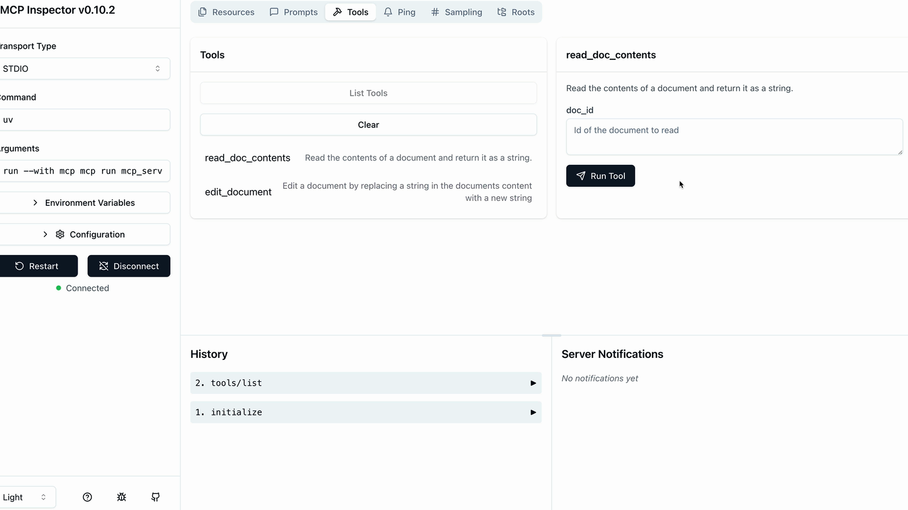

[⬅ Back to course index](../README.md)

# 📚 Introduction to Model Context Protocol — Course Notes

> Builds on [Claude 101](../claude-101/README.md) (Ch 8 "Connecting Your Tools": connectors) and [Claude Code 101](../claude-code-101/README.md) (Ch 11 "MCP"). This course goes under the hood: what MCP solves, how **clients** and **servers** work, and how to build both with **tools**, **resources**, and **prompts**.

### 🗺️ Course Map

| Unit | Chapters | Status |
|------|----------|:------:|
| 🗂️ **Introduction** | [Background: What Is MCP?](#-background-what-is-the-model-context-protocol-mcp) · [Ch 1: Introducing MCP](#chapter-1-introducing-mcp) · [Ch 2: MCP Clients](#chapter-2-mcp-clients) | ✅ |
| 🗂️ **Hands-on with MCP Servers** | [Ch 3: Project Setup](#chapter-3-project-setup) · [Ch 4: Defining Tools with MCP](#chapter-4-defining-tools-with-mcp) · [Ch 5: The Server Inspector](#chapter-5-the-server-inspector) | ✅ |
| 🗂️ **Connecting with MCP Clients** | [Ch 6: Implementing a Client](#chapter-6-implementing-a-client) · [Ch 7: Defining Resources](#chapter-7-defining-resources) · [Ch 8: Accessing Resources](#chapter-8-accessing-resources) · [Ch 9: Defining Prompts](#chapter-9-defining-prompts) · [Ch 10: Prompts in the Client](#chapter-10-prompts-in-the-client) | ✅ |
| 🗂️ **Assessment and Wrap Up** | [Ch 11: MCP Review](#chapter-11-mcp-review) | ✅ |
| 🗂️ **Quiz** | [Final assessment on MCP](#-final-assessment-on-mcp-quiz) | ✅ |

> _Two lessons have no chapter: **"Welcome to the course"** (intro video) and the **"Course satisfaction survey"** (feedback form)._

> **Annotation guide for these notes:** 📌 = my own reading from screenshots/context — **not stated in the lesson text itself**. 🔗 = my cross-reference between chapters — **my mapping, not the lesson's wording**. For exam prep, focus on the **📝 Quick Reference** tables and **Key features for exam** bullet lists at the end of each chapter.

### ⚡ The Whole Course in 30 Seconds

- **MCP** = a standard way to plug **tools and data** into Claude, so **someone else writes the integration code**.
- Your app has an **MCP client**; each **MCP server** fronts an outside service and offers **tools, resources, prompts**.
- **Who controls them:** tools → **Claude** · resources → **your app** · prompts → **the user**.

---

> 🗂️ **Unit 1: Introduction** · Background reading

## 📖 Background: What Is the Model Context Protocol (MCP)?

> 📎 *Source: the official MCP docs ("What is the Model Context Protocol?"), supplied as background reading. Not one of the course's lesson videos; cross-checked against the live docs.*

### 🧠 Key Takeaways

- **MCP** is an **open-source standard** for **connecting AI applications to external systems**: **data sources** (files, databases), **tools** (search engines, calculators), and **workflows** (specialized prompts)
- **Analogy:** MCP is a **USB-C port for AI applications**: one standard plug instead of a custom cable for each device


| Who | Benefit of MCP |
|-----|----------------|
| 👩‍💻 **Developers** | **Less development time and complexity** when building or integrating an AI app or agent |
| 🤖 **AI apps / agents** | Access to an **ecosystem of data sources, tools, and apps** |
| 🙋 **End-users** | **More capable** apps that can **access their data and act on their behalf** |

**Examples from the docs:** agents using **Google Calendar and Notion** · Claude Code building a **web app from a Figma design** · enterprise chatbots querying **multiple databases** · AI creating **3D designs in Blender** for a 3D printer.

> 🔗 Same "USB-C for AI" idea as [Claude 101, Ch 8](../claude-101/README.md) (connectors) and [Claude Code 101, Ch 11](../claude-code-101/README.md) (my mapping).

> 🎓 **Memory tip:** **MCP = USB-C for AI.**

---

> 🗂️ **Unit 1: Introduction** · Chapter 1

## Chapter 1: Introducing MCP

> **MCP** is a **communication layer** that gives Claude **context and tools** *without* you writing tedious **integration code**. It **shifts tool definitions and execution** from **your server** to specialized **MCP servers**.

### 🧠 Key Takeaways

- An **MCP Client** (inside *your* server) connects to **MCP Servers**; each server holds **tools, prompts, and resources** and is an **interface to an outside service**
- **Anyone** can write an MCP server; providers often publish **official** ones (e.g. AWS)
- **MCP vs. calling an API directly:** with MCP, the **tool schemas and functions are already defined**
- **MCP vs. tool use:** **complementary, not the same**. The difference is **who does the work**

---

### 🏗️ The Basic Architecture


| Piece | What it is |
|-------|------------|
| 🖥️ **Our Server** | **Your** application; contains the MCP Client |
| 🔌 **MCP Client** | The part of your server that **connects to MCP servers** |
| 🗄️ **MCP Server** | Interface to an **outside service**; holds **tools, prompts, resources** |
| 🌐 **Outside Service** | The real service behind it (e.g. GitHub) |

### 😓 The Problem MCP Solves

**Example:** a chat app where users ask Claude about their **GitHub data** ("What open pull requests do I have across all my repositories?"). Claude needs **tools to access GitHub's API**. GitHub has huge functionality (repos, pull requests, issues, projects…), so **without MCP** you write an **incredible number of tool schemas and functions**, and you **test and maintain** all of them.


| | ❌ **Without MCP** | ✅ **With MCP** |
|---|---|---|
| **Who writes the GitHub tools?** | **You** (schemas + functions) | A **GitHub MCP server** |
| **Where do tools live?** | **Your server** | The **MCP server** |
| **Your maintenance burden** | **High**, ongoing | **Low**, you just connect |

The **MCP Server for GitHub** wraps GitHub's functionality as **standardized tools** and connects to GitHub's API. **Your server only talks to the MCP server**, which handles the GitHub-specific details.

### ❓ Common Questions

| Question | Answer |
|----------|--------|
| **Who authors MCP servers?** | **Anyone.** Service providers often publish **official** ones |
| **How is this different from calling an API directly?** | MCP gives you **tool schemas and functions already defined**; with a direct API call, **you author them** |
| **Isn't MCP the same as tool use?** | **No.** **MCP servers** provide the **tool definitions + functions**; **tool use** is **how Claude calls** those tools. With MCP, **someone else already implemented the tools** |

### 📝 Quick Reference: Introducing MCP (for exam prep)

| Concept | Key point |
|---------|-----------|
| 🔌 **MCP** | **Communication layer** giving Claude **context + tools** without custom integration code |
| 🎯 **Core idea** | **Shifts the burden** of tool definitions + execution to **MCP servers** |
| 🖥️ **MCP Client** | Lives **in your server**; connects to MCP servers |
| 🗄️ **MCP Server** | Fronts an **outside service**; exposes **tools, prompts, resources** |
| ⚖️ **vs. tool use** | **Complementary.** MCP = *who provides* the tools; tool use = *how Claude calls* them |

> 🎓 **Memory tip:** **"MCP = someone else already wrote the tools."** Your server (client) → MCP server → outside service.

**Key features for exam:**
- MCP is a **communication layer**: no hand-written integration code.
- It **moves tool definitions and execution** to **MCP servers**.
- **MCP ≠ tool use**; they work together.

---

> 🗂️ **Unit 1: Introduction** · Chapter 2

## Chapter 2: MCP Clients

> The **MCP client** is the **communication bridge** between **your server** and **MCP servers**. It is your **access point to the server's tools** and handles the **message exchange and protocol details**.

### 🧠 Key Takeaways

- MCP is **transport agnostic**: client and server can talk over **different protocols**
- **Most common:** both on the **same machine**, over **standard input/output (stdio)**; also **HTTP**, **WebSockets**, and other network protocols
- Two message pairs, **defined in the MCP specification**: **`ListToolsRequest` / `ListToolsResult`** and **`CallToolRequest` / `CallToolResult`**

---

### 📨 The Two Message Pairs

| Client sends | Server replies | Meaning |
|--------------|----------------|---------|
| 📋 **`ListToolsRequest`** | **`ListToolsResult`** | "What tools do you provide?" → "Here are the tools I can run" |
| ▶️ **`CallToolRequest`** | **`CallToolResult`** | "Run this tool with these arguments" → "Here's the result" |

### 🔄 The Full Flow

**Example:** the user asks *"What repositories do I have?"*


| # | Step | What happens |
|:-:|------|--------------|
| 1 | **User query** | The user asks **your server** |
| 2-4 | **Tool discovery** | Your server asks the **MCP client** for the tools → client sends **`ListToolsRequest`** → gets **`ListToolsResult`** |
| 5 | **Claude request** | Your server sends **query + tools** to Claude |
| 6 | **Tool use decision** | **Claude decides** to call a tool (**`ToolUse`**) |
| 7-9 | **Tool execution** | Your server asks the client to run it → client sends **`CallToolRequest`** → the **MCP server makes the actual GitHub API call** → **`CallToolResult`** comes back |
| 10 | **Tool result to Claude** | Your server sends the result (**`toolResult`**) to Claude |
| 11-12 | **Final answer** | Claude writes the answer; your server delivers it to the user |

> 📌 *From the diagram:* **`ToolUse`** and **`toolResult`** are the **Claude-side** messages; **`ListTools…`** and **`CallTool…`** are the **MCP-side** messages.

> 🔗 Steps 5, 6, 10, 11 are the normal **tool use loop** from earlier courses. MCP only changes **where the tools come from** (steps 2-4) and **who runs them** (steps 7-9) (my mapping).

### 📝 Quick Reference: MCP Clients (for exam prep)

| Concept | Key point |
|---------|-----------|
| 🔌 **MCP client** | **Bridge** between your server and MCP servers |
| 🔀 **Transport agnostic** | **Different protocols** possible |
| 💻 **Most common transport** | **stdio**, same machine |
| 🌐 **Other transports** | **HTTP**, **WebSockets**, others |
| 📋 **List tools** | **`ListToolsRequest`** → **`ListToolsResult`** |
| ▶️ **Call tool** | **`CallToolRequest`** → **`CallToolResult`** |
| 🤖 **Who decides to use a tool** | **Claude** |
| 🌍 **Who calls the external API** | The **MCP server**, not the client |

> 🎓 **Memory tip:** **"List, then Call."** The client is the **messenger**; the **MCP server** does the real work.

**Key features for exam:**
- **stdio** is the most common transport (same machine); **HTTP** and **WebSockets** also work.
- **List** tools first (so Claude knows them), then **Call** the one Claude picks.
- The **MCP server** makes the actual external API call.

---

> 🗂️ **Unit 2: Hands-on with MCP Servers** · Chapter 3

## Chapter 3: Project Setup

> 📌 *Written from the lesson's slides and terminal screenshots only (a 3-minute orientation video; no lesson text), so the wording is mine. Nothing needs to be run for the exam.*

### 🧠 Key Takeaways

- The project is a **CLI chatbot** for chatting with a **set of documents**
- The MCP server has **two tools**: **read a doc** and **update (edit) a doc**
- **`@doc_name`** mentions a document; its **contents are added as context**. **`/command_name`** runs a **command**
- **Important:** normally a project implements **either** an MCP client **or** an MCP server. This one implements **both**, **just to learn how they work**


| Project file / command | Meaning |
|------------------------|---------|
| **`uv run main.py`** | Starts the chatbot |
| `mcp_server.py` | The **MCP server** (tools defined in Ch 4) |
| `mcp_client.py` | The **MCP client** (built in Ch 6) |

> 📌 *My reading:* the file roles come from the file names. On the slide's terminal, typing **`@`** lists documents tagged **"Resource"**, so `@` documents = **resources** and `/commands` = **prompts**. The chat replies come from Claude, so running the chat likely needs Claude API access (my inference).

> 🔗 Previews the course: **tools** (Ch 4), **resources** (Ch 7-8), **prompts** (Ch 9-10) (my mapping).

### 📝 Quick Reference: Project Setup (for exam prep)

| Concept | Key point |
|---------|-----------|
| 🎯 **Project** | **CLI chatbot** over **documents** |
| 🛠️ **Server tools** | **Read a doc** · **update a doc** |
| `@doc_name` / `/command_name` | **Mention** a document (adds context) / run a **command** |
| ⚖️ **Client + server** | Usually **one or the other**; **both** here, for learning |

> 🎓 **Memory tip:** **"@ = documents in, / = commands."** One project, **both sides**, just to learn.

**Key features for exam:**
- The MCP server provides **two tools**: read a doc and update a doc.
- Real projects build **either** a client **or** a server; this project builds **both** for learning.

---

> 🗂️ **Unit 2: Hands-on with MCP Servers** · Chapter 4

## Chapter 4: Defining Tools with MCP

> With the **official Python SDK** you define tools with **decorators** instead of writing **JSON schemas by hand**.

### 🧠 Key Takeaways

- Create the server in one line with **`FastMCP`**
- Define a tool with **`@mcp.tool(name=..., description=...)`** on a Python function
- The **parameters** are the tool's arguments; **type hints + `Field(description=...)`** (Pydantic) become the **schema Claude sees**
- Errors use normal **Python exceptions** (`raise ValueError`)
- Example: a **document server** with **two tools** (read, edit); docs live **in memory** in a dict (`doc id → content`)

```python
from mcp.server.fastmcp import FastMCP

mcp = FastMCP("DocumentMCP", log_level="ERROR")

docs = {
    "deposition.md": "This deposition covers the testimony of Angela Smith, P.E.",
    "report.pdf": "The report details the state of a 20m condenser tower.",
    # ... financials.docx, outlook.pdf, plan.md, spec.txt
}
```

**Tool 1: read a document**

```python
@mcp.tool(
    name="read_doc_contents",
    description="Read the contents of a document and return it as a string."
)
def read_document(
    doc_id: str = Field(description="Id of the document to read")
):
    if doc_id not in docs:
        raise ValueError(f"Doc with id {doc_id} not found")
    return docs[doc_id]
```

**Tool 2: edit a document** (find and replace)

```python
@mcp.tool(
    name="edit_document",
    description="Edit a document by replacing a string in the documents content with a new string."
)
def edit_document(
    doc_id: str = Field(description="Id of the document that will be edited"),
    old_str: str = Field(description="The text to replace. Must match exactly, including whitespace."),
    new_str: str = Field(description="The new text to insert in place of the old text.")
):
    if doc_id not in docs:
        raise ValueError(f"Doc with id {doc_id} not found")
    docs[doc_id] = docs[doc_id].replace(old_str, new_str)
```

| Tool | Arguments | What it does |
|------|-----------|--------------|
| 📖 **`read_doc_contents`** | `doc_id` | Returns the content; **error** if the id doesn't exist |
| ✏️ **`edit_document`** | `doc_id`, `old_str`, `new_str` | **Find-and-replace** in the content; **error** if the id doesn't exist |

**Benefits of the SDK approach:** **no manual JSON schema** · **type hints** give automatic validation · **descriptions** help Claude understand each parameter · errors are **Python exceptions** · **decorators** register tools automatically.

### 📝 Quick Reference: Defining Tools (for exam prep)

| Concept | Key point |
|---------|-----------|
| 🖥️ **Create server** | `FastMCP("Name")` |
| 🏷️ **Define a tool** | `@mcp.tool(name=..., description=...)` |
| 📥 **Arguments** | Function **parameters** with **type hints** + `Field(description=...)` |
| 📄 **Schema** | **Auto-generated**, not hand-written |
| ❌ **Errors** | Raise a **Python exception** |

> 🎓 **Memory tip:** **"Decorator in, schema out."**

**Key features for exam:**
- The SDK removes the need to **write JSON schemas by hand**.
- **`@mcp.tool()`** registers a tool; **type hints** and **`Field(description=...)`** make the schema.

---

> 🗂️ **Unit 2: Hands-on with MCP Servers** · Chapter 5

## Chapter 5: The Server Inspector

> The SDK includes a built-in **browser-based inspector** to **test and debug your server** without a full application.

### 🧠 Key Takeaways

- Start it with **`mcp dev mcp_server.py`** (activate the Python environment first); open the **local URL** it prints (typically `http://127.0.0.1:6274`)
- The UI may change over time; the core is the same: a **Connect** button, tabs for **Resources / Tools / Prompts**, and a tool list and test panel
- It **keeps server state between calls**, so you can **edit a doc, then read it** to confirm the change



| Step | Action |
|:----:|--------|
| 1 | Run **`mcp dev mcp_server.py`** and open the URL |
| 2 | Click **Connect** (Disconnected → Connected) |
| 3 | **Tools** tab → **List Tools** |
| 4 | Select a tool (e.g. `read_doc_contents`), enter inputs (e.g. `deposition.md`), click **Run Tool** |
| 5 | Check the **success status** and the **returned data** |

**Why it matters:** quick iteration, testing **edge cases and error conditions**, checking **state**, and **real-time debugging**, with **no separate test scripts** and no full application.

### 📝 Quick Reference: The Server Inspector (for exam prep)

| Concept | Key point |
|---------|-----------|
| 🔍 **What** | Built-in **browser-based** tool in the Python MCP SDK |
| ▶️ **Start** | **`mcp dev mcp_server.py`** |
| 🛠️ **Test a tool** | **Connect → Tools → List Tools →** select **→ Run Tool** |
| 💾 **State** | **Kept** between calls |

> 🎓 **Memory tip:** **"Dev, Connect, List, Run."**

**Key features for exam:**
- Test a server **without a full application** using **`mcp dev mcp_server.py`**.
- The inspector **keeps state**, so edits persist between calls.

---

> 🗂️ **Unit 3: Connecting with MCP Clients** · Chapter 6

## Chapter 6: Implementing a Client

> With the server working, build the **client side**, which lets your **application code** use the server.

### 🧠 Key Takeaways

- The MCP client has **two parts**: the **MCP Client** (a **custom class we write** to make the session easier) and the **Client Session** (the **actual connection** to the server, from the **MCP Python SDK**)
- The session needs **careful resource management** (cleaning up connections), so we **wrap it in our own class** that does the cleanup
- Two core functions: **`list_tools()`** and **`call_tool()`**
- The CLI uses the client in **two places**: **getting tools to send to Claude**, and **executing tools when Claude asks**


```python
async def list_tools(self) -> list[types.Tool]:
    result = await self.session().list_tools()
    return result.tools

async def call_tool(
    self, tool_name: str, tool_input: dict
) -> types.CallToolResult | None:
    return await self.session().call_tool(tool_name, tool_input)
```

| Function | Input | Returns |
|----------|-------|---------|
| 📋 **`list_tools()`** | none | The server's **tools** |
| ▶️ **`call_tool()`** | **tool name** + **input dict** (from Claude) | A **`CallToolResult`** |

> 🔗 These wrap the [Ch 2](#chapter-2-mcp-clients) messages: `list_tools` ↔ `ListToolsRequest/Result`, `call_tool` ↔ `CallToolRequest/Result` (my mapping).

**Testing:** **`uv run mcp_client.py`** runs a test harness that connects and **prints the available tools**. **`uv run main.py`** runs the full app; try *"What is the contents of the report.pdf document?"*. Behind the scenes: **get tools** via the client → **send to Claude** with the question → **Claude picks `read_doc_contents`** → the **client runs it** → **result goes back to Claude** → Claude answers.

### 📝 Quick Reference: Implementing a Client (for exam prep)

| Concept | Key point |
|---------|-----------|
| 🧰 **MCP Client** | **Custom wrapper class**; handles cleanup |
| 🔗 **Client Session** | The **real connection** (MCP Python SDK) |
| 🧹 **Why wrap it** | The session needs **resource management / cleanup** |
| 📋 **`list_tools()`** | Returns the server's tools |
| ▶️ **`call_tool(name, input)`** | Runs a tool; returns **`CallToolResult`** |

> 🎓 **Memory tip:** **"Wrapper + Session."** Two moves: **list** and **call**.

**Key features for exam:**
- The MCP client = **our wrapper class + the SDK's client session** (the session is the real connection).
- Two key functions: **`list_tools()`** and **`call_tool()`**.

---

> 🗂️ **Unit 3: Connecting with MCP Clients** · Chapter 7

## Chapter 7: Defining Resources

> **Resources** let an MCP server **expose data to clients**, like **GET request handlers** in an HTTP server. Use them to **fetch information**, not to **perform actions**.

### 🧠 Key Takeaways

- Example: the **`@document_name` mention** needs (1) a **list of all documents** (autocomplete) and (2) the **contents of one document**
- When a document is mentioned, your system **injects its contents into the prompt**, so **Claude needs no tool call**
- The client sends **`ReadResourceRequest`** with a **URI**; the server runs the matching function and returns **`ReadResourceResult`**
- **Two types:** **direct** (static URI) and **templated** (URI with parameters)


| Type | URI | Use for | Example |
|------|-----|---------|---------|
| 📌 **Direct** | **Static**, no parameters | Operations with **no parameters** | `docs://documents` → list of doc IDs |
| 🧩 **Templated** | Has **parameters** like `{doc_id}` | One **specific item** | `docs://documents/{doc_id}` → one doc's content |

```python
@mcp.resource("docs://documents", mime_type="application/json")
def list_docs() -> list[str]:
    return list(docs.keys())

@mcp.resource("docs://documents/{doc_id}", mime_type="text/plain")
def fetch_doc(doc_id: str) -> str:
    if doc_id not in docs:
        raise ValueError(f"Doc with id {doc_id} not found")
    return docs[doc_id]
```

For templated resources the SDK **parses the URI parameter** and passes it as a **keyword argument**.

**MIME types and serialization:** resources can return **any data** (strings, JSON, binary). **`mime_type`** is a **hint to the client**: **`application/json`** (structured data), **`text/plain`** (plain text), **`application/pdf`** (binary files). The SDK **serializes return values automatically**.

**Testing:** in the inspector (`uv run mcp dev mcp_server.py`), **Resources** lists **direct** resources and **Resource Templates** lists **templated** ones. For templated ones, enter the **parameter values**.

### 📝 Quick Reference: Defining Resources (for exam prep)

| Concept | Key point |
|---------|-----------|
| 📦 **Resource** | **Read-only data** exposed by the server (like **GET**) |
| 🛠️ **vs. tool** | Resource = **fetch data**; tool = **perform an action** |
| 🏷️ **Define** | `@mcp.resource("uri", mime_type=...)` |
| 📌 **Direct** | **Static URI**, no parameters |
| 🧩 **Templated** | URI with **`{param}`**, passed as a **keyword argument** |
| 📥 **Messages** | `ReadResourceRequest` (URI) → `ReadResourceResult` |
| 🎯 **Benefit** | Data goes **straight into the prompt**, **no tool call** |

> 🎓 **Memory tip:** **"Resource = GET."** *Direct* = fixed address (the **list**). *Templated* = address with a **blank to fill** (one **item**).

**Key features for exam:**
- Resources **expose read-only data**: use them to **fetch**, not to **act**.
- **Direct** = static URI; **templated** = URI with parameters (passed as keyword arguments).
- **`mime_type`** tells the client the data type; the SDK **serializes automatically**.

---

> 🗂️ **Unit 3: Connecting with MCP Clients** · Chapter 8

## Chapter 8: Accessing Resources

> Resources let the client put server data **directly into prompts**, instead of making Claude use **tool calls**.

### 🧠 Key Takeaways

- The client needs a **`read_resource(uri)`** function (imports: `json` and `AnyUrl` from `pydantic`)
- The result has a **`contents` list**; we take the **first item**
- The **MIME type** decides how to handle it: **`application/json`** → **parse with `json.loads`**; otherwise → **return the raw text**

```python
async def read_resource(self, uri: str) -> Any:
    result = await self.session().read_resource(AnyUrl(uri))
    resource = result.contents[0]

    if isinstance(resource, types.TextResourceContents):
        if resource.mimeType == "application/json":
            return json.loads(resource.text)

    return resource.text
```

**What the user sees:** typing **`@`** shows an **autocomplete list** of resources (built from `docs://documents`) → select one (arrow keys + space) → its **content is included in the prompt** → everything goes to the model **with no extra tool call**. The model can answer **immediately** because the content is already in the **initial context**.


> 📌 *From the slide (my reading):* **Our Code** builds the prompt: the question goes in **`<query>`** tags and the mentioned document in **`<document id="…">`** tags, then it goes to Claude.

### 📝 Quick Reference: Accessing Resources (for exam prep)

| Concept | Key point |
|---------|-----------|
| 📥 **Client function** | **`read_resource(uri)`** |
| 📦 **Response** | A **`contents` list**; use the **first item** |
| 🏷️ **JSON MIME type** | **`application/json`** → **`json.loads`** |
| 📝 **Other types** | Return the **text as-is** |

> 🎓 **Memory tip:** **"Read, check MIME, parse."** JSON gets parsed; everything else stays text.

**Key features for exam:**
- The client reads a resource with **`read_resource(uri)`** (sends **`ReadResourceRequest`**).
- The **MIME type** decides handling: **JSON → parse**, otherwise **text**.
- Resource content is placed **directly in the prompt**, so **no extra tool call**.

---

> 🗂️ **Unit 3: Connecting with MCP Clients** · Chapter 9

## Chapter 9: Defining Prompts

> **Prompts** are **pre-built, high-quality instructions** the server provides, so clients don't write their own from scratch. Think of them as **carefully crafted, tested templates**.

### 🧠 Key Takeaways

- Users can ask Claude directly ("reformat report.pdf in markdown"), but a **thoroughly tested, specialized prompt** gives **better results** (handles edge cases, follows best practices)
- The **server author** crafts and tests prompts, so **users get expertise without being prompt engineers**
- Define with **`@mcp.prompt`**; the function returns a **list of messages** sent to Claude (can mix user and assistant messages)
- Example: **`/format doc_id`** converts a document to **markdown**


```python
@mcp.prompt(
    name="format",
    description="Rewrites the contents of the document in Markdown format."
)
def format_document(
    doc_id: str = Field(description="Id of the document to format")
) -> list[base.Message]:
    prompt = f"""
Your goal is to reformat a document to be written with markdown syntax.
The id of the document you need to reformat is:
<document_id>{doc_id}</document_id>
...
Use the 'edit_document' tool to edit the document.
"""
    return [base.UserMessage(prompt)]
```

**The `/format` workflow:** the user types **`/`** → selects **`format`** and a **document ID** → Claude uses your **pre-built prompt** to read and reformat the document → clean markdown. Test prompts in the **MCP Inspector**, which shows the **exact messages** sent to Claude, with variables filled in.

| Benefit | Meaning |
|---------|---------|
| 🔁 **Consistency** | Reliable results every time |
| 🎓 **Expertise** | **Domain knowledge** encoded in the prompt |
| ♻️ **Reusability** | **Many clients** can use the same prompt |
| 🔧 **Maintenance** | **Update once**, all clients improve |

> 🔗 The prompt tells Claude to use the **`edit_document` tool** from [Ch 4](#chapter-4-defining-tools-with-mcp), so prompts and tools **work together** (my mapping).

### 📝 Quick Reference: Defining Prompts (for exam prep)

| Concept | Key point |
|---------|-----------|
| 💬 **Prompt** | **Pre-built, tested instruction template** on the server |
| 🏷️ **Define** | `@mcp.prompt(name=..., description=...)` |
| 📤 **Returns** | A **list of messages** (e.g. `base.UserMessage(...)`) |
| 🎯 **Why** | Better, **consistent** results than users' own prompts |

> 🎓 **Memory tip:** **"Prompt = a tested recipe the server hands out."** The user brings the *ingredient* (`doc_id`); the server brings the *recipe*.

**Key features for exam:**
- Prompts are **pre-built, tested instructions** provided by the server.
- Defined with **`@mcp.prompt`**; they return a **list of messages**.
- Benefits: **consistency, expertise, reusability, easy maintenance**.

---

> 🗂️ **Unit 3: Connecting with MCP Clients** · Chapter 10

## Chapter 10: Prompts in the Client

> The last piece of the client: **list the server's prompts** and **get one with its variables filled in**.

### 🧠 Key Takeaways

- Two functions: **`list_prompts()`** and **`get_prompt(name, args)`**
- **`get_prompt`** handles **variable interpolation**: the **args become keyword arguments** of the server's prompt function (e.g. `{"doc_id": "plan.md"}`)
- In the CLI, typing **`/`** shows the prompts as **commands**; after you pick a document, the full prompt goes to Claude, which then **uses tools** to fetch and process the content

```python
async def list_prompts(self) -> list[types.Prompt]:
    result = await self.session().list_prompts()
    return result.prompts

async def get_prompt(self, prompt_name, args: dict[str, str]):
    result = await self.session().get_prompt(prompt_name, args)
    return result.messages
```

| Function | Input | Returns |
|----------|-------|---------|
| 📋 **`list_prompts()`** | none | The server's **prompts** |
| 💬 **`get_prompt(name, args)`** | **prompt name** + **args dict** | The **messages**, variables filled in |

**The full prompt workflow:** **write and evaluate** a prompt → **define it** with `@mcp.prompt` → **clients request it any time** → **client args become keyword arguments** → the function **returns messages** ready for the model.

### 📝 Quick Reference: Prompts in the Client (for exam prep)

| Concept | Key point |
|---------|-----------|
| 📋 **`list_prompts()`** | Returns the server's prompts |
| 💬 **`get_prompt(name, args)`** | Returns **messages** with variables **interpolated** |
| 🔤 **Arguments** | Dict → **keyword arguments** on the server |
| ⌨️ **In the CLI** | **`/`** shows prompts as **commands** |

> 🎓 **Memory tip:** **"List, then Get."**

**Key features for exam:**
- Client functions: **`list_prompts()`** and **`get_prompt(prompt_name, args)`**.
- **Args become keyword arguments** in the server's prompt function.

---

> 🗂️ **Unit 4: Assessment and Wrap Up** · Chapter 11

## Chapter 11: MCP Review

> The **three server primitives** and **when to use each**. Key insight: **each primitive is controlled by a different part of your application stack**.

### 🧠 Key Takeaways

- **Tools = model-controlled** (Claude decides)
- **Resources = app-controlled** (your application code decides)
- **Prompts = user-controlled** (the user decides)
- **Tools serve the model, resources serve your app, prompts serve your users**

### 🧭 The Three Server Primitives

| | 🛠️ **Tools** | 📄 **Resources** | 💬 **Prompts** |
|---|-------------|------------------|----------------|
| **Controlled by** | **Model** (Claude decides when to call) | **App** (your code decides when to call) | **User** (decides when to run) |
| **Used for** | Giving **Claude additional functionality** | **Getting data into your app** · **adding context to messages** | **Workflows** started by user input (slash command, button click, menu option) |
| **Define with** 🔗 | `@mcp.tool` | `@mcp.resource("uri")` | `@mcp.prompt` |
| **Client function** 🔗 | `list_tools` · `call_tool` | `read_resource(uri)` | `list_prompts` · `get_prompt` |
| **Example** | Claude runs a **JavaScript tool** to calculate a square root | **Autocomplete options** in the UI · **augmenting prompts** with context | The **workflow buttons** below the chat input; **`/format`** |

> 🔗 The "Define with" and "Client function" rows are my summary of Ch 4, 6, 7, 8, 9, 10.

### 🖥️ In Claude's Own Interface

| Feature | Primitive |
|---------|-----------|
| **"Add from Google Drive"**: the app decides which documents to show and injects their content | 📄 **Resources** |
| **Workflow buttons** below the chat input: one-click predefined workflows | 💬 **Prompts** |
| Claude **runs code or does calculations** behind the scenes | 🛠️ **Tools** |

### 🧩 Choosing the Right Primitive

| If you need to… | Use |
|-----------------|-----|
| Give **Claude new capabilities** | 🛠️ **Tools** |
| Get **data into your app** (UI or context) | 📄 **Resources** |
| Create **predefined workflows for users** | 💬 **Prompts** |

> 💡 These are **high-level guidelines**; pick what fits your use case.

### 📝 Quick Reference: MCP Review (for exam prep)

| Primitive | Controlled by | Typical use | Example |
|-----------|---------------|-------------|---------|
| 🛠️ **Tools** | **Model** | New **capabilities** for Claude | Run JavaScript to calculate |
| 📄 **Resources** | **App** | **Data** for the UI / **context** for messages | Autocomplete list; "Add from Google Drive" |
| 💬 **Prompts** | **User** | **Predefined workflows** | Slash command, button, menu option |

> 🎓 **Memory tip:** **"Model · App · User"** = **Tools · Resources · Prompts**. Ask: **"who decides when it runs?"**

**Key features for exam:**
- **Tools = model-controlled** · **Resources = app-controlled** · **Prompts = user-controlled**.
- New capabilities for Claude → **tools**; data for your app → **resources**; predefined user workflows → **prompts**.
- In Claude's interface: **Google Drive = resources**, **workflow buttons = prompts**, **code execution = tools**.

---

> 🗂️ **Quiz** · Final assessment on MCP

## 📝 Final Assessment on MCP (Quiz)

> **My result:** ✅ **Passed, 5 of 7 (71%)**. Questions **5** and **7** were missed. This is the **answer key for all 7**, so it works as a study sheet. ⚠️ marks the two to re-read.

| # | Question (short) | ✅ Correct answer | Why | Chapter |
|:-:|------------------|-------------------|-----|:-------:|
| 1 | Two main components of an **MCP client** | **MCP Client class + Client Session** | Our wrapper + the SDK's real connection | [Ch 6](#chapter-6-implementing-a-client) |
| 2 | Message to **discover tools** | **`ListToolsRequest`** | Server answers with `ListToolsResult` | [Ch 2](#chapter-2-mcp-clients) |
| 3 | Easiest way to **test tools** without a full app | **MCP Inspector**: `mcp dev mcp_server.py` | Built-in, browser-based, keeps state | [Ch 5](#chapter-5-the-server-inspector) |
| 4 | Main problem **without MCP** | **You write and maintain all the tool code yourself** | MCP moves tool definitions and execution to the server | [Ch 1](#chapter-1-introducing-mcp) |
| 5 ⚠️ | A **button** the user clicks to start a "summarize document" workflow | **Prompts** | The **user** decides when to start a predefined workflow | [Ch 9](#chapter-9-defining-prompts), [Ch 11](#chapter-11-mcp-review) |
| 6 | Easiest way to define a **tool** (Python SDK) | **`@mcp.tool()` on a Python function** | SDK builds the schema; no manual JSON schema | [Ch 4](#chapter-4-defining-tools-with-mcp) |
| 7 ⚠️ | Resource that fetches docs **by ID** (`docs://documents/report.pdf`) | **Templated resource** with parameters in the URI | The URI has a `{doc_id}` parameter | [Ch 7](#chapter-7-defining-resources) |

| Missed | I picked | Rule to remember |
|:------:|----------|------------------|
| **5** | **Resources** | A **user-triggered workflow** is a **prompt**. Resources are **data for your app** |
| **7** | **A database query resource** (not an MCP type) | **ID in the URI → templated.** No parameter → direct |

> 🎓 **Memory tip:** **"Tools do, Resources give, Prompts guide"** and **"`{param}` in the URI = templated."**
