[⬅ Back to course index](../README.md)

# 📚 Introduction to Model Context Protocol — Course Notes

> Builds on [Claude 101](../claude-101/README.md) (Ch 8 "Connecting Your Tools" — connectors) and [Claude Code 101](../claude-code-101/README.md) (Ch 11 "MCP"). This course goes under the hood: what MCP solves, how **clients** and **servers** work, and how to build both with **tools**, **resources**, and **prompts**.

### 🗺️ Course Map

| Unit | Chapters | Status |
|------|----------|:------:|
| 🗂️ **Introduction** | [Ch 1: Introducing MCP](#chapter-1-introducing-mcp) · [Ch 2: MCP Clients](#chapter-2-mcp-clients) · [Background: What Is MCP?](#-background-what-is-the-model-context-protocol-mcp) | 🚧 |
| 🗂️ **Hands-on with MCP Servers** | [Ch 3: Project Setup](#chapter-3-project-setup) · [Ch 4: Defining Tools with MCP](#chapter-4-defining-tools-with-mcp) · [Ch 5: The Server Inspector](#chapter-5-the-server-inspector) | ✅ |
| 🗂️ **Connecting with MCP Clients** | [Ch 6: Implementing a Client](#chapter-6-implementing-a-client) · [Ch 7: Defining Resources](#chapter-7-defining-resources) · [Ch 8: Accessing Resources](#chapter-8-accessing-resources) · [Ch 9: Defining Prompts](#chapter-9-defining-prompts) · [Ch 10: Prompts in the Client](#chapter-10-prompts-in-the-client) | ✅ |
| 🗂️ **Assessment and Wrap Up** | Ch 11: MCP Review | 🔲 |
| 🗂️ **Quiz** | Final assessment on MCP | 🔲 |

> _Two lessons have no chapter of their own: **"Welcome to the course"** (an intro video; its course-goals slide is summarized in the Introduction below) and the **"Course satisfaction survey"** (a feedback form with no learning content)._

> **Annotation guide for these notes:** 📌 = my own reading from screenshots/context — **not stated in the lesson text itself**. 🔗 = my cross-reference between chapters — **my mapping, not the lesson's wording**. For exam prep, focus on the **📝 Quick Reference** tables and **Key features for exam** bullet lists at the end of each chapter.

---

> 🗂️ **Unit 1: Introduction** · Background reading

## 📖 Background: What Is the Model Context Protocol (MCP)?

> 📎 *Source: the official MCP docs ("What is the Model Context Protocol?"), supplied as background reading for the Introduction unit. It is not one of the course's lesson videos, and it was cross-checked against the live docs.*

### 🧠 Key Takeaways

- **MCP** (Model Context Protocol) is an **open-source standard** for **connecting AI applications to external systems**
- With MCP, AI applications like **Claude** or **ChatGPT** can connect to:
  - **Data sources** — e.g. local files, databases
  - **Tools** — e.g. search engines, calculators
  - **Workflows** — e.g. specialized prompts
- …so they can **access key information and perform tasks**
- **Analogy:** MCP is like a **USB-C port for AI applications**. USB-C is a standardized way to connect electronic devices; MCP is a **standardized way to connect AI applications to external systems**


> 📌 *From the diagram:* MCP sits **in the middle** with **two-way (bidirectional) data flow** on both sides. The **left** column is the **AI applications** (clients' side) and the **right** column is the **data sources and tools** (servers' side). The product names are examples shown in the picture (my reading).

### 🔌 What Can MCP Enable?

| Example |
|---------|
| 📅 **Agents** can access your **Google Calendar** and **Notion**, acting as a more personalized AI assistant |
| 🎨 **Claude Code** can generate an **entire web app from a Figma design** |
| 🏢 **Enterprise chatbots** can connect to **multiple databases** across an organization, so users can analyze data through chat |
| 🧊 **AI models** can create **3D designs in Blender** and print them on a **3D printer** |

### 🎯 Why Does MCP Matter?

| Who | Benefit |
|-----|---------|
| 👩‍💻 **Developers** | MCP **reduces development time and complexity** when building or integrating with an AI application or agent |
| 🤖 **AI applications / agents** | Access to an **ecosystem of data sources, tools, and apps**, which enhances their capabilities and improves the end-user experience |
| 🙋 **End-users** | **More capable** AI applications or agents that can **access user data and take actions on the user's behalf** when necessary |

> 🔗 Same "**USB-C for AI**" idea as [Claude 101, Ch 8](../claude-101/README.md) (where MCP powers **connectors**) and the **external tools and data sources** definition in [Claude Code 101, Ch 11](../claude-code-101/README.md) (my mapping).

> 🎓 **Memory tip:** **MCP = USB-C for AI.** One standard plug, many apps on one side and many tools/data on the other.

---

> 🗂️ **Unit 1: Introduction** · Welcome to the course (no chapter)

## 🎯 Course Goals

> 📌 *From the "Course goals" slide in the Welcome video (the lesson has no text, so this is my reading of the slide, not lesson wording).* It's a handy map of the whole course.

| Goal | Meaning | Covered in |
|------|---------|-----------|
| 🔭 **Overview of MCP** | Understand **what problems MCP solves** | Ch 1 |
| 🔌 **MCP Clients and Servers** | **Servers host resources, tools, and more. Clients use servers** | Ch 1-2, Ch 6 |
| 🛠️ **Tools** | Tools are **implemented on a server** and **extend an LLM's capabilities** | Ch 4 |
| 📄 **Resources** | Servers can deliver **any kind of document or information** to clients | Ch 7-8 |
| 💬 **Prompts** | Servers can provide clients with **pre-optimized prompts** | Ch 9-10 |

> 🔗 The "Covered in" column maps each goal to the Course Map chapters (my mapping).

> 🎓 **Memory tip:** servers offer **T-R-P** (**T**ools · **R**esources · **P**rompts); **clients use** them.

---

> 🗂️ **Unit 1: Introduction** · Chapter 1

## Chapter 1: Introducing MCP

> **Model Context Protocol (MCP)** is a **communication layer** that provides Claude with **context and tools** *without* requiring you to write a bunch of tedious **integration code**. Think of it as a way to **shift the burden of tool definitions and execution** away from your server to **specialized MCP servers**.

### 🧠 Key Takeaways

- MCP is a **communication layer** that gives Claude **context and tools** without you writing integration code
- It **moves tool definitions and execution** from **your server** to dedicated **MCP servers**
- **Architecture:** an **MCP Client** (inside *your* server) connects to **MCP Servers**; each server contains **tools, prompts, and resources** and is an **interface to some outside service**
- **Anyone can author an MCP server**; service providers often publish **official** ones (e.g. AWS)
- **MCP vs. calling an API directly:** with MCP the **tool schemas and functions are already defined for you**
- **MCP vs. tool use:** they are **complementary, not the same**. The difference is **who does the work**

---

### 🏗️ The Basic Architecture

When you first meet MCP you'll see this diagram:

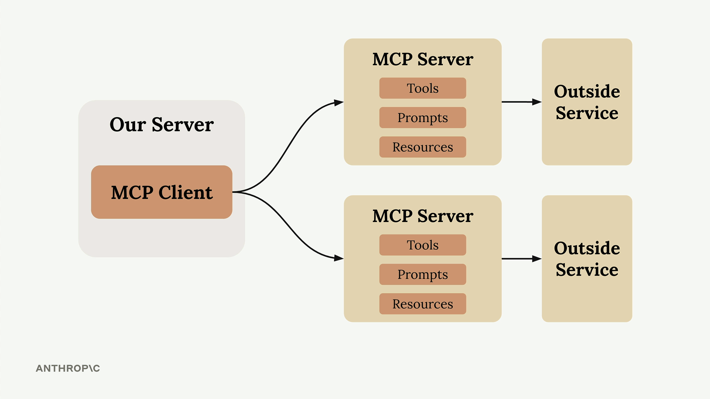

| Piece | What it is |
|-------|------------|
| 🖥️ **Our Server** | **Your** application. It contains the **MCP Client** |
| 🔌 **MCP Client** | The part of your server that **connects to MCP servers** |
| 🗄️ **MCP Server** | An **interface to an outside service**. It holds **tools, prompts, and resources** |
| 🌐 **Outside Service** | The real service behind the server (e.g. GitHub) |

> 🔗 The three things inside an MCP server (**tools, prompts, resources**) are exactly what the later hands-on lessons build one by one (Ch 4, Ch 7, Ch 9) (my mapping).

---

### 😓 The Problem MCP Solves

**Example app:** a chat interface where users ask Claude about their **GitHub data**. A user asks: *"What open pull requests are there across all my repositories?"* To answer, Claude needs **tools to access GitHub's API**.

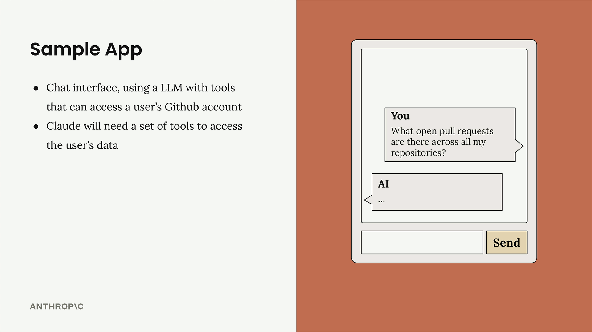

GitHub has **massive functionality**: repositories, pull requests, issues, projects, and more. **Without MCP**, you must create an **incredible number of tool schemas and functions** to cover it.


> ⚠️ **That's code *you* have to write, test, and maintain**: a lot of effort and an ongoing maintenance burden.

> 📌 *From the slide:* each tool is drawn as a **schema + function pair**. The tool names shown (`list_repos`, `create_repos`, `search_issues`, `update_issue`, `create_issue`, `get_issue`, `create_file`) are slide examples. The lesson text itself only names `get_repos()` (my reading).

| | ❌ **Without MCP** | ✅ **With MCP** |
|---|---|---|
| **Who writes the GitHub tools?** | **You** (schemas + functions) | A **GitHub MCP server** |
| **Where do tools live?** | **Your server** | The **MCP server** |
| **Your maintenance burden** | **High**, ongoing | **Low**, you just connect |

---

### ⚙️ How MCP Works

MCP **shifts this burden** by moving **tool definitions and execution** from your server to a dedicated **MCP server**. Instead of authoring all the GitHub tools yourself, an **MCP Server for GitHub** handles it.

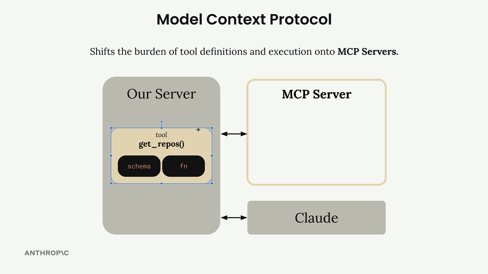

- The MCP server **wraps up tons of functionality** around GitHub and exposes it as a **standardized set of tools**
- Your application **connects to that MCP server** instead of implementing everything from scratch

---

### 🗄️ MCP Servers Explained

**MCP Servers provide access to data or functionality implemented by outside services.** They are specialized interfaces that expose **tools, prompts, and resources** in a **standardized** way.


In the GitHub example:
- The **MCP Server for GitHub** contains tools like **`get_repos()`**
- It **connects directly to GitHub's API**
- **Your server talks to the MCP server**, which handles **all the GitHub-specific implementation details**

---

### ❓ Common Questions

| Question | Answer |
|----------|--------|
| **Who authors MCP servers?** | **Anyone.** Often the **service providers themselves** publish **official** MCP servers (e.g. **AWS** might release one with tools for its services) |
| **How is this different from calling APIs directly?** | MCP servers give you **tool schemas and functions already defined**. Calling an API directly means **you author those tool definitions yourself**. MCP saves that work |
| **Isn't MCP just the same as tool use?** | **No, a common misconception.** They're **complementary but different**: **MCP servers** provide **tool schemas + functions already defined for you**; **tool use** is **how Claude actually calls those tools**. The key difference is **who does the work**: with MCP, **someone else has already implemented the tools** |

> 💡 **The benefit:** instead of maintaining a complex set of integrations yourself, you use MCP servers that **handle the heavy lifting** of connecting to external services.

---

### 🔁 Recap

**MCP** is a **communication layer**. Your server's **MCP client** connects to **MCP servers** (each wrapping an outside service and exposing **tools, prompts, and resources**), so **you don't write and maintain the integration code**. MCP is **not** the same as tool use. They work together.

### 📝 Quick Reference: Introducing MCP (for exam prep)

| Concept | Key point |
|---------|-----------|
| 🔌 **MCP** | **Communication layer** giving Claude **context + tools** without custom integration code |
| 🎯 **Core idea** | **Shifts the burden** of tool definitions + execution **from your server to MCP servers** |
| 🖥️ **MCP Client** | Lives **in your server**; connects to MCP servers |
| 🗄️ **MCP Server** | Interface to an **outside service**; exposes **tools, prompts, resources** |
| 👥 **Authors** | **Anyone**; service providers often make **official** servers (e.g. AWS) |
| ⚖️ **vs. direct API calls** | MCP: schemas/functions **already defined**. Direct API: **you** author them |
| ⚖️ **vs. tool use** | **Complementary, not the same**. MCP = *who provides* the tools; tool use = *how Claude calls* them |

> 🎓 **Memory tip:** **"MCP = someone else already wrote the tools."** Flow: **Your server (MCP client) → MCP server (tools · prompts · resources) → Outside service.**

**Key features for exam:**
- **MCP** = a **communication layer** that gives Claude **context and tools** without you writing integration code.
- It **moves tool definitions and execution** from your server to **MCP servers**.
- An **MCP client** (in your server) connects to **MCP servers**; each server holds **tools, prompts, and resources** and fronts an **outside service**.
- **Anyone** can write an MCP server; **service providers often publish official ones**.
- MCP servers come with **tool schemas and functions already defined**; calling an API directly means **you write them**.
- **MCP ≠ tool use**: they're **complementary**. The difference is **who does the work** (with MCP, someone else already implemented the tools).

---

> 🗂️ **Unit 1: Introduction** · Chapter 2

## Chapter 2: MCP Clients

> The **MCP client** is the **communication bridge** between **your server** and **MCP servers**. It is your **access point to all the tools** an MCP server provides, and it handles the **message exchange and protocol details** so your application doesn't have to.

### 🧠 Key Takeaways

- The **MCP client** = the **bridge** between your server and MCP servers; it **hides protocol details**
- MCP is **transport agnostic**: client and server can talk over **different protocols**
- **Most common setup:** client and server on the **same machine**, talking via **standard input/output (stdio)**
- Other transports: **HTTP**, **WebSockets**, and various network protocols
- The **two main message types** you work with:
  - **`ListToolsRequest` / `ListToolsResult`**: "what tools do you provide?"
  - **`CallToolRequest` / `CallToolResult`**: "run this tool with these arguments"
- These messages are **defined in the MCP specification**

---

### 🔀 Transport Agnostic Communication

**Transport agnostic** = the client and server can communicate over **different protocols**, depending on your setup.

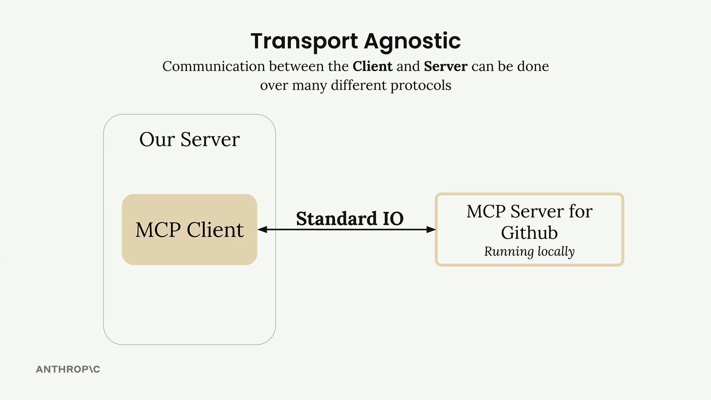

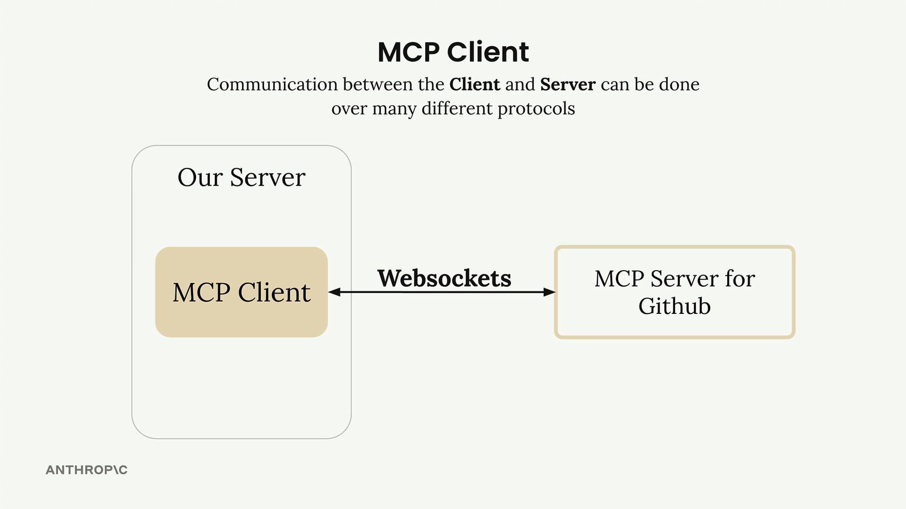

| Transport | When / note |
|-----------|-------------|
| 💻 **Standard I/O (stdio)** | **Most common.** Client and server run on the **same machine** (server "running locally") |
| 🌐 **HTTP** | Connect over the network |
| 🔌 **WebSockets** | Connect over the network (shown in the slide) |
| ➕ **Other network protocols** | Also possible |

> 📌 *From the slides:* the link is drawn **two-way** (arrow on both ends) in both pictures, and only the label changes (**Standard IO** vs **Websockets**). That is the "transport agnostic" point (my reading).

---

### 📨 MCP Message Types

Once connected, client and server exchange **specific message types** defined in the **MCP specification**.

| Message pair | Direction | Meaning |
|--------------|-----------|---------|
| 📋 **`ListToolsRequest`** → **`ListToolsResult`** | Client asks, server answers | "Give me a list of tools you provide" → "Here are the tools I can run" |
| ▶️ **`CallToolRequest`** → **`CallToolResult`** | Client asks, server answers | "Please run a particular tool with these arguments" → "Here's the result of the tool run" |

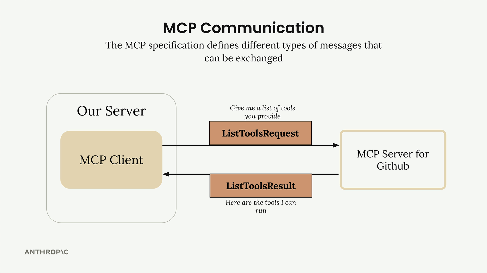

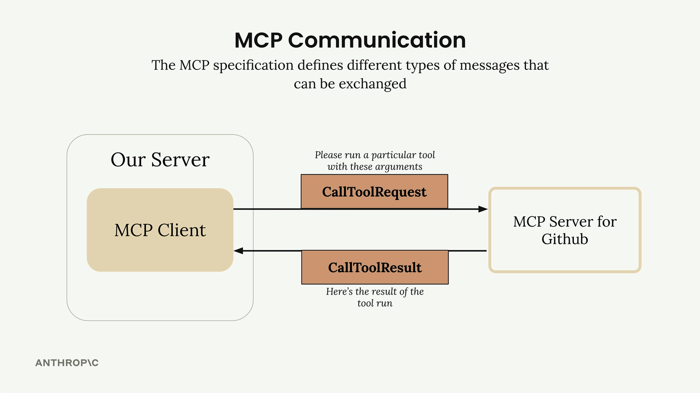

---

### 🔄 The Full Flow

**Example:** a user asks *"What repositories do I have?"* The query travels through **your server → MCP client → MCP server → GitHub** and back through **Claude**.

![Sequence diagram with six columns: User, Our Server, MCP Client, MCP Server, Claude, Github. Steps: user asks "What repositories do I have?"; server says "I need a list of tools to send to Claude"; ListToolsRequest/ListToolsResult between client and MCP server; "Query + Tools" sent to Claude; Claude replies ToolUse; server says "Please run this tool with these args"; CallToolRequest to MCP server, which sends a request to Github; Github responds; CallToolResult returns to the server; toolResult sent to Claude; Claude answers "Your repositories are…" back to the user](assets/L2-mcp-clients/full-flow-sequence.png)

| # | Step | What happens |
|:-:|------|--------------|
| 1 | **User Query** | The user submits the question to **your server** |
| 2 | **Tool Discovery** | Your server needs to know **which tools are available** to send to Claude |
| 3 | **List Tools Exchange** | Your server asks the **MCP client** for the available tools |
| 4 | **MCP Communication** | The MCP client sends **`ListToolsRequest`** to the MCP server and receives **`ListToolsResult`** |
| 5 | **Claude Request** | Your server sends the **user's query + the available tools** to Claude |
| 6 | **Tool Use Decision** | **Claude decides** it needs to call a tool (**`ToolUse`**) |
| 7 | **Tool Execution Request** | Your server asks the **MCP client** to run the tool Claude specified |
| 8 | **External API Call** | The MCP client sends **`CallToolRequest`** to the MCP server, which makes the **actual GitHub API call** |
| 9 | **Results Flow Back** | GitHub responds; the data flows back through the MCP server as a **`CallToolResult`** |
| 10 | **Tool Result to Claude** | Your server sends the **tool result** (**`toolResult`**) back to Claude |
| 11 | **Final Response** | Claude **formulates the final answer** using the repository data |
| 12 | **User Gets Answer** | Your server **delivers Claude's response** to the user |

> 💡 Many steps, but **each component has a clear responsibility**. The MCP client **abstracts away server communication**, so you focus on **application logic**.

> 📌 *From the diagram:* the two labels in tan boxes, **`ToolUse`** (Claude → your server) and **`toolResult`** (your server → Claude), are the **Claude-side** messages. The brown boxes (**`ListTools…`**, **`CallTool…`**) are the **MCP-side** messages (my reading).

> 🔗 Steps 5, 6, 10, 11 are the normal **tool use loop** from earlier courses; MCP only changes **where the tools come from (step 3-4)** and **who runs them (step 7-9)** (my mapping).

---

### 🔁 Recap

The **MCP client** sits in your server and talks to MCP servers over **any transport** (usually **stdio** locally). It uses **`ListTools`** to discover tools and **`CallTool`** to run them, while your server shuttles **tools + results** to and from **Claude**.

### 📝 Quick Reference: MCP Clients (for exam prep)

| Concept | Key point |
|---------|-----------|
| 🔌 **MCP client** | **Bridge** between your server and MCP servers; handles **message exchange + protocol details** |
| 🔀 **Transport agnostic** | Client and server can use **different protocols** |
| 💻 **Most common transport** | **Standard input/output**, both on the **same machine** |
| 🌐 **Other transports** | **HTTP**, **WebSockets**, other network protocols |
| 📋 **List tools** | **`ListToolsRequest`** → **`ListToolsResult`** |
| ▶️ **Call tool** | **`CallToolRequest`** → **`CallToolResult`** |
| 📜 **Where messages are defined** | The **MCP specification** |
| 🤖 **Who decides to use a tool** | **Claude** (your server then asks the client to run it) |
| 🌍 **Who calls the external API** | The **MCP server** (e.g. GitHub), not the client |

> 🎓 **Memory tip:** **"List, then Call."** First **List** tools (so Claude knows them), then **Call** the one Claude picks. The client is just the **messenger**; the **MCP server** does the real work.

**Key features for exam:**
- The **MCP client** is the **communication bridge** between your server and MCP servers.
- MCP is **transport agnostic**: **stdio** (most common, same machine), **HTTP**, **WebSockets**, others.
- **`ListToolsRequest` / `ListToolsResult`**: ask for and receive the **available tools**.
- **`CallToolRequest` / `CallToolResult`**: ask to **run a tool with arguments** and receive its **result**.
- Flow: **list tools → send query + tools to Claude → Claude requests tool use → client calls tool on MCP server → result back to Claude → final answer to user**.
- The **MCP server** makes the **actual external API call** (e.g. GitHub).

---

> 🗂️ **Unit 2: Hands-on with MCP Servers** · Chapter 3 · 🎬 Video (3 min)

## Chapter 3: Project Setup

> 📌 *This chapter is written from the lesson's slides and terminal screenshots only (no lesson text was supplied), so wording is mine. It is a short **orientation** lesson: it introduces the project you build in the rest of the course. Running it is optional for the notes.*

### 🧠 Key Takeaways

- The course project is a **CLI-based chatbot** that lets users **chat with a set of documents**
- It has **two tools** on the MCP server: **read a doc** and **update (edit) a doc**
- Users can **mention** a document with **`@doc_name`**; its **contents are automatically included as context**
- Users can run a **command** with **`/command_name`**
- **Important note:** normally a project implements **either** an MCP **client** **or** an MCP **server**. This project implements **both**, just so you understand how they work

---

### 🎯 The Project


| Feature | What it means |
|---------|---------------|
| 💬 **CLI chatbot** | A terminal chat with a **set of documents** |
| 📖 **Read a document** | Claude can **read** a document |
| ✏️ **Edit a document** | Claude can **edit** a document |
| `@doc_name` | The user **mentions** a document; its **contents are auto-added as context** |
| `/command_name` | The user runs a **command** |

> 📌 *From the lesson's "Project!" slide terminal:* typing **`@`** pops up a list of documents, each tagged **"Resource"**. This hints that **documents will be MCP resources** and **`/commands` will be MCP prompts** (my reading; the lesson text doesn't say it here).

> 🔗 This previews the course goals: **tools** (read/update a doc, Ch 4), **resources** (the `@` documents, Ch 7-8), **prompts** (the `/commands`, Ch 9-10) (my mapping).

---

### 🏗️ The Architecture of the Project


| Piece | Role in the project |
|-------|---------------------|
| 🖥️ **Our Server** | Your app; contains the **MCP client** |
| 🔌 **Our MCP Client** | Talks (two-way) to our MCP server |
| 🗄️ **Our MCP Server** | Holds the **two tools**: **read a doc** and **update a doc** |
| 📄 **Documents** | The files behind the server (e.g. `document.pdf`, `spreadsheet.xlsx`, `report.txt`, `spec.md`) |

> 📌 *The file names in the diagram are slide examples; the terminal slide uses different `.md` names.*

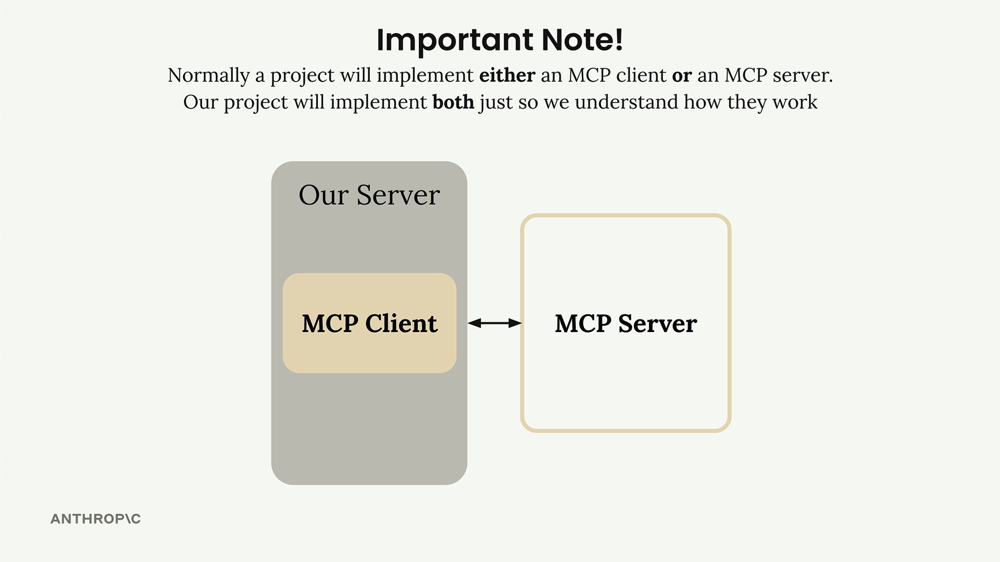

> ⚠️ **Exam angle:** in real projects you build **one side** (client **or** server). Building **both** here is **only for learning**.

---

### 💻 Running It


| File / command | Meaning |
|----------------|---------|
| `main.py` | Entry point; run it with **`uv run main.py`** |
| `mcp_server.py` | The **MCP server** (where tools get defined, Ch 4) |
| `mcp_client.py` | The **MCP client** (implemented in Ch 6) |
| `core/` | Supporting code folder |
| `README.md` | Project instructions |

> 📌 *From the lesson's terminal:* it shows `uv run main.py` and also `python main.py`, then a test chat ("whats 1+1?" → "1+1 = 2") to confirm the CLI works. The file roles above are my reading of the file names (the lesson text doesn't describe them). The reply to the test question is generated by **Claude**, so running the chat needs access to Claude (my inference; not shown on screen).

---

### 🔁 Recap

You'll build a **document chatbot** with an **MCP client and an MCP server in one project**. The server exposes **read/update doc tools** (and later **resources** and **prompts**); the CLI supports **`@mentions`** and **`/commands`**.

### 📝 Quick Reference: Project Setup (for exam prep)

| Concept | Key point |
|---------|-----------|
| 🎯 **Project** | **CLI chatbot** to chat with a set of **documents** |
| 🛠️ **MCP server tools** | **Read a doc** · **update a doc** |
| `@doc_name` | **Mention** a document; **contents added as context** |
| `/command_name` | Run a **command** |
| ⚖️ **Client + server** | Usually **one or the other**; here **both**, **for learning only** |
| ▶️ **Run** | `uv run main.py` |

> 🎓 **Memory tip:** **"@ = documents in, / = commands out."** And **one project, both sides** (client + server) **just to learn**.

**Key features for exam:**
- The project is a **CLI chatbot** over a set of documents with **read** and **edit** abilities.
- **`@doc_name`** mentions a document and **auto-includes its contents as context**; **`/command_name`** runs a command.
- The MCP server provides **two tools**: **read a doc** and **update a doc**.
- Normally a project implements **either** an MCP client **or** an MCP server; this one implements **both** to teach how they work.

---

> 🗂️ **Unit 2: Hands-on with MCP Servers** · Chapter 4

## Chapter 4: Defining Tools with MCP

> Building an MCP server is much simpler with the **official Python SDK**. Instead of writing complex **JSON schemas by hand**, you define tools with **decorators** and the SDK does the heavy lifting.

### 🧠 Key Takeaways

- Use the **official Python MCP SDK**: no manual **JSON schema** writing
- Create a server in **one line** with **`FastMCP`**
- Define a tool with the **`@mcp.tool()`** decorator (give it a **`name`** and **`description`**)
- The **function parameters** define the tool's arguments; **type hints + `Field(description=...)`** (Pydantic) become the schema Claude sees
- **Errors** are handled with normal **Python exceptions** (e.g. `raise ValueError`)
- Example project: a **document server** with **two tools**: **read** and **edit**; docs live **in memory** in a dict (`doc id → content`)

---

### ⚙️ Setting Up the Server

```python
from mcp.server.fastmcp import FastMCP

mcp = FastMCP("DocumentMCP", log_level="ERROR")
```

Documents are a simple **dictionary**: keys = **document IDs**, values = **content**.

```python
docs = {
    "deposition.md": "This deposition covers the testimony of Angela Smith, P.E.",
    "report.pdf": "The report details the state of a 20m condenser tower.",
    # ... financials.docx, outlook.pdf, plan.md, spec.txt
}
```

---

### 🛠️ Tool 1: Read a Document

```python
@mcp.tool(
    name="read_doc_contents",
    description="Read the contents of a document and return it as a string."
)
def read_document(
    doc_id: str = Field(description="Id of the document to read")
):
    if doc_id not in docs:
        raise ValueError(f"Doc with id {doc_id} not found")
    return docs[doc_id]
```

### ✏️ Tool 2: Edit a Document

```python
@mcp.tool(
    name="edit_document",
    description="Edit a document by replacing a string in the documents content with a new string."
)
def edit_document(
    doc_id: str = Field(description="Id of the document that will be edited"),
    old_str: str = Field(description="The text to replace. Must match exactly, including whitespace."),
    new_str: str = Field(description="The new text to insert in place of the old text.")
):
    if doc_id not in docs:
        raise ValueError(f"Doc with id {doc_id} not found")
    docs[doc_id] = docs[doc_id].replace(old_str, new_str)
```

| Tool | Name | Arguments | What it does |
|------|------|-----------|--------------|
| 📖 **Read** | `read_doc_contents` | `doc_id` | Returns the document's content; **error** if the id doesn't exist |
| ✏️ **Edit** | `edit_document` | `doc_id`, `old_str`, `new_str` | **Find-and-replace** in the content; **error** if the id doesn't exist |

> 📌 *From the code:* the edit tool has **no `return`**, so it returns nothing. The `Field` import (`from pydantic import Field`) is not shown in the lesson snippet (my reading).

### ✅ Key Benefits of the SDK Approach

| Benefit | Meaning |
|---------|---------|
| 🚫 **No manual JSON schema** | The SDK **generates the schema** from the function |
| 🔒 **Automatic validation** | **Type hints** validate inputs |
| 💬 **Clear descriptions** | `Field(description=...)` helps **Claude understand each parameter** |
| ⚠️ **Natural error handling** | Use **Python exceptions** |
| 🏷️ **Automatic registration** | **Decorators** register the tool |

> 🔗 Ties back to [Ch 1](#chapter-1-introducing-mcp): with MCP, tool schemas + functions are **defined once on the server**; the SDK just removes the schema-writing work (my mapping).

### 📝 Quick Reference: Defining Tools (for exam prep)

| Concept | Key point |
|---------|-----------|
| 📦 **SDK** | Official **Python MCP SDK** |
| 🖥️ **Create server** | `FastMCP("Name")` |
| 🏷️ **Define a tool** | `@mcp.tool(name=..., description=...)` on a function |
| 📥 **Arguments** | Function **parameters** with **type hints** + `Field(description=...)` |
| 📄 **Schema** | **Auto-generated**, not hand-written |
| ❌ **Errors** | Raise a normal **Python exception** |

> 🎓 **Memory tip:** **"Decorator in, schema out."** Write a Python function, add `@mcp.tool`, and the SDK builds the schema for Claude.

**Key features for exam:**
- The Python MCP SDK removes the need to **write JSON schemas by hand**.
- `FastMCP` creates the server; **`@mcp.tool()`** registers a tool.
- **Type hints** and **`Field(description=...)`** produce the schema and help Claude use the tool correctly.
- **Python exceptions** are the natural way to report errors.

---

> 🗂️ **Unit 2: Hands-on with MCP Servers** · Chapter 5

## Chapter 5: The Server Inspector

> The Python MCP SDK includes a built-in **browser-based inspector** to **test and debug your server** without connecting it to a full application.

### 🧠 Key Takeaways

- The **MCP Inspector** lets you test a server **in real time** without a full application
- Start it with **`mcp dev mcp_server.py`** (activate your Python environment first)
- It gives a **local URL** (typically like `http://127.0.0.1:6274`); open it in the browser
- The UI may look different over time, but the **core is the same**: **Connect** button, tabs for **Resources / Tools / Prompts**, a tools list + testing panel
- The inspector **keeps server state between calls**, so edits persist

---

### ▶️ Using the Inspector

| Step | What to do |
|:----:|------------|
| 1 | Activate the Python environment (see the project README) |
| 2 | Run **`mcp dev mcp_server.py`** |
| 3 | Open the **local URL** in a browser |
| 4 | Click **Connect** (status goes **Disconnected → Connected**) |
| 5 | Open the **Tools** tab → **List Tools** |
| 6 | Select a tool (e.g. `read_doc_contents`), enter inputs (e.g. `deposition.md`), click **Run Tool** |
| 7 | Check the **success status** and the **returned data** |


> 📌 *From the screenshot:* the tabs are **Resources · Prompts · Tools · Ping · Sampling · Roots**, and the **History** panel logs the protocol calls the inspector made (`initialize`, `tools/list`). The version (v0.10.2) is just what the video showed (my reading).

### 🔁 Testing Tool Interactions

- Test **several tools in sequence**, e.g. **edit** a document, then **read** it to confirm the change
- Because the inspector **maintains state**, edits **persist** between calls

### 💡 Why It Matters in the Workflow

| Instead of… | You can… |
|-------------|----------|
| Writing separate test scripts | **Iterate quickly** on tool implementations |
| Connecting to a full application | **Test edge cases and error conditions** |
| Guessing | **Verify interactions and state**, **debug in real time** |

> 🔗 Inspector = the quick way to check what a client would see: **List Tools** mirrors the `ListTools` message from [Ch 2](#chapter-2-mcp-clients), and **Run Tool** mirrors `CallTool` (my mapping).

### 📝 Quick Reference: The Server Inspector (for exam prep)

| Concept | Key point |
|---------|-----------|
| 🔍 **What** | Built-in **browser-based** tool in the Python MCP SDK |
| ▶️ **Start** | `mcp dev mcp_server.py` |
| 🌐 **Access** | Local URL (typically `http://127.0.0.1:6274`) |
| 🔌 **First step** | Click **Connect** |
| 🛠️ **Test a tool** | **Tools → List Tools →** select tool **→ Run Tool** |
| 💾 **State** | **Maintained** between calls |
| 🎯 **Purpose** | Test/debug **without a full application** |

> 🎓 **Memory tip:** **"Dev, Connect, List, Run."** `mcp dev` → **Connect** → **List Tools** → **Run Tool**.

**Key features for exam:**
- The inspector tests an MCP server **without a full application**.
- Command: **`mcp dev mcp_server.py`**.
- Workflow: **Connect → List Tools → pick a tool → Run Tool → check results**.
- It **keeps state between calls**, so you can edit then read to verify.

---

> 🗂️ **Unit 3: Connecting with MCP Clients** · Chapter 6

## Chapter 6: Implementing a Client

> With the server working, build the **client side**: what lets your **application code** talk to the MCP server and use its functionality.

### 🧠 Key Takeaways

- In most real projects you build **either** a client **or** a server, **not both**. This project builds both **just to show how they work together**
- The MCP client has **two parts**:
  - **MCP Client**: a **custom class we write** to make using the session easier
  - **Client Session**: the **actual connection to the server** (part of the **MCP Python SDK**)
- The session needs **careful resource management** (clean up connections), so we **wrap it in our own class** that does cleanup automatically
- Two core functions to implement: **`list_tools()`** and **`call_tool()`**
- The CLI uses the client to **get tools to send to Claude** and to **execute tools when Claude requests them**

---

### 🧩 Client Architecture

| Component | What it is |
|-----------|------------|
| 🧰 **MCP Client** | Our **custom wrapper class** that makes the session easier to use and handles cleanup |
| 🔗 **Client Session** | The **real connection** to the server, from the **MCP Python SDK** |

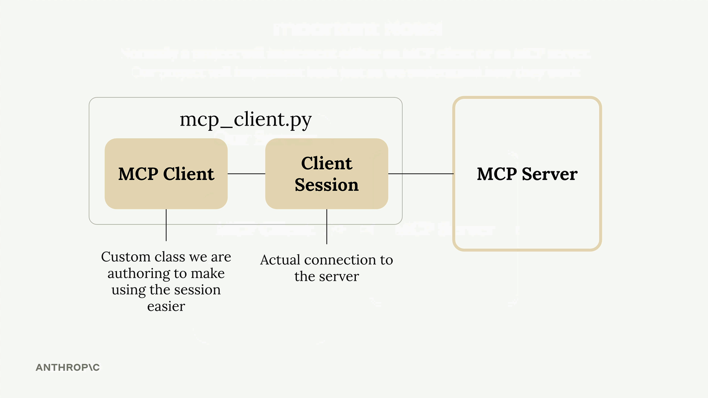

### 🔧 The Two Core Functions

**List tools**: gets all tools from the MCP server:

```python
async def list_tools(self) -> list[types.Tool]:
    result = await self.session().list_tools()
    return result.tools
```

**Call tool**: runs a specific tool on the server:

```python
async def call_tool(
    self, tool_name: str, tool_input: dict
) -> types.CallToolResult | None:
    return await self.session().call_tool(tool_name, tool_input)
```

| Function | Input | Returns |
|----------|-------|---------|
| 📋 **`list_tools()`** | none | The server's **tools** (`result.tools`) |
| ▶️ **`call_tool()`** | **tool name** + **tool input** (dict, provided by Claude) | A **`CallToolResult`** |

> 🔗 These wrap the two messages from [Ch 2](#chapter-2-mcp-clients): `session.list_tools()` ↔ **`ListToolsRequest/Result`**, `session.call_tool()` ↔ **`CallToolRequest/Result`** (my mapping).


> 🧠 These are the **two points** where the CLI uses the client: **get the tool list** (to pass to Claude) and **call a tool** (when Claude asks).

---

### 🧪 Testing the Client

| Command | What it does |
|---------|--------------|
| **`uv run mcp_client.py`** | Runs the client's built-in **test harness**: connects to your server and **prints the available tools** (with descriptions and input schemas) |
| **`uv run main.py`** | Runs the **full app**. Try: *"What is the contents of the report.pdf document?"* |

**What happens behind the scenes** for that question:

| # | Step |
|:-:|------|
| 1 | The app uses the **client** to **get the available tools** |
| 2 | The tools are **sent to Claude** along with the question |
| 3 | **Claude decides** to use the **`read_doc_contents`** tool |
| 4 | The app uses the **client** to **execute that tool** |
| 5 | The **result goes back to Claude**, who responds to the user |

> 🔗 Same flow as the 12-step diagram in [Ch 2](#chapter-2-mcp-clients), shortened (my mapping).

### 🔁 Recap

The **client** is the **bridge between your application logic and the MCP server**. It is a **wrapper class** around the SDK's **client session** and exposes **`list_tools()`** and **`call_tool()`**.

### 📝 Quick Reference: Implementing a Client (for exam prep)

| Concept | Key point |
|---------|-----------|
| 🤝 **Client vs server** | Usually **one or the other**; both here for learning |
| 🧰 **MCP Client** | **Custom class** wrapping the session; handles cleanup |
| 🔗 **Client Session** | The **actual connection** (MCP Python SDK) |
| 🧹 **Why wrap it** | Session needs **resource management / cleanup** |
| 📋 **`list_tools()`** | Returns the server's tools |
| ▶️ **`call_tool(name, input)`** | Runs a tool; returns **`CallToolResult`** |
| 🧪 **Test** | `uv run mcp_client.py` (tools list) · `uv run main.py` (full app) |

> 🎓 **Memory tip:** **"Wrapper + Session."** Our **client class wraps** the SDK's **session**; it only needs **two moves: list and call**.

**Key features for exam:**
- The MCP client = **our wrapper class + the SDK's client session**.
- The session is the **real server connection**; the wrapper makes it **easy to use and cleans up** resources.
- Two key functions: **`list_tools()`** (tools to send to Claude) and **`call_tool()`** (run the tool Claude picked).
- The **CLI/app** uses the client at **two points**: getting tools, and executing tools.

---

> 🗂️ **Unit 3: Connecting with MCP Clients** · Chapter 7

## Chapter 7: Defining Resources

> **Resources** let an MCP server **expose data to clients**, similar to **GET request handlers** in an HTTP server. Use them when you need to **fetch information** rather than **perform actions**.

### 🧠 Key Takeaways

- **Resources = read-only data** the server exposes (like **GET**); **tools = actions**
- Example: the **`@document_name` mention** feature needs two operations: **list all documents** (autocomplete) and **fetch one document's contents**
- When a user mentions a document, **your system injects its contents into the prompt** sent to Claude, so **Claude doesn't need a tool call** to fetch it
- Pattern: client sends **`ReadResourceRequest`** with a **URI** → server runs the matching function → returns **`ReadResourceResult`**
- **Two types:** **direct** (static URI) and **templated** (URI with parameters)
- Use **`mime_type`** to hint what kind of data is returned; the SDK **serializes return values automatically**

---


### 🔄 How Resources Work

Your code asks the **MCP client**, which forwards the request to the **MCP server**. The server **matches the URI**, **runs the function**, and **returns the result**.

| Message | Direction | Meaning |
|---------|-----------|---------|
| 📥 **`ReadResourceRequest`** (with a **URI**) | Client → Server | "Give me the resource at this URI" |
| 📤 **`ReadResourceResult`** | Server → Client | The data |

> 🔗 Same request/result style as `ListTools` / `CallTool` in [Ch 2](#chapter-2-mcp-clients) (my mapping).

### 🗂️ Two Types of Resources

| Type | URI | Use for | Example |
|------|-----|---------|---------|
| 📌 **Direct** | **Static**, never changes | Operations with **no parameters** | `docs://documents` → list of doc IDs |
| 🧩 **Templated** | Has **parameters** like `{doc_id}` | Fetching **one specific item** | `docs://documents/{doc_id}` → one doc's content |


**Direct resource:**

```python
@mcp.resource(
    "docs://documents",
    mime_type="application/json"
)
def list_docs() -> list[str]:
    return list(docs.keys())
```

**Templated resource** (the SDK **parses the URI parameter** and passes it as a **keyword argument**):

```python
@mcp.resource(
    "docs://documents/{doc_id}",
    mime_type="text/plain"
)
def fetch_doc(doc_id: str) -> str:
    if doc_id not in docs:
        raise ValueError(f"Doc with id {doc_id} not found")
    return docs[doc_id]
```

### 🏷️ MIME Types and Serialization

| `mime_type` | Use for |
|-------------|---------|
| `application/json` | **Structured data** |
| `text/plain` | **Plain text** |
| `application/pdf` | **Binary files** |

- Resources can return **any type of data** (strings, JSON, binary…)
- The SDK **auto-serializes** return values: **no manual JSON conversion**

### 🧪 Testing Resources

- Start with **`uv run mcp dev mcp_server.py`**, then connect to the inspector in the browser
- Two sections: **Resources** (lists **direct** resources) and **Resource Templates** (lists **templated** resources)
- For templated ones, **enter the parameter values**; the inspector shows the **exact response** (MIME type + serialized data) your client will get

![MCP Inspector, Resources tab: the Resources column lists docs://documents (direct) and the Resource Templates column lists fetch_doc (templated). The right panel shows the read result: contents[0] with uri "docs://documents", mimeType "application/json" and text ["deposition.md","report.pdf","financials.docx","outlook.pdf","plan.md","spec.txt"]. History shows initialize, resources/list, resources/templates/list, resources/read](assets/L7-defining-resources/inspector-resources.png)

> 📌 *From the screenshot:* the result is a **`contents` list**; each item has **`uri`**, **`mimeType`**, and **`text`** (a JSON string here). This is the structure the client reads in [Ch 8](#chapter-8-accessing-resources). Templated resources are listed under the **function name** (`fetch_doc`) (my reading).

### 📝 Quick Reference: Defining Resources (for exam prep)

| Concept | Key point |
|---------|-----------|
| 📦 **Resource** | **Read-only data** exposed by the server (like **GET**) |
| 🛠️ **vs. tool** | Resource = **fetch data**; tool = **perform an action** |
| 🏷️ **Define** | `@mcp.resource("uri", mime_type=...)` |
| 📌 **Direct** | **Static URI**, no parameters |
| 🧩 **Templated** | URI with **`{param}`**; passed as **keyword argument** |
| 📥 **Messages** | `ReadResourceRequest` (URI) → `ReadResourceResult` |
| 🎯 **Main benefit** | Data goes **straight into the prompt**, **no tool call** needed |
| 🧪 **Inspector** | **Resources** tab (direct) · **Resource Templates** tab (templated) |

> 🎓 **Memory tip:** **"Resource = GET."** *Direct* = fixed address (the **list**); *Templated* = address with a **blank to fill** (one **item**).

**Key features for exam:**
- Resources **expose read-only data**, like GET handlers; use them to **fetch** rather than **act**.
- Request/response: **`ReadResourceRequest`** (with a **URI**) → **`ReadResourceResult`**.
- **Direct** = static URI; **Templated** = URI with parameters, parsed into **keyword arguments**.
- **`mime_type`** tells the client what kind of data it gets; the SDK **serializes automatically**.
- Mentioned docs are **injected into the prompt**, so Claude doesn't need a tool call.

---

> 🗂️ **Unit 3: Connecting with MCP Clients** · Chapter 8

## Chapter 8: Accessing Resources

> Resources let your server expose information that is **included directly in prompts**, instead of requiring **tool calls**. This is a more efficient way to give context to the model.

### 🧠 Key Takeaways

- When the user types something like *"What's in the @…"*, your code recognizes a **resource request**, sends **`ReadResourceRequest`** to the MCP server, and gets back **`ReadResourceResult`** with the content
- The client needs a **`read_resource(uri)`** function
- The result has a **`contents` list**; we take the **first element** (`contents[0]`)
- The function checks the **MIME type**: **`application/json`** → **parse as JSON**; otherwise → **return the raw text**

---

### 🔄 The Flow


---

### 🔧 Implementing `read_resource`

Imports: `json` and `AnyUrl` (from `pydantic`).

```python
async def read_resource(self, uri: str) -> Any:
    result = await self.session().read_resource(AnyUrl(uri))
    resource = result.contents[0]

    if isinstance(resource, types.TextResourceContents):
        if resource.mimeType == "application/json":
            return json.loads(resource.text)

    return resource.text
```

| Part of the response | Meaning |
|----------------------|---------|
| 📄 **Content** | The actual text or data |
| 🏷️ **MIME type** | Tells you **how to parse** the content |
| ℹ️ **Other metadata** | Extra info about the resource |

| MIME type | What the client does |
|-----------|----------------------|
| `application/json` | **`json.loads`** the text → return the parsed object |
| anything else | Return the **raw text** |

### 🧪 What the User Sees

| # | Step |
|:-:|------|
| 1 | Type **`@`** → an **autocomplete list** of available resources appears |
| 2 | Select one (**arrow keys + space**) |
| 3 | The **resource content is included directly in the prompt** |
| 4 | Everything is sent to the model **without extra tool calls** |


> 📌 *From the slide:* **Our Code** builds the prompt: the user's question goes in **`<query>`** tags and the mentioned document's content goes in **`<document id="…">`** tags, then the whole thing goes to **Claude**. This is the "injection into the prompt" in practice (my reading; the tags are the slide's example).

> 💡 **Why it's better:** the content is part of the **initial context**, so the model can answer **immediately** instead of making separate tool calls.

> 🔗 Compare with [Ch 6](#chapter-6-implementing-a-client): the client now has **`list_tools`**, **`call_tool`**, and **`read_resource`** (my mapping).

### 📝 Quick Reference: Accessing Resources (for exam prep)

| Concept | Key point |
|---------|-----------|
| 📥 **Client function** | `read_resource(uri)` |
| 📦 **Response** | Has a **`contents` list**; use the **first item** |
| 🏷️ **JSON MIME type** | `application/json` → **parse with `json.loads`** |
| 📝 **Other types** | Return the **text as-is** |
| 🎯 **Benefit** | Content is in the **prompt from the start**, **no tool call** |

> 🎓 **Memory tip:** **"Read, check MIME, parse."** Fetch the URI → look at the **MIME type** → JSON gets parsed, everything else stays text.

**Key features for exam:**
- The client reads a resource with **`read_resource(uri)`**, sending **`ReadResourceRequest`**.
- Results come in a **`contents` list**; the **MIME type** decides how to handle them (**JSON → parse**, else **text**).
- Resource content is placed **directly in the prompt**, avoiding extra tool calls.

---

> 🗂️ **Unit 3: Connecting with MCP Clients** · Chapter 9

## Chapter 9: Defining Prompts

> **Prompts** in MCP servers are **pre-built, high-quality instructions** that clients can use instead of writing their own from scratch. Think of them as **carefully crafted, tested templates**.

### 🧠 Key Takeaways

- Users *can* ask Claude directly (e.g. "reformat report.pdf in markdown"), but a **thoroughly tested, specialized prompt** gives **better results** (handles edge cases, follows best practices)
- The **server author** crafts, tests, and evaluates prompts, so **users benefit without being prompt-engineering experts**
- Defined with the **`@mcp.prompt`** decorator (same pattern as tools and resources)
- A prompt function returns a **list of messages** that are **sent directly to Claude**
- Example: a **`/format doc_id`** command that converts a document to **markdown**


> 📌 *From the slide:* the tested prompt has a **role**, the **`<document_id>`** variable, **numbered instructions**, an **analysis step** before the output, and an **example output structure**. This is what a server author can pack in that a user won't type (my reading).

---

### ⚙️ The `/format` Workflow

| # | Step |
|:-:|------|
| 1 | The user types **`/`** to see available commands |
| 2 | They select **`format`** and give a **document ID** |
| 3 | Claude uses your **pre-built prompt** to read and reformat the document |
| 4 | Result: clean markdown with **headers, lists, tables** |

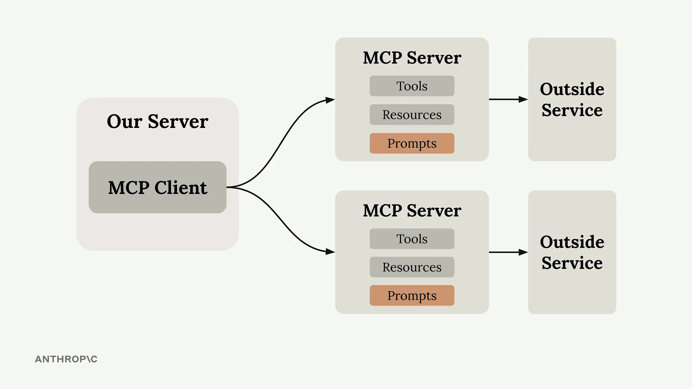

### 🛠️ Defining a Prompt

```python
@mcp.prompt(
    name="format",
    description="Rewrites the contents of the document in Markdown format."
)
def format_document(
    doc_id: str = Field(description="Id of the document to format")
) -> list[base.Message]:
    prompt = f"""
Your goal is to reformat a document to be written with markdown syntax.

The id of the document you need to reformat is:
<document_id>
{doc_id}
</document_id>

Add in headers, bullet points, tables, etc as necessary. ...
Use the 'edit_document' tool to edit the document. ...
"""
    return [
        base.UserMessage(prompt)
    ]
```

- The function returns a **list of messages** sent to Claude
- You can include **multiple user and assistant messages** for more complex conversation flows

> 📌 *From the slide (my reading):* it says a prompt "defines a set of **User and Assistant messages** that can be used by the client" and that prompts should be **high quality, well-tested, and relevant to the overall purpose of the MCP** server.

### 🧪 Testing Prompts

Use the **MCP Inspector**: it shows **exactly what messages will be sent to Claude**, including how **variables are interpolated** into the template.


> 📌 *From the screenshot:* choose the argument (**`doc_id`**), click **Get Prompt**, and see the **final message** with the variable filled in. The result is a **`messages`** list with `role: "user"` (my reading).

### ✅ Key Benefits

| Benefit | Meaning |
|---------|---------|
| 🔁 **Consistency** | Reliable results every time |
| 🎓 **Expertise** | Encode **domain knowledge** into prompts |
| ♻️ **Reusability** | **Multiple clients** can use the same prompts |
| 🔧 **Maintenance** | **Update in one place**, all clients improve |

> 💡 Prompts work best when **specialized for the server's domain** (a document server: formatting, summarizing, analyzing; a data-analysis server: reports, visualizations).

> 🔗 The prompt tells Claude to use the **`edit_document` tool** from [Ch 4](#chapter-4-defining-tools-with-mcp), so prompts and tools **work together** (my mapping).

### 📝 Quick Reference: Defining Prompts (for exam prep)

| Concept | Key point |
|---------|-----------|
| 💬 **Prompt** | **Pre-built, tested instruction template** defined on the server |
| 🏷️ **Define** | `@mcp.prompt(name=..., description=...)` |
| 📤 **Returns** | A **list of messages** (e.g. `base.UserMessage(...)`) |
| 🎯 **Why** | Better, **consistent** results than users' own prompts |
| 🧪 **Test** | MCP Inspector shows the **final messages** |
| 👥 **Who benefits** | **Many clients** reuse it; **update once** |

> 🎓 **Memory tip:** **"Prompt = a tested recipe the server hands out."** The user supplies the *ingredient* (`doc_id`); the server supplies the *recipe*.

**Key features for exam:**
- MCP prompts are **pre-built, high-quality, tested instructions** provided by the server.
- Defined with **`@mcp.prompt`**; return a **list of messages** (user/assistant).
- Benefits: **consistency, expertise, reusability, easy maintenance**.
- Test them in the **MCP Inspector**.

---

> 🗂️ **Unit 3: Connecting with MCP Clients** · Chapter 10

## Chapter 10: Prompts in the Client

> The last step of building the MCP client: **list the server's prompts** and **get a specific prompt with its variables filled in**.

### 🧠 Key Takeaways

- Two new client functions: **`list_prompts()`** and **`get_prompt(name, args)`**
- **`get_prompt`** handles **variable interpolation**: the arguments you pass become **keyword arguments** of the prompt function on the server
- Example: the `format` prompt expects `doc_id`, so `args = {"doc_id": "plan.md"}`
- In the CLI, typing **`/`** shows the prompts as **commands**

---

### 🔧 The Two Functions

```python
async def list_prompts(self) -> list[types.Prompt]:
    result = await self.session().list_prompts()
    return result.prompts

async def get_prompt(self, prompt_name, args: dict[str, str]):
    result = await self.session().get_prompt(prompt_name, args)
    return result.messages
```

| Function | Input | Returns |
|----------|-------|---------|
| 📋 **`list_prompts()`** | none | The server's **prompts** |
| 💬 **`get_prompt(name, args)`** | **prompt name** + **dict of arguments** | The **messages** (with variables filled in) |

### 🧪 Prompts in Action

| # | Step |
|:-:|------|
| 1 | The user types **`/`** → available prompts appear as **commands** |
| 2 | Select **`format`** → choose a **document** from the list |
| 3 | The **complete prompt** is sent to Claude |
| 4 | Claude gets the **formatting instructions + document ID**, then **uses tools** to fetch and process the content |

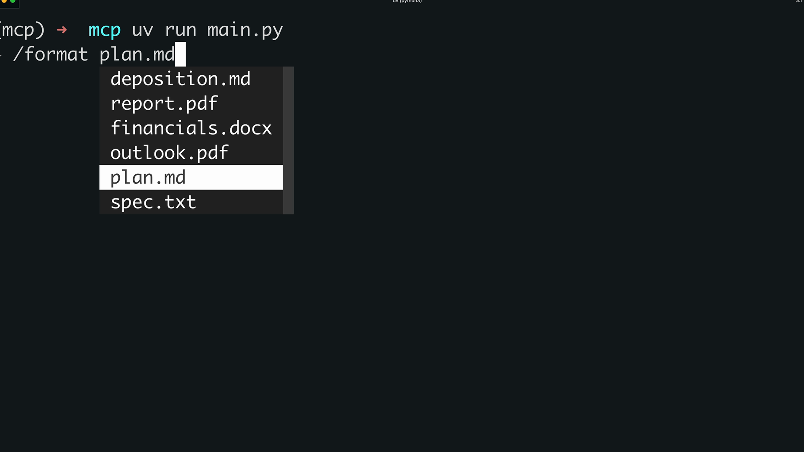

### 🔁 How Prompts Work (the full workflow)

| # | Step |
|:-:|------|
| 1 | **Write and evaluate** a prompt relevant to your server |
| 2 | **Define it** in the server with **`@mcp.prompt`** |
| 3 | Clients can **request it at any time** |
| 4 | Client **arguments** become **keyword arguments** of the prompt function |
| 5 | The function **returns formatted messages** ready for the AI model |

![Slide "Prompts": defines a set of User and Assistant messages that can be used by the client; these prompts should be high quality, well-tested, and relevant to the overall purpose of the MCP. A code box shows @mcp.prompt(name="format", description="Rewrites the contents of a document in Markdown format") on format_document(doc_id: str) -> list[base.Message] with the comment "Return a list of messages"](assets/L10-prompts-in-the-client/prompts-slide.png)

> 💡 Reusable, **parameterized** prompts keep things **consistent** while allowing **customization through variables**; great for **complex workflows**.

### 📝 Quick Reference: Prompts in the Client (for exam prep)

| Concept | Key point |
|---------|-----------|
| 📋 **`list_prompts()`** | Returns the server's prompts |
| 💬 **`get_prompt(name, args)`** | Returns **messages** with variables **interpolated** |
| 🔤 **Arguments** | Dict → become **keyword arguments** on the server |
| ⌨️ **In the CLI** | **`/`** shows prompts as **commands** |
| 🧠 **After the prompt is sent** | Claude **uses tools** to do the work |

> 🎓 **Memory tip:** **"List, then Get."** *List* the prompts, then *Get* one by name with its **arguments**.

**Key features for exam:**
- Client functions: **`list_prompts()`** and **`get_prompt(prompt_name, args)`**.
- **Arguments become keyword arguments** in the server's prompt function (e.g. `{"doc_id": "plan.md"}`).
- A prompt returns **messages** ready for the model; the model can then use **tools** to complete the task.

---

> 🗂️ **Unit 3 wrap-up** · Tools vs. Resources vs. Prompts

## 🧭 Tools vs. Resources vs. Prompts (at a glance)

> 🔗 *My summary table built from Ch 4, 7, 9 (not a lesson slide).*

| | 🛠️ **Tools** | 📄 **Resources** | 💬 **Prompts** |
|---|-------------|------------------|----------------|
| **What** | **Actions** the server can perform | **Read-only data** the server exposes | **Pre-built, tested instructions** |
| **Like** | A function call | A **GET** request | A recipe / template |
| **Define with** | `@mcp.tool` | `@mcp.resource("uri")` | `@mcp.prompt` |
| **Client function** | `list_tools` · `call_tool` | `read_resource(uri)` | `list_prompts` · `get_prompt` |
| **Project example** | `read_doc_contents`, `edit_document` | `docs://documents` · `docs://documents/{doc_id}` (the **`@`** mentions) | `format` (the **`/format`** command) |
| **Who triggers it** 📌 | **Claude** decides | The **app/user** (e.g. `@mention`) | The **user** (e.g. `/command`) |

> 📌 *The last row is **beyond the lesson text** (the common way MCP docs describe it), but it fits the project: Claude picks tools on its own, the user triggers `@` and `/`. Not stated in these lessons.*

> 🎓 **Memory tip:** **T-R-P** = **T**ools **do**, **R**esources **give**, **P**rompts **guide**.
